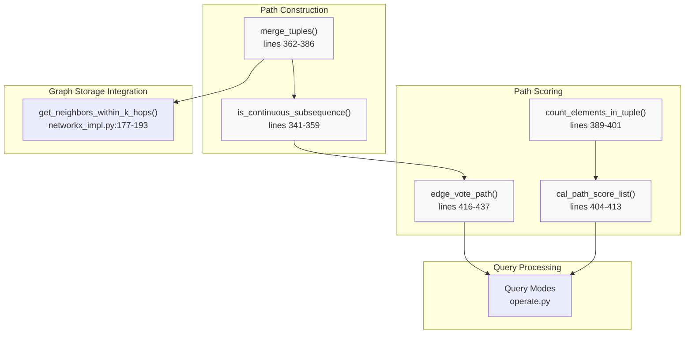
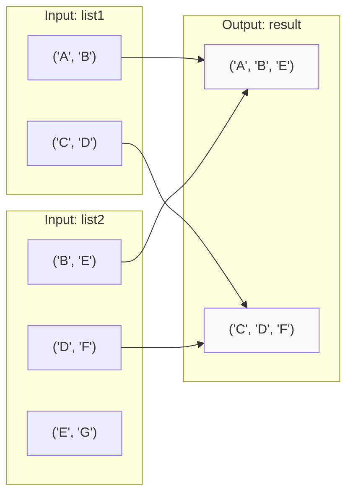
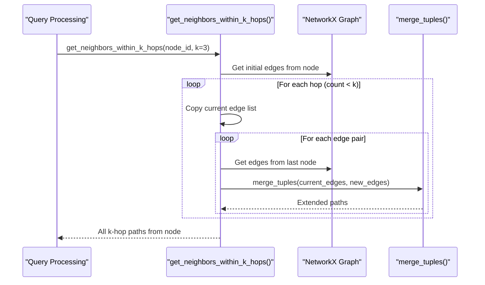
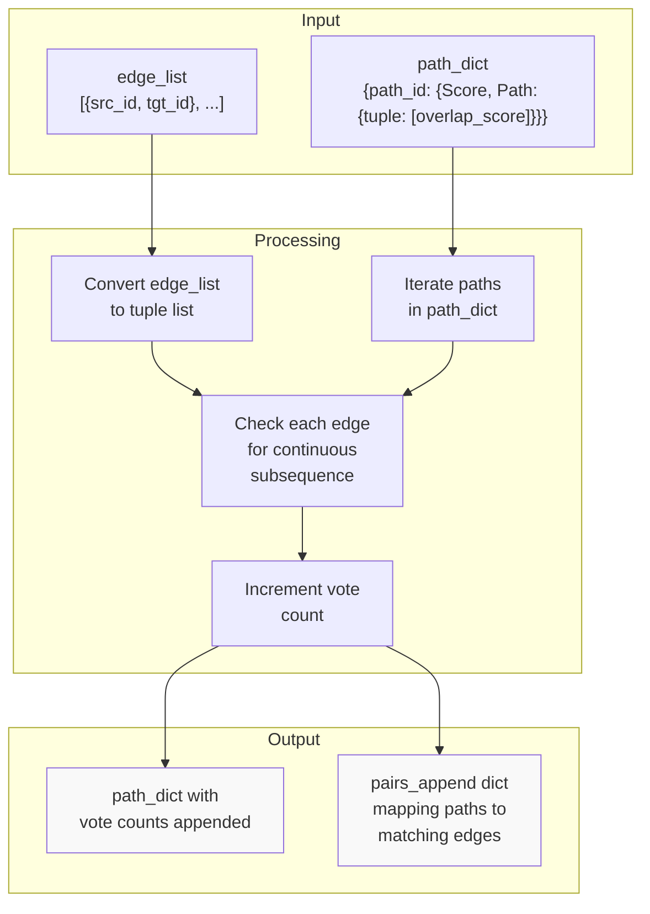
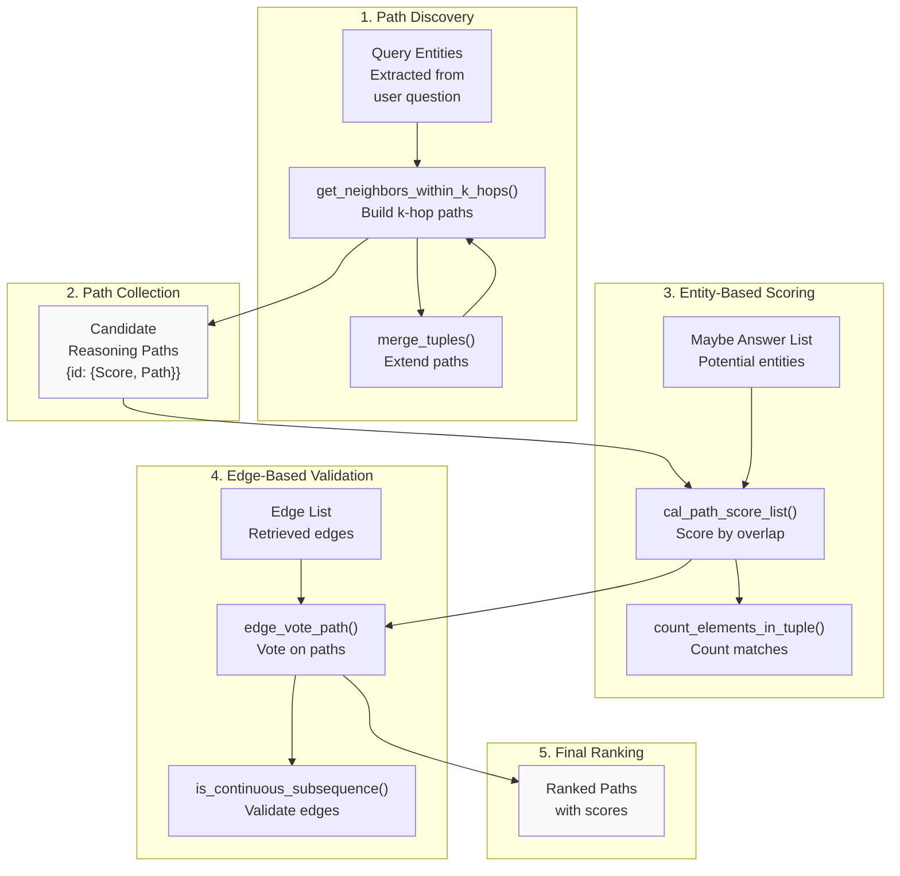

<!-- source: DeepWiki mcp.deepwiki.com · repo HKUDS/MiniRAG · page 9.3 Graph Processing Utilities · fetched 2026-11-09 -->

# Graph Processing Utilities

<details>
<summary>Relevant source files</summary>

The following files were used as context for generating this wiki page:

- [minirag/kg/networkx_impl.py](minirag/kg/networkx_impl.py)
- [minirag/utils.py](minirag/utils.py)

</details>


This page documents the graph-specific utility functions in MiniRAG that support topology-enhanced retrieval operations. These utilities handle path construction, merging, scoring, and validation within the knowledge graph structure.

For general text processing utilities, see [Text Processing](#9.1). For similarity calculation methods, see [Similarity Calculations](#9.2). For the storage implementations that use these utilities, see [Graph Storage Backends](#5.1).

## Purpose and Scope

The graph processing utilities in [minirag/utils.py]() provide specialized functions for working with graph paths and reasoning chains. These utilities are essential for MiniRAG's topology-enhanced retrieval mechanism, which constructs and evaluates reasoning paths through the heterogeneous knowledge graph to answer queries.

The primary responsibilities of these utilities include:
- **Path Construction**: Merging edge tuples to build multi-hop reasoning paths
- **Path Validation**: Checking path continuity and subsequence relationships
- **Path Scoring**: Ranking paths based on entity overlap and edge voting
- **Path Extension**: Supporting k-hop neighbor traversal operations

Sources: [minirag/utils.py:341-437]()

## Core Graph Utility Functions

### Function Overview



Sources: [minirag/utils.py:341-437](), [minirag/kg/networkx_impl.py:177-193]()

## Path Construction and Merging

### Tuple Merging for Path Extension

The `merge_tuples()` function [minirag/utils.py:362-386]() is the core path construction utility. It takes two lists of tuples representing graph edges or paths and merges them by connecting paths where the last element of one tuple matches the first element of another.

**Function Signature:**
```python
def merge_tuples(list1, list2):
    """
    Merges tuples from list1 and list2 by connecting paths.
    
    Args:
        list1: List of tuples representing initial paths
        list2: List of tuples representing potential extensions
    
    Returns:
        List of merged tuples with extended paths
    """
```

**Algorithm:**
1. For each tuple in `list1`, extract the last element
2. Find tuples in `list2` where the first element matches this last element
3. Check if the potential merge would create a cycle (using `is_continuous_subsequence()`)
4. If valid, append the remaining elements from the `list2` tuple to create an extended path
5. If no merge is possible, keep the original tuple

**Example Operation:**



Sources: [minirag/utils.py:362-386]()

### Continuity and Cycle Detection

The `is_continuous_subsequence()` function [minirag/utils.py:341-359]() validates whether a 2-element subsequence appears consecutively in a larger sequence. This prevents cycles and ensures path validity during merging.

**Function Signature:**
```python
def is_continuous_subsequence(subseq, seq):
    """
    Check if a 2-element subsequence appears consecutively in seq.
    
    Args:
        subseq: Tuple with 2 elements (edge)
        seq: Longer tuple (path)
    
    Returns:
        bool: True if subseq appears consecutively in seq
    """
```

**Implementation Details:**
- Uses a helper function `find_all_indexes()` to locate all occurrences of the first element
- For each occurrence, checks if the next element matches the second element of the subsequence
- Returns `True` if any consecutive match is found

**Usage in merge_tuples:**
```python
# Check if edge already exists in path (lines 374-376)
if is_continuous_subsequence(match, tup) or is_continuous_subsequence(matchh, tup):
    continue  # Skip to avoid cycles
```

Sources: [minirag/utils.py:341-359](), [minirag/utils.py:374-376]()

### Integration with k-Hop Traversal

The `get_neighbors_within_k_hops()` method in NetworkXStorage [minirag/kg/networkx_impl.py:177-193]() uses `merge_tuples()` to iteratively expand paths:



**Code Reference:**
```python
# Lines 184-192 in networkx_impl.py
while count<k:
    count = count+1
    sc_edge = copy.deepcopy(source_edge)
    source_edge =[]
    for pair in sc_edge:
        append_edge = list(self._graph.edges(pair[-1]))
        for tuples in merge_tuples([pair],append_edge):
            source_edge.append(tuples)
```

Sources: [minirag/kg/networkx_impl.py:177-193](), [minirag/kg/networkx_impl.py:67]()

## Path Scoring and Ranking

### Element Counting in Paths

The `count_elements_in_tuple()` function [minirag/utils.py:389-401]() counts how many elements from a target list appear in a given path tuple. This is used to score paths based on their overlap with query entities or answer candidates.

**Function Signature:**
```python
def count_elements_in_tuple(tuple_elements, list_elements):
    """
    Count matching elements between tuple and list.
    
    Args:
        tuple_elements: Tuple of node IDs in a path
        list_elements: List of target entities
    
    Returns:
        int: Count of matching elements
    """
```

**Algorithm:**
- Sorts both inputs for efficient comparison
- Uses a two-pointer technique to count matches
- Time complexity: O(n log n + m log m) for sorting, O(n + m) for counting

Sources: [minirag/utils.py:389-401]()

### Reasoning Path Score Calculation

The `cal_path_score_list()` function [minirag/utils.py:404-413]() scores candidate reasoning paths based on entity overlap with answer candidates.

**Function Signature:**
```python
def cal_path_score_list(candidate_reasoning_path, maybe_answer_list):
    """
    Calculate scores for reasoning paths based on entity overlap.
    
    Args:
        candidate_reasoning_path: Dict with path candidates and initial scores
        maybe_answer_list: List of potential answer entities
    
    Returns:
        Dict with updated path scores based on entity overlap
    """
```

**Input/Output Structure:**

| Input Structure | Output Structure |
|----------------|------------------|
| `{key: {"Score": float, "Path": [paths]}}` | `{key: {"Score": float, "Path": {path: [score]}}}` |
| Paths are lists of tuples | Each path mapped to list with overlap count |

**Scoring Logic:**
```python
# For each candidate path (lines 406-412)
for p in paths:
    scores[p] = [count_elements_in_tuple(p, maybe_answer_list)]
```

Sources: [minirag/utils.py:404-413]()

### Edge Voting Mechanism

The `edge_vote_path()` function [minirag/utils.py:416-437]() validates and scores paths by counting how many edges from the retrieved edge list appear consecutively in each path.

**Function Signature:**
```python
def edge_vote_path(path_dict, edge_list):
    """
    Vote on paths based on edge presence.
    
    Args:
        path_dict: Dict with paths and initial scores
        edge_list: List of dicts with 'src_id' and 'tgt_id'
    
    Returns:
        Tuple of (updated_path_dict, pairs_append_dict)
    """
```

**Voting Process:**



**Implementation Details:**
```python
# Convert edge list to tuples (lines 420-421)
for i in edge_list:
    EDGELIST.append((i["src_id"], i["tgt_id"]))

# Vote on each path (lines 427-433)
for pairs in EDGELIST:
    if is_continuous_subsequence(pairs, j[0]):
        count = count + 1
        # Track which edges voted for this path
        if j[0] not in pairs_append:
            pairs_append[j[0]] = [pairs]
        else:
            pairs_append[j[0]].append(pairs)
```

**Return Values:**
1. **return_dict**: Deep copy of path_dict with vote counts appended to each path's score list
2. **pairs_append**: Dict mapping each path tuple to the list of edges that voted for it

Sources: [minirag/utils.py:416-437]()

## Utility Function Relationships

### Data Flow in Query Processing

The graph utilities work together to support the topology-enhanced retrieval pipeline:



Sources: [minirag/utils.py:341-437](), [minirag/kg/networkx_impl.py:177-193]()

## Common Usage Patterns

### Pattern 1: Building k-Hop Paths

This pattern is used in NetworkXStorage to explore the graph neighborhood:

```python
# From networkx_impl.py:177-193
async def get_neighbors_within_k_hops(self, source_node_id: str, k):
    # 1. Get initial edges
    if await self.has_node(source_node_id):
        source_edge = list(self._graph.edges(source_node_id))
    else:
        return []
    
    # 2. Iteratively expand to k hops
    count = 0
    while count < k:
        count += 1
        sc_edge = copy.deepcopy(source_edge)
        source_edge = []
        for pair in sc_edge:
            append_edge = list(self._graph.edges(pair[-1]))
            # merge_tuples connects paths
            for tuples in merge_tuples([pair], append_edge):
                source_edge.append(tuples)
    
    return source_edge
```

Sources: [minirag/kg/networkx_impl.py:177-193]()

### Pattern 2: Scoring and Ranking Paths

This pattern combines entity overlap scoring with edge validation:

```python
# Step 1: Score by entity overlap
scored_paths = cal_path_score_list(
    candidate_reasoning_path=candidate_paths,
    maybe_answer_list=extracted_entities
)
# Result: {id: {"Score": score, "Path": {path_tuple: [overlap_count]}}}

# Step 2: Add edge voting
final_paths, edge_mapping = edge_vote_path(
    path_dict=scored_paths,
    edge_list=retrieved_edges
)
# Result: Path scores now have [overlap_count, edge_vote_count]
```

Sources: [minirag/utils.py:404-413](), [minirag/utils.py:416-437]()

### Pattern 3: Path Validation

This pattern ensures path quality during construction:

```python
# Check if merging would create a cycle
for match in matching_tuples:
    matchh = (match[1], match[0])  # Reverse edge
    if is_continuous_subsequence(match, tup) or \
       is_continuous_subsequence(matchh, tup):
        continue  # Skip, would create cycle
    
    # Safe to merge
    merged_tuple = tup + match[1:]
    result.append(merged_tuple)
```

Sources: [minirag/utils.py:374-376]()

## Summary Table

| Function | Purpose | Input | Output | Line Reference |
|----------|---------|-------|--------|----------------|
| `is_continuous_subsequence()` | Check if edge exists in path | (subseq, seq) | bool | [341-359]() |
| `merge_tuples()` | Extend paths by joining edges | (list1, list2) | list of tuples | [362-386]() |
| `count_elements_in_tuple()` | Count entity overlap | (tuple, list) | int | [389-401]() |
| `cal_path_score_list()` | Score paths by entity overlap | (path_dict, entities) | scored dict | [404-413]() |
| `edge_vote_path()` | Validate paths with edge voting | (path_dict, edges) | (dict, mapping) | [416-437]() |

Sources: [minirag/utils.py:341-437]()

---

