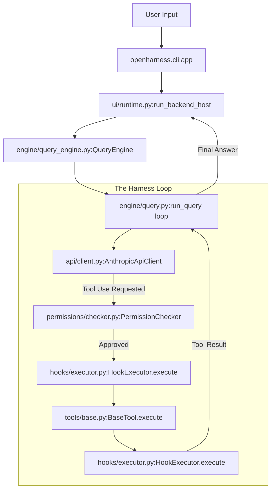
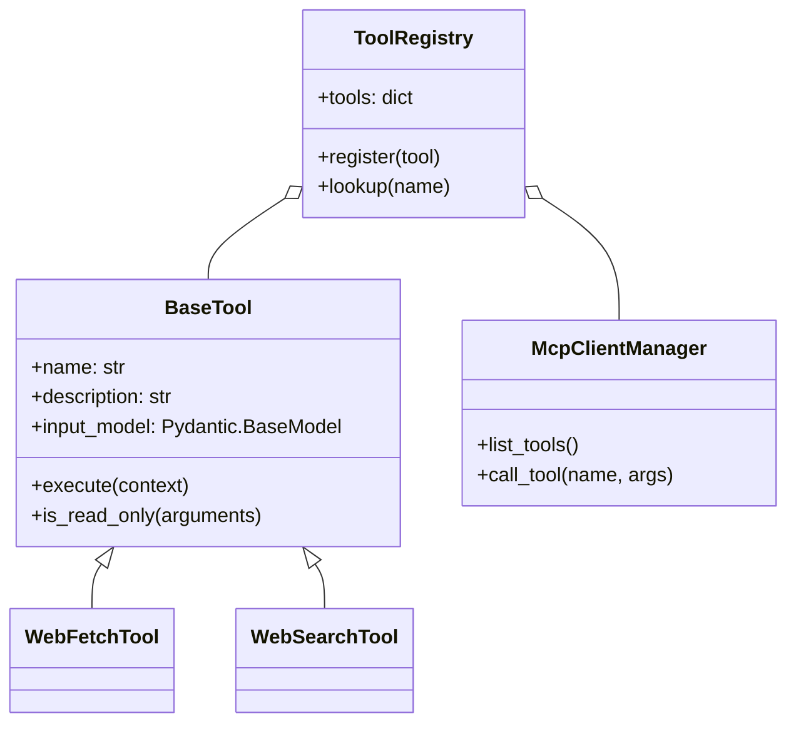

<!-- source: DeepWiki mcp.deepwiki.com · repo HKUDS/OpenHarness · page 1 OpenHarness Overview · fetched 2026-11-09 -->

# OpenHarness Overview

<details>
<summary>Relevant source files</summary>

The following files were used as context for generating this wiki page:

- [.gitignore](.gitignore)
- [CHANGELOG.md](CHANGELOG.md)
- [README.md](README.md)
- [README.zh-CN.md](README.zh-CN.md)
- [RELEASE_NOTES_v0.1.8.md](RELEASE_NOTES_v0.1.8.md)
- [RELEASE_NOTES_v0.1.9.md](RELEASE_NOTES_v0.1.9.md)
- [assets/scene-agentloop.png](assets/scene-agentloop.png)
- [assets/scene-context.png](assets/scene-context.png)
- [assets/scene-governance.png](assets/scene-governance.png)
- [assets/scene-swarm.png](assets/scene-swarm.png)
- [assets/scene-toolkit.png](assets/scene-toolkit.png)
- [ohmo/__init__.py](ohmo/__init__.py)
- [pyproject.toml](pyproject.toml)
- [src/openharness/cli.py](src/openharness/cli.py)
- [src/openharness/tools/web_fetch_tool.py](src/openharness/tools/web_fetch_tool.py)
- [src/openharness/tools/web_search_tool.py](src/openharness/tools/web_search_tool.py)
- [src/openharness/utils/network_guard.py](src/openharness/utils/network_guard.py)
- [tests/test_commands/test_cli.py](tests/test_commands/test_cli.py)
- [tests/test_entrypoints/test_config_cli.py](tests/test_entrypoints/test_config_cli.py)
- [tests/test_tools/test_web_fetch_tool.py](tests/test_tools/test_web_fetch_tool.py)
- [tests/test_utils/test_network_guard.py](tests/test_utils/test_network_guard.py)

</details>


OpenHarness (`oh`) is an open-source Python implementation of an **Agent Harness**. While a Large Language Model (LLM) provides the "intelligence," OpenHarness provides the "infrastructure"—the hands, eyes, memory, and safety boundaries required to transform a model into a functional agent capable of software engineering and system interaction [README.md:137-143]().

It delivers core lightweight agent infrastructure including tool-use, skills, memory, and multi-agent coordination, supporting integration with models from Anthropic, OpenAI, and other compatible providers [README.md:14-16](), [README.zh-CN.md:86-117]().

### Core Philosophy
- **Lightweight:** Designed as a core agent infrastructure with 43+ built-in tools [README.md:14-23]().
- **Transparent:** Pure Python implementation for easy auditing and extension [pyproject.toml:5-14]().
- **Safe:** Built-in multi-level permission system and lifecycle hooks [README.md:102-115]().
- **Extensible:** Supports the Model Context Protocol (MCP) and a plugin ecosystem [README.md:70-82]().

---

## System Architecture

The OpenHarness architecture is divided into primary subsystems that manage the lifecycle of an agentic session.

### High-Level Subsystems
| Subsystem | Responsibility |
| :--- | :--- |
| **Engine** | Manages the iterative `run_query` loop and tool execution flow [README.md:54-65](). |
| **Tools** | 43+ built-in capabilities (File I/O, Shell, Search, Web, MCP) [README.md:78](). |
| **Permissions** | Safety checks for tool execution and file path access [README.md:102-113](). |
| **Hooks** | Lifecycle events (`PreToolUse`, `PostToolUse`) for automation [README.md:112](). |
| **MCP** | Model Context Protocol client for external tool integration [README.md:78](). |
| **Memory** | Persistent knowledge storage via `MEMORY.md` and `CLAUDE.md` [README.md:86-97](). |
| **Coordinator** | Multi-agent management and sub-agent spawning (Swarm) [README.md:118-129](). |
| **UI** | Dual-mode interface: React/Ink TUI or non-interactive print mode [README.md:30](), [README.zh-CN.md:153-169](). |
| **ohmo** | Personal agent application built on the harness [README.md:16](), [ohmo/__init__.py:1-5](). |

### Data Flow: User Input to LLM Response
The following diagram illustrates how a user request flows through the `QueryEngine` and interacts with various code entities.

**Diagram: Request Execution Pipeline**

Sources: [pyproject.toml:48-52](), [src/openharness/cli.py:1-18](), [README.md:54-65]()

---

## Key Subsystems

### 1. The Agent Loop (Engine)
The `Engine` implements an asynchronous loop that streams messages from the LLM, parses tool calls, evaluates permissions, and feeds results back to the model until a final response is generated [README.md:62-65](). It tracks token usage and costs via a `CostTracker` [README.md:65]().

For details, see [Architecture Overview](#1.2).

### 2. Tools and MCP
OpenHarness includes 43+ built-in tools for file manipulation, shell execution, and web searching [README.md:78](). It also supports the **Model Context Protocol (MCP)**, allowing it to connect to external tool servers [README.md:78]().

**Diagram: Tool Registration and Discovery**

Sources: [src/openharness/tools/web_fetch_tool.py:33-38](), [src/openharness/tools/web_search_tool.py:28-33](), [README.md:78]()

### 3. Permissions and Safety
Safety is enforced through `PermissionMode` settings (DEFAULT, PLAN, FULL_AUTO) and glob-based `PathRule` patterns [README.md:110-113](). Every tool execution is intercepted by the `PermissionChecker` before it reaches the OS [README.md:112-113]().

### 4. Skills and Plugins
- **Skills:** On-demand Markdown-based knowledge files loaded into the LLM context via the `skill` tool [README.md:79]().
- **Plugins:** Self-contained extensions that can contribute new tools, hooks, or agents [README.md:80](). Discovery includes auto-instantiation of `BaseTool` subclasses from a plugin's `tools_dir` [CHANGELOG.md:37-38]().

---

## Getting Started

### Prerequisites
- **Python 3.10+** [pyproject.toml:11]()
- **Node.js 18+** (required for React TUI)
- An LLM API Key (Anthropic, OpenAI, or compatible provider) [README.zh-CN.md:93-117]()

### Installation
The recommended way to install is via the one-click installer script:
```bash
curl -fsSL https://raw.githubusercontent.com/HKUDS/OpenHarness/main/scripts/install.sh | bash
```
Sources: [README.zh-CN.md:43-45]()

### Entry Points
- `oh`: Launches the interactive React Terminal UI [pyproject.toml:50]().
- `oh setup`: Guided configuration for providers and models [src/openharness/cli.py:53-61](), [README.zh-CN.md:71-75]().
- `ohmo`: Launches the personal agent application [pyproject.toml:52]().
- `oh --dry-run`: Safe preview of runtime settings, tools, and MCP servers without execution [src/openharness/cli.py:38](), [CHANGELOG.md:38]().

For detailed installation and first-run instructions, see [Getting Started](#1.1).

---

## Project Structure
```text
src/openharness/
├── api/           # LLM provider clients (Anthropic, OpenAI, Codex)
├── engine/        # Agent loop and query execution
├── tools/         # Built-in tool implementations
├── permissions/   # Safety and access control
├── hooks/         # Lifecycle event handlers
├── mcp/           # Model Context Protocol integration
├── memory/        # Persistent session memory
├── swarm/         # Multi-agent coordination
├── ui/            # React TUI backend host
└── config/        # Settings and path management
ohmo/              # Personal agent application
```
Sources: [pyproject.toml:54-55](), [README.md:48-133]()

---

