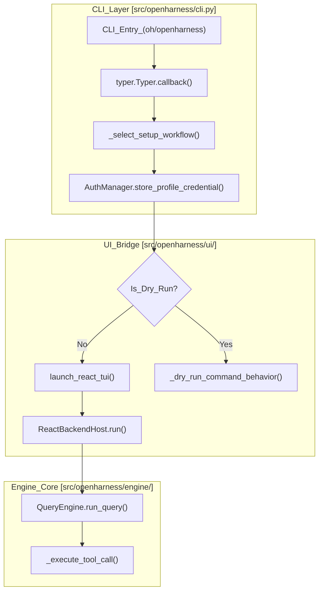
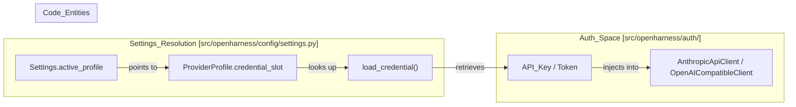

<!-- source: DeepWiki mcp.deepwiki.com · repo HKUDS/OpenHarness · page 1.1 Getting Started · fetched 2026-11-09 -->

# Getting Started

<details>
<summary>Relevant source files</summary>

The following files were used as context for generating this wiki page:

- [.gitignore](.gitignore)
- [CHANGELOG.md](CHANGELOG.md)
- [README.md](README.md)
- [README.zh-CN.md](README.zh-CN.md)
- [RELEASE_NOTES_v0.1.8.md](RELEASE_NOTES_v0.1.8.md)
- [RELEASE_NOTES_v0.1.9.md](RELEASE_NOTES_v0.1.9.md)
- [ohmo/__init__.py](ohmo/__init__.py)
- [pyproject.toml](pyproject.toml)
- [scripts/install.ps1](scripts/install.ps1)
- [scripts/install.sh](scripts/install.sh)
- [scripts/install_dev.sh](scripts/install_dev.sh)
- [src/openharness/cli.py](src/openharness/cli.py)
- [src/openharness/prompts/environment.py](src/openharness/prompts/environment.py)
- [src/openharness/tools/image_to_text_tool.py](src/openharness/tools/image_to_text_tool.py)
- [src/openharness/tools/web_fetch_tool.py](src/openharness/tools/web_fetch_tool.py)
- [src/openharness/tools/web_search_tool.py](src/openharness/tools/web_search_tool.py)
- [src/openharness/utils/network_guard.py](src/openharness/utils/network_guard.py)
- [tests/test_commands/test_cli.py](tests/test_commands/test_cli.py)
- [tests/test_entrypoints/test_config_cli.py](tests/test_entrypoints/test_config_cli.py)
- [tests/test_install/test_windows_alias.py](tests/test_install/test_windows_alias.py)
- [tests/test_prompts/test_environment.py](tests/test_prompts/test_environment.py)
- [tests/test_prompts/test_system_prompt.py](tests/test_prompts/test_system_prompt.py)
- [tests/test_tools/test_web_fetch_tool.py](tests/test_tools/test_web_fetch_tool.py)
- [tests/test_utils/test_network_guard.py](tests/test_utils/test_network_guard.py)

</details>


This page provides a technical guide for installing, configuring, and initializing **OpenHarness**. It covers the environment setup, the resolution logic for settings and API keys, and the transition from the CLI entry point to the interactive agent loop.

## Installation and Environment Setup

OpenHarness is a Python-based application requiring **Python 3.10+** [README.md:29-29](). It uses `hatchling` as the build backend [pyproject.toml:2-3]().

### One-Click Installation
The recommended way to install OpenHarness is via the provided shell script, which handles OS detection, Python version checks (>= 3.10), and virtual environment creation [scripts/install.sh:90-103]().

**Linux/macOS:**
```bash
curl -fsSL https://raw.githubusercontent.com/HKUDS/OpenHarness/main/scripts/install.sh | bash
```

**Windows (PowerShell):**
```powershell
iex (Invoke-WebRequest -Uri 'https://raw.githubusercontent.com/HKUDS/OpenHarness/main/scripts/install.ps1')
```

The installer also checks for **Node.js >= 18**, which is required to power the React-based Terminal UI (TUI) [scripts/install.sh:153-179]().

### Manual Setup
To install the package from source in editable mode:
```bash
git clone https://github.com/HKUDS/OpenHarness.git
cd OpenHarness
pip install -e ".[dev]"
```

The installation registers primary CLI entry points: `openharness`, `oh`, and `ohmo` [pyproject.toml:49-52]().

**Sources:** [README.md:29-30](), [scripts/install.sh:1-203](), [scripts/install.ps1:1-188](), [pyproject.toml:1-52]()

---

## Configuration and Directory Structure

OpenHarness follows XDG-like conventions for persistent data. By default, it stores all configurations and state in a hidden directory in the user's home folder.

### Directory Resolution
| Directory | Path (Default) | Role |
| :--- | :--- | :--- |
| **Config Root** | `~/.openharness/` | Global settings, profiles, and auth storage. |
| **Data Root** | `~/.openharness/data/` | Persistent state, tasks, and cron registry. |
| **Sessions**| `~/.openharness/data/sessions/` | JSON snapshots of conversation history. |
| **Skills** | `~/.openharness/skills/` | User-defined Markdown skill files. |
| **Plugins** | `~/.openharness/plugins/` | Externally installed agent extensions. |

The system also creates a project-specific `.openharness/` directory within the current working directory to store local context like `issue.md` or `pr_comments.md`.

### Settings Precedence
The configuration is populated using a strict resolution order (highest priority first):
1.  **CLI Arguments**: Passed via `typer` and merged into the runtime state [src/openharness/cli.py:17-18]().
2.  **Environment Variables**: `ANTHROPIC_API_KEY`, `OPENAI_API_KEY`, `OPENHARNESS_MODEL`, etc. [CHANGELOG.md:43-45]().
3.  **Config File**: `~/.openharness/settings.json`.
4.  **Provider Profiles**: Scoped settings (base URL, model, credentials) defined in `active_profile` [tests/test_commands/test_cli.py:58-60]().

**Sources:** [src/openharness/cli.py:1-18](), [CHANGELOG.md:33-64](), [tests/test_commands/test_cli.py:34-60]()

---

## CLI Entry Points and First Run

The CLI is implemented using `typer` in `src/openharness/cli.py`.

### Provider and Auth Setup
OpenHarness uses a unified `setup` workflow to guide users through provider selection and authentication [tests/test_commands/test_cli.py:34-56]().
```bash
oh setup
```
This command supports multiple workflows:
*   **API Key Providers**: Anthropic, OpenAI, NVIDIA NIM, Qwen (DashScope), MiniMax, and Gemini [CHANGELOG.md:33-41]().
*   **Subscription Services**: Claude Code and OpenAI Codex [tests/test_commands/test_cli.py:42-43]().

### Dry-Run Mode
A safety feature `oh --dry-run` allows users to preview the resolved environment without executing the model or tools [src/openharness/cli.py:38-38](). It inspects:
*   Resolved runtime settings and auth state [src/openharness/cli.py:157-158]().
*   Configured MCP servers and their connection status [src/openharness/cli.py:89-121]().
*   Available tools, skills, and slash commands [src/openharness/cli.py:124-201]().

### CLI Subcommands
*   `oh provider`: Manage profiles (`add`, `edit`, `list`, `remove`) [tests/test_commands/test_cli.py:157-206]().
*   `oh setup`: Interactive wizard for initial configuration [tests/test_commands/test_cli.py:34-56]().
*   `ohmo init`: Bootstraps the personal agent workspace (`soul.md`, `user.md`) [README.md:16-17]().

### Data Flow: CLI to Runtime
The following diagram illustrates how the CLI command initializes the system state and transitions into the interactive session.

**CLI Initialization Flow**

**Sources:** [src/openharness/cli.py:89-124](), [tests/test_commands/test_cli.py:34-56](), [CHANGELOG.md:38-38]()

---

## Session Modes

OpenHarness supports two primary modes of operation:

### 1. Interactive Mode (Default)
Launches the React-based Terminal User Interface (TUI). 
*   **Real-time Streaming**: Renders structured Markdown blocks, including tables and code fences [CHANGELOG.md:50-51]().
*   **Unified Diffs**: Tools like `edit_file` and `write_file` show a diff preview for approval [CHANGELOG.md:12-12]().
*   **Slash Commands**: Direct control via `/config`, `/memory`, `/skills`, etc. [CHANGELOG.md:24-25]().

### 2. Print Mode (`--print` / `-p`)
A non-interactive mode that executes the query and prints the final result to stdout. Useful for CI/CD or piping output to other tools.

### Session Persistence
Sessions are automatically saved as snapshots. Users can resume the most recent session using `oh --continue` or a specific one using `oh --resume <id>` [CHANGELOG.md:59-61]().

---

## Technical Implementation: Provider Resolution

The system resolves credentials based on the `active_profile`. This allows switching between different LLM backends (e.g., switching from Anthropic to a local Ollama instance) without re-entering keys.

**Provider and Credential Mapping**


### Key Classes
*   `Settings`: Central Pydantic model for configuration [tests/test_commands/test_cli.py:13-13]().
*   `AuthManager`: Handles secure storage and retrieval of credentials [tests/test_commands/test_cli.py:100-104]().
*   `WebFetchTool`: Example of a network-aware tool using `NetworkGuard` for security [src/openharness/tools/web_fetch_tool.py:33-40]().
*   `NetworkGuard`: Validates outbound HTTP requests to prevent SSRF and access to non-public IPs [src/openharness/utils/network_guard.py:95-113]().

**Sources:** [src/openharness/config/settings.py:1-13](), [src/openharness/auth/storage.py:1-10](), [src/openharness/tools/web_fetch_tool.py:33-71](), [src/openharness/utils/network_guard.py:1-113]()

---

