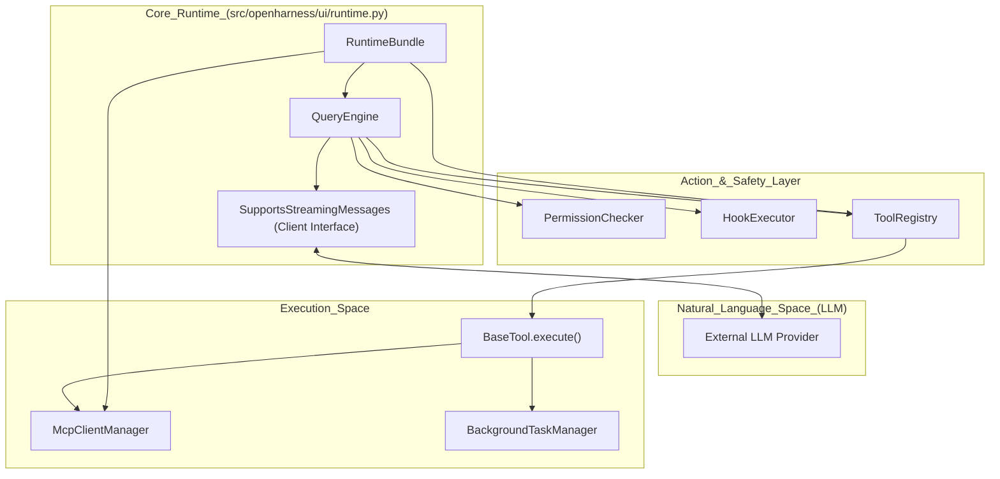
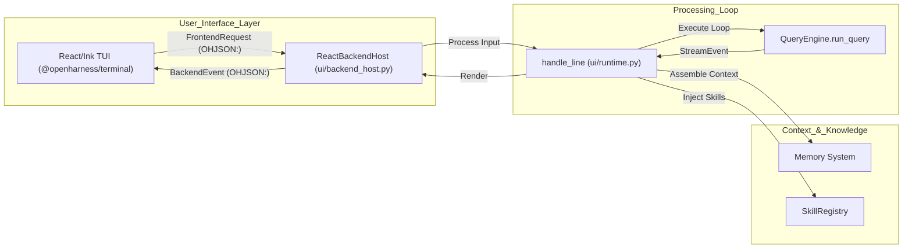

<!-- source: DeepWiki mcp.deepwiki.com · repo HKUDS/OpenHarness · page 1.2 Architecture Overview · fetched 2026-11-09 -->

# Architecture Overview

Relevant source files

The following files were used as context for generating this wiki page:

- [README.md](README.md)
- [README.zh-CN.md](README.zh-CN.md)
- [assets/scene-agentloop.png](assets/scene-agentloop.png)
- [assets/scene-context.png](assets/scene-context.png)
- [assets/scene-governance.png](assets/scene-governance.png)
- [assets/scene-swarm.png](assets/scene-swarm.png)
- [assets/scene-toolkit.png](assets/scene-toolkit.png)
- [src/openharness/tools/web_search_tool.py](src/openharness/tools/web_search_tool.py)
- [src/openharness/ui/backend_host.py](src/openharness/ui/backend_host.py)
- [src/openharness/ui/runtime.py](src/openharness/ui/runtime.py)
- [src/openharness/utils/network_guard.py](src/openharness/utils/network_guard.py)
- [tests/test_entrypoints/test_config_cli.py](tests/test_entrypoints/test_config_cli.py)
- [tests/test_tools/test_web_fetch_tool.py](tests/test_tools/test_web_fetch_tool.py)
- [tests/test_ui/test_react_backend.py](tests/test_ui/test_react_backend.py)
- [tests/test_utils/test_network_guard.py](tests/test_utils/test_network_guard.py)

OpenHarness is designed as an ultra-lightweight, modular Agent Harness. An "Agent Harness" serves as the infrastructure wrapping an LLM, providing it with the necessary interfaces to interact with the physical and digital world—specifically tools, persistent memory, safety boundaries, and multi-agent coordination capabilities [README.md:133-139]().

The system is composed of 10 primary subsystems that work in concert to transform natural language user input into structured agentic actions and responses. The `RuntimeBundle` serves as the primary container for these subsystems during an active session [src/openharness/ui/runtime.py:121-141]().

## System Subsystems

The architecture is organized into the following functional areas:

| Subsystem | Responsibility | Key Code Entities |
|:---|:---|:---|
| **Engine** | Manages the core agent loop (Query -> Tool -> Loop). | `QueryEngine`, `run_query` |
| **Tools** | 43+ built-in functions for file I/O, shell, and web. | `BaseTool`, `ToolRegistry` |
| **MCP** | Integration with Model Context Protocol servers. | `McpClientManager`, `McpStdioServerConfig` |
| **Skills** | On-demand knowledge injection via Markdown files. | `SkillRegistry`, `SkillDefinition` |
| **Plugins** | Extends commands, hooks, and tools via manifests. | `PluginManifest`, `load_plugins` |
| **Permissions** | Safety gatekeeper for tool execution and path access. | `PermissionChecker`, `PermissionMode` |
| **Hooks** | Lifecycle event triggers (Pre/Post Tool Use). | `HookExecutor`, `HookReloader` |
| **UI** | Dual-mode interface (React TUI and Print Mode). | `ReactBackendHost`, `launch_react_tui` |
| **Memory** | Persistent cross-session knowledge storage. | `MEMORY.md`, `add_memory_entry` |
| **Coordinator** | Multi-agent spawning and swarm management. | `TeamRegistry`, `TeamLifecycleManager` |

Sources: [README.md:44-129](), [src/openharness/ui/runtime.py:11-43](), [src/openharness/ui/backend_host.py:73-116]().

## High-Level Data Flow

The flow of information in OpenHarness follows a cyclical "Agent Loop" pattern. The `QueryEngine` acts as the orchestrator, managing the transition between the Natural Language Space (LLM) and the Code Entity Space (Tools/System).

### Sequence of Operations

1.  **Input Assembly**: The `build_runtime_system_prompt` gathers environment data, `CLAUDE.md` project instructions, active skills, and memory entries to create the initial context [src/openharness/ui/runtime.py:40]().
2.  **LLM Query**: The `QueryEngine` sends message history and tool definitions to the resolved API client (e.g., `AnthropicApiClient`, `OpenAICompatibleClient`, `CodexApiClient`, or `CopilotClient`) [src/openharness/ui/runtime.py:11-15](), [src/openharness/ui/runtime.py:124]().
3.  **Event Streaming**: As the LLM responds, the `ReactBackendHost` translates API events into `StreamEvent` objects (like `AssistantTextDelta`, `ToolExecutionStarted`, and `ToolExecutionCompleted`) for the UI [src/openharness/ui/backend_host.py:24-33]().
4.  **Tool Execution**:
    *   **Permission Check**: `PermissionChecker` evaluates if the tool and its arguments are allowed based on the active `PermissionMode` [src/openharness/ui/runtime.py:38]().
    *   **Pre-Use Hooks**: `HookExecutor` runs configured shell, HTTP, or LLM hooks before execution [src/openharness/ui/runtime.py:34]().
    *   **Execution**: The tool's `execute()` method is called within a `ToolExecutionContext` [src/openharness/tools/web_search_tool.py:39-43]().
    *   **Post-Use Hooks**: Hooks run again to validate or process tool output [src/openharness/hooks/executor.py:34]().
5.  **Loop Continuation**: Tool results are appended to the message history via `ConversationMessage`, and the engine re-queries the LLM until a completion state is reached [src/openharness/ui/runtime.py:26-31]().

## Architectural Diagrams

### 1. Component Interconnectivity (Code Entity Space)
This diagram shows how the core Python classes interact to facilitate the agent loop and manage the session lifecycle.

Sources: [src/openharness/ui/runtime.py:121-141](), [src/openharness/ui/backend_host.py:92-116](), [src/openharness/tasks/manager.py:35]().

### 2. UI-to-Engine Data Flow
This diagram bridges user input in the UI to the underlying code entities that process the data through the `OHJSON` protocol.

Sources: [src/openharness/ui/backend_host.py:45](), [src/openharness/ui/backend_host.py:128-175](), [src/openharness/ui/runtime.py:38]().

## Subsystem Details

### The Permission System
The `PermissionChecker` validates tool calls against `PathRule` glob patterns and `command_deny_patterns`. It operates in three modes: `DEFAULT` (ask for mutating tools), `PLAN` (dry-run mode), and `FULL_AUTO` (no prompts) [src/openharness/ui/runtime.py:38](), [README.zh-CN.md:333-339]().

### The Multi-Agent Swarm
Multi-agent coordination is handled via the `swarm` and `coordinator` modules. The primary agent uses the `agent` tool to spawn sub-agents, which are managed by the `TeamRegistry`. Communication is facilitated through a file-based `TeammateMailbox` to ensure persistence and isolation [README.md:118-129]().

### Memory and Persistence
Memory is managed as a set of Markdown files, with `MEMORY.md` serving as the primary index. The system automatically scans for these files in the project root or user home directory and injects relevant snippets into the system prompt to maintain long-term context [README.md:86-97]().

### Plugin and Skill Architecture
OpenHarness allows for dynamic extension. **Skills** are Markdown files with YAML frontmatter that provide on-demand domain knowledge [src/openharness/ui/runtime.py:21-23](). **Plugins** are structured directories containing a `plugin.json` manifest that can contribute new tools, hooks, and MCP server configurations to the `RuntimeBundle` [src/openharness/ui/runtime.py:39](), [src/openharness/ui/runtime.py:154-160]().

### Web and Network Guard
For outbound interactions, OpenHarness implements a `NetworkGuard` to prevent Server-Side Request Forgery (SSRF). Tools like `WebFetchTool` and `WebSearchTool` use `fetch_public_http_response` to ensure that only public IP addresses are targeted, supporting proxy and synthetic DNS modes for enterprise environments [src/openharness/utils/network_guard.py:95-113](), [src/openharness/tools/web_search_tool.py:47-52]().

Sources: [src/openharness/ui/runtime.py:1-141](), [src/openharness/ui/backend_host.py:1-126](), [README.md:48-131]().

---

