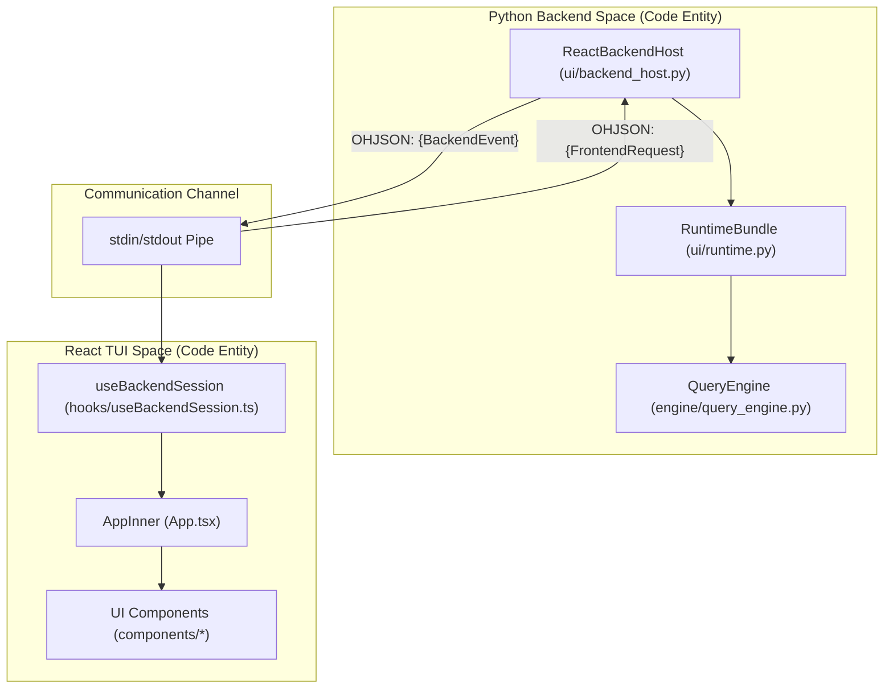
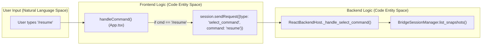

<!-- source: DeepWiki mcp.deepwiki.com · repo HKUDS/OpenHarness · page 10 User Interface Layer · fetched 2026-11-09 -->

# User Interface Layer

Relevant source files

The following files were used as context for generating this wiki page:

- [frontend/terminal/src/App.tsx](frontend/terminal/src/App.tsx)
- [frontend/terminal/src/clipboardImage.ts](frontend/terminal/src/clipboardImage.ts)
- [frontend/terminal/src/components/PromptInput.test.tsx](frontend/terminal/src/components/PromptInput.test.tsx)
- [frontend/terminal/src/components/PromptInput.tsx](frontend/terminal/src/components/PromptInput.tsx)
- [frontend/terminal/src/hooks/useBackendSession.ts](frontend/terminal/src/hooks/useBackendSession.ts)
- [frontend/terminal/src/types.ts](frontend/terminal/src/types.ts)
- [src/openharness/ui/backend_host.py](src/openharness/ui/backend_host.py)
- [src/openharness/ui/protocol.py](src/openharness/ui/protocol.py)
- [src/openharness/ui/runtime.py](src/openharness/ui/runtime.py)
- [tests/test_ui/test_react_backend.py](tests/test_ui/test_react_backend.py)

The User Interface (UI) layer provides the interaction surface for OpenHarness, supporting both an immersive, interactive Terminal User Interface (TUI) and a streamlined, non-interactive print mode. The architecture follows a frontend-backend split where a Python-based host manages the agent logic and communicates with a React/Ink-based frontend via a JSON-lines protocol.

## Dual-Mode Interaction

OpenHarness operates in two primary modes depending on the terminal environment and user flags:

1.  **Interactive TUI Mode**: The default mode which launches a React application rendered in the terminal using [Ink](https://github.com/vadimdemedes/ink). It provides a rich layout with side panels, status bars, and real-time streaming updates.
2.  **Print Mode (Non-Interactive)**: A fallback mode that outputs plain text to `stdout`. This is used when the environment does not support TUI features or when running in automated pipelines.

### UI Layer Overview
The following diagram illustrates the relationship between the Python backend and the React TUI frontend.

Sources: [src/openharness/ui/backend_host.py:73-91](), [src/openharness/ui/runtime.py:121-141](), [frontend/terminal/src/App.tsx:61-82](), [frontend/terminal/src/hooks/useBackendSession.ts:17-23]().

---

## React Terminal UI (Frontend)

The frontend is a standalone Node.js application located in `frontend/terminal/`. It uses **React** to manage UI state and **Ink** to render components into terminal frames.

*   **Root Component**: The `AppInner` component in `frontend/terminal/src/App.tsx` serves as the layout engine, orchestrating the `ConversationView`, `StatusBar`, and side panels like `SwarmPanel` and `TodoPanel`. [frontend/terminal/src/App.tsx:61-82]()
*   **State Management**: The `useBackendSession` hook manages the lifecycle of the connection to the Python host via `child_process.spawn`, parsing incoming `BackendEvent` objects and writing `FrontendRequest` objects to `stdin`. [frontend/terminal/src/hooks/useBackendSession.ts:115-177]()
*   **Interactive Elements**: Includes specialized components like `PromptInput` for multi-line input and `CommandPicker` for slash-command autocompletion. [frontend/terminal/src/components/PromptInput.tsx:199-219]()

For details, see [React Terminal UI (Frontend)](#10.1).

Sources: [frontend/terminal/src/App.tsx:1-15](), [frontend/terminal/src/hooks/useBackendSession.ts:24-46]().

---

## Python Backend Host and Protocol

The Python backend acts as the "Server" for the TUI. It wraps the `QueryEngine` and other core subsystems via a `RuntimeBundle`.

*   **Host Logic**: `ReactBackendHost` (in `ui/backend_host.py`) manages the communication loop, multiplexing tool outputs, agent thoughts, and system status into the protocol via `_emit`. [src/openharness/ui/backend_host.py:92-126]()
*   **Protocol**: Communication occurs over `stdin`/`stdout` using a line-delimited JSON format prefixed with `OHJSON:`. Pydantic models in `ui/protocol.py` define the schema for `BackendEvent` and `FrontendRequest`. [src/openharness/ui/protocol.py:37-57](), [src/openharness/ui/protocol.py:90-112]()
*   **Runtime Assembly**: `RuntimeBundle` in `ui/runtime.py` wires together the `McpClientManager`, `ToolRegistry`, and `QueryEngine` into a unified session state. [src/openharness/ui/runtime.py:121-141]()

For details, see [Python Backend Host and Protocol](#10.2).

---

## Slash Commands

Slash commands provide a CLI-within-a-CLI interface for controlling the agent's behavior and inspecting system state without sending a message to the LLM.

*   **Registry**: All commands are registered in a central `CommandRegistry` created via `create_default_command_registry`. [src/openharness/ui/runtime.py:17-23]()
*   **Key Commands**:
    *   `/permissions`: Interactive mode picker for safety levels. [frontend/terminal/src/App.tsx:196-199]()
    *   `/resume`: Triggers a session list request to the backend. [frontend/terminal/src/App.tsx:191-194]()
    *   `/plan`: Toggles "Plan Mode" to block all write operations. [frontend/terminal/src/App.tsx:203-206]()
*   **TUI Integration**: The TUI intercepts specific commands in `handleCommand` to provide specialized interactive modals via `setSelectModal`. [frontend/terminal/src/App.tsx:188-208]()

For details, see [Slash Commands](#10.3).

### Natural Language to Command Mapping
This diagram shows how user input in the `PromptInput` component is routed through the system.

Sources: [frontend/terminal/src/App.tsx:188-208](), [frontend/terminal/src/hooks/useBackendSession.ts:107-113](), [src/openharness/ui/backend_host.py:142-144]().

---

## UI Components Reference

| Component | File | Responsibility |
| :--- | :--- | :--- |
| `AppInner` | `App.tsx` | Main layout, global keyboard handling, and session lifecycle management. |
| `StatusBar` | `components/StatusBar.tsx` | Displays current model, permission mode, and session status. |
| `PromptInput` | `components/PromptInput.tsx` | Handles multi-line text input, cursor movement, and command history. |
| `CommandPicker` | `components/CommandPicker.tsx` | Provides a floating suggestion list for `/` commands. |
| `SelectModal` | `components/SelectModal.tsx` | Generic UI for choosing from lists (sessions, themes, models). |
| `ConversationView`| `components/ConversationView.tsx` | Renders the transcript of messages, tool calls, and logs. |
| `SwarmPanel` | `components/SwarmPanel.tsx` | Displays status and notifications for multi-agent teammates. |

Sources: [frontend/terminal/src/App.tsx:5-15](), [frontend/terminal/src/components/PromptInput.tsx:199-254](), [frontend/terminal/src/types.ts:6-12]().

---

