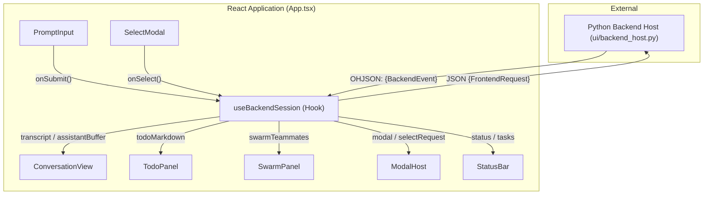
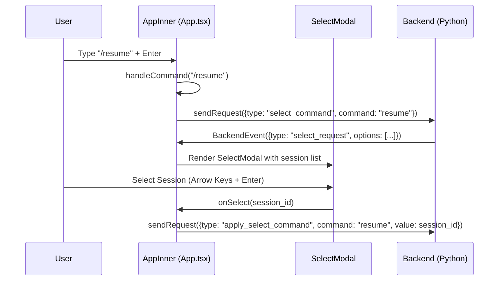

<!-- source: DeepWiki mcp.deepwiki.com · repo HKUDS/OpenHarness · page 10.1 React Terminal UI (Frontend) · fetched 2026-11-09 -->

# React Terminal UI (Frontend)

Relevant source files

The following files were used as context for generating this wiki page:

- [frontend/terminal/package-lock.json](frontend/terminal/package-lock.json)
- [frontend/terminal/package.json](frontend/terminal/package.json)
- [frontend/terminal/src/App.tsx](frontend/terminal/src/App.tsx)
- [frontend/terminal/src/clipboardImage.ts](frontend/terminal/src/clipboardImage.ts)
- [frontend/terminal/src/components/CommandPicker.tsx](frontend/terminal/src/components/CommandPicker.tsx)
- [frontend/terminal/src/components/Composer.tsx](frontend/terminal/src/components/Composer.tsx)
- [frontend/terminal/src/components/ConversationView.tsx](frontend/terminal/src/components/ConversationView.tsx)
- [frontend/terminal/src/components/MarkdownText.test.tsx](frontend/terminal/src/components/MarkdownText.test.tsx)
- [frontend/terminal/src/components/MarkdownText.tsx](frontend/terminal/src/components/MarkdownText.tsx)
- [frontend/terminal/src/components/ModalHost.test.tsx](frontend/terminal/src/components/ModalHost.test.tsx)
- [frontend/terminal/src/components/ModalHost.tsx](frontend/terminal/src/components/ModalHost.tsx)
- [frontend/terminal/src/components/PromptInput.test.tsx](frontend/terminal/src/components/PromptInput.test.tsx)
- [frontend/terminal/src/components/PromptInput.tsx](frontend/terminal/src/components/PromptInput.tsx)
- [frontend/terminal/src/components/Spinner.tsx](frontend/terminal/src/components/Spinner.tsx)
- [frontend/terminal/src/components/StatusBar.tsx](frontend/terminal/src/components/StatusBar.tsx)
- [frontend/terminal/src/components/SwarmPanel.tsx](frontend/terminal/src/components/SwarmPanel.tsx)
- [frontend/terminal/src/components/TodoPanel.tsx](frontend/terminal/src/components/TodoPanel.tsx)
- [frontend/terminal/src/components/ToolCallDisplay.tsx](frontend/terminal/src/components/ToolCallDisplay.tsx)
- [frontend/terminal/src/components/WelcomeBanner.tsx](frontend/terminal/src/components/WelcomeBanner.tsx)
- [frontend/terminal/src/hooks/useBackendSession.ts](frontend/terminal/src/hooks/useBackendSession.ts)
- [frontend/terminal/src/index.tsx](frontend/terminal/src/index.tsx)
- [frontend/terminal/src/theme/ThemeContext.tsx](frontend/terminal/src/theme/ThemeContext.tsx)
- [frontend/terminal/src/theme/builtinThemes.ts](frontend/terminal/src/theme/builtinThemes.ts)
- [frontend/terminal/src/types.ts](frontend/terminal/src/types.ts)
- [src/openharness/output_styles/loader.py](src/openharness/output_styles/loader.py)
- [src/openharness/tools/file_edit_tool.py](src/openharness/tools/file_edit_tool.py)
- [src/openharness/tools/file_write_tool.py](src/openharness/tools/file_write_tool.py)
- [src/openharness/ui/protocol.py](src/openharness/ui/protocol.py)
- [tests/test_config/test_output_styles_loader.py](tests/test_config/test_output_styles_loader.py)
- [tests/test_ui/test_tui_exit_sequence.py](tests/test_ui/test_tui_exit_sequence.py)

The `@openharness/terminal` package is a React-based Terminal User Interface (TUI) built using the **Ink** library [frontend/terminal/src/App.tsx:2](). It serves as the primary interactive frontend for OpenHarness, communicating with the Python backend via a JSON-RPC protocol over stdin/stdout using the `OHJSON:` prefix [frontend/terminal/src/hooks/useBackendSession.ts:17-19]().

## Architecture Overview

The frontend is structured as a single-page React application rendered into the terminal. It maintains a persistent connection to the backend through the `useBackendSession` hook which manages the message loop, process lifecycle, and application state synchronization.

### Component Hierarchy and Data Flow

The `App.tsx` component acts as the root, coordinating between the `useBackendSession` hook (state) and various UI components (presentation).

Title: Frontend Component and Data Flow

**Sources:** [frontend/terminal/src/App.tsx:60-82](), [frontend/terminal/src/hooks/useBackendSession.ts:24-39](), [frontend/terminal/src/components/ConversationView.tsx:30-40](), [src/openharness/ui/protocol.py:90-135]()

## Core Application Logic

### `App.tsx` Root Component
The `App` component manages high-level UI state, including command history, input buffering, and image attachments [frontend/terminal/src/App.tsx:64-74](). It intercepts specific commands (like `/permissions`, `/plan`, and `/resume`) to trigger interactive UI flows (such as `SelectModal`) instead of passing them directly to the backend as raw text [frontend/terminal/src/App.tsx:188-210](). It also handles clipboard image processing, allowing users to attach screenshots to prompts via `Ctrl+V` [frontend/terminal/src/App.tsx:111-124]().

### `useBackendSession` Hook
This hook is the central engine for the frontend. It:
1.  **Establishes Communication**: Spawns the backend process (defined by `config.backend_command`) and manages stdin/stdout streams [frontend/terminal/src/hooks/useBackendSession.ts:116-126]().
2.  **State Synchronization**: Maintains `transcript`, `status`, `tasks`, `mcpServers`, and `bridgeSessions` [frontend/terminal/src/hooks/useBackendSession.ts:25-31]().
3.  **Event Handling**: Parses incoming lines prefixed with `OHJSON:` into `BackendEvent` objects [frontend/terminal/src/hooks/useBackendSession.ts:129-136]().
4.  **Delta Buffering**: Buffers assistant text deltas to prevent terminal flicker, flushing at `ASSISTANT_DELTA_FLUSH_MS` intervals [frontend/terminal/src/hooks/useBackendSession.ts:48-66]().

**Sources:** [frontend/terminal/src/hooks/useBackendSession.ts:1-177](), [frontend/terminal/src/types.ts:73-98]()

## UI Components

### 1. Messaging and Conversation
*   **ConversationView**: Renders the session history. It uses `groupToolPairs` to visually pair tool calls with their results [frontend/terminal/src/components/ConversationView.tsx:13-28]().
*   **ToolCallDisplay**: A specialized component for rendering tool invocations. It summarizes tool inputs (e.g., showing the file path for `read` or the command for `bash`) and renders errors with specific themes [frontend/terminal/src/components/ToolCallDisplay.tsx:19-78]().
*   **MarkdownText**: A robust markdown renderer for the terminal that handles headings, code blocks, blockquotes, lists, and tables using `marked` [frontend/terminal/src/components/MarkdownText.tsx:139-250]().
*   **WelcomeBanner**: Displays the OpenHarness ASCII logo and version info [frontend/terminal/src/components/WelcomeBanner.tsx:9-31]().

### 2. Interaction and Modals
*   **PromptInput**: A multiline text input supporting cursor movement, history recall, and a "busy" spinner [frontend/terminal/src/components/PromptInput.tsx:199-254]().
*   **ModalHost**: Manages blocking interactions including `permission` (Y/N tool confirmation), `edit_diff` (visual diff confirmation for file edits), and `question` (LLM-initiated user questions) [frontend/terminal/src/components/ModalHost.tsx:187-251]().
*   **SelectModal**: A generic list-selection interface used for switching models, providers, or resuming sessions [frontend/terminal/src/App.tsx:164-185]().

### 3. Specialized Panels
*   **StatusBar**: Displays real-time metrics including the active model, token usage, and active tasks [frontend/terminal/src/components/StatusBar.tsx:57-110]().
*   **TodoPanel**: Renders a markdown-based TODO list, supporting compact and expanded views [frontend/terminal/src/components/TodoPanel.tsx:21-56]().
*   **SwarmPanel**: Displays the status of multi-agent teammates and recent notifications from the swarm [frontend/terminal/src/components/SwarmPanel.tsx:39-87]().

## Type System

The frontend uses TypeScript to enforce the protocol schema defined in `protocol.py`.

| Type | Description |
| :--- | :--- |
| `TranscriptItem` | A single turn in the conversation history (system, user, assistant, tool, etc.) [frontend/terminal/src/types.ts:6-12]() |
| `BackendEvent` | Data packet sent from Python to React (ready, state_snapshot, transcript_item, etc.) [frontend/terminal/src/types.ts:73-98]() |
| `FrontendRequest` | Data packet sent from React to Python (submit_line, interrupt, select_command) [src/openharness/ui/protocol.py:37-58]() |
| `TaskSnapshot` | UI representation of a background task [frontend/terminal/src/types.ts:20-26]() |
| `McpServerSnapshot` | Metadata for a connected MCP server [frontend/terminal/src/types.ts:28-36]() |

**Sources:** [frontend/terminal/src/types.ts:1-98](), [src/openharness/ui/protocol.py:1-135]()

## Implementation Detail: Interactive Command Flow

The frontend implements "UI-first" logic for certain commands to provide a richer experience than a standard CLI prompt.

Title: Interactive Command Sequence

**Sources:** [frontend/terminal/src/App.tsx:164-185](), [frontend/terminal/src/App.tsx:191-194](), [src/openharness/ui/protocol.py:45-46]()

---

