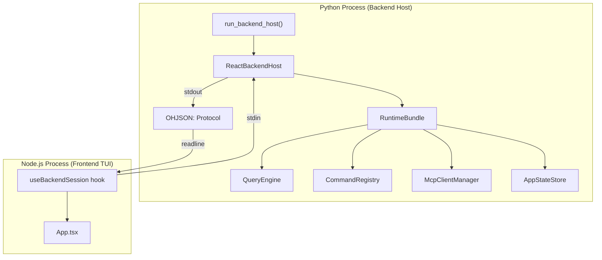
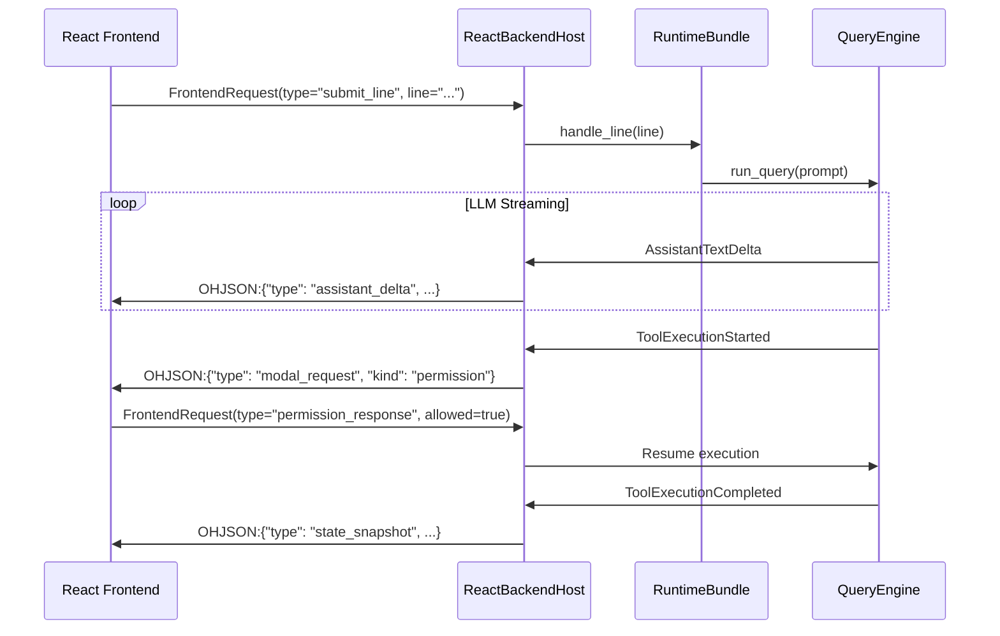

<!-- source: DeepWiki mcp.deepwiki.com · repo HKUDS/OpenHarness · page 10.2 Python Backend Host and Protocol · fetched 2026-11-09 -->

# Python Backend Host and Protocol

Relevant source files

The following files were used as context for generating this wiki page:

- [frontend/terminal/src/App.tsx](frontend/terminal/src/App.tsx)
- [frontend/terminal/src/clipboardImage.ts](frontend/terminal/src/clipboardImage.ts)
- [frontend/terminal/src/components/PromptInput.test.tsx](frontend/terminal/src/components/PromptInput.test.tsx)
- [frontend/terminal/src/components/PromptInput.tsx](frontend/terminal/src/components/PromptInput.tsx)
- [frontend/terminal/src/hooks/useBackendSession.ts](frontend/terminal/src/hooks/useBackendSession.ts)
- [frontend/terminal/src/types.ts](frontend/terminal/src/types.ts)
- [src/openharness/ui/app.py](src/openharness/ui/app.py)
- [src/openharness/ui/backend_host.py](src/openharness/ui/backend_host.py)
- [src/openharness/ui/output.py](src/openharness/ui/output.py)
- [src/openharness/ui/protocol.py](src/openharness/ui/protocol.py)
- [src/openharness/ui/react_launcher.py](src/openharness/ui/react_launcher.py)
- [src/openharness/ui/runtime.py](src/openharness/ui/runtime.py)
- [src/openharness/ui/textual_app.py](src/openharness/ui/textual_app.py)
- [tests/test_ui/test_coordinator_drain.py](tests/test_ui/test_coordinator_drain.py)
- [tests/test_ui/test_react_backend.py](tests/test_ui/test_react_backend.py)
- [tests/test_ui/test_react_launcher.py](tests/test_ui/test_react_launcher.py)

The Python Backend Host serves as the bridge between the core OpenHarness engine and the React-based Terminal User Interface (TUI). It manages the lifecycle of the interactive session, translates engine events into a structured JSON-lines protocol, and handles asynchronous requests from the frontend.

## ReactBackendHost and the Runtime

The `ReactBackendHost` in `ui/backend_host.py` is the primary orchestrator for interactive sessions. It encapsulates the `QueryEngine`, `CommandRegistry`, and various managers (MCP, Tasks, Teams) to provide a unified interface for the React frontend [src/openharness/ui/backend_host.py:73-77]().

The `ui/runtime.py` bundle provides the `build_runtime` and `start_runtime` functions, which wire these subsystems together. It initializes the `RuntimeBundle`, starts background services, and prepares the environment for the frontend [src/openharness/ui/runtime.py:121-141](). The `launch_react_tui` function in `ui/react_launcher.py` is responsible for spawning the Node.js process that runs the React/Ink TUI [src/openharness/ui/react_launcher.py:116-176]().

### System Architecture: Code Entity Space

The following diagram illustrates how the Python backend entities interact with the core engine and the frontend process.

**Backend-Frontend Interconnect**

Sources: [src/openharness/ui/backend_host.py:73-91](), [src/openharness/ui/runtime.py:121-141](), [src/openharness/ui/react_launcher.py:116-176](), [frontend/terminal/src/hooks/useBackendSession.ts:24-177]()

## The OHJSON: Protocol

Communication between the Python backend and the React frontend occurs over standard I/O using a JSON-lines protocol. Every message from the backend to the frontend is prefixed with the string `OHJSON:` [src/openharness/ui/backend_host.py:45-45]().

### Backend Events (`BackendEvent`)
The backend emits events defined by the `BackendEvent` Pydantic model in `ui/protocol.py`.

| Event Type | Description | Key Fields |
| :--- | :--- | :--- |
| `ready` | Sent upon backend initialization. | `state`, `tasks`, `commands` [src/openharness/ui/protocol.py:138-151]() |
| `transcript_item` | A new message or tool call for the UI. | `item` (TranscriptItem) [src/openharness/ui/protocol.py:115-115]() |
| `assistant_delta` | Streaming text chunk from the LLM. | `message` (delta text) [src/openharness/ui/protocol.py:99-99]() |
| `assistant_complete`| End of an LLM turn. | `message` (full text) [src/openharness/ui/protocol.py:100-100]() |
| `state_snapshot` | Updates to global state (MCP, tasks). | `state`, `tasks`, `mcp_servers` [src/openharness/ui/protocol.py:165-199]() |
| `modal_request` | Triggers a UI modal (Permission/Question). | `modal` (metadata) [src/openharness/ui/protocol.py:121-121]() |

### Frontend Requests (`FrontendRequest`)
The frontend sends JSON objects to the backend's stdin. Key request types include:
* `submit_line`: Sends a user message or slash command to the engine [src/openharness/ui/protocol.py:41-41]().
* `permission_response`: Responds to a tool execution permission prompt [src/openharness/ui/protocol.py:42-42]().
* `question_response`: Responds to an `ask_user_question` tool call [src/openharness/ui/protocol.py:43-43]().
* `interrupt`: Cancels the active LLM turn [src/openharness/ui/protocol.py:47-47]().
* `shutdown`: Gracefully terminates the backend [src/openharness/ui/protocol.py:48-48]().

Sources: [src/openharness/ui/backend_host.py:127-199](), [src/openharness/ui/protocol.py:37-57](), [src/openharness/ui/protocol.py:90-136]()

## Data Flow and State Synchronization

The backend maintains the "Source of Truth" via the `RuntimeBundle` and `AppStateStore`. The frontend synchronizes its local state by listening to `OHJSON:` events.

### Interactive Request Flow
1.  **Input**: User types a command in the React TUI and hits Enter [frontend/terminal/src/components/PromptInput.tsx:92-101]().
2.  **Request**: The frontend sends a `submit_line` `FrontendRequest` to the backend's stdin [frontend/terminal/src/hooks/useBackendSession.ts:107-113]().
3.  **Processing**: `ReactBackendHost` receives the line and calls `handle_line` from `ui/runtime.py` [src/openharness/ui/backend_host.py:173-177]().
4.  **Streaming**: As the `QueryEngine` processes the request, it emits `StreamEvent` objects. `ReactBackendHost` converts these into `BackendEvent` objects and writes them to stdout [src/openharness/ui/backend_host.py:284-338]().
5.  **Completion**: Once the turn is finished, a state snapshot is emitted to ensure the UI reflects the latest MCP and task statuses [src/openharness/ui/backend_host.py:339-343]().

**State Synchronization Flow**

Sources: [src/openharness/ui/backend_host.py:92-126](), [src/openharness/ui/backend_host.py:127-199](), [frontend/terminal/src/hooks/useBackendSession.ts:179-228]()

## Key Functions and Classes

### `ReactBackendHost`
Defined in `src/openharness/ui/backend_host.py:73`.
* **`run()`**: The main event loop that initializes the runtime and processes the request queue [src/openharness/ui/backend_host.py:92-126]().
* **`_emit(event: BackendEvent)`**: Serializes the event to JSON and writes it to stdout with the `OHJSON:` prefix [src/openharness/ui/backend_host.py:276-282]().
* **`_handle_line(line, images)`**: Routes the input to the `handle_line` logic which handles both slash commands and LLM queries [src/openharness/ui/backend_host.py:236-268]().

### `RuntimeBundle`
Defined in `src/openharness/ui/runtime.py:121`.
* **Purpose**: A container for all long-lived session objects, including the `api_client`, `tool_registry`, `hook_executor`, and `mcp_manager` [src/openharness/ui/runtime.py:124-141]().
* **`current_settings()`**: Resolves effective settings including CLI overrides [src/openharness/ui/runtime.py:143-152]().

### `launch_react_tui()`
Defined in `src/openharness/ui/react_launcher.py:116`.
* **Process Spawning**: Resolves the `tsx` executable and launches the React entry point `src/index.tsx` [src/openharness/ui/react_launcher.py:166-176]().
* **Config Injection**: Passes backend connection details via the `OPENHARNESS_FRONTEND_CONFIG` environment variable [src/openharness/ui/react_launcher.py:148-165]().

Sources: [src/openharness/ui/backend_host.py:73-343](), [src/openharness/ui/runtime.py:121-152](), [src/openharness/ui/react_launcher.py:116-176]()

---

