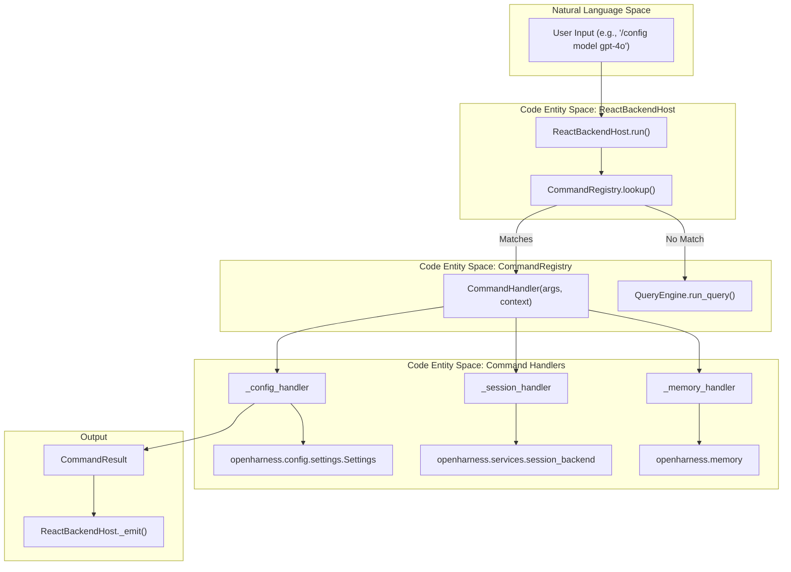
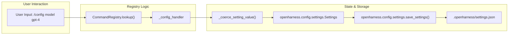

<!-- source: DeepWiki mcp.deepwiki.com · repo HKUDS/OpenHarness · page 10.3 Slash Commands · fetched 2026-11-09 -->

# Slash Commands

Relevant source files

The following files were used as context for generating this wiki page:

- [src/openharness/commands/registry.py](src/openharness/commands/registry.py)
- [src/openharness/ui/backend_host.py](src/openharness/ui/backend_host.py)
- [src/openharness/ui/runtime.py](src/openharness/ui/runtime.py)
- [tests/test_commands/test_registry.py](tests/test_commands/test_registry.py)
- [tests/test_ohmo/test_gateway.py](tests/test_ohmo/test_gateway.py)
- [tests/test_ui/test_react_backend.py](tests/test_ui/test_react_backend.py)

The slash command system in OpenHarness provides a robust mechanism for users to interact with the agent's internal state, manage sessions, configure system behavior, and trigger specialized utilities without sending a prompt to the LLM. This subsystem is built around a central registry that maps command strings to asynchronous handlers.

## Command Infrastructure

The infrastructure for slash commands is defined in `openharness.commands.registry`. It utilizes a decoupled architecture where the `CommandRegistry` manages a collection of `SlashCommand` objects, each containing a name, description, and an asynchronous `CommandHandler` [src/openharness/commands/registry.py:154-164]().

### Core Classes and Data Flow

*   **`CommandRegistry`**: The central authority for registering and looking up commands. It parses raw input starting with `/` and extracts the command name and arguments via `lookup()` [src/openharness/commands/registry.py:165-192]().
*   **`CommandContext`**: A container passed to every handler, providing access to the `QueryEngine`, `ToolRegistry`, `AppStateStore`, and summaries of hooks, plugins, and MCP status [src/openharness/commands/registry.py:132-149]().
*   **`CommandResult`**: The return type for handlers, which can specify a message to display, whether the TUI should exit (`should_exit`), clear the screen (`clear_screen`), or replay messages (used for rewinding or resuming sessions) [src/openharness/commands/registry.py:103-115]().
*   **`SlashCommand`**: A dataclass that binds a string name (e.g., "help") to a specific `CommandHandler` function and defines security properties like `remote_invocable` [src/openharness/commands/registry.py:154-164]().

### Command Execution Flow

The following diagram illustrates how a slash command moves from user input to execution within the `ReactBackendHost` and `CommandRegistry`.

**Slash Command Resolution Flow**

**Sources:** [src/openharness/commands/registry.py:165-192](), [src/openharness/ui/backend_host.py:142-162](), [src/openharness/commands/registry.py:103-115]()

---

## Built-in Commands Reference

OpenHarness includes over 30 built-in commands. These are typically initialized and registered during the `build_runtime` phase via `create_default_command_registry` [src/openharness/ui/runtime.py:131-131]().

### Session and History Management
These commands manipulate the conversation state and persistence.

| Command | Description | Implementation Detail |
| :--- | :--- | :--- |
| `/clear` | Clears current conversation history. | Resets the message list in the `QueryEngine` [src/openharness/commands/registry.py:108-108](). |
| `/rewind` | Removes the last N turns from history. | Uses `_rewind_turns` to pop messages until the last user turn is reached [src/openharness/commands/registry.py:33-33](). |
| `/resume` | Resumes a specific session by ID. | Calls `load_session_snapshot` and updates the engine's message list [src/openharness/commands/registry.py:28-28](). |
| `/session` | Lists or switches project sessions. | Queries session directories for stored snapshots [src/openharness/commands/registry.py:90-90](). |
| `/compact` | Summarizes and truncates history. | Invokes `compact_conversation` service to reduce token pressure [src/openharness/commands/registry.py:71-71](). |
| `/export` | Exports session to Markdown. | Uses `export_session_markdown` to create a readable log [src/openharness/commands/registry.py:33-33](). |

**Sources:** [src/openharness/commands/registry.py:28-90](), [src/openharness/ui/backend_host.py:139-141]()

### System Configuration and State
Commands to view or modify the environment and runtime settings.

| Command | Description | Implementation Detail |
| :--- | :--- | :--- |
| `/config` | Get/set runtime settings. | Modifies the `Settings` model and calls `save_settings()` [src/openharness/commands/registry.py:32-32](). |
| `/status` | Shows current system status. | Displays active model, provider, and permission mode [src/openharness/api/provider.py:31-31](). |
| `/usage` | Shows token usage for the session. | Aggregates data from the `UsageSnapshot` [src/openharness/api/usage.py:1-20](). |
| `/cost` | Estimates session cost in USD. | Calculates cost based on model-specific pricing [src/openharness/commands/registry.py:73-75](). |
| `/version` | Shows software version. | Retrieves version from `importlib.metadata` [src/openharness/commands/registry.py:5-5](). |
| `/theme` | Changes UI color theme. | Updates `Settings.theme` via `_coerce_setting_value` [src/openharness/commands/registry.py:32-32](). |
| `/stats` | Shows detailed session statistics. | Summarizes turns, tools, and token efficiency [src/openharness/commands/registry.py:73-75](). |

**Sources:** [src/openharness/commands/registry.py:5-75](), [src/openharness/config/settings.py:32-32]()

### Extension and Knowledge Management
Manages Skills, Plugins, and Model Context Protocol (MCP) integrations.

| Command | Description | Implementation Detail |
| :--- | :--- | :--- |
| `/skills` | Lists or reloads available skills. | Triggers `load_skill_registry()` to rescan skill directories [src/openharness/commands/registry.py:91-91](). |
| `/plugins` | Manages installed plugins. | Interfaces with `install_plugin_from_path` and `uninstall_plugin` [src/openharness/commands/registry.py:68-68](). |
| `/reload-plugins` | Hot-reloads all plugins. | Re-runs the plugin discovery and loading logic [src/openharness/commands/registry.py:66-66](). |
| `/hooks` | Lists active lifecycle hooks. | Displays hooks currently registered in the environment [src/openharness/ui/runtime.py:162-164](). |
| `/memory` | Manages persistent memory. | Uses `add_memory_entry` and `remove_memory_entry` via a `MemoryCommandBackend` [src/openharness/commands/registry.py:118-130](). |

**Sources:** [src/openharness/commands/registry.py:66-130](), [src/openharness/ui/runtime.py:162-187]()

### Specialized Utilities

*   **`/init`**: Scaffolds a project by creating a `CLAUDE.md` file with project-specific instructions [src/openharness/config/paths.py:25-26]().
*   **`/plan`**: Switches the permission mode to `PLAN`, allowing the LLM to propose actions without execution [src/openharness/permissions.py:65-65]().
*   **`/commit`**: Automates git commits by generating a message based on recent changes via `_run_git_command` [src/openharness/commands/registry.py:206-220]().
*   **`/vim` / `/voice`**: Toggles modal editing or voice-to-text input modes by updating `Settings` [src/openharness/commands/registry.py:32-32]().
*   **`/bridge`**: Generates a `WorkSecret` for spawning child/remote sessions [src/openharness/bridge/work_secret.py:30-30]().
*   **`/agents`**: Lists active background tasks and swarm agents [src/openharness/tasks/manager.py:93-93]().
*   **`/files`**: Lists files currently in the LLM's context or working directory [src/openharness/commands/registry.py:39-42]().

---

## Technical Implementation: Command Logic

### Command Security and Remote Access
Commands define their accessibility via `remote_invocable` and `remote_admin_opt_in` flags. For example, sensitive commands like `/permissions` or `/plugin` are typically marked `remote_invocable=False` to prevent unauthorized remote execution [tests/test_commands/test_registry.py:91-100]().

### Data Flow for State Persistence
When a command like `/config` or `/memory` is executed, it results in a file-system write to ensure persistence across restarts.

**Configuration Persistence Diagram**

**Sources:** [src/openharness/commands/registry.py:32-32](), [src/openharness/config/settings.py:32-32]()

### Integration with React TUI
In the React Terminal UI, slash commands are intercepted by `ReactBackendHost`. When a command returns a `CommandResult` with `clear_screen: True`, the host sends a protocol message to the frontend to reset the display buffer [src/openharness/ui/backend_host.py:118-124](). The `BackendEvent.ready` event provides the list of all registered commands to the frontend for autocomplete [src/openharness/ui/backend_host.py:118-124]().

**Sources:** [src/openharness/ui/backend_host.py:118-126](), [src/openharness/commands/registry.py:108-108]()

---

