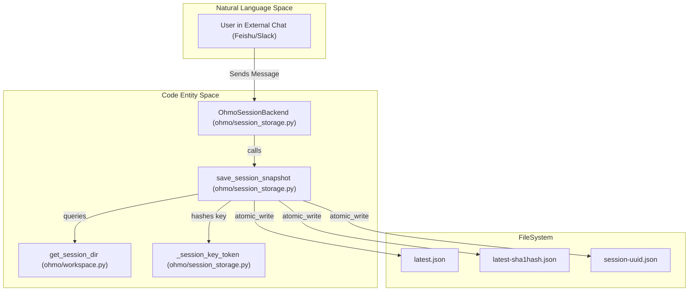
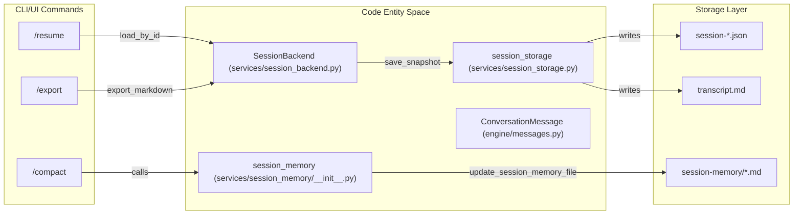

<!-- source: DeepWiki mcp.deepwiki.com · repo HKUDS/OpenHarness · page 11.1 Session Storage · fetched 2026-11-09 -->

# Session Storage

Relevant source files

The following files were used as context for generating this wiki page:

- [ohmo/session_storage.py](ohmo/session_storage.py)
- [src/openharness/services/session_backend.py](src/openharness/services/session_backend.py)
- [src/openharness/services/session_memory/__init__.py](src/openharness/services/session_memory/__init__.py)
- [src/openharness/services/session_storage.py](src/openharness/services/session_storage.py)
- [tests/test_ohmo/test_ohmo_session_storage.py](tests/test_ohmo/test_ohmo_session_storage.py)
- [tests/test_services/test_session_storage.py](tests/test_services/test_session_storage.py)

OpenHarness provides a robust session management system designed to persist conversation history, tool execution results, and agent states across restarts. Sessions are scoped to specific projects using SHA1-keyed directories, ensuring that context remains isolated between different codebases. This system supports snapshots, manual exports to Markdown, and seamless resumption via CLI flags.

## Session Lifecycle and Persistence

The session storage logic is responsible for serializing the current state of the `QueryEngine` and its associated `ConversationMessage` history. Persistence is abstracted through a backend interface to allow for different storage implementations, such as the standard OpenHarness project-based storage or the workspace-based `ohmo` storage.

### Session Backend Interface
The `SessionBackend` protocol defines the contract for persisting and restoring session state [src/openharness/services/session_backend.py:14-48](). 

| Method | Description |
| :--- | :--- |
| `save_snapshot()` | Serializes conversation history, `UsageSnapshot`, and system prompts to a JSON file [src/openharness/services/session_backend.py:20-30](). |
| `load_latest()` | Restores the most recent session from the project's session directory [src/openharness/services/session_backend.py:32-33](). |
| `list_snapshots()` | Scans the project-scoped session directory and returns a list of available recovery points [src/openharness/services/session_backend.py:35-36](). |
| `load_by_id()` | Retrieves a specific session using its unique identifier [src/openharness/services/session_backend.py:38-39](). |
| `export_markdown()` | Converts structured `ConversationMessage` objects into a human-readable Markdown transcript [src/openharness/services/session_backend.py:41-47](). |

### Project-Scoped Directories
Sessions are organized by project to prevent context leakage. The storage path is derived from the SHA1 hash of the project's root directory path via `get_project_session_dir()`, creating a unique namespace for each codebase under the sessions directory [src/openharness/services/session_storage.py:54-60]().

### CLI Integration: Resume and Continue
The OpenHarness CLI provides two primary mechanisms for session recovery:
*   `--resume`: Triggers `list_session_snapshots()` to allow the user to select a specific recovery point [src/openharness/services/session_storage.py:131-191]().
*   `--continue`: Automatically invokes `load_session_snapshot()` to pick up the most recent interaction for the current directory [src/openharness/services/session_storage.py:123-128]().

Sources: [src/openharness/services/session_backend.py:14-48](), [src/openharness/services/session_storage.py:54-191](), [src/openharness/services/session_backend.py:51-92]()

## Core Persistence Functions

The system uses atomic writes to ensure data integrity during snapshotting.

### Snapshot Generation
The `save_session_snapshot()` function performs several critical steps:
1.  **Sanitization**: Invokes `sanitize_conversation_messages()` to remove empty or malformed assistant turns [src/openharness/services/session_storage.py:77-77]().
2.  **Summary Extraction**: Automatically generates a summary from the first user message [src/openharness/services/session_storage.py:79-84]().
3.  **Metadata Filtering**: Filters tool metadata using `_persistable_tool_metadata()` to only include keys like `permission_mode`, `task_focus_state`, and `compact_checkpoints` [src/openharness/services/session_storage.py:18-29](), [src/openharness/services/session_storage.py:44-51]().
4.  **Atomic Write**: Writes the payload to `latest.json` and a unique `session-{id}.json` file [src/openharness/services/session_storage.py:99-105]().

### Session Retrieval
Snapshots are loaded via `load_session_snapshot()` (for the latest) or `load_session_by_id()` [src/openharness/services/session_storage.py:123-128](). During loading, `_sanitize_snapshot_payload()` is called to ensure forward compatibility by re-validating the message models [src/openharness/services/session_storage.py:110-120]().

### Markdown Export
The `export_session_markdown()` function iterates through `ConversationMessage` objects, converting roles and text content into a structured document for human review [ohmo/session_storage.py:134-148]().

Sources: [src/openharness/services/session_storage.py:63-107](), [src/openharness/services/session_storage.py:110-128](), [ohmo/session_storage.py:134-148]()

## ohmo Session Management

The `ohmo` application implements its own `OhmoSessionBackend` which roots sessions in a workspace directory (e.g., `~/.ohmo/sessions`) rather than project-local directories [ohmo/session_storage.py:151-158]().

### Session Keys
`ohmo` introduces the concept of a `session_key` (e.g., a Feishu chat ID), which allows retrieving the latest session associated with a specific external thread [ohmo/session_storage.py:95-99](). These keys are hashed using SHA1 to generate a `latest-{token}.json` pointer [ohmo/session_storage.py:31-38]().

Title: ohmo Session Storage Flow

Sources: [ohmo/session_storage.py:41-85](), [ohmo/session_storage.py:151-203](), [tests/test_ohmo/test_ohmo_session_storage.py:31-55]()

## Session Memory and Continuity

To maintain context across very long conversations or compaction boundaries, OpenHarness uses "Session Memory."

### File-Backed Continuity
The `update_session_memory_file()` function creates a Markdown checkpoint [src/openharness/services/session_memory/__init__.py:62-74](). This checkpoint includes:
*   **Current State**: Goals and next steps from `task_focus_state` [src/openharness/services/session_memory/__init__.py:84-98]().
*   **Verified Work**: A list of recently completed and verified items [src/openharness/services/session_memory/__init__.py:99-100]().
*   **Recent Conversation**: Summarized snippets of the last few messages [src/openharness/services/session_memory/__init__.py:103-103]().

Title: Session Persistence and Retrieval

Sources: [src/openharness/services/session_memory/__init__.py:77-108](), [src/openharness/services/session_storage.py:131-191](), [src/openharness/services/session_backend.py:51-92]()

## Data Models and Types

| Class / Function | File | Purpose |
| :--- | :--- | :--- |
| `UsageSnapshot` | `api/usage.py` | Tracks `input_tokens` and `output_tokens` within a session snapshot [src/openharness/services/session_storage.py:91-91](). |
| `ConversationMessage` | `engine/messages.py` | The core message model serialized into the `messages` list in JSON [src/openharness/services/session_storage.py:90-90](). |
| `_persistable_tool_metadata` | `services/session_storage.py` | Filters the internal `tool_metadata` dict to only include keys safe for persistence [src/openharness/services/session_storage.py:44-51](). |
| `get_session_memory_path` | `services/session_memory/__init__.py` | Generates a deterministic path for the session's memory checkpoint [src/openharness/services/session_memory/__init__.py:27-31](). |

Sources: [src/openharness/services/session_storage.py:18-51](), [src/openharness/services/session_memory/__init__.py:1-45](), [ohmo/session_storage.py:64-77]()

---

