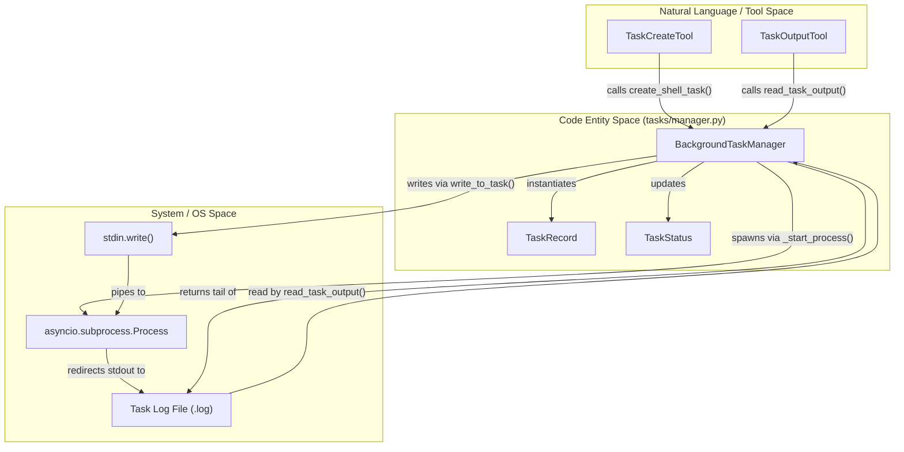
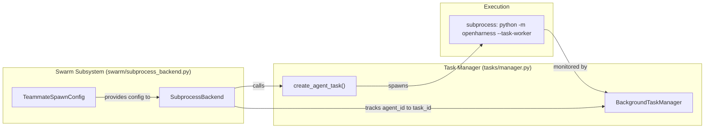

<!-- source: DeepWiki mcp.deepwiki.com · repo HKUDS/OpenHarness · page 11.2 Background Tasks · fetched 2026-11-09 -->

# Background Tasks

Relevant source files

The following files were used as context for generating this wiki page:

- [src/openharness/swarm/subprocess_backend.py](src/openharness/swarm/subprocess_backend.py)
- [src/openharness/tasks/manager.py](src/openharness/tasks/manager.py)
- [src/openharness/tasks/types.py](src/openharness/tasks/types.py)
- [tests/test_tasks/test_manager.py](tests/test_tasks/test_manager.py)
- [tests/test_tools/test_task_tools.py](tests/test_tools/test_task_tools.py)

The `BackgroundTaskManager` in `src/openharness/tasks/manager.py` serves as the central orchestration layer for long-running operations that must persist outside the primary synchronous tool execution loop. It manages the lifecycle of shell-based processes and sub-agent sessions, providing mechanisms for asynchronous output streaming, input injection, and automatic process recovery.

## Overview of Task Management

The system distinguishes between several primary types of background tasks, primarily categorized as shell-based or agent-based. The `BackgroundTaskManager` tracks these via a `TaskRecord`, which encapsulates the process state, communication pipes, and execution history [src/openharness/tasks/manager.py:52-60]().

### Task Data Structures

Tasks are defined and tracked using the following core types in `src/openharness/tasks/types.py`:

| Entity | Description |
| :--- | :--- |
| `TaskStatus` | Literal representing the lifecycle state: `pending`, `running`, `completed`, `failed`, or `killed` [src/openharness/tasks/types.py:11-11](). |
| `TaskType` | Literal defining the execution environment: `local_bash`, `local_agent`, `remote_agent`, `in_process_teammate`, or `dream` [src/openharness/tasks/types.py:10-10](). |
| `TaskRecord` | A dataclass containing the `id`, `type`, `status`, `command`, `cwd`, `output_file`, and optional `argv` or `env` overrides [src/openharness/tasks/types.py:15-33](). |

Sources: [src/openharness/tasks/manager.py:52-60](), [src/openharness/tasks/types.py:10-33]().

## Task Lifecycle and Logic

The `BackgroundTaskManager` manages tasks through specialized methods that handle process spawning, monitoring, and termination.

### Task Creation
- **`create_shell_task()`**: Starts a background command. It accepts either a shell-evaluated `command` string or a direct `argv` list [src/openharness/tasks/manager.py:61-87](). The `argv` form is preferred for cross-platform reliability (e.g., spawning Python on Windows via Git Bash) as it bypasses shell-quoting issues [src/openharness/tasks/manager.py:74-82](). It initializes a log file in the tasks directory via `get_tasks_dir()` [src/openharness/tasks/manager.py:93-100]().
- **`create_agent_task()`**: Spawns a local agent as a subprocess. If no command is provided, it defaults to running `python -m openharness` with the current API key and model [src/openharness/tasks/manager.py:114-144](). It automatically writes the initial `prompt` to the task's stdin upon creation [src/openharness/tasks/manager.py:157-157]().

### Communication and Output
- **`read_task_output()`**: Returns the tail of a task's output file (defaulting to the last 12,000 bytes) [src/openharness/tasks/manager.py:228-245](). This allows the UI or LLM to poll for updates without blocking.
- **`write_to_task()`**: Writes data to the task's `stdin`. It uses an `_input_locks` mechanism to ensure thread-safe writes [src/openharness/tasks/manager.py:199-211]().
- **`_encode_task_worker_payload()`**: A utility that serializes worker input as a single JSON line. It wraps plain-text prompts in a `{"text": ...}` object to ensure they can be read by `readline()`-based protocols even if they contain internal newlines [src/openharness/tasks/manager.py:23-44]().

### Restart Logic
The manager implements a recovery strategy for agent tasks. If a `write_to_task()` call fails because the process has exited (e.g., `BrokenPipeError`), and the task is an agent type, the manager invokes `_restart_agent_task()` [src/openharness/tasks/manager.py:215-226](). This spawns a new process, increments a `restart_count` in metadata, and injects a notice (`_TASK_RESTART_NOTICE`) into the task's output log to inform the user that interactive context was lost [src/openharness/tasks/manager.py:20-20](), [src/openharness/tasks/manager.py:293-315]().

## Architectural Flow

The following diagram illustrates how the `BackgroundTaskManager` bridges the gap between the `QueryEngine` tool calls and the underlying operating system processes.

### Background Task Execution Flow
"This diagram maps the interaction between the Engine tool calls and the BackgroundTaskManager entities."

Sources: [src/openharness/tasks/manager.py:61-112](), [src/openharness/tasks/manager.py:199-245](), [tests/test_tools/test_task_tools.py:32-57]().

## Multi-Agent Coordination Mapping

When `create_agent_task()` is invoked via the `AgentTool`, the system utilizes the `SubprocessBackend` to manage the lifecycle of the teammate.

### Agent Task Communication
"This diagram shows how agent-specific tasks bridge the Swarm subsystem to the Task Manager."

Sources: [src/openharness/swarm/subprocess_backend.py:47-115](), [src/openharness/tasks/manager.py:114-158]().

## Key Functions Reference

| Function | File Location | Description |
| :--- | :--- | :--- |
| `create_shell_task` | [src/openharness/tasks/manager.py:61]() | Spawns a background task; supports `command` (shell) or `argv` (direct). |
| `create_agent_task` | [src/openharness/tasks/manager.py:114]() | Spawns a sub-agent with a specific prompt and model; handles default CLI flags. |
| `stop_task` | [src/openharness/tasks/manager.py:183]() | Sends `terminate()` then `kill()` to a process if it doesn't exit. |
| `read_task_output` | [src/openharness/tasks/manager.py:228]() | Reads the tail of the task's `.log` file safely using `_output_locks`. |
| `write_to_task` | [src/openharness/tasks/manager.py:199]() | Writes to `stdin` with automatic `_restart_agent_task` for agent types. |
| `update_task` | [src/openharness/tasks/manager.py:171]() | Updates mutable task metadata like `description`, `progress`, or `status_note`. |

Sources: [src/openharness/tasks/manager.py:61-245]().

---

