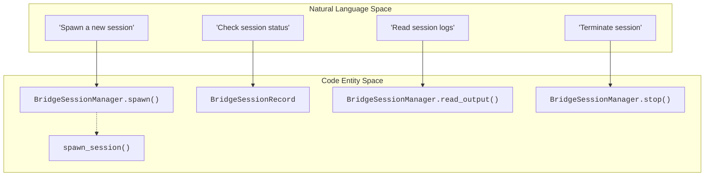
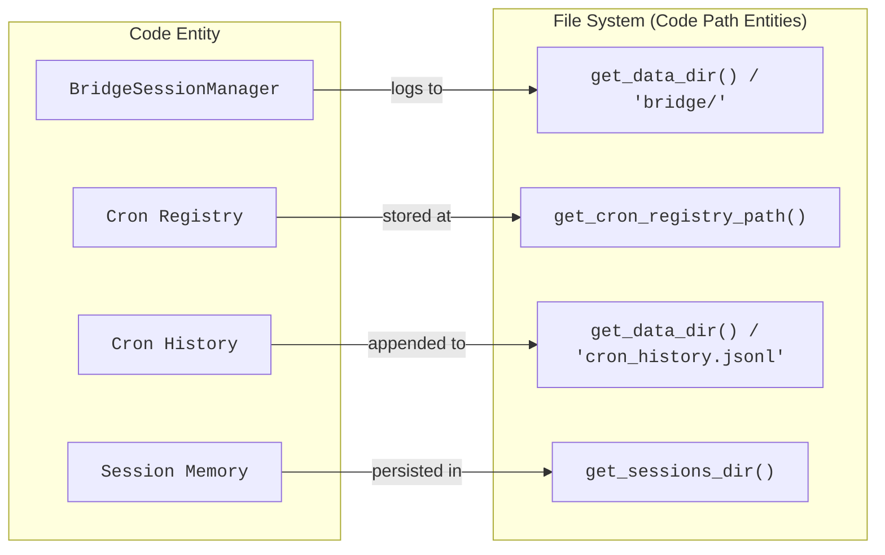

<!-- source: DeepWiki mcp.deepwiki.com · repo HKUDS/OpenHarness · page 11.3 Bridge Sessions and Supporting Services · fetched 2026-11-09 -->

# Bridge Sessions and Supporting Services

Relevant source files

The following files were used as context for generating this wiki page:

- [ohmo/gateway/notify.py](ohmo/gateway/notify.py)
- [ohmo/runtime.py](ohmo/runtime.py)
- [src/openharness/bridge/session_runner.py](src/openharness/bridge/session_runner.py)
- [src/openharness/engine/query.py](src/openharness/engine/query.py)
- [src/openharness/engine/query_engine.py](src/openharness/engine/query_engine.py)
- [src/openharness/services/compact/__init__.py](src/openharness/services/compact/__init__.py)
- [src/openharness/services/cron.py](src/openharness/services/cron.py)
- [src/openharness/services/cron_scheduler.py](src/openharness/services/cron_scheduler.py)
- [src/openharness/services/tool_outputs.py](src/openharness/services/tool_outputs.py)
- [src/openharness/tools/cron_create_tool.py](src/openharness/tools/cron_create_tool.py)
- [src/openharness/tools/cron_list_tool.py](src/openharness/tools/cron_list_tool.py)
- [src/openharness/tools/remote_trigger_tool.py](src/openharness/tools/remote_trigger_tool.py)
- [tests/test_bridge/test_core.py](tests/test_bridge/test_core.py)
- [tests/test_engine/test_query_engine.py](tests/test_engine/test_query_engine.py)
- [tests/test_services/test_compact.py](tests/test_services/test_compact.py)
- [tests/test_services/test_cron.py](tests/test_services/test_cron.py)
- [tests/test_services/test_cron_scheduler.py](tests/test_services/test_cron_scheduler.py)

The Bridge system and its associated services provide the infrastructure for spawning managed child sessions, handling secure token exchange, and maintaining persistent background operations like cron jobs and conversation compaction.

## Bridge Session Management

The `BridgeSessionManager` in `src/openharness/bridge/manager.py` is the central coordinator for lifecycle management of child processes spawned via the bridge. It tracks active sessions, captures their output to disk, and provides a UI-safe interface for monitoring session status through `BridgeSessionRecord` [src/openharness/bridge/manager.py:14-24]().

### Bridge Architecture and Code Entities

The following diagram illustrates how the Bridge system maps natural language concepts to specific code entities within the `openharness.bridge` package.

**Bridge Session Lifecycle Mapping**

**Sources:** [src/openharness/bridge/manager.py:26-105](), [src/openharness/bridge/session_runner.py:10-46]()

### Session Execution Flow

When a session is spawned, the `BridgeSessionManager` utilizes `spawn_session` to create an asynchronous subprocess [src/openharness/bridge/manager.py:35-36]().

1.  **Process Creation**: `spawn_session` executes the command, returning a `SessionHandle` that wraps the `asyncio.subprocess.Process` [src/openharness/bridge/session_runner.py:12-28]().
2.  **Output Capture**: The manager initializes a `.log` file in the bridge data directory (retrieved via `get_data_dir() / "bridge"`) and starts a background `asyncio.Task` called `_copy_output` [src/openharness/bridge/manager.py:39-44]().
3.  **Persistence**: Logs are written to `~/.openharness/data/bridge/{session_id}.log` using an asynchronous read loop from the process `stdout` [src/openharness/bridge/manager.py:85-94]().
4.  **Monitoring**: The `list_sessions()` method returns `BridgeSessionRecord` objects containing the PID, status (running/completed/failed), and start time [src/openharness/bridge/manager.py:47-68]().

**Sources:** [src/openharness/bridge/manager.py:35-95](), [src/openharness/bridge/session_runner.py:12-28]()

---

## Secure Token Handling (WorkSecret)

The bridge utilizes a `WorkSecret` mechanism to securely encode and decode session ingress tokens and API base URLs. This allows the system to establish authenticated WebSocket connections for session management.

### Data Flow for Session Ingress

The `work_secret.py` module provides utility functions for base64url encoding of session metadata.

| Function | Purpose | Implementation Detail |
| :--- | :--- | :--- |
| `encode_work_secret` | Encodes `WorkSecret` to string | Uses `json.dumps` and `base64.urlsafe_b64encode` [tests/test_bridge/test_core.py:12-16]() |
| `decode_work_secret` | Decodes string to `WorkSecret` | Reverses the encoding process to restore the dataclass [tests/test_bridge/test_core.py:12-16]() |
| `build_sdk_url` | Generates WebSocket URL | Determines `ws://` or `wss://` based on the API base URL [tests/test_bridge/test_core.py:19-22]() |

**Sources:** [tests/test_bridge/test_core.py:9-22]()

---

## Supporting Services

OpenHarness includes several background services that handle specialized tasks such as cron job persistence and conversation management.

### Cron Service
The cron system consists of a registry in `src/openharness/services/cron.py` and a background daemon in `src/openharness/services/cron_scheduler.py`.

*   **Registry**: Jobs are stored as JSON in `get_cron_registry_path()` [src/openharness/services/cron.py:25-32](). The registry uses `exclusive_file_lock` during updates [src/openharness/services/cron.py:86-90]().
*   **Scheduler Daemon**: The `run_scheduler_loop` checks for due jobs every `TICK_INTERVAL_SECONDS` (30s) [src/openharness/services/cron_scheduler.py:46-47](), [src/openharness/services/cron_scheduler.py:149-222](). It manages its lifecycle via a PID file [src/openharness/services/cron_scheduler.py:91-119]().
*   **Execution**: Jobs are executed via `execute_job`, which captures `stdout`/`stderr` and handles timeouts [src/openharness/services/cron_scheduler.py:245-285](). Results are appended to `cron_history.jsonl` [src/openharness/services/cron_scheduler.py:54-64]().
*   **Tools**: LLMs interact with this via `CronCreateTool` [src/openharness/tools/cron_create_tool.py:44-52]() and `CronListTool` [src/openharness/tools/cron_list_tool.py:16-21]().

**Sources:** [src/openharness/services/cron.py:1-138](), [src/openharness/services/cron_scheduler.py:1-285](), [src/openharness/tools/cron_create_tool.py:1-106]()

### Conversation Compaction and Token Estimation
The `src/openharness/services/compact/` module manages context window overflow through multi-stage reduction strategies.

*   **Microcompact**: Clears old tool result content for specific tools like `read_file`, `bash`, and `grep` to reduce token count without LLM calls [src/openharness/services/compact/__init__.py:41-52]().
*   **Context Collapse**: Trims oversized messages or tool results by keeping only the head and tail of long text blocks [src/openharness/services/compact/__init__.py:64-66]().
*   **Auto-Compaction**: Triggered automatically when the estimated token count exceeds `AUTOCOMPACT_BUFFER_TOKENS` [src/openharness/services/compact/__init__.py:55](). It uses `estimate_message_tokens` which applies a `TOKEN_ESTIMATION_PADDING` of 1.33x for safety [src/openharness/services/compact/__init__.py:116-132]().
*   **Reactive Compaction**: If the API returns a "prompt too long" error, the `QueryEngine` triggers a reactive compaction and retries the request [src/openharness/engine/query.py:47-48](), [src/openharness/engine/query_engine.py:52-53]().

**Sources:** [src/openharness/services/compact/__init__.py:1-132](), [src/openharness/engine/query.py:66-87](), [src/openharness/services/token_estimation.py:1-20]()

### Service Data Locations
All bridge and service-related data is stored within the standard OpenHarness data directory.

**Service Entity to Path Mapping**

**Sources:** [src/openharness/config/paths.py:11-23](), [src/openharness/bridge/manager.py:39-43](), [src/openharness/services/cron_scheduler.py:54-56](), [ohmo/runtime.py:20-21]()

---

