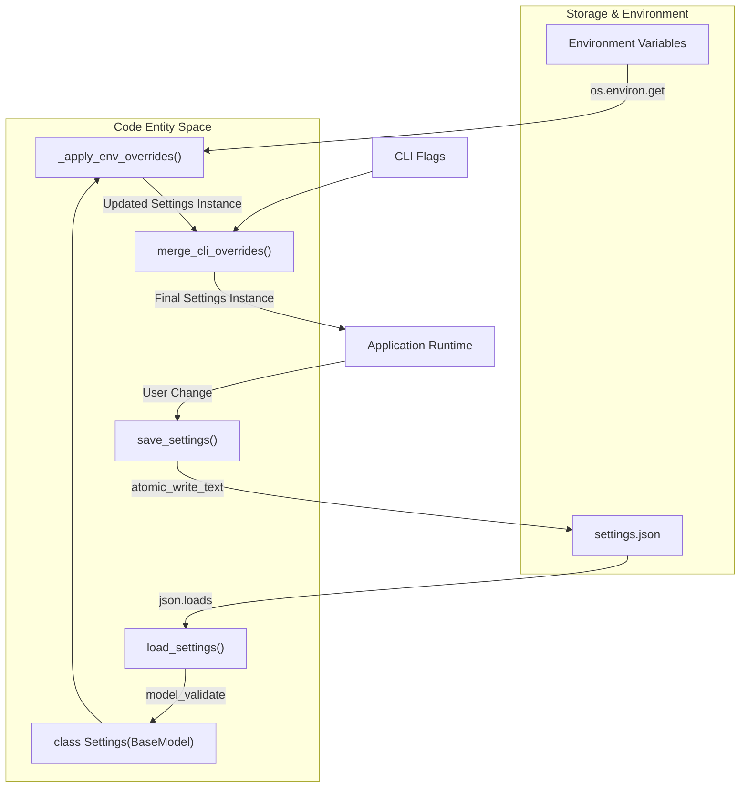
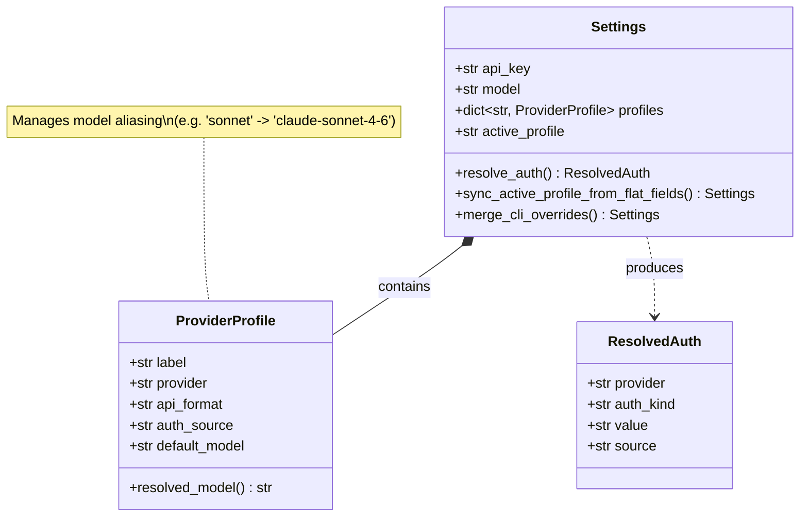

<!-- source: DeepWiki mcp.deepwiki.com · repo HKUDS/OpenHarness · page 12.1 Settings Model · fetched 2026-11-09 -->

# Settings Model

Relevant source files

The following files were used as context for generating this wiki page:

- [src/openharness/auth/manager.py](src/openharness/auth/manager.py)
- [src/openharness/channels/impl/manager.py](src/openharness/channels/impl/manager.py)
- [src/openharness/channels/impl/telegram.py](src/openharness/channels/impl/telegram.py)
- [src/openharness/config/schema.py](src/openharness/config/schema.py)
- [src/openharness/config/settings.py](src/openharness/config/settings.py)
- [tests/test_channels/test_telegram_security.py](tests/test_channels/test_telegram_security.py)
- [tests/test_config/test_schema.py](tests/test_config/test_schema.py)
- [tests/test_config/test_settings.py](tests/test_config/test_settings.py)

The `Settings` model is the central configuration authority for OpenHarness. It defines the schema for application behavior, API connectivity, security permissions, and UI preferences. Implemented using Pydantic, it provides validation, serialization, and a hierarchical resolution strategy that merges defaults, file-based configurations, environment variables, and CLI overrides.

### Configuration Hierarchy and Data Flow

Settings are resolved using a strict precedence logic to ensure flexibility across different environments (local development, CI/CD, or production).

**Precedence (Highest to Lowest):**
1.  **CLI Arguments:** Applied via `merge_cli_overrides()` [src/openharness/config/settings.py:530-558]().
2.  **Environment Variables:** Handled by `_apply_env_overrides()` [src/openharness/config/settings.py:644-710]().
3.  **Config File:** Loaded from `~/.openharness/settings.json` via `load_settings()` [src/openharness/config/settings.py:713-736]().
4.  **Defaults:** Defined in the Pydantic model field declarations [src/openharness/config/settings.py:330-410]().

**Settings Resolution and Persistence Flow**

Sources: [src/openharness/config/settings.py:1-8](), [src/openharness/config/settings.py:713-755](), [tests/test_config/test_settings.py:24-99]()

---

### The Settings Model

The `Settings` class aggregates several sub-models to organize configuration into logical domains.

#### API and Provider Configuration
OpenHarness uses a profile-based system to manage different LLM backends.

*   **`ProviderProfile`** [src/openharness/config/settings.py:124-138](): Defines a named workflow (e.g., `claude-api`, `openai-compatible`).
    *   `provider`: The underlying engine (e.g., `anthropic`, `openai`, `copilot`).
    *   `api_format`: The protocol used (`anthropic`, `openai`, or `copilot`).
    *   `auth_source`: Identifies which credential slot to use (e.g., `anthropic_api_key`).
    *   `resolved_model`: A property that normalizes the model name using `resolve_model_setting` [src/openharness/config/settings.py:140-146]().

#### Sub-Models: Permissions, Memory, and Sandbox
Settings delegates complex configurations to specialized sub-models:

1.  **`PermissionSettings`** [src/openharness/config/settings.py:50-58]():
    *   `mode`: A `PermissionMode` enum [src/openharness/permissions/modes.py]().
    *   `allowed_tools` / `denied_tools`: Lists of tool names to explicitly permit or restrict.
    *   `path_rules`: A list of `PathRuleConfig` objects [src/openharness/config/settings.py:43-48]() containing glob patterns.
    *   `denied_commands`: Specific shell commands to block.

2.  **`MemorySettings`** [src/openharness/config/settings.py:60-75]():
    *   `enabled`: Toggle for the persistent memory system.
    *   `max_files`: Limits the number of memory files scanned (default: 5).
    *   `auto_compact_threshold_tokens`: Threshold for conversation compaction.
    *   `auto_dream_enabled`: Toggle for background memory synthesis ("dreaming").

3.  **`SandboxSettings`** [src/openharness/config/settings.py:104-114]():
    *   `enabled`: Whether to enforce OS-level isolation.
    *   `backend`: The sandbox implementation (e.g., `srt` or `docker`).
    *   `network`: `SandboxNetworkSettings` [src/openharness/config/settings.py:77-81]() (allowed/denied domains).
    *   `filesystem`: `SandboxFilesystemSettings` [src/openharness/config/settings.py:84-91]() (read/write path restrictions).
    *   `docker`: `DockerSandboxSettings` [src/openharness/config/settings.py:93-102]() for containerized execution.

#### UI and Execution Fields
*   **`theme` / `output_style`**: Visual preferences for the React TUI [src/openharness/config/settings.py:381-383]().
*   **`vim_mode` / `voice_mode`**: Boolean flags for specialized input methods [src/openharness/config/settings.py:384-385]().
*   **`effort` / `passes`**: Controls for reasoning effort and iterative execution passes [src/openharness/config/settings.py:391-392]().

Sources: [src/openharness/config/settings.py:50-146](), [src/openharness/config/settings.py:330-410]()

---

### Key Functions and Model Normalization

#### `load_settings(config_path: Path | None = None) -> Settings`
Initializes the configuration state. It reads the JSON file, validates it against the `Settings` model, and applies environment overrides. It also performs migration of legacy flat fields into the profile-based system [src/openharness/config/settings.py:713-736]().

#### `save_settings(settings: Settings, config_path: Path | None = None)`
Serializes the current `Settings` instance to `settings.json`. It ensures parent directories exist and uses `exclusive_file_lock` and `atomic_write_text` to prevent corruption [src/openharness/config/settings.py:739-755]().

#### Model Name Normalization and Aliasing
OpenHarness supports human-friendly aliases (e.g., `sonnet`, `opus`) which are mapped to specific version strings via `_CLAUDE_ALIAS_TARGETS` [src/openharness/config/settings.py:171-177](). The `normalize_anthropic_model_name` function ensures consistency by stripping `anthropic/` prefixes and converting dots to hyphens [src/openharness/config/settings.py:180-193]().

**Environment Mapping Table:**
| Environment Variable | Settings Field Override |
| :--- | :--- |
| `ANTHROPIC_API_KEY` | `api_key` (via `resolve_api_key`) |
| `OPENHARNESS_MODEL` | `model` |
| `OPENHARNESS_BASE_URL` | `base_url` |
| `OPENHARNESS_PERMISSION_MODE` | `permission.mode` |
| `OPENHARNESS_WEB_PROXY` | `web.proxy` |

Sources: [src/openharness/config/settings.py:180-193](), [src/openharness/config/settings.py:644-710](), [tests/test_config/test_settings.py:42-58]()

---

### Implementation Details: Auth and Profiles

The `Settings` model manages complex authentication through `resolve_auth()`. This method returns a `ResolvedAuth` dataclass [src/openharness/config/settings.py:150-158]() containing the normalized provider, auth kind, and credential value. It handles the precedence between environment variables (like `OPENHARNESS_OPENAI_API_KEY`) and internal credential storage [src/openharness/config/settings.py:560-642]().

**Relationship between Settings and Provider Profiles**

Sources: [src/openharness/config/settings.py:124-158](), [src/openharness/config/settings.py:330-410](), [tests/test_config/test_settings.py:100-134]()

---

