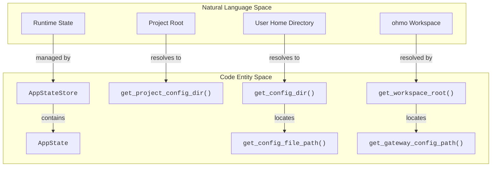

<!-- source: DeepWiki mcp.deepwiki.com · repo HKUDS/OpenHarness · page 12.2 File Paths and Application State · fetched 2026-11-09 -->

# File Paths and Application State

<details>
<summary>Relevant source files</summary>

The following files were used as context for generating this wiki page:

- [src/openharness/config/paths.py](src/openharness/config/paths.py)
- [tests/test_utils/test_fs.py](tests/test_utils/test_fs.py)

</details>


This page documents the structural layout of the OpenHarness filesystem and the mechanisms used to track application-wide state. OpenHarness follows XDG-like conventions to manage configuration, session data, and project-specific context, while utilizing a centralized state store for runtime coordination.

## Directory Layout and Path Resolution

OpenHarness uses a hierarchical directory structure rooted by default at `~/.openharness/`. Path resolution is handled by `config/paths.py`, which provides utility functions to locate and create necessary directories for logs, sessions, tasks, and configuration.

### Global Configuration and Data
The global state is split between configuration (settings) and data (persistent artifacts).

| Function | Default Path | Environment Variable Override | Purpose |
| :--- | :--- | :--- | :--- |
| `get_config_dir` | `~/.openharness/` | `OPENHARNESS_CONFIG_DIR` | Primary root for settings and base directories. [src/openharness/config/paths.py:15-29]() |
| `get_config_file_path` | `~/.openharness/settings.json` | N/A | Main JSON settings file. [src/openharness/config/paths.py:32-34]() |
| `get_data_dir` | `~/.openharness/data/` | `OPENHARNESS_DATA_DIR` | Storage for caches, history, and internal registries. [src/openharness/config/paths.py:37-51]() |
| `get_logs_dir` | `~/.openharness/logs/` | `OPENHARNESS_LOGS_DIR` | Application and execution logs. [src/openharness/config/paths.py:54-68]() |
| `get_sessions_dir` | `~/.openharness/data/sessions/` | N/A | Persistent session snapshots. [src/openharness/config/paths.py:71-75]() |
| `get_tasks_dir` | `~/.openharness/data/tasks/` | N/A | Outputs from background shell/agent tasks. [src/openharness/config/paths.py:78-82]() |
| `get_cron_registry_path`| `~/.openharness/data/cron_jobs.json`| N/A | Persistence for scheduled cron jobs. [src/openharness/config/paths.py:97-99]() |

### Project-Specific Context
In addition to global settings, OpenHarness looks for a `.openharness/` directory within the current working directory (`cwd`) to store project-specific instructions and context.

*   **Project Config Dir**: Resolved via `get_project_config_dir(cwd)`, creating a `.openharness` folder in the project root. [src/openharness/config/paths.py:102-106]()
*   **Issue Context**: `issue.md` inside the project config dir, used to inject specific issue descriptions into the LLM context. [src/openharness/config/paths.py:109-111]()
*   **PR Comments**: `pr_comments.md` inside the project config dir, used for providing PR feedback context. [src/openharness/config/paths.py:114-116]()
*   **Autopilot State**: Managed via `get_project_autopilot_dir(cwd)`, this directory houses the `registry.json`, `repo_journal.jsonl`, and various policy YAML files (autopilot, verification, release). [src/openharness/config/paths.py:119-160]()

**Sources:**
* [src/openharness/config/paths.py:1-161]()

## Application State Management

The application state is managed through the `AppState` dataclass and the `AppStateStore`. These entities ensure that runtime information—such as the active session, current tool execution status, and UI state—is consistent across the engine and the UI layer.

### Logical Path and State Resolution
The following diagram maps the relationship between the path resolution logic and the entities that consume them.

**Path and State Entity Mapping**

**Sources:**
* [src/openharness/config/paths.py:15-34]()
* [src/openharness/config/paths.py:102-106]()

## Directory Structure Visualization

The `.openharness/` directory acts as the central nervous system for persistent data. The following diagram illustrates the physical layout generated by the functions in `config/paths.py`.

**Filesystem Layout Diagram**
```mermaid
graph TD
    ROOT[".openharness/"]
    
    subgraph "Global Config (~/.openharness)"
        ROOT --> SETTINGS["settings.json"]
        ROOT --> DATA["data/"]
        ROOT --> LOGS["logs/"]
        
        DATA --> SESSIONS["sessions/"]
        DATA --> TASKS["tasks/"]
        DATA --> CRON["cron_jobs.json"]
        DATA --> FEEDBACK["feedback/"]
        FEEDBACK --> F_LOG["feedback.log"]
    end
    
    subgraph "Project Local (./.openharness)"
        PROJ[".openharness/"]
        PROJ --> ISSUE["issue.md"]
        PROJ --> PR["pr_comments.md"]
        PROJ --> AUTO["autopilot/"]
        AUTO --> REG["registry.json"]
        AUTO --> JOUR["repo_journal.jsonl"]
        AUTO --> RUNS["runs/"]
    end

    %% Function Associations
    "get_config_file_path()" -.-> SETTINGS
    "get_sessions_dir()" -.-> SESSIONS
    "get_tasks_dir()" -.-> TASKS
    "get_cron_registry_path()" -.-> CRON
    "get_project_issue_file()" -.-> ISSUE
    "get_project_autopilot_runs_dir()" -.-> RUNS
```

**Sources:**
* [src/openharness/config/paths.py:11-12]()
* [src/openharness/config/paths.py:71-99]()
* [src/openharness/config/paths.py:109-160]()

## Implementation Details

### Path Resolution Logic
The `config/paths.py` module uses `pathlib.Path` for cross-platform compatibility. Most functions follow a strict resolution order:
1.  Check for a specific environment variable (e.g., `OPENHARNESS_CONFIG_DIR`). [src/openharness/config/paths.py:19-22]()
2.  Fall back to the default `~/.openharness/` subdirectory. [src/openharness/config/paths.py:26]()
3.  Ensure the directory exists using `mkdir(parents=True, exist_ok=True)` before returning the path. [src/openharness/config/paths.py:28]()

### Atomic Persistence
To prevent data corruption during state or configuration updates, OpenHarness utilizes atomic write helpers. These ensure that files are fully written to a temporary location before being moved to their final destination.

*   **`atomic_write_text`**: Writes string content to a path. It handles parent directory creation and preserves or applies specific POSIX file modes (e.g., `0o600` for credentials). [tests/test_utils/test_fs.py:22-26](), [tests/test_utils/test_fs.py:61-64]()
*   **Atomicity**: If a write fails (e.g., disk full), the existing file remains untouched, and no partial tempfiles are leaked. [tests/test_utils/test_fs.py:109-128]()
*   **Concurrency**: When combined with `exclusive_file_lock`, these helpers allow multiple processes to safely perform read-modify-write operations on shared JSON registries. [tests/test_utils/test_fs.py:134-151]()

**Sources:**
* [src/openharness/config/paths.py:15-29]()
* [tests/test_utils/test_fs.py:1-176]()

---

