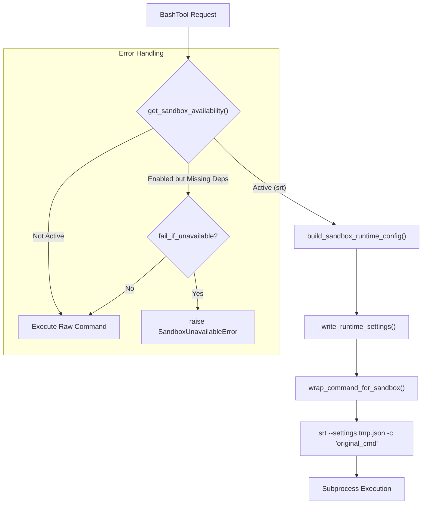
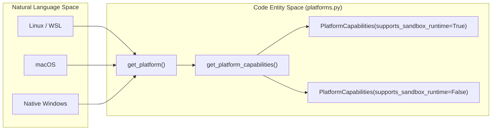

<!-- source: DeepWiki mcp.deepwiki.com · repo HKUDS/OpenHarness · page 12.3 Sandbox Runtime · fetched 2026-11-09 -->

# Sandbox Runtime

Relevant source files

The following files were used as context for generating this wiki page:

- [.claude/skills/harness-eval/SKILL.md](.claude/skills/harness-eval/SKILL.md)
- [.claude/skills/harness-eval/references/feature-matrix.md](.claude/skills/harness-eval/references/feature-matrix.md)
- [.claude/skills/harness-eval/references/test-patterns.md](.claude/skills/harness-eval/references/test-patterns.md)
- [.claude/skills/pr-merge/SKILL.md](.claude/skills/pr-merge/SKILL.md)
- [.claude/skills/pr-merge/references/merge-scenarios.md](.claude/skills/pr-merge/references/merge-scenarios.md)
- [scripts/test_docker_sandbox_e2e.py](scripts/test_docker_sandbox_e2e.py)
- [src/openharness/platforms.py](src/openharness/platforms.py)
- [src/openharness/sandbox/Dockerfile](src/openharness/sandbox/Dockerfile)
- [src/openharness/sandbox/__init__.py](src/openharness/sandbox/__init__.py)
- [src/openharness/sandbox/adapter.py](src/openharness/sandbox/adapter.py)
- [src/openharness/sandbox/docker_backend.py](src/openharness/sandbox/docker_backend.py)
- [src/openharness/sandbox/docker_image.py](src/openharness/sandbox/docker_image.py)
- [src/openharness/sandbox/path_validator.py](src/openharness/sandbox/path_validator.py)
- [src/openharness/sandbox/session.py](src/openharness/sandbox/session.py)
- [src/openharness/swarm/lockfile.py](src/openharness/swarm/lockfile.py)
- [src/openharness/utils/file_lock.py](src/openharness/utils/file_lock.py)
- [tests/test_platforms.py](tests/test_platforms.py)
- [tests/test_sandbox/test_adapter.py](tests/test_sandbox/test_adapter.py)
- [tests/test_sandbox/test_docker_backend.py](tests/test_sandbox/test_docker_backend.py)
- [tests/test_swarm/test_lockfile.py](tests/test_swarm/test_lockfile.py)

The `sandbox/` subsystem provides a secure execution environment for tool execution by isolating child processes. It supports multiple backends, primarily the `srt` (sandbox-runtime) CLI for local process isolation and a Docker-based backend for containerized execution. It allows for fine-grained control over network access and filesystem permissions, ensuring that LLM-driven agents operate within defined safety boundaries.

## Overview and Purpose

The sandbox runtime acts as an intermediary layer between tool execution (such as `BashTool`) and the host operating system [src/openharness/sandbox/adapter.py:1-10](). When enabled, it translates OpenHarness `SandboxSettings` into configuration payloads for either the `@anthropic-ai/sandbox-runtime` [src/openharness/sandbox/adapter.py:36-49]() or Docker container parameters [src/openharness/sandbox/docker_backend.py:82-128]().

### Key Capabilities
- **Network Isolation**: Restrict access to specific `allowed_domains` or block `denied_domains` (supported in `srt` backend) [src/openharness/sandbox/adapter.py:39-42]().
- **Filesystem Guardrails**: Define explicit `allow_read`, `deny_read`, `allow_write`, and `deny_write` paths [src/openharness/sandbox/adapter.py:43-48]().
- **Resource Limits**: Control CPU and memory usage (supported in Docker backend) [src/openharness/sandbox/docker_backend.py:109-113]().
- **Platform Awareness**: Detects if the host system supports specific sandboxing technologies (e.g., requiring `bubblewrap` on Linux) [src/openharness/sandbox/adapter.py:86-92]().

---

## Architecture and Data Flow

The sandbox integration follows a "Wrap-and-Execute" pattern for the `srt` backend and a "Session-Persistent" pattern for the Docker backend.

### Sandbox Execution Pipeline (srt Backend)

| Step | Component | Action |
| :--- | :--- | :--- |
| 1 | `BashTool` | Requests command execution via `create_shell_subprocess`. |
| 2 | `get_sandbox_availability` | Checks if `srt` and platform dependencies (like `bwrap`) exist [src/openharness/sandbox/adapter.py:52-102](). |
| 3 | `build_sandbox_runtime_config` | Maps Pydantic `SandboxSettings` to `srt` JSON schema [src/openharness/sandbox/adapter.py:36-49](). |
| 4 | `_write_runtime_settings` | Persists settings to a temporary `.json` file [src/openharness/sandbox/adapter.py:134-149](). |
| 5 | `wrap_command_for_sandbox` | Prepends `srt --settings <path> -c` to the original command [src/openharness/sandbox/adapter.py:124-131](). |

### System Logic Flow

"Sandbox Command Wrapping Logic"

**Sources:** [src/openharness/sandbox/adapter.py:52-130](), [src/openharness/sandbox/adapter.py:17-18]()

---

## Docker Sandbox Backend

The Docker backend provides stronger isolation by running all tools within a dedicated container for the duration of a session [src/openharness/sandbox/docker_backend.py:61-64]().

### Docker Lifecycle
- **Availability**: Checked via `get_docker_availability`, which verifies the `docker` CLI exists and the daemon is reachable [src/openharness/sandbox/docker_backend.py:19-58]().
- **Session Management**: `DockerSandboxSession` manages a container named `openharness-sandbox-{session_id}` [src/openharness/sandbox/docker_backend.py:71-76]().
- **Execution**: Commands are executed via `docker exec` into the running container [src/openharness/sandbox/docker_backend.py:198-208]().
- **Network**: Currently defaults to `--network none` to ensure safety, as domain-level filtering is not yet implemented for Docker [src/openharness/sandbox/docker_backend.py:102-107]().

---

## Platform Capability Detection

OpenHarness uses `platforms.py` to determine if the environment can support sandboxing. Capabilities are mapped to normalized platform names [src/openharness/platforms.py:55-86]().

### Platform Capability Matrix

| Platform | `supports_sandbox_runtime` | `supports_docker_sandbox` | Required Dependency |
| :--- | :--- | :--- | :--- |
| **Linux** | `True` | `True` | `srt`, `bwrap` or `docker` [src/openharness/platforms.py:58-67]() |
| **WSL** | `True` | `True` | `srt`, `bwrap` or `docker` [src/openharness/platforms.py:58-67]() |
| **macOS** | `True` | `True` | `srt`, `sandbox-exec` or `docker` [src/openharness/platforms.py:58-67]() |
| **Windows** | `False` | `False` | N/A (Suggests WSL) [src/openharness/platforms.py:68-77]() |

"Platform to Code Entity Mapping"

**Sources:** [src/openharness/platforms.py:49-82](), [tests/test_platforms.py:25-30]()

---

## Key Components

### SandboxAvailability
A dataclass storing the computed state of the sandbox [src/openharness/sandbox/adapter.py:21-28]().
- `enabled`: Setting from `Settings.sandbox.enabled`.
- `available`: Whether physical requirements (`srt` binary, `bwrap`, or `docker`) are met.
- `active`: Property returning `True` only if both `enabled` and `available` are true [src/openharness/sandbox/adapter.py:30-33]().

### SandboxUnavailableError
Raised when sandboxing is required (via `fail_if_unavailable: true`) but the environment lacks necessary support [src/openharness/sandbox/adapter.py:17-18](), [src/openharness/sandbox/adapter.py:114-118]().

### wrap_command_for_sandbox()
The entry point for `srt` integration. It transforms a standard `argv` list into a sandboxed execution string using `shlex.join` to preserve command integrity [src/openharness/sandbox/adapter.py:105-131]().

### File Locking
To prevent race conditions during concurrent tool execution or session state updates, the system uses `exclusive_file_lock` [src/openharness/utils/file_lock.py:26-44](). This utility provides cross-platform locking using `fcntl` on POSIX [src/openharness/utils/file_lock.py:48-62]() and `msvcrt` on Windows [src/openharness/utils/file_lock.py:65-86]().

---

## Configuration Mapping

The `build_sandbox_runtime_config` function maps `SandboxSettings` to the `srt` CLI JSON structure [src/openharness/sandbox/adapter.py:36-49]().

| OpenHarness Setting (`settings.sandbox`) | `srt` JSON Key |
| :--- | :--- |
| `network.allowed_domains` | `network.allowedDomains` |
| `network.denied_domains` | `network.deniedDomains` |
| `filesystem.allow_read` | `filesystem.allowRead` |
| `filesystem.deny_read` | `filesystem.denyRead` |
| `filesystem.allow_write` | `filesystem.allowWrite` |
| `filesystem.deny_write` | `filesystem.denyWrite` |

**Sources:** [src/openharness/sandbox/adapter.py:36-49](), [tests/test_sandbox/test_adapter.py:23-38]()

---

## Integration with Tools

Tools that execute shell commands (e.g., `BashTool`) utilize the sandbox via the `create_shell_subprocess` utility [tests/test_sandbox/test_adapter.py:106-132]().

### Example: Validation Workflow
When validating the harness, the `harness-eval` skill recommends verifying the `srt` installation and running a smoke check to ensure the adapter path is healthy [.claude/skills/harness-eval/SKILL.md:40-63]().

**Sources:** [src/openharness/sandbox/adapter.py:105-131](), [.claude/skills/harness-eval/SKILL.md:109-114]()

---

