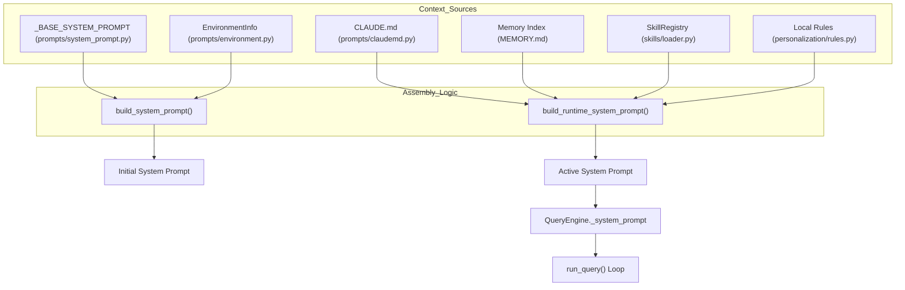
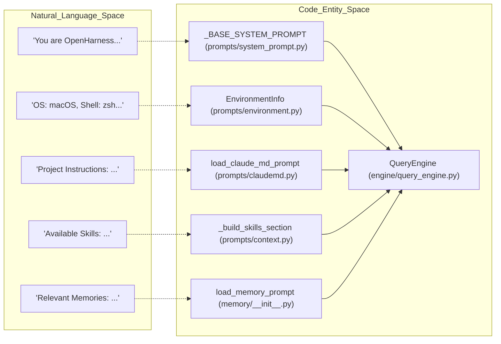

<!-- source: DeepWiki mcp.deepwiki.com · repo HKUDS/OpenHarness · page 13 Prompts and Context Assembly · fetched 2026-11-09 -->

# Prompts and Context Assembly

Relevant source files

The following files were used as context for generating this wiki page:

- [src/openharness/coordinator/coordinator_mode.py](src/openharness/coordinator/coordinator_mode.py)
- [src/openharness/prompts/context.py](src/openharness/prompts/context.py)
- [src/openharness/prompts/system_prompt.py](src/openharness/prompts/system_prompt.py)
- [src/openharness/swarm/__init__.py](src/openharness/swarm/__init__.py)
- [src/openharness/swarm/mailbox.py](src/openharness/swarm/mailbox.py)
- [src/openharness/swarm/permission_sync.py](src/openharness/swarm/permission_sync.py)
- [src/openharness/swarm/team_lifecycle.py](src/openharness/swarm/team_lifecycle.py)
- [tests/test_prompts/test_claudemd.py](tests/test_prompts/test_claudemd.py)
- [tests/test_ui/test_runtime_plan_mode.py](tests/test_ui/test_runtime_plan_mode.py)

The **Prompts and Context Assembly** subsystem is responsible for constructing the high-level instructions and environmental awareness that govern the LLM's behavior. Rather than using a static string, OpenHarness dynamically builds a comprehensive system prompt by aggregating the base agentic instructions with real-time environment data, project-specific rules (`CLAUDE.md`), persistent memory, and on-demand skills.

This assembly process ensures that the `QueryEngine` [src/openharness/engine/query_engine.py:18-101]() always operates with a contextually aware "brain" that knows its current operating system, git state, and project-specific coding standards.

### Context Assembly Flow

The following diagram illustrates how various components are gathered from the "Code Entity Space" and transformed into the final system prompt used by the `QueryEngine`.

**System Prompt Construction Pipeline**

Sources: [src/openharness/prompts/context.py:102-180](), [src/openharness/prompts/system_prompt.py:11-55](), [src/openharness/prompts/system_prompt.py:88-109](), [src/openharness/engine/query_engine.py:18-49]()

### Core Components

The assembly logic is spread across several specialized modules within the `prompts/` directory:

| Component | Responsibility | Key Code Entities |
| :--- | :--- | :--- |
| **System Builder** | Orchestrates the merging of all prompt segments including permission modes and reasoning settings. | `build_system_prompt` [src/openharness/prompts/system_prompt.py:88](), `build_runtime_system_prompt` [src/openharness/prompts/context.py:102]() |
| **Environment** | Captures OS, shell, Python version, and Git metadata. | `EnvironmentInfo` [src/openharness/prompts/environment.py:8](), `get_environment_info` [src/openharness/prompts/environment.py:8]() |
| **Project Context** | Loads `CLAUDE.md` and handles Issue/PR context. | `load_claude_md_prompt` [src/openharness/prompts/claudemd.py:20](), `get_project_issue_file` [src/openharness/config/paths.py:10]() |
| **Context Injection** | Manages the insertion of memory, skills, and delegation guidance. | `_build_skills_section` [src/openharness/prompts/context.py:25](), `_build_delegation_section` [src/openharness/prompts/context.py:58]() |
| **Coordinator Mode** | Provides specialized prompts for swarm leaders. | `get_coordinator_system_prompt` [src/openharness/coordinator/coordinator_mode.py:14]() |

### Integration with Query Engine

The assembled prompt is passed into the `QueryEngine` during initialization. The `build_runtime_system_prompt` function [src/openharness/prompts/context.py:102-180]() specifically handles session-specific state, such as whether **Plan Mode** is enabled [src/openharness/prompts/context.py:80-99]() or if **Fast Mode** should be prioritized [src/openharness/prompts/context.py:122-126]().

**Context to Execution Mapping**

Sources: [src/openharness/prompts/context.py:102-180](), [src/openharness/prompts/system_prompt.py:11-55](), [src/openharness/engine/query_engine.py:18-49]()

---

## Child Pages

### [System Prompt Builder](#13.1)
This page provides a deep dive into the functions `build_system_prompt()` [src/openharness/prompts/system_prompt.py:88-109]() and `build_runtime_system_prompt()` [src/openharness/prompts/context.py:102-180](). It covers the static base prompt, the `EnvironmentInfo` object (OS, shell, git branch, Python version, cwd, date), and how memory entrypoints and skills are augmented into the final string.

### [CLAUDE.md and Project Context](#13.2)
This page documents the `prompts/claudemd.py` module, which is responsible for loading project-specific instructions via `load_claude_md_prompt` [src/openharness/prompts/context.py:146](). It also covers the `/init` slash command used to scaffold these instructions and the mechanisms for injecting GitHub issue, PR comments, and active repo context files into the active context [src/openharness/prompts/context.py:154-162]().

---

