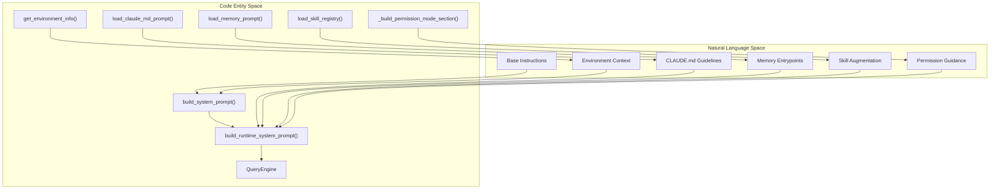
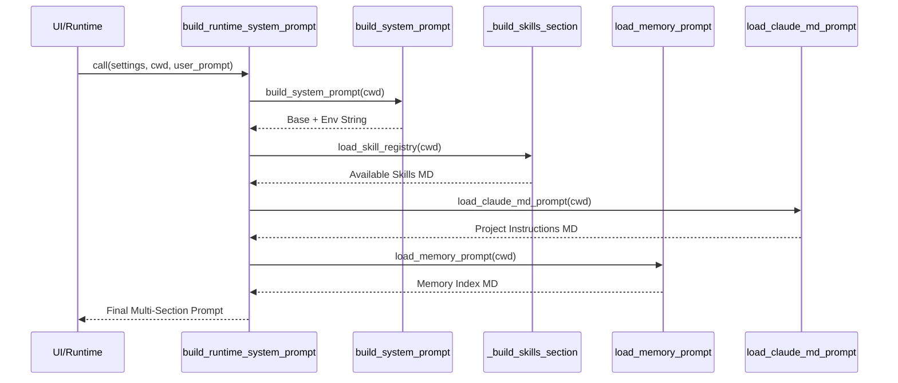

<!-- source: DeepWiki mcp.deepwiki.com · repo HKUDS/OpenHarness · page 13.1 System Prompt Builder · fetched 2026-11-09 -->

# System Prompt Builder

Relevant source files

The following files were used as context for generating this wiki page:

- [scripts/install.sh](scripts/install.sh)
- [scripts/install_dev.sh](scripts/install_dev.sh)
- [src/openharness/prompts/context.py](src/openharness/prompts/context.py)
- [src/openharness/prompts/environment.py](src/openharness/prompts/environment.py)
- [src/openharness/tools/image_to_text_tool.py](src/openharness/tools/image_to_text_tool.py)
- [tests/test_prompts/test_claudemd.py](tests/test_prompts/test_claudemd.py)
- [tests/test_prompts/test_environment.py](tests/test_prompts/test_environment.py)
- [tests/test_prompts/test_system_prompt.py](tests/test_prompts/test_system_prompt.py)
- [tests/test_ui/test_runtime_plan_mode.py](tests/test_ui/test_runtime_plan_mode.py)

The System Prompt Builder is a critical component of the OpenHarness context assembly pipeline. It is responsible for transforming a static base prompt into a dynamic, environment-aware instruction set that guides the LLM's behavior. By aggregating system metadata, project-specific instructions (`CLAUDE.md`), persistent memory entries, and on-demand skills, it ensures the agent has a high-fidelity understanding of its operating environment and mission constraints.

## Overview of Prompt Construction

The construction process involves two layers: the low-level `build_system_prompt()` in `src/openharness/prompts/system_prompt.py` and the high-level `build_runtime_system_prompt()` in `src/openharness/prompts/context.py`. These functions orchestrate the aggregation of data from various subsystems to create the final string sent to the LLM.

### Data Flow Diagram: System Prompt Assembly

The following diagram illustrates how different code entities contribute to the final system prompt string used by the `QueryEngine`.

Sources: [src/openharness/prompts/context.py:102-111](), [src/openharness/prompts/system_prompt.py:84-105](), [src/openharness/prompts/environment.py:104-135]()

## Core Components

### 1. Base Prompt and Environment Info
The foundation of the system prompt is assembled by `build_system_prompt()`. It combines a base identity with an environment snapshot.

The `EnvironmentInfo` dataclass [src/openharness/prompts/environment.py:18-35]() captures a snapshot of the current runtime:
*   **Operating System**: Detected via `detect_os()` using `platform.system()` and the `distro` package [src/openharness/prompts/environment.py:38-53]().
*   **Shell**: The active shell name (e.g., `bash`, `zsh`) resolved via the `SHELL` environment variable or `shutil.which` [src/openharness/prompts/environment.py:56-67]().
*   **Git Context**: The current branch and repository status via `detect_git_info()`, which executes `git rev-parse` [src/openharness/prompts/environment.py:70-101]().
*   **Python Context**: Includes the version, executable path, and virtual environment root [src/openharness/prompts/environment.py:109-115]().
*   **Temporal Context**: The current UTC date formatted as `YYYY-MM-DD` [src/openharness/prompts/environment.py:128]().

Sources: [src/openharness/prompts/system_prompt.py:84-105](), [src/openharness/prompts/environment.py:104-135]()

### 2. CLAUDE.md and Project Context
OpenHarness prioritizes project-specific conventions by scanning for `CLAUDE.md` files using `load_claude_md_prompt(cwd)` [src/openharness/prompts/context.py:146](). Additionally, the builder injects external context from specific project files if they exist:
*   **Issue Context**: Loaded via `get_project_issue_file(cwd)` [src/openharness/prompts/context.py:155]().
*   **PR Comments**: Loaded via `get_project_pr_comments_file(cwd)` [src/openharness/prompts/context.py:156]().
*   **Active Repo Context**: Loaded via `get_project_active_repo_context_path(cwd)` [src/openharness/prompts/context.py:157]().

Sources: [src/openharness/prompts/context.py:146-162]()

### 3. Memory and Skill Augmentation
The runtime prompt dynamically includes persistence and capabilities:
*   **Memory Entrypoints**: If enabled in `Settings`, `load_memory_prompt()` includes the `MEMORY.md` index [src/openharness/prompts/context.py:165-171]().
*   **Relevant Memories**: If a user prompt is provided, `select_relevant_memories()` finds and injects specific memory snippets based on relevance [src/openharness/prompts/context.py:174-178]().
*   **Skill Augmentation**: `_build_skills_section()` lists available skills from the `SkillRegistry`, instructing the LLM to use the `skill` tool to load details [src/openharness/prompts/context.py:25-55]().

Sources: [src/openharness/prompts/context.py:134-141](), [src/openharness/prompts/context.py:164-178]()

### 4. Permission and Session Mode
The builder injects instructions regarding the current operational constraints:
*   **Permission Mode**: `_build_permission_mode_section()` provides specific guidance for `PLAN`, `FULL_AUTO`, or `DEFAULT` modes [src/openharness/prompts/context.py:80-99]().
*   **Fast Mode**: If `settings.fast_mode` is true, the LLM is instructed to be concise and minimize tool use [src/openharness/prompts/context.py:122-125]().
*   **Reasoning Settings**: Injects the `effort` and `passes` settings to guide the LLM's depth of investigation [src/openharness/prompts/context.py:127-132]().

Sources: [src/openharness/prompts/context.py:80-99](), [src/openharness/prompts/context.py:120-132]()

## Implementation Details

### Key Functions

| Function | Responsibility | File Path |
| :--- | :--- | :--- |
| `build_runtime_system_prompt()` | High-level orchestrator that combines environment, project context, memory, and skills. | [src/openharness/prompts/context.py:102-182]() |
| `build_system_prompt()` | Core builder that merges base instructions with formatted `EnvironmentInfo`. | [src/openharness/prompts/system_prompt.py:84-105]() |
| `get_environment_info()` | Gathers OS, shell, git, and python metadata into a dataclass. | [src/openharness/prompts/environment.py:104-135]() |
| `_build_skills_section()` | Generates a Markdown list of skills available via the `skill` tool. | [src/openharness/prompts/context.py:25-55]() |

### Runtime Prompt Logic Flow

This diagram shows the sequence of operations when `build_runtime_system_prompt` is invoked during the session loop.

Sources: [src/openharness/prompts/context.py:102-182](), [src/openharness/prompts/system_prompt.py:84-105]()

## Special Modes

### Coordinator Mode
If the environment variable `CLAUDE_CODE_COORDINATOR_MODE` is set, the system prompt is replaced by `get_coordinator_system_prompt()` [src/openharness/prompts/context.py:112-113](). This mode changes the LLM's role from a direct worker to a manager of sub-agents.

### Delegation and Subagents
When not in coordinator mode, the builder injects a "Delegation And Subagents" section via `_build_delegation_section()` [src/openharness/prompts/context.py:58-77](). This instructs the LLM on how to use the `agent` tool to spawn background workers and how to interact with them using `/agents` commands or the `send_message` tool.

Sources: [src/openharness/prompts/context.py:58-77](), [src/openharness/prompts/context.py:112-115]()

---

