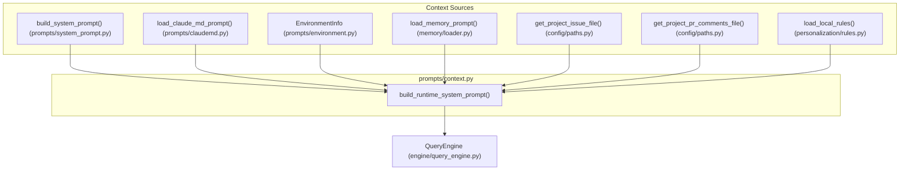
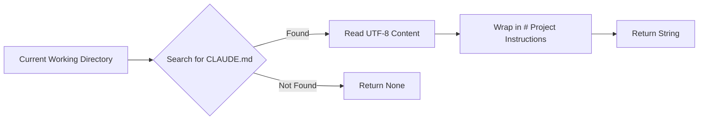

<!-- source: DeepWiki mcp.deepwiki.com · repo HKUDS/OpenHarness · page 13.2 CLAUDE.md and Project Context · fetched 2026-11-09 -->

# CLAUDE.md and Project Context

Relevant source files

The following files were used as context for generating this wiki page:

- [src/openharness/prompts/context.py](src/openharness/prompts/context.py)
- [tests/test_prompts/test_claudemd.py](tests/test_prompts/test_claudemd.py)
- [tests/test_ui/test_runtime_plan_mode.py](tests/test_ui/test_runtime_plan_mode.py)

This page documents how OpenHarness manages project-specific context, primarily through the `CLAUDE.md` guide, and how it injects specialized metadata like environment information, issue descriptions, and PR comments into the LLM's system prompt.

## Overview of Project Context

OpenHarness uses a multi-layered approach to provide the LLM with project-specific knowledge. While the global system prompt provides general operational instructions, project context allows the agent to adapt to specific coding styles, build commands, and active tasks within a repository.

The primary components of this system are:
1.  **`CLAUDE.md`**: A project-level guide containing build/test instructions and style guidelines.
2.  **Environment Metadata**: Real-time information about the OS, shell, and git state.
3.  **Project Metadata Files**: Files located in `.openharness/` that describe specific tasks (e.g., `issue.md`, `pr_comments.md`).
4.  **The `/init` Command**: A scaffolding tool to bootstrap these files in a new repository.

### Context Assembly Flow

The `build_runtime_system_prompt` function in `prompts/context.py` acts as the orchestrator, aggregating various context sources into a final system message [src/openharness/prompts/context.py:102-111]().

**Title: System Prompt Context Assembly (Code Entity Space)**

Sources: `src/openharness/prompts/context.py:102-180`(), `src/openharness/prompts/claudemd.py:7-25`(), `src/openharness/config/paths.py:8-12`()

---

## Environment Detection

Before any project files are read, OpenHarness captures the state of the local machine to ground the LLM in its operational reality. This is handled by the `EnvironmentInfo` dataclass in `prompts/environment.py`.

### Implementation Details
The `build_runtime_system_prompt` integrates environment data via `build_system_prompt` [src/openharness/prompts/context.py:115-118](). The assembly includes:
*   **OS/Platform**: Operating system and architecture details.
*   **Shell**: The active shell environment.
*   **Git State**: Current branch and repository status.
*   **Python Version**: The runtime Python environment version.

This data ensures the LLM uses the correct syntax for shell commands and understands the repository structure.

Sources: `src/openharness/prompts/context.py:112-119`(), `tests/test_prompts/test_claudemd.py:55-55`()

---

## CLAUDE.md Management

The `CLAUDE.md` file is the central repository for project-specific instructions. It is intended to be a concise reference for the LLM regarding build commands, test execution, and code style.

### Loading Logic
The `prompts/claudemd.py` module provides `load_claude_md_prompt(cwd)` [src/openharness/prompts/claudemd.py:7-25](). It searches for `CLAUDE.md` in the provided directory. If found, it wraps the content in a `# Project Instructions` header. OpenHarness also supports discovering nested rule files (e.g., `.claude/rules/*.md`) via `discover_claude_md_files` [tests/test_prompts/test_claudemd.py:19-32]().

**Title: CLAUDE.md Loading Process**

Sources: `src/openharness/prompts/claudemd.py:7-25`(), `tests/test_prompts/test_claudemd.py:34-44`()

---

## The `/init` Command

The `/init` command (documented in the Slash Commands section) scaffolds the project context files, ensuring a repository is "agent-ready."

### Scaffolding Logic
When a user runs `/init`, the system performs the following:
1.  **Directory Creation**: Ensures `.openharness/` exists using `get_project_config_dir` [src/openharness/config/paths.py:102-106]().
2.  **File Generation**: Creates a template `CLAUDE.md` in the root if it doesn't exist.
3.  **Metadata Initialization**: Creates `issue.md` and `pr_comments.md` within the `.openharness/` directory.

Sources: `src/openharness/config/paths.py:102-116`()

---

## Issue and PR Context Injection

OpenHarness supports task-specific focus via specialized files injected during `build_runtime_system_prompt` [src/openharness/prompts/context.py:154-162]().

### 1. Issue Context (`issue.md`)
The path is resolved via `get_project_issue_file(cwd)` [src/openharness/config/paths.py:109-111](). If this file contains text, it is injected under an `# Issue Context` header [src/openharness/prompts/context.py:155-162](). This allows users to provide a stable reference for the current task that persists across the entire session.

### 2. PR Comments (`pr_comments.md`)
The path is resolved via `get_project_pr_comments_file(cwd)` [src/openharness/config/paths.py:114-116](). Injected under `# Pull Request Comments` [src/openharness/prompts/context.py:156-162](), this is used to provide the LLM with specific feedback or review comments it needs to address.

### Context Injection Summary
The following table describes how these components are integrated into the runtime prompt:

| Component | Source Function | Injection Header | Character Limit |
| :--- | :--- | :--- | :--- |
| **CLAUDE.md** | `load_claude_md_prompt` | `# Project Instructions` | None |
| **Issue Context** | `get_project_issue_file` | `# Issue Context` | 12,000 chars |
| **PR Comments** | `get_project_pr_comments_file` | `# Pull Request Comments` | 12,000 chars |
| **Active Repo Context** | `get_project_active_repo_context_path` | `# Active Repo Context` | 12,000 chars |

Sources: `src/openharness/prompts/context.py:146-162`(), `src/openharness/config/paths.py:102-117`()

---

## Path Resolutions

The `config/paths.py` module defines the standard locations for these project-specific entities, ensuring they are always relative to the active project root:

*   **Project Config Dir**: `.openharness/` [src/openharness/config/paths.py:104-104]()
*   **Issue File**: `.openharness/issue.md` [src/openharness/config/paths.py:111-111]()
*   **PR Comments File**: `.openharness/pr_comments.md` [src/openharness/config/paths.py:116-116]()
*   **Active Repo Context**: `.openharness/context.md` [src/openharness/config/paths.py:119-121]()

Sources: `src/openharness/config/paths.py:102-121`()

---

