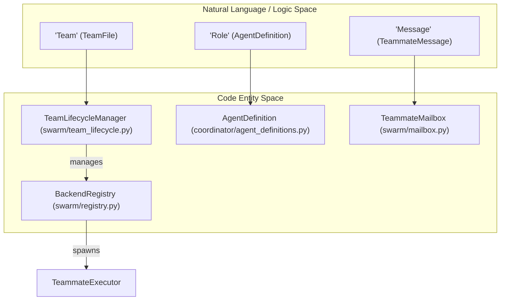
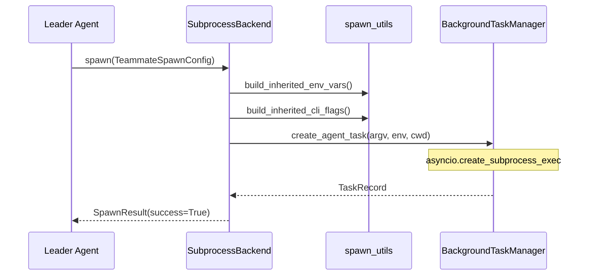

<!-- source: DeepWiki mcp.deepwiki.com · repo HKUDS/OpenHarness · page 14 Multi-Agent Coordination (Swarm) · fetched 2026-11-09 -->

# Multi-Agent Coordination (Swarm)

Relevant source files

The following files were used as context for generating this wiki page:

- [src/openharness/coordinator/agent_definitions.py](src/openharness/coordinator/agent_definitions.py)
- [src/openharness/coordinator/coordinator_mode.py](src/openharness/coordinator/coordinator_mode.py)
- [src/openharness/prompts/system_prompt.py](src/openharness/prompts/system_prompt.py)
- [src/openharness/swarm/__init__.py](src/openharness/swarm/__init__.py)
- [src/openharness/swarm/mailbox.py](src/openharness/swarm/mailbox.py)
- [src/openharness/swarm/permission_sync.py](src/openharness/swarm/permission_sync.py)
- [src/openharness/swarm/spawn_utils.py](src/openharness/swarm/spawn_utils.py)
- [src/openharness/swarm/team_lifecycle.py](src/openharness/swarm/team_lifecycle.py)
- [tests/test_coordinator/test_agent_definitions.py](tests/test_coordinator/test_agent_definitions.py)
- [tests/test_swarm/test_spawn_utils.py](tests/test_swarm/test_spawn_utils.py)
- [tests/test_swarm/test_subprocess_backend.py](tests/test_swarm/test_subprocess_backend.py)

The Multi-Agent Coordination subsystem provides the infrastructure for spawning, organizing, and managing sub-agents within OpenHarness. It allows a primary agent to delegate complex tasks to specialized sub-processes, organize them into logical teams, and facilitate inter-agent communication through structured message passing and shared state.

### High-Level Architecture

The coordination system bridges the gap between high-level "Team" logic and low-level "Task" execution. It uses a persistent team registry to track active teams and maps them to sub-processes or in-process tasks managed by various backends (tmux, subprocess, or asyncio).

**Coordination Entity Mapping**

Sources: [src/openharness/swarm/team_lifecycle.py:1-10](), [src/openharness/coordinator/agent_definitions.py:60-86](), [src/openharness/swarm/registry.py:7-16]()

---

### Team Management and Agent Roles

The core of the coordination system is the `TeamLifecycleManager`, which maintains `TeamFile` objects persisted to disk. These records track `TeamMember` metadata, including agent IDs, backend types, and joined timestamps.

*   **TeamLifecycleManager**: Provides CRUD operations for teams stored under `~/.openharness/teams/<name>/team.json` [src/openharness/swarm/team_lifecycle.py:1-10]().
*   **Agent Definitions**: The `AgentDefinition` model defines the capabilities of sub-agents, including their `system_prompt`, allowed `tools`, `model` overrides, and `isolation` requirements [src/openharness/coordinator/agent_definitions.py:60-135]().
*   **Team Registry**: The `TeamRegistry` (often accessed via `get_team_registry`) provides an in-memory interface for creating teams and adding agents [src/openharness/coordinator/coordinator_mode.py:27-71]().

For a detailed breakdown of registry methods and role configurations, see [Team Registry and Agent Definitions](#14.1).

---

### Agent Lifecycle and Swarm Backends

Sub-agents can run in different environments depending on the system capabilities. The `SubprocessBackend` manages the spawning of agents as independent OS processes, ensuring they inherit the correct environment variables and CLI flags.

**Agent Spawning Flow**

Sources: [src/openharness/swarm/subprocess_backend.py:12-58](), [src/openharness/swarm/spawn_utils.py:109-152](), [src/openharness/swarm/mailbox.py:38-49]()

The lifecycle includes:
*   **Environment Inheritance**: Forwarding critical API keys and configuration paths (e.g., `OPENHARNESS_MODEL`, `ANTHROPIC_API_KEY`) to teammates [src/openharness/swarm/spawn_utils.py:22-80]().
*   **Command Resolution**: Determining the correct executable (Python interpreter or `openharness` entry-point) for the sub-agent [src/openharness/swarm/spawn_utils.py:83-106]().
*   **CLI Flag Propagation**: Ensuring teammates inherit permission modes and system prompt overrides [src/openharness/swarm/spawn_utils.py:109-170]().

For details on subprocess management and the `/agents` command, see [Task Types and Agent Lifecycle](#14.2).

---

### Swarm Infrastructure: Mailbox and Permissions

Inter-agent coordination relies on a robust communication and synchronization layer.

*   **TeammateMailbox**: A file-based messaging system that allows agents to exchange `MailboxMessage` objects asynchronously. It uses atomic writes to prevent partial reads [src/openharness/swarm/mailbox.py:1-7]().
*   **Permission Sync**: The `PermissionSyncProtocol` ensures that sub-agents (workers) request permission from the leader before executing sensitive tools. It supports both file-based and mailbox-based request/response flows [src/openharness/swarm/permission_sync.py:1-20]().
*   **Locking**: The system uses `exclusive_file_lock` to manage concurrent access to shared mailbox and permission files [src/openharness/swarm/lockfile.py:35-35]().

| Component | Purpose | Primary Code Entity |
| :--- | :--- | :--- |
| **Mailbox** | Async message queue | `TeammateMailbox` [src/openharness/swarm/mailbox.py:102]() |
| **Permission Sync** | Leader-Worker coordination | `SwarmPermissionRequest` [src/openharness/swarm/permission_sync.py:102]() |
| **Atomic Writes** | Prevents partial reads | `os.replace` in `write()` [src/openharness/swarm/mailbox.py:147]() |

Sources: [src/openharness/swarm/permission_sync.py:102-158](), [src/openharness/swarm/mailbox.py:39-75](), [src/openharness/swarm/lockfile.py:35-35]()

For details on low-level swarm infrastructure, see [Swarm Infrastructure: Mailbox, Permission Sync, and Worktrees](#14.3).

---

