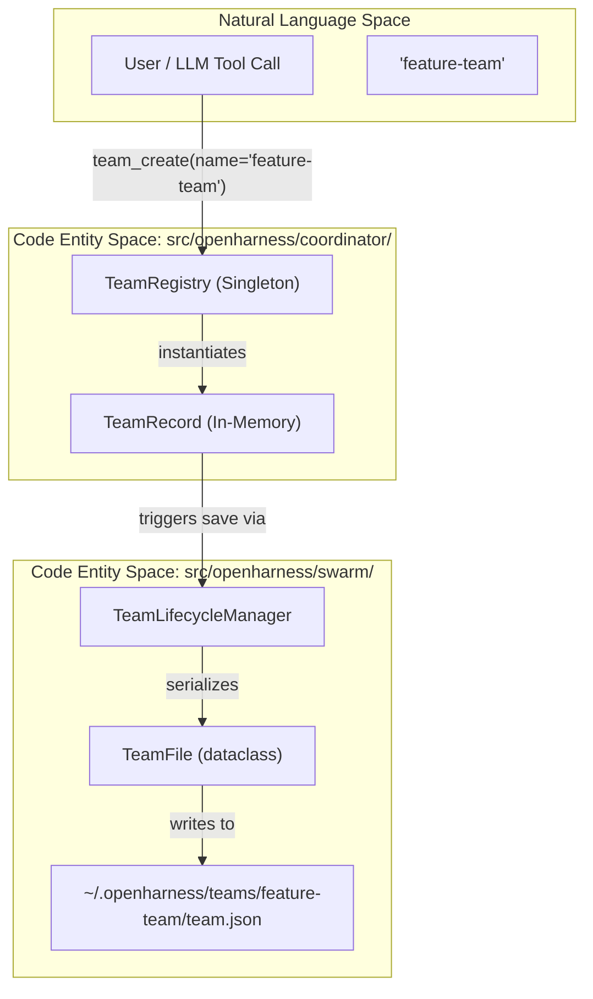
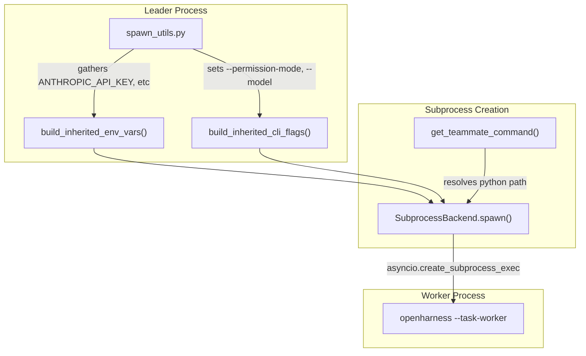

<!-- source: DeepWiki mcp.deepwiki.com · repo HKUDS/OpenHarness · page 14.1 Team Registry and Agent Definitions · fetched 2026-11-09 -->

# Team Registry and Agent Definitions

Relevant source files

The following files were used as context for generating this wiki page:

- [src/openharness/coordinator/agent_definitions.py](src/openharness/coordinator/agent_definitions.py)
- [src/openharness/coordinator/coordinator_mode.py](src/openharness/coordinator/coordinator_mode.py)
- [src/openharness/prompts/system_prompt.py](src/openharness/prompts/system_prompt.py)
- [src/openharness/swarm/__init__.py](src/openharness/swarm/__init__.py)
- [src/openharness/swarm/mailbox.py](src/openharness/swarm/mailbox.py)
- [src/openharness/swarm/permission_sync.py](src/openharness/swarm/permission_sync.py)
- [src/openharness/swarm/spawn_utils.py](src/openharness/swarm/spawn_utils.py)
- [src/openharness/swarm/team_lifecycle.py](src/openharness/swarm/team_lifecycle.py)
- [tests/test_coordinator/test_agent_definitions.py](tests/test_coordinator/test_agent_definitions.py)
- [tests/test_coordinator/test_coordinator_mode.py](tests/test_coordinator/test_coordinator_mode.py)
- [tests/test_swarm/__init__.py](tests/test_swarm/__init__.py)
- [tests/test_swarm/test_in_process.py](tests/test_swarm/test_in_process.py)
- [tests/test_swarm/test_mailbox.py](tests/test_swarm/test_mailbox.py)
- [tests/test_swarm/test_permission_sync.py](tests/test_swarm/test_permission_sync.py)
- [tests/test_swarm/test_registry.py](tests/test_swarm/test_registry.py)
- [tests/test_swarm/test_spawn_utils.py](tests/test_swarm/test_spawn_utils.py)
- [tests/test_swarm/test_subprocess_backend.py](tests/test_swarm/test_subprocess_backend.py)
- [tests/test_swarm/test_team_lifecycle.py](tests/test_swarm/test_team_lifecycle.py)
- [tests/test_swarm/test_types.py](tests/test_swarm/test_types.py)
- [tests/test_swarm/test_worktree.py](tests/test_swarm/test_worktree.py)

The Multi-Agent Coordination (Swarm) subsystem in OpenHarness allows for the creation and management of collaborative agent teams. This page documents the `TeamRegistry`, the persistent `TeamLifecycleManager`, the underlying `AgentDefinition` structures, and the communication protocols (Mailbox and Permission Sync) that facilitate inter-agent collaboration and state persistence.

## Agent Definitions

Agent roles are defined using the `AgentDefinition` Pydantic model [src/openharness/coordinator/agent_definitions.py:60-86](), which provides a blueprint for the capabilities, system prompts, and tool access of specific agent types.

### Agent Configuration Fields
The `AgentDefinition` maps directly to the capabilities required by the engine to spawn a specialized sub-agent:

| Field | Description |
| :--- | :--- |
| `name` | The agent type identifier (e.g., "code-review", "explorer") [src/openharness/coordinator/agent_definitions.py:89](). |
| `system_prompt` | The core instructions for the LLM role [src/openharness/coordinator/agent_definitions.py:93](). |
| `tools` | List of allowed tools; `None` or `['*']` allows all [src/openharness/coordinator/agent_definitions.py:94](). |
| `permission_mode` | One of `default`, `plan`, `bypassPermissions`, etc. [src/openharness/coordinator/agent_definitions.py:102](). |
| `isolation` | Isolation strategy, such as `worktree` or `remote` [src/openharness/coordinator/agent_definitions.py:122](). |
| `color` | UI display color (e.g., "cyan", "magenta") [src/openharness/coordinator/agent_definitions.py:116](). |

### Predefined Roles
The system provides several built-in specialized prompts:
- **General Purpose**: Standard coding assistant [src/openharness/coordinator/agent_definitions.py:160-165]().
- **Explore**: A strict **READ-ONLY** specialist prohibited from file modifications [src/openharness/coordinator/agent_definitions.py:166-179]().
- **Researcher**: Optimized for broad codebase analysis [src/openharness/coordinator/agent_definitions.py:180-185]().

**Sources:**
- [src/openharness/coordinator/agent_definitions.py:1-185]()

## Team Registry and Lifecycle Management

OpenHarness distinguishes between in-memory coordination (`TeamRegistry`) and on-disk persistence (`TeamLifecycleManager`).

### TeamRegistry (In-Memory)
The `TeamRegistry` class acts as the central management hub for active teams during a session. It maintains a mapping of team names to `TeamRecord` objects.

- `create_team(name, description)`: Initializes a new `TeamRecord`. Raises `ValueError` if the name is already taken [src/openharness/coordinator/coordinator_mode.py:33-38]().
- `add_agent(team_name, task_id)`: Appends a specific agent task ID to the team's membership list [src/openharness/coordinator/coordinator_mode.py:45-48]().
- `send_message(team_name, message)`: Appends a string message to the team's shared message history [src/openharness/coordinator/coordinator_mode.py:50-51]().
- `list_teams()`: Returns all active teams sorted by name [src/openharness/coordinator/coordinator_mode.py:53-54]().

### TeamLifecycleManager (Persistent)
For cross-session persistence, `TeamLifecycleManager` manages JSON state stored at `~/.openharness/teams/<name>/team.json` [src/openharness/swarm/team_lifecycle.py:1-10]().

- **Storage Structure**: Uses the `TeamFile` dataclass to encapsulate `members` (a dict of `TeamMember`), `team_allowed_paths`, and `lead_agent_id` [src/openharness/swarm/team_lifecycle.py:190-217]().
- **Member Tracking**: `TeamMember` records the `agent_id`, `backend_type` (e.g., `subprocess`, `in_process`), and `worktree_path` [src/openharness/swarm/team_lifecycle.py:92-141]().

**Sources:**
- [src/openharness/coordinator/coordinator_mode.py:17-71]()
- [src/openharness/swarm/team_lifecycle.py:1-217]()

## Communication Infrastructure

Agents communicate via an asynchronous, file-based mailbox system and a structured permission synchronization protocol.

### Mailbox System
The `TeammateMailbox` handles atomic message exchange [src/openharness/swarm/mailbox.py:102-109]().
- **Storage**: Messages are stored as JSON in `~/.openharness/teams/<team>/agents/<agent_id>/inbox/` [src/openharness/swarm/mailbox.py:4-7]().
- **Atomicity**: Writes use a `.tmp` file and `os.replace` to ensure readers never see partial data [src/openharness/swarm/mailbox.py:126-151]().
- **Message Types**: Includes `user_message`, `permission_request`, `permission_response`, and `shutdown` [src/openharness/swarm/mailbox.py:27-35]().

### Permission Synchronization
The `permission_sync.py` module ensures that workers can request elevated permissions from the leader [src/openharness/swarm/permission_sync.py:1-20]().
- **Request Flow**: A worker generates a `SwarmPermissionRequest` [src/openharness/swarm/permission_sync.py:102-160]() and sends it to the leader's mailbox via `send_permission_request()` [src/openharness/swarm/permission_sync.py:31]().
- **Auto-Approval**: Tools like `read_file`, `glob`, and `grep` are treated as read-only and may be auto-approved [src/openharness/swarm/permission_sync.py:76-93]().

**Sources:**
- [src/openharness/swarm/mailbox.py:1-182]()
- [src/openharness/swarm/permission_sync.py:1-205]()

## Implementation and Data Flow

### Team Creation and Persistence Flow
This diagram bridges the high-level concept of a "Team" to the specific code entities that manage them.

**Sources:**
- [src/openharness/coordinator/coordinator_mode.py:33-38]()
- [src/openharness/swarm/team_lifecycle.py:4-10]()
- [src/openharness/swarm/team_lifecycle.py:190-217]()

### Teammate Spawning and Environment Inheritance
When a teammate is spawned, the leader ensures environment variables and CLI flags are propagated to maintain consistency.

**Sources:**
- [src/openharness/swarm/spawn_utils.py:83-106]()
- [src/openharness/swarm/spawn_utils.py:109-152]()
- [src/openharness/swarm/subprocess_backend.py:41-58]()

## Singleton and Utility Access

The registry is managed as a singleton via `get_team_registry()` to ensure consistency across the engine [src/openharness/coordinator/coordinator_mode.py:66-71]().

### Registry Operations Detail

| Operation | Code Symbol | Logic |
| :--- | :--- | :--- |
| **Validation** | `_require_team()` | Internal helper that raises `ValueError` if a team does not exist [src/openharness/coordinator/coordinator_mode.py:56-60](). |
| **Sanitization** | `sanitize_name()` | Replaces non-alphanumeric chars with hyphens for safe directory naming [src/openharness/swarm/team_lifecycle.py:34-40](). |
| **Teammate Command** | `get_teammate_command()` | Resolves the binary path, preferring the current Python interpreter [src/openharness/swarm/spawn_utils.py:83-106](). |

**Sources:**
- [src/openharness/coordinator/coordinator_mode.py:56-71]()
- [src/openharness/swarm/team_lifecycle.py:34-40]()
- [src/openharness/swarm/spawn_utils.py:83-106]()

---

