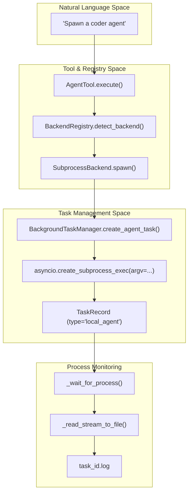
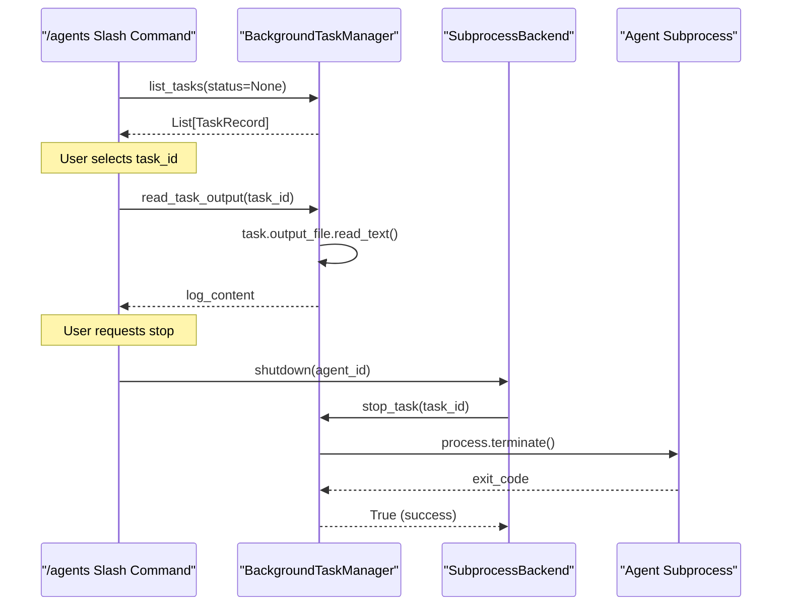

<!-- source: DeepWiki mcp.deepwiki.com · repo HKUDS/OpenHarness · page 14.2 Task Types and Agent Lifecycle · fetched 2026-11-09 -->

# Task Types and Agent Lifecycle

Relevant source files

The following files were used as context for generating this wiki page:

- [src/openharness/coordinator/agent_definitions.py](src/openharness/coordinator/agent_definitions.py)
- [src/openharness/swarm/in_process.py](src/openharness/swarm/in_process.py)
- [src/openharness/swarm/registry.py](src/openharness/swarm/registry.py)
- [src/openharness/swarm/spawn_utils.py](src/openharness/swarm/spawn_utils.py)
- [src/openharness/swarm/subprocess_backend.py](src/openharness/swarm/subprocess_backend.py)
- [src/openharness/swarm/types.py](src/openharness/swarm/types.py)
- [src/openharness/tasks/manager.py](src/openharness/tasks/manager.py)
- [src/openharness/tasks/types.py](src/openharness/tasks/types.py)
- [tests/conftest.py](tests/conftest.py)
- [tests/test_coordinator/test_agent_definitions.py](tests/test_coordinator/test_agent_definitions.py)
- [tests/test_swarm/test_spawn_utils.py](tests/test_swarm/test_spawn_utils.py)
- [tests/test_swarm/test_subprocess_backend.py](tests/test_swarm/test_subprocess_backend.py)
- [tests/test_tasks/test_manager.py](tests/test_tasks/test_manager.py)
- [tests/test_tools/test_task_tools.py](tests/test_tools/test_task_tools.py)

This page documents the lifecycle of sub-agents and background tasks within OpenHarness. It covers the classification of task types, the mechanism for spawning agent subprocesses, the `InProcessBackend` for asyncio-task-based teammates, and the dual-signal `TeammateAbortController`.

## Task Type Definitions

OpenHarness categorizes background activities using the `TaskType` literal. This allows the `BackgroundTaskManager` to apply different execution strategies based on whether the task is a simple shell command, a full-fledged autonomous agent, or an in-process coroutine.

| Task Type | Description | Implementation |
| :--- | :--- | :--- |
| `local_bash` | A standard shell command or script running in the background. | [src/openharness/tasks/types.py:10-10]() |
| `local_agent` | A sub-agent spawned as a separate OpenHarness process on the same machine. | [src/openharness/tasks/types.py:10-10]() |
| `remote_agent` | An agent running on a different host. | [src/openharness/tasks/types.py:10-10]() |
| `in_process_teammate` | A virtual agent running as an `asyncio.Task` within the leader process. | [src/openharness/tasks/types.py:10-10]() |

Sources: [src/openharness/tasks/types.py:10-10](), [src/openharness/tasks/manager.py:49-59]()

## Agent Lifecycle Management

The lifecycle of an agent is managed by the `BackgroundTaskManager` and specialized backends. When an agent is requested (e.g., via the `AgentTool`), the system selects a backend (subprocess, tmux, or in-process) and transitions through spawning, communication, and termination.

### 1. Subprocess Spawning
The `SubprocessBackend` uses `create_agent_task` to initialize a new sub-agent [src/openharness/swarm/subprocess_backend.py:47-52](). It builds a CLI command using `get_teammate_command()` and `build_inherited_cli_flags()` to ensure the child inherits the leader's model, permission mode, and environment [src/openharness/swarm/spawn_utils.py:83-152](). To ensure cross-platform compatibility (specifically for Git Bash on Windows), the backend prefers passing an `argv` list directly to `asyncio.create_subprocess_exec` rather than a shell-evaluated command string [src/openharness/swarm/subprocess_backend.py:68-85]().

### 2. In-Process Teammates
The `InProcessBackend` runs teammates as `asyncio.Task` objects [src/openharness/swarm/in_process.py:196-206](). It uses `ContextVar` to isolate `TeammateContext` (identity, status, token counts) across concurrent agents [src/openharness/swarm/in_process.py:173-190](). This avoids the overhead of OS process creation for lightweight coordination.

### 3. Stdin/Stdout Communication
Communication with `subprocess` tasks is handled via pipes:
- **Stdin**: Used to send structured JSON messages. `SubprocessBackend.send_message` serializes the `TeammateMessage` and writes it to the task's stdin [src/openharness/swarm/subprocess_backend.py:117-139](). Input payloads are wrapped in a JSON object with a `text` field via `_encode_task_worker_payload` to preserve multiline strings [src/openharness/tasks/manager.py:23-44]().
- **Stdout**: Captured and buffered in a `TaskRecord`. The output can be polled via `read_task_output` [src/openharness/tasks/manager.py:240-246]().

### 4. Automatic Restart on Broken Pipe
The `BackgroundTaskManager.write_to_task` method includes recovery logic for agent tasks [src/openharness/tasks/manager.py:206-238](). If a `BrokenPipeError` occurs during a write to an agent (indicating the subprocess crashed or closed its pipe), the manager automatically invokes `_restart_agent_task` [src/openharness/tasks/manager.py:228-232](). This restarts the process and injects a notice (`_TASK_RESTART_NOTICE`) into the output log [src/openharness/tasks/manager.py:20-20]().

### Code Entity Mapping: Agent Spawning
The following diagram illustrates how the `BackendRegistry` and `SubprocessBackend` bridge the high-level tool request to the `BackgroundTaskManager`.

Sources: [src/openharness/swarm/subprocess_backend.py:47-115](), [src/openharness/tasks/manager.py:114-158](), [src/openharness/swarm/registry.py:128-183]()

## Teammate Abort Controller

For in-process teammates, OpenHarness implements a dual-signal `TeammateAbortController` [src/openharness/swarm/in_process.py:52-61]().

- **Graceful Cancel**: Sets `cancel_event`. The agent loop checks this after completing the current tool execution and exits cleanly [src/openharness/swarm/in_process.py:64-65]().
- **Force Kill**: Sets `force_cancel`. This signal is used to immediately terminate the `asyncio.Task` if it does not respond to a graceful request [src/openharness/swarm/in_process.py:67-68]().

Sources: [src/openharness/swarm/in_process.py:52-103]()

## Team Coordination and Registry

Agents are grouped into teams via the `TeamRegistry`. This tracks which `task_id` belongs to which logical team, enabling name-based routing (e.g., `worker@dev-team`).

### Backend Detection
The `BackendRegistry` implements a priority pipeline to select the best available execution environment [src/openharness/swarm/registry.py:128-183]():
1. **in_process**: Used if a fallback was previously activated [src/openharness/swarm/registry.py:148-157]().
2. **tmux**: Preferred if running inside a tmux session [src/openharness/swarm/registry.py:160-169]().
3. **subprocess**: Default fallback for standard background execution [src/openharness/swarm/registry.py:177-183]().

Sources: [src/openharness/swarm/registry.py:97-183](), [src/openharness/swarm/types.py:16-17]()

## The `/agents` Slash Command

The `/agents` command (and associated task tools) provides a management interface for the agent lifecycle by interacting with the `BackgroundTaskManager`.

- **Listing**: Calls `list_tasks()` to retrieve all background processes and their `TaskStatus` [src/openharness/tasks/manager.py:164-169]().
- **Output**: Calls `read_task_output(task_id)` to show the tail of the logs [src/openharness/tasks/manager.py:240-246]().
- **Termination**: Calls `stop_task(task_id)` which attempts a `SIGTERM` followed by a `SIGKILL` if the process remains [src/openharness/tasks/manager.py:189-204]().

### Data Flow: Agent Monitoring
This diagram shows how the system retrieves the state of background agents for the UI.

Sources: [src/openharness/tasks/manager.py:164-246](), [src/openharness/swarm/subprocess_backend.py:141-167]()

---

