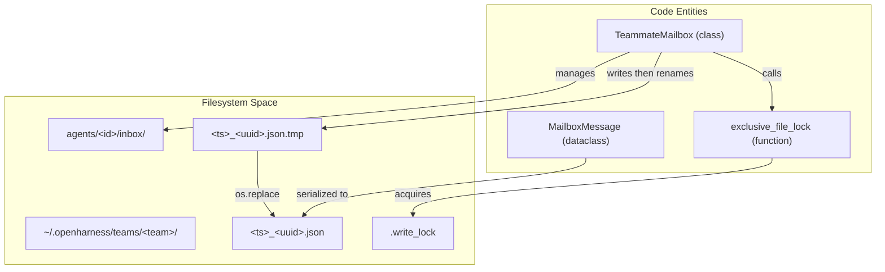
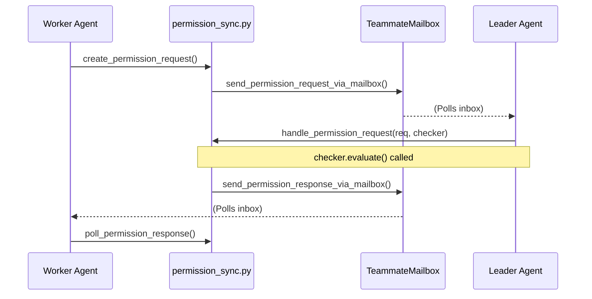

<!-- source: DeepWiki mcp.deepwiki.com · repo HKUDS/OpenHarness · page 14.3 Swarm Infrastructure: Mailbox, Permission Sync, and Worktrees · fetched 2026-11-09 -->

# Swarm Infrastructure: Mailbox, Permission Sync, and Worktrees

Relevant source files

The following files were used as context for generating this wiki page:

- [src/openharness/coordinator/coordinator_mode.py](src/openharness/coordinator/coordinator_mode.py)
- [src/openharness/platforms.py](src/openharness/platforms.py)
- [src/openharness/prompts/system_prompt.py](src/openharness/prompts/system_prompt.py)
- [src/openharness/swarm/__init__.py](src/openharness/swarm/__init__.py)
- [src/openharness/swarm/in_process.py](src/openharness/swarm/in_process.py)
- [src/openharness/swarm/lockfile.py](src/openharness/swarm/lockfile.py)
- [src/openharness/swarm/mailbox.py](src/openharness/swarm/mailbox.py)
- [src/openharness/swarm/permission_sync.py](src/openharness/swarm/permission_sync.py)
- [src/openharness/swarm/registry.py](src/openharness/swarm/registry.py)
- [src/openharness/swarm/team_lifecycle.py](src/openharness/swarm/team_lifecycle.py)
- [src/openharness/swarm/types.py](src/openharness/swarm/types.py)
- [src/openharness/swarm/worktree.py](src/openharness/swarm/worktree.py)
- [src/openharness/utils/file_lock.py](src/openharness/utils/file_lock.py)
- [tests/conftest.py](tests/conftest.py)
- [tests/test_platforms.py](tests/test_platforms.py)
- [tests/test_swarm/test_lockfile.py](tests/test_swarm/test_lockfile.py)

This page documents the low-level infrastructure supporting multi-agent coordination (Swarms) in OpenHarness. This includes atomic file-based messaging, synchronized permission protocols between leaders and workers, and filesystem isolation via Git worktrees.

## Teammate Mailbox

The `TeammateMailbox` provides a robust, file-based asynchronous message queue for communication between a swarm leader and its workers [src/openharness/swarm/mailbox.py:1-7](). Each agent in a team is assigned a unique inbox directory.

### Data Model and Storage
Messages are represented by the `MailboxMessage` dataclass [src/openharness/swarm/mailbox.py:39-49](). Supported message types include `user_message`, `permission_request`, `permission_response`, `sandbox_permission_request`, `sandbox_permission_response`, `shutdown`, and `idle_notification` [src/openharness/swarm/mailbox.py:27-35]().

Messages are stored as individual JSON files using the following path structure:
`~/.openharness/teams/<team_name>/agents/<agent_id>/inbox/<timestamp>_<message_id>.json` [src/openharness/swarm/mailbox.py:4-7]().

### Atomic Writes and Persistence
To prevent partial reads by concurrent processes, `TeammateMailbox.write` implements an atomic write-and-rename pattern [src/openharness/swarm/mailbox.py:126-141](). This method offloads blocking I/O to a thread pool using `loop.run_in_executor` [src/openharness/swarm/mailbox.py:151]().

1. The payload is serialized to JSON [src/openharness/swarm/mailbox.py:142]().
2. An exclusive file lock is acquired on `.write_lock` [src/openharness/swarm/mailbox.py:145]().
3. The content is written to a `.tmp` file [src/openharness/swarm/mailbox.py:146]().
4. `os.replace` is used to rename the temporary file to the final `.json` destination [src/openharness/swarm/mailbox.py:147]().

### Mailbox Flow Diagram
The following diagram illustrates the relationship between the `TeammateMailbox` class and the underlying filesystem entities.

**Mailbox Entity Mapping**

Sources: [src/openharness/swarm/mailbox.py:102-152](), [src/openharness/utils/file_lock.py:27-44]()

## Permission Sync Protocol

The `PermissionSyncProtocol` facilitates coordination between workers and leaders when a worker needs to execute a tool that requires external approval [src/openharness/swarm/permission_sync.py:1-20](). It supports both file-based (directory polling) and mailbox-based flows.

### Request Lifecycle
1. **Worker Initiation**: When a worker agent requires permission, it creates a `SwarmPermissionRequest` [src/openharness/swarm/permission_sync.py:102-158]().
2. **Dispatch**: 
    - **File-based**: Worker calls `write_permission_request()` to save a JSON to the team's `permissions/pending/` directory [src/openharness/swarm/permission_sync.py:7-8]().
    - **Mailbox-based**: Worker calls `send_permission_request_via_mailbox()`, which wraps the request into a `MailboxMessage` and writes it to the leader's inbox [src/openharness/swarm/permission_sync.py:13-14]().
3. **Leader Evaluation**: The leader polls for requests and passes them to its local `PermissionChecker`.
    - Read-only tools (e.g., `read_file`, `glob`, `grep`, `web_fetch`) are identified via the `_is_read_only` heuristic [src/openharness/swarm/permission_sync.py:76-93]().
4. **Response**: The leader resolves the request and sends a `SwarmPermissionResponse` back via the chosen medium [src/openharness/swarm/permission_sync.py:9-15]().

### Permission Coordination Diagram
This diagram bridges the conceptual permission flow with the specific functions in `permission_sync.py`.

**Permission Sync Entity Mapping**

Sources: [src/openharness/swarm/permission_sync.py:1-20](), [src/openharness/swarm/mailbox.py:38-45]()

## Worktree Manager

The `WorktreeManager` provides filesystem isolation by creating Git worktrees for individual agents [src/openharness/swarm/worktree.py:135-141](). This prevents agents from interfering with each other's file edits or git branch states.

### Key Features
- **Slug Validation**: Worktree names (slugs) are sanitized to prevent path traversal (rejecting `..`) and restricted to 64 characters [src/openharness/swarm/worktree.py:21-55]().
- **Directory Flattening**: Slugs containing `/` (e.g., branch names) are flattened by replacing `/` with `+` to maintain a flat directory structure under `~/.openharness/worktrees/` [src/openharness/swarm/worktree.py:78-80]().
- **Dependency Sharing**: Common large directories (e.g., `node_modules`, `.venv`) are symlinked from the main repository into the worktree via `_symlink_common_dirs` [src/openharness/swarm/worktree.py:105-118]().

### Implementation Details
The `create_worktree` method first attempts a "fast resume" by checking if a valid git directory already exists at the target path [src/openharness/swarm/worktree.py:179-192](). If not, it executes `git worktree add -B <branch> <path> HEAD` [src/openharness/swarm/worktree.py:195-200]().

Sources: [src/openharness/swarm/worktree.py:150-203]()

## Cross-Platform Locking

The `exclusive_file_lock` function in `utils/file_lock.py` (re-exported by `swarm/lockfile.py`) provides the synchronization primitive used by the mailbox and permission systems [src/openharness/utils/file_lock.py:27-44]().

| Platform | Mechanism | Implementation Detail |
| :--- | :--- | :--- |
| **POSIX** (Linux/macOS) | `fcntl.flock` | Uses `LOCK_EX` for exclusive access and `LOCK_UN` for release [src/openharness/utils/file_lock.py:48-62](). |
| **Windows** | `msvcrt.locking` | Locks the first byte of the file using `LK_LOCK` [src/openharness/utils/file_lock.py:65-86](). |

Sources: [src/openharness/utils/file_lock.py:1-87](), [tests/test_swarm/test_lockfile.py:79-84]()

## Backend Registry and Detection

The `BackendRegistry` in `swarm/registry.py` manages the mapping of `BackendType` names to `TeammateExecutor` instances [src/openharness/swarm/registry.py:97-110]().

### Detection Pipeline
The registry uses a priority-based detection pipeline to select the most capable available backend [src/openharness/swarm/registry.py:128-183]():
1. **in_process**: Selected if the in-process fallback was previously activated after a failed spawn [src/openharness/swarm/registry.py:148-157]().
2. **tmux**: Selected if the process is running inside an active tmux session (`$TMUX` env var) and the `tmux` binary is available on PATH [src/openharness/swarm/registry.py:25-39]().
3. **subprocess**: The default fallback, always available [src/openharness/swarm/registry.py:176-183]().

### Platform Capabilities
Detection is supported by `openharness.platforms`, which defines the `PlatformCapabilities` matrix [src/openharness/platforms.py:14-25](). For instance, native Windows environments do not support the swarm mailbox or tmux backends [src/openharness/platforms.py:68-77]().

Sources: [src/openharness/swarm/registry.py:97-183](), [src/openharness/platforms.py:55-86](), [src/openharness/swarm/types.py:16-20]()

---

