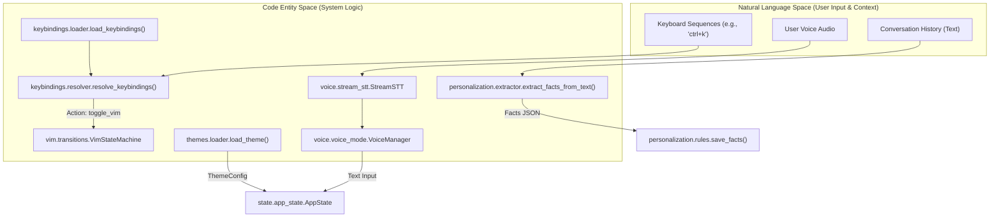
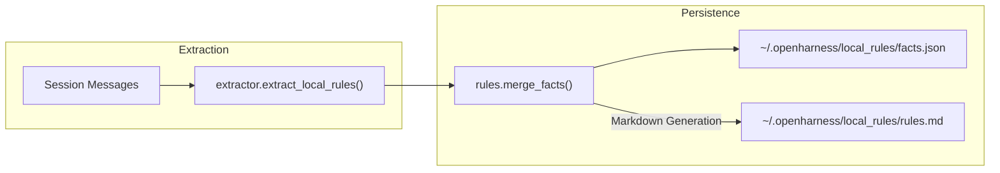
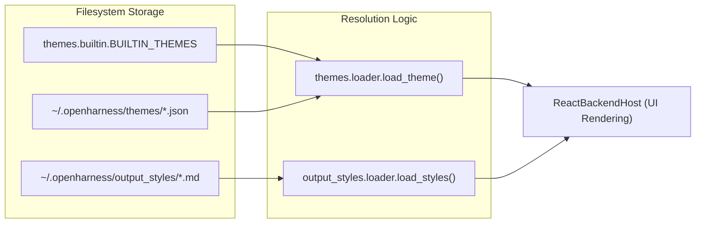

<!-- source: DeepWiki mcp.deepwiki.com · repo HKUDS/OpenHarness · page 15 Advanced Features · fetched 2026-11-09 -->

# Advanced Features

Relevant source files

The following files were used as context for generating this wiki page:

- [src/openharness/personalization/__init__.py](src/openharness/personalization/__init__.py)
- [src/openharness/personalization/extractor.py](src/openharness/personalization/extractor.py)
- [src/openharness/personalization/rules.py](src/openharness/personalization/rules.py)
- [src/openharness/personalization/session_hook.py](src/openharness/personalization/session_hook.py)
- [src/openharness/themes/__init__.py](src/openharness/themes/__init__.py)
- [src/openharness/themes/builtin.py](src/openharness/themes/builtin.py)
- [src/openharness/themes/loader.py](src/openharness/themes/loader.py)
- [src/openharness/themes/schema.py](src/openharness/themes/schema.py)
- [tests/test_personalization/__init__.py](tests/test_personalization/__init__.py)
- [tests/test_personalization/test_extractor.py](tests/test_personalization/test_extractor.py)

OpenHarness provides a suite of advanced interaction modalities, visual customization options, and input enhancements designed for power users and specific accessibility needs. These features extend the core agent loop by modifying how users input commands and how the system renders its responses, interface, and environment-specific context.

### Interaction Modalities

OpenHarness supports multiple ways to interact with the agent beyond standard text input. These modalities can be toggled dynamically during a session using keyboard shortcuts defined in the keybinding system.

*   **Vim Mode**: Enables modal editing within the prompt input, allowing users to use standard Vim motions and commands. This is managed by a state transition engine that tracks the current mode (Insert, Normal, Visual).
*   **Voice Mode**: Integrates Speech-to-Text (STT) capabilities, allowing for hands-free interaction. The system includes diagnostics to detect audio hardware and specialized term handling to improve transcription accuracy for technical jargon.
*   **Keybindings**: A flexible system for mapping physical key combinations to internal application actions. The default configuration provides quick access to system state toggles.

#### Default Keybindings
The system initializes with a set of standard shortcuts defined in `DEFAULT_KEYBINDINGS`:

| Key Combination | Action | Code Reference |
| :--- | :--- | :--- |
| `ctrl+l` | Clear terminal/session view | [src/openharness/keybindings/default_bindings.py:7-7]() |
| `ctrl+k` | Toggle Vim emulation mode | [src/openharness/keybindings/default_bindings.py:8-8]() |
| `ctrl+v` | Toggle Voice input mode | [src/openharness/keybindings/default_bindings.py:9-9]() |
| `ctrl+t` | Open/Toggle background tasks view | [src/openharness/keybindings/default_bindings.py:10-10]() |

For details on customizing these shortcuts and the Vim state machine, see **[Keybindings and Vim Mode](#15.1)**.

### Customization and Output Styles

The visual presentation of the agent's thoughts, tool calls, and results is governed by an extensible styling and theming system.

*   **Theming System**: OpenHarness supports a robust theming engine that controls colors, borders, icons, and layout density. Themes like `cyberpunk`, `solarized`, and `minimal` are built-in, while users can add custom JSON definitions to `~/.openharness/themes/`.
*   **Output Styles**: The `loader` identifies available styles from the user's configuration directory (`~/.openharness/output_styles/`). These styles control how different event types (e.g., `AssistantTextDelta`, `ToolResult`) are rendered in the TUI using Markdown templates.
*   **Personalization**: The system can automatically extract local environment facts (e.g., SSH hosts, Python environments, API endpoints) from session history. This data is persisted and used to build project-specific context.

#### Built-in Themes
Themes are defined using the `ThemeConfig` model in [src/openharness/themes/schema.py:47-55](), which aggregates specific configurations for different UI elements:

| Theme Name | Border Style | Primary Color | Icon Set |
| :--- | :--- | :--- | :--- |
| `default` | `rounded` | `#5875d4` | Standard (⚙, ✔) |
| `minimal` | `none` | `#ffffff` | ASCII (:, .) |
| `cyberpunk`| `double` | `#00ff41` | Tech (◈, ◉) |

**Sources:** [src/openharness/themes/builtin.py:13-89](), [src/openharness/themes/schema.py:47-55](), [src/openharness/themes/loader.py:15-19]()

### Advanced Feature Architecture

The following diagram illustrates how the advanced feature subsystems bridge the gap between user hardware/input (Natural Language Space) and the internal command resolution (Code Entity Space).

**Input and Configuration Flow**

**Sources:** [src/openharness/keybindings/default_bindings.py:6-11](), [src/openharness/themes/loader.py:44-55](), [src/openharness/personalization/extractor.py:46-75]()

### Personalization and Rule Extraction

The personalization engine analyzes conversation history to extract environment-specific "facts" using regex patterns defined in `_FACT_PATTERNS` [src/openharness/personalization/extractor.py:11-43](). This includes:
*   **Infrastructure**: SSH hosts, IP addresses, and API endpoints.
*   **Environment**: Conda/Python environments and environment variables.
*   **Workflow**: Git remotes and cron schedules.

These facts are merged into a persistent JSON store (`facts.json`) and converted into a human-readable Markdown file (`rules.md`) via `facts_to_rules_markdown` [src/openharness/personalization/extractor.py:101-138]().

**Personalization Pipeline**

**Sources:** [src/openharness/personalization/session_hook.py:22-66](), [src/openharness/personalization/rules.py:49-64]()

### Configuration Resolution

Advanced features are resolved at runtime through a pipeline that merges default settings with user-defined overrides.

**Theme and Style Resolution Pipeline**

**Sources:** [src/openharness/themes/loader.py:35-41](), [src/openharness/themes/loader.py:50-55]()

For details on configuring STT hardware and creating custom output templates, see **[Voice Mode and Output Styles](#15.2)**.

---

### Sub-pages
*   **[Keybindings and Vim Mode](#15.1)**: Deep dive into the modal editing engine and keyboard event resolution.
*   **[Voice Mode and Output Styles](#15.2)**: Detailed documentation on STT integration, hardware requirements, the output styling engine, and personalization fact extraction.

---

