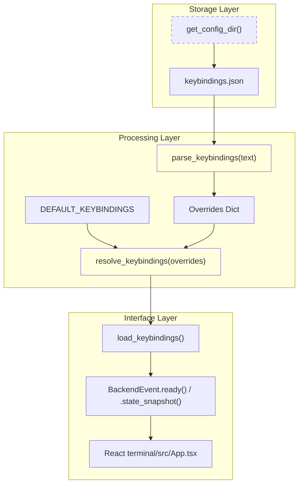

<!-- source: DeepWiki mcp.deepwiki.com · repo HKUDS/OpenHarness · page 15.1 Keybindings and Vim Mode · fetched 2026-11-09 -->

# Keybindings and Vim Mode

<details>
<summary>Relevant source files</summary>

The following files were used as context for generating this wiki page:

- [frontend/terminal/src/App.tsx](frontend/terminal/src/App.tsx)
- [frontend/terminal/src/clipboardImage.ts](frontend/terminal/src/clipboardImage.ts)
- [frontend/terminal/src/components/PromptInput.test.tsx](frontend/terminal/src/components/PromptInput.test.tsx)
- [frontend/terminal/src/components/PromptInput.tsx](frontend/terminal/src/components/PromptInput.tsx)
- [frontend/terminal/src/hooks/useBackendSession.ts](frontend/terminal/src/hooks/useBackendSession.ts)
- [frontend/terminal/src/types.ts](frontend/terminal/src/types.ts)
- [src/openharness/ui/protocol.py](src/openharness/ui/protocol.py)

</details>


This page documents the keybinding system and modal editing state management in OpenHarness. The system allows for customizable keyboard shortcuts that trigger specific application actions, such as clearing the screen, toggling voice mode, or enabling Vim-style modal editing within the terminal interface.

## Keybinding Architecture

OpenHarness employs a layered approach to keybinding resolution, merging hardcoded defaults with user-defined configurations stored in the filesystem. The React TUI receives these resolved keybindings via the `OHJSON:` protocol and maps them to frontend actions.

### Data Flow and Resolution

The keybinding system follows a linear pipeline from raw configuration files to a resolved mapping used by the UI layer.

Title: Keybinding Resolution Pipeline

**Sources:** `src/openharness/keybindings/loader.py:12-22`, `src/openharness/keybindings/parser.py:8-18`, `src/openharness/keybindings/resolver.py:8-13`, `src/openharness/ui/protocol.py:138-155`

## Default Keybindings

The system provides a set of core shortcuts out of the box. These are defined in `DEFAULT_KEYBINDINGS` as a mapping between key combinations and internal action identifiers.

| Key Combination | Action Identifier | Description |
| :--- | :--- | :--- |
| `ctrl+l` | `clear` | Clears the terminal conversation view. |
| `ctrl+k` | `toggle_vim` | Toggles Vim modal editing mode for the prompt input. |
| `ctrl+v` | `toggle_voice` | Toggles the voice-to-text input system. |
| `ctrl+t` | `tasks` | Opens the background tasks management view. |

**Sources:** `src/openharness/keybindings/default_bindings.py:6-11`

## Configuration and Loading

Keybindings are managed via three primary components in the `keybindings/` directory:

### Keybinding Loader (`loader.py`)
The `load_keybindings` function is the primary entry point for the UI to retrieve the active keymap [src/openharness/keybindings/loader.py:17-18](). It performs the following steps:
1. Locates the user's configuration directory using `get_config_dir()` [src/openharness/keybindings/loader.py:12-14]().
2. Checks for the existence of `keybindings.json` [src/openharness/keybindings/loader.py:20-20]().
3. If the file exists, it passes the file content to `parse_keybindings` [src/openharness/keybindings/loader.py:22-22]().
4. Merges the results with defaults via `resolve_keybindings` [src/openharness/keybindings/loader.py:22-22]().

### Parser (`parser.py`)
The `parse_keybindings` function handles the conversion of raw JSON strings into Python dictionaries [src/openharness/keybindings/parser.py:8-9](). It enforces strict type checking, ensuring that both keys and values are strings [src/openharness/keybindings/parser.py:15-16](), and raises `ValueError` if the JSON structure is invalid [src/openharness/keybindings/parser.py:11-12]().

### Resolver (`resolver.py`)
The `resolve_keybindings` function implements the merging logic [src/openharness/keybindings/resolver.py:8-9](). It creates a copy of `DEFAULT_KEYBINDINGS` [src/openharness/keybindings/resolver.py:10-10]() and updates it with any provided `overrides` [src/openharness/keybindings/resolver.py:11-13](), allowing users to redefine existing shortcuts or add new ones.

**Sources:** `src/openharness/keybindings/loader.py:12-22`, `src/openharness/keybindings/parser.py:8-18`, `src/openharness/keybindings/resolver.py:8-13`

## Vim Mode and Modal State

Vim mode allows users to interact with the `PromptInput` using standard Vim motions and commands. While the state is persisted in the backend, the interactive handling occurs in the React TUI.

Title: Vim Mode State and Transition Logic
```mermaid
classDiagram
    class AppState {
        +bool vim_enabled
        +dict keybindings
    }
    class FrontendRequest {
        +Literal type "submit_line"
        +str line
    }
    class PromptInput {
        +MultilineTextInput
        +handleRawInput()
    }
    class VimTransitions {
        +handle_transition(current_state, input)
        +INSERT
        +NORMAL
        +VISUAL
    }

    AppState --o FrontendRequest : "Serialized via BackendEvent"
    PromptInput ..> VimTransitions : "Uses for cursor/input logic"
    VimTransitions --* "vim/transitions.py" : "Logic defined in"
```

### Implementation Details
*   **State Persistence**: The `vim_enabled` boolean is part of the `AppState` [src/openharness/ui/protocol.py:211-211]() and is synced to the frontend via `BackendEvent` [src/openharness/ui/protocol.py:154-155]().
*   **Toggling**: When the `ctrl+k` keybinding is triggered [src/openharness/keybindings/default_bindings.py:8-8](), the UI sends a `FrontendRequest` of type `select_command` with the value `vim` [frontend/terminal/src/App.tsx:191-194]() to toggle the setting.
*   **Input Handling**: The `PromptInput` component manages raw terminal sequences. It uses `useInput` to capture keys like `leftArrow`, `rightArrow`, and `backspace` [frontend/terminal/src/components/PromptInput.tsx:75-113]().
*   **Modal Transitions**: The `vim/transitions.py` logic (managed by the backend but utilized by UI state updates) manages the internal state machine for switching between `INSERT`, `NORMAL`, and `VISUAL` modes. This ensures that keystrokes are interpreted correctly (e.g., `h/j/k/l` as motions in `NORMAL` mode vs. literal characters in `INSERT` mode).
*   **Clipboard Integration**: Even in Vim mode, specific combinations like `ctrl+v` are intercepted to allow for image attachments rather than literal paste, handled by `attachClipboardImage` [frontend/terminal/src/App.tsx:111-124]().

**Sources:** `src/openharness/keybindings/default_bindings.py:8-8`, `src/openharness/ui/protocol.py:202-222`, `frontend/terminal/src/App.tsx:188-194`, `frontend/terminal/src/components/PromptInput.tsx:75-160`, `src/openharness/vim/transitions.py:1-25`

---

