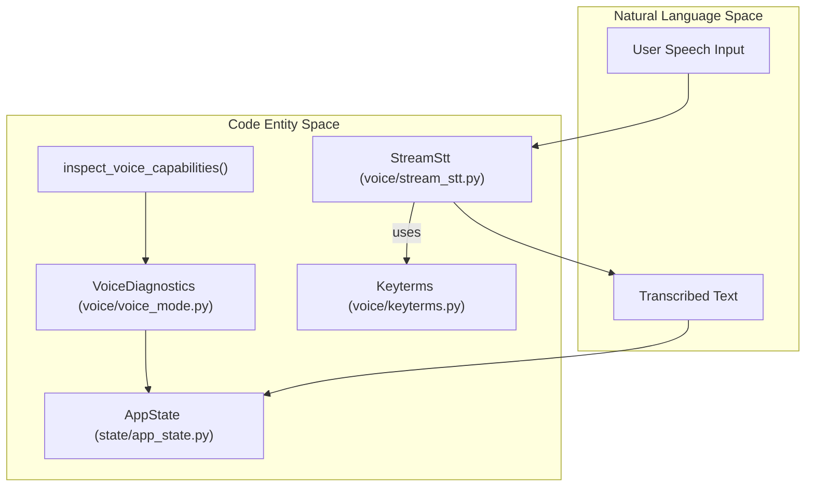
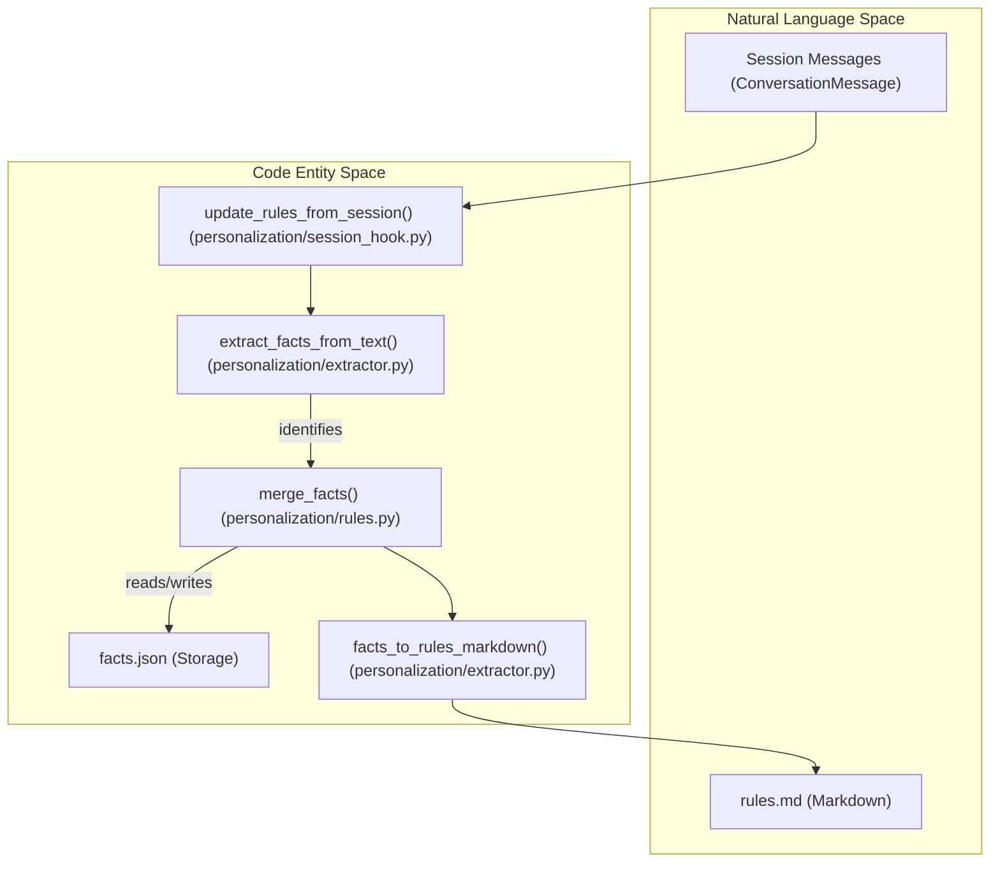

<!-- source: DeepWiki mcp.deepwiki.com · repo HKUDS/OpenHarness · page 15.2 Voice Mode and Output Styles · fetched 2026-11-09 -->

# Voice Mode and Output Styles

Relevant source files

The following files were used as context for generating this wiki page:

- [frontend/terminal/src/components/ConversationView.tsx](frontend/terminal/src/components/ConversationView.tsx)
- [frontend/terminal/src/components/ToolCallDisplay.tsx](frontend/terminal/src/components/ToolCallDisplay.tsx)
- [src/openharness/output_styles/loader.py](src/openharness/output_styles/loader.py)
- [src/openharness/personalization/__init__.py](src/openharness/personalization/__init__.py)
- [src/openharness/personalization/extractor.py](src/openharness/personalization/extractor.py)
- [src/openharness/personalization/rules.py](src/openharness/personalization/rules.py)
- [src/openharness/personalization/session_hook.py](src/openharness/personalization/session_hook.py)
- [src/openharness/themes/__init__.py](src/openharness/themes/__init__.py)
- [src/openharness/themes/builtin.py](src/openharness/themes/builtin.py)
- [src/openharness/themes/loader.py](src/openharness/themes/loader.py)
- [src/openharness/themes/schema.py](src/openharness/themes/schema.py)
- [tests/test_config/test_output_styles_loader.py](tests/test_config/test_output_styles_loader.py)
- [tests/test_personalization/__init__.py](tests/test_personalization/__init__.py)
- [tests/test_personalization/test_extractor.py](tests/test_personalization/test_extractor.py)

This page documents the implementation of voice interaction capabilities, the customizable output formatting and theming system, and the personalization engine that extracts environment-specific facts from user interactions.

## Voice Mode

Voice mode provides an alternative input method using system-level audio recording and transcription. It is managed by a diagnostic layer that verifies hardware capabilities and a streaming engine that handles audio capture and processing.

### Voice Diagnostics and Capabilities

The `VoiceDiagnostics` class and `inspect_voice_capabilities` function are responsible for environment validation. This includes checking for required libraries (like `PyAudio`) and detecting available input devices.

*   **`VoiceDiagnostics`**: A dataclass that encapsulates the status of the voice subsystem, including whether the recorder is available and any error messages encountered during initialization [src/openharness/voice/voice_mode.py:11-17]().
*   **`inspect_voice_capabilities()`**: Probes the system for audio recording support. It attempts to initialize the recording backend and returns a `VoiceDiagnostics` object [src/openharness/voice/voice_mode.py:20-45]().

### Audio Streaming and STT

The voice system utilizes a streaming architecture to capture audio and convert it to text.

*   **`StreamStt`**: Manages the lifecycle of an audio stream. It handles opening the microphone, buffering audio data, and interfacing with a transcription provider [src/openharness/voice/stream_stt.py:10-50]().
*   **Keyterms**: The system supports `keyterms.py`, which defines specific phrases or commands that the STT engine should prioritize or recognize as triggers for specific actions [src/openharness/voice/keyterms.py:1-25]().

### Voice System Architecture

The following diagram illustrates the relationship between the diagnostic layer, the recorder, and the application state.

**Voice Subsystem Integration**

**Sources:** [src/openharness/voice/voice_mode.py:11-45](), [src/openharness/voice/stream_stt.py:10-50](), [src/openharness/voice/keyterms.py:1-25]()

---

## Output Styles and Themes

OpenHarness separates the structural formatting of responses (Styles) from the visual aesthetics of the terminal (Themes).

### OutputStyle Model

The `OutputStyle` dataclass represents a specific formatting configuration for LLM responses. Built-in styles include `default`, `minimal`, and `codex` [src/openharness/output_styles/loader.py:29-33]().

| Field | Type | Description |
| :--- | :--- | :--- |
| `name` | `str` | The identifier for the style (e.g., "minimal"). |
| `content` | `str` | Formatting instructions or template content. |
| `source` | `str` | "builtin" or "user" defined [src/openharness/output_styles/loader.py:11-18](). |

### Terminal UI Rendering (Codex Style)

The React/Ink TUI uses the active `outputStyle` to determine how to render components like `ConversationView` and `ToolCallDisplay`.

*   **`ConversationView`**: When `outputStyle` is "codex", it renders messages with compact `>` prefixes for users and omits icons for the assistant [frontend/terminal/src/components/ConversationView.tsx:103-143]().
*   **`ToolCallDisplay`**: In "codex" mode, tool calls are rendered as bullet points (`• Ran tool_name`) with a condensed status indicator (e.g., `5L` for 5 lines of output) [frontend/terminal/src/components/ToolCallDisplay.tsx:46-61]().

### Theme System

The theme system controls colors, icons, and layout density via the `ThemeConfig` model [src/openharness/themes/schema.py:47-55]().

*   **`ColorsConfig`**: Defines hex codes for `primary`, `secondary`, `accent`, `error`, etc [src/openharness/themes/schema.py:10-20]().
*   **`IconConfig`**: Customizes glyphs for the `spinner`, `tool`, `error`, `success`, and `assistant` indicators [src/openharness/themes/schema.py:29-37]().
*   **Resolution**: `load_theme(name)` checks `~/.openharness/themes/*.json` first, then falls back to `BUILTIN_THEMES` [src/openharness/themes/loader.py:44-55]().

---

## Personalization and Fact Extraction

The personalization subsystem automatically learns about the user's environment by scanning session history for specific patterns.

### Fact Extraction Engine

The `extractor.py` module uses regex patterns to identify environment facts such as SSH hosts, IP addresses, Conda environments, and API endpoints [src/openharness/personalization/extractor.py:11-43]().

*   **`extract_facts_from_text(text)`**: Scans a string for patterns, deduplicates them, and returns a list of fact dictionaries containing the `type`, `label`, `value`, and a default `confidence` of 0.7 [src/openharness/personalization/extractor.py:46-75]().
*   **`merge_facts(existing, new)`**: Merges new facts into the persistent store. If a fact key already exists, it updates the entry only if the new fact has equal or higher confidence [src/openharness/personalization/rules.py:49-64]().

### Rule Persistence

Facts are persisted in `~/.openharness/local_rules/facts.json` and rendered into a human-readable Markdown file for the LLM's system prompt.

*   **`facts_to_rules_markdown(facts)`**: Groups extracted facts by category (e.g., "SSH Hosts", "Python Environments") and generates a Markdown document [src/openharness/personalization/extractor.py:101-138]().
*   **`update_rules_from_session(messages)`**: A session-end hook that collects all message content, extracts new facts, merges them with the global store, and regenerates the rules Markdown [src/openharness/personalization/session_hook.py:22-65]().

### Personalization Data Flow

**Personalization Pipeline**

**Sources:** [src/openharness/personalization/extractor.py:11-138](), [src/openharness/personalization/rules.py:9-64](), [src/openharness/personalization/session_hook.py:22-65](), [frontend/terminal/src/components/ConversationView.tsx:30-190](), [src/openharness/themes/loader.py:15-55]()

---

