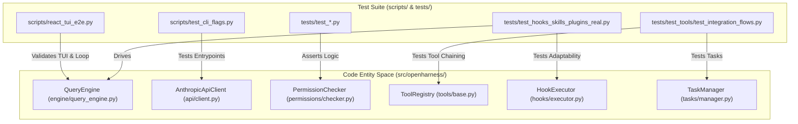
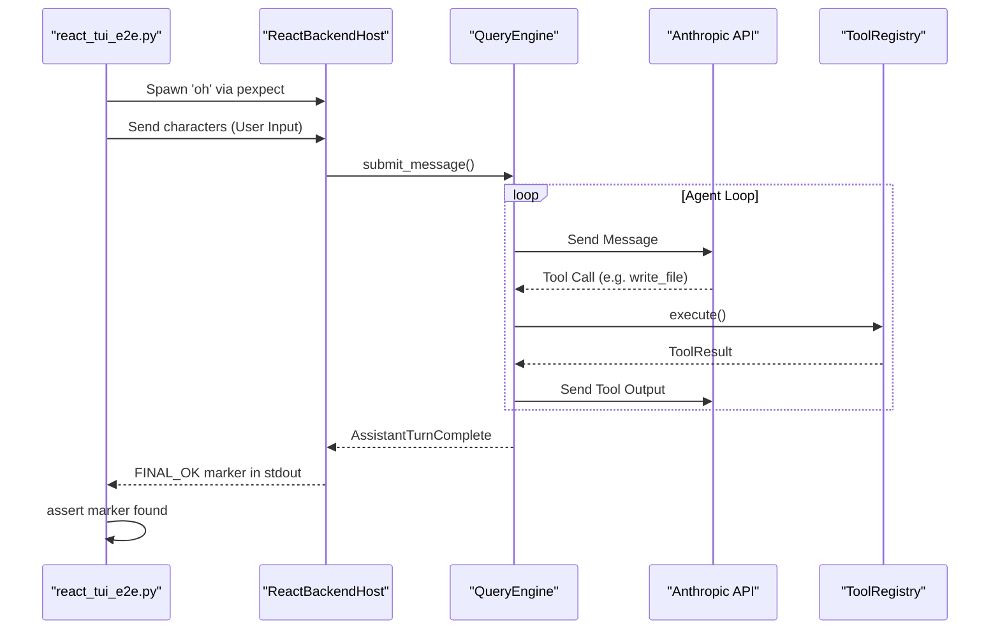

<!-- source: DeepWiki mcp.deepwiki.com · repo HKUDS/OpenHarness · page 16 Testing · fetched 2026-11-09 -->

# Testing

Relevant source files

The following files were used as context for generating this wiki page:

- [.github/ISSUE_TEMPLATE/bug_report.yml](.github/ISSUE_TEMPLATE/bug_report.yml)
- [.github/ISSUE_TEMPLATE/config.yml](.github/ISSUE_TEMPLATE/config.yml)
- [.github/ISSUE_TEMPLATE/feature_request.yml](.github/ISSUE_TEMPLATE/feature_request.yml)
- [.github/PULL_REQUEST_TEMPLATE.md](.github/PULL_REQUEST_TEMPLATE.md)
- [.github/workflows/ci.yml](.github/workflows/ci.yml)
- [CONTRIBUTING.md](CONTRIBUTING.md)
- [docs/SHOWCASE.md](docs/SHOWCASE.md)
- [scripts/react_tui_e2e.py](scripts/react_tui_e2e.py)
- [scripts/test_cli_flags.py](scripts/test_cli_flags.py)
- [scripts/test_harness_features.py](scripts/test_harness_features.py)
- [src/openharness/tools/__init__.py](src/openharness/tools/__init__.py)
- [tests/test_hooks_skills_plugins_real.py](tests/test_hooks_skills_plugins_real.py)
- [tests/test_real_large_tasks.py](tests/test_real_large_tasks.py)
- [tests/test_swarm/test_imports.py](tests/test_swarm/test_imports.py)
- [tests/test_tools/test_integration_flows.py](tests/test_tools/test_integration_flows.py)
- [tests/test_untested_features.py](tests/test_untested_features.py)

OpenHarness employs a multi-tiered testing strategy to ensure the reliability of its agentic loop, tool execution, and user interface. The test suite is divided into granular unit tests that validate individual components in isolation and comprehensive integration/end-to-end (E2E) scripts that verify system behavior against real LLM providers.

### Test Suite Structure

The codebase separates tests into two primary directories based on their scope and execution requirements:

1.  **Unit Tests (`tests/`)**: Pytest-based tests focusing on internal logic, state management, and protocol compliance. These typically run without external API dependencies, though specialized files like `tests/test_untested_features.py` [tests/test_untested_features.py:1-8]() and `tests/test_hooks_skills_plugins_real.py` [tests/test_hooks_skills_plugins_real.py:1-7]() utilize real API keys for deep integration verification of the agent loop.
2.  **Integration & E2E Scripts (`scripts/`)**: High-level scripts designed to run real-world scenarios against Anthropic-compatible APIs (e.g., Claude, Kimi). These validate the full "Natural Language to Tool Action" pipeline and CLI behavior [scripts/test_cli_flags.py:2-8]().

### System Testing Architecture

The following diagram illustrates how testing entities map to the core system components they validate.

**Testing to Code Entity Mapping**

Sources: [scripts/test_cli_flags.py:26-36](), [scripts/react_tui_e2e.py:21-34](), [tests/test_hooks_skills_plugins_real.py:61-110](), [tests/test_untested_features.py:43-65](), [tests/test_tools/test_integration_flows.py:28-30]()

### Unit Testing (`tests/`)

The unit test suite leverages `pytest` and `pytest-asyncio` to validate the modular subsystems of OpenHarness. Key areas of focus include:

*   **API Protocol**: Ensuring `AnthropicApiClient` correctly handles streaming events and retry logic.
*   **Tool Logic**: Verifying that built-in tools return expected `ToolResult` objects and correctly interact with the filesystem. `test_integration_flows.py` specifically tests the "Search-Edit" flow using `GlobTool`, `GrepTool`, and `FileEditTool` [tests/test_tools/test_integration_flows.py:28-58]().
*   **Permissions**: Testing `PermissionChecker` against various `PermissionMode` settings and path rules.
*   **Hook & Skill Integration**: Validating that `HookExecutor` can block tool calls [tests/test_untested_features.py:104-144]() and that the model can adapt when tools are restricted by a `PRE_TOOL_USE` hook [tests/test_hooks_skills_plugins_real.py:61-133]().
*   **Task Management**: Verifying `TaskManager` and `BackgroundTaskManager` handle shell and agent tasks [tests/test_tools/test_integration_flows.py:61-111]().

For a detailed breakdown of fixtures and subsystem-specific tests, see **[Unit Test Suite](#16.1)**.

### End-to-End (E2E) and Integration Scripts (`scripts/`)

Integration testing is performed using specialized scripts that simulate user interactions and complex agent workflows.

| Script | Purpose | Key Components Tested |
| :--- | :--- | :--- |
| `react_tui_e2e.py` | Scripted TUI checks using `pexpect`. | React/Ink Frontend, `AskUserQuestionTool`, Plan Mode [scripts/react_tui_e2e.py:63-140](). |
| `test_cli_flags.py` | Validates CLI arguments and output formats. | `oh` CLI, `--print` mode, JSON output, `mcp/plugin` subcommands [scripts/test_cli_flags.py:40-125](). |
| `e2e_smoke.py` | Runs 18+ real-model scenarios. | `QueryEngine`, `McpClientManager`, `Plugin` loading. |

#### Scenario-Based Testing
Scenario-based testing ensures the agent can handle multi-turn flows, such as a security audit involving `web_fetch`, `grep`, and lifecycle hooks [tests/test_real_large_tasks.py:93-158]().

**E2E Data Flow**

Sources: [scripts/react_tui_e2e.py:21-44](), [scripts/react_tui_e2e.py:63-86](), [tests/test_untested_features.py:68-85](), [tests/test_hooks_skills_plugins_real.py:34-50]()

### Related Pages
*   **[Unit Test Suite](#16.1)**: Deep dive into `tests/`, `conftest.py`, and subsystem-specific assertions.
*   **[End-to-End and Integration Scripts](#16.2)**: Detailed guide on `scripts/`, real-model testing, and CLI flag validation.

Sources: [scripts/test_cli_flags.py:1-158](), [scripts/react_tui_e2e.py:1-162](), [tests/test_untested_features.py:1-144](), [tests/test_hooks_skills_plugins_real.py:1-133](), [tests/test_tools/test_integration_flows.py:1-194](), [tests/test_real_large_tasks.py:1-158]()

---

