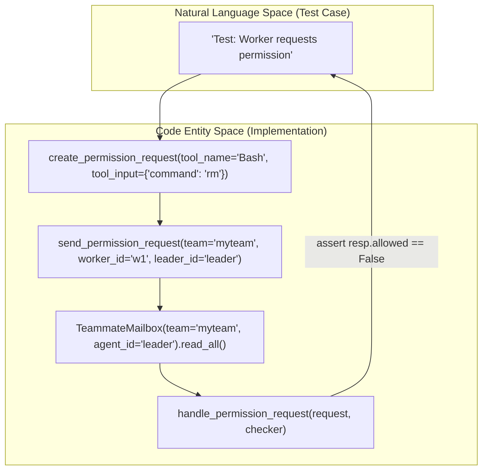
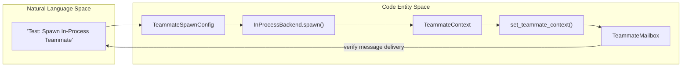

<!-- source: DeepWiki mcp.deepwiki.com · repo HKUDS/OpenHarness · page 16.1 Unit Test Suite · fetched 2026-11-09 -->

# Unit Test Suite

Relevant source files

The following files were used as context for generating this wiki page:

- [.github/ISSUE_TEMPLATE/bug_report.yml](.github/ISSUE_TEMPLATE/bug_report.yml)
- [.github/ISSUE_TEMPLATE/config.yml](.github/ISSUE_TEMPLATE/config.yml)
- [.github/ISSUE_TEMPLATE/feature_request.yml](.github/ISSUE_TEMPLATE/feature_request.yml)
- [.github/PULL_REQUEST_TEMPLATE.md](.github/PULL_REQUEST_TEMPLATE.md)
- [.github/workflows/ci.yml](.github/workflows/ci.yml)
- [CONTRIBUTING.md](CONTRIBUTING.md)
- [docs/SHOWCASE.md](docs/SHOWCASE.md)
- [scripts/react_tui_e2e.py](scripts/react_tui_e2e.py)
- [scripts/test_cli_flags.py](scripts/test_cli_flags.py)
- [scripts/test_harness_features.py](scripts/test_harness_features.py)
- [src/openharness/tools/__init__.py](src/openharness/tools/__init__.py)
- [tests/test_coordinator/test_coordinator_mode.py](tests/test_coordinator/test_coordinator_mode.py)
- [tests/test_hooks_skills_plugins_real.py](tests/test_hooks_skills_plugins_real.py)
- [tests/test_real_large_tasks.py](tests/test_real_large_tasks.py)
- [tests/test_swarm/__init__.py](tests/test_swarm/__init__.py)
- [tests/test_swarm/test_imports.py](tests/test_swarm/test_imports.py)
- [tests/test_swarm/test_in_process.py](tests/test_swarm/test_in_process.py)
- [tests/test_swarm/test_mailbox.py](tests/test_swarm/test_mailbox.py)
- [tests/test_swarm/test_permission_sync.py](tests/test_swarm/test_permission_sync.py)
- [tests/test_swarm/test_registry.py](tests/test_swarm/test_registry.py)
- [tests/test_swarm/test_team_lifecycle.py](tests/test_swarm/test_team_lifecycle.py)
- [tests/test_swarm/test_types.py](tests/test_swarm/test_types.py)
- [tests/test_swarm/test_worktree.py](tests/test_swarm/test_worktree.py)
- [tests/test_tools/test_integration_flows.py](tests/test_tools/test_integration_flows.py)
- [tests/test_untested_features.py](tests/test_untested_features.py)

The OpenHarness unit test suite provides comprehensive coverage of the system's core logic, from API communication and tool execution to permission evaluation, swarm coordination, and UI protocol handling. Built on `pytest` and leveraging `pytest-asyncio` for asynchronous operations, the suite ensures that individual components behave correctly in isolation and when integrated.

## Test Architecture and Configuration

The test suite is located in the `tests/` directory and follows a modular structure corresponding to the system's sub-packages. Global test configurations and shared utilities are defined in `conftest.py`.

### Fixtures and Environment
The suite utilizes `pytest` fixtures to provide clean, isolated environments for each test case. This includes:
*   **Temporary Directories**: Using `tmp_path` to simulate project structures, config directories, and session storage [tests/test_tools/test_integration_flows.py:28-30]().
*   **Mocked API Clients**: Replacing `AnthropicApiClient` with mocks to test error handling and retry logic without incurring costs [tests/test_untested_features.py:57-65]().
*   **Settings Overrides**: Injecting specific `Settings` models via `monkeypatch` to test different permission modes or data directories [tests/test_tools/test_integration_flows.py:61-64]().
*   **Isolated Swarm Environments**: Mocking `Path.home` to a `tmp_path` ensures that swarm mailboxes and lockfiles do not interfere with the host system [tests/test_swarm/test_in_process.py:35-37]().

### Async Testing
OpenHarness relies heavily on Python's `asyncio`. The test suite uses the `@pytest.mark.asyncio` decorator to handle asynchronous functions, particularly for:
*   `QueryEngine.submit_message()` execution loops [tests/test_hooks_skills_plugins_real.py:113-117]().
*   Tool execution via `BaseTool.execute()` [tests/test_tools/test_integration_flows.py:38-41]().
*   Swarm operations like spawning teammates and polling for permission responses [tests/test_swarm/test_permission_sync.py:166-169]().

Sources: [tests/test_tools/test_integration_flows.py:28-64](), [tests/test_untested_features.py:57-65](), [tests/test_swarm/test_in_process.py:35-37](), [tests/test_swarm/test_permission_sync.py:166-169]()

## Component-Specific Test Modules

### API and Connectivity (`test_api`)
Tests the `AnthropicApiClient` and its ability to handle various API responses.
*   **Client Initialization**: Validates `AnthropicApiClient` setup with `api_key` and `base_url` [tests/test_untested_features.py:57-57]().
*   **Protocol Compliance**: Ensures `AssistantTextDelta` and `AssistantTurnComplete` are correctly collected and parsed from the stream [tests/test_untested_features.py:68-85]().

### Swarm and Multi-Agent Coordination (`test_swarm`)
Focuses on the infrastructure for agent teams, inter-agent communication, and permission synchronization.
*   **Permission Sync**: Validates the `SwarmPermissionResponse` and the polling mechanism for worker-leader coordination [tests/test_swarm/test_permission_sync.py:10-18]().
*   **In-Process Backend**: Tests the `InProcessBackend` for spawning asyncio-based teammates, including context management via `TeammateContext` [tests/test_swarm/test_in_process.py:9-15]().
*   **Backend Registry**: Ensures `BackendRegistry` correctly detects available environments (e.g., `subprocess`, `in_process`) and caches detection results [tests/test_swarm/test_registry.py:47-60]().
*   **Import Isolation**: `test_create_default_tool_registry_does_not_import_mailbox_eagerly` ensures that the tools system does not have a hard dependency on the swarm mailbox at import time [tests/test_swarm/test_imports.py:9-22]().

### Permissions and Security (`test_permissions`)
Focuses on the `PermissionChecker` and the enforcement of safety rules.
*   **Read-Only Heuristics**: Validates that safe tools (e.g., `read_file`, `glob`) are automatically approved while write tools (e.g., `bash`, `edit_file`) require evaluation [tests/test_swarm/test_permission_sync.py:26-37]().
*   **Decision Delegation**: Ensures `handle_permission_request` correctly delegates to the `PermissionChecker` for dangerous commands like `rm -rf /` [tests/test_swarm/test_permission_sync.py:130-145]().

### Tools and Registry (`test_tools`)
Covers the lifecycle of tool execution and registration.
*   **Registry Loading**: Validates that `create_default_tool_registry` correctly discovers and registers the standard 40+ tools [src/openharness/tools/__init__.py:48-98]().
*   **Integration Flows**: `test_search_edit_flow_across_registry` validates the sequence of `write_file` -> `glob` -> `grep` -> `edit_file` -> `read_file` [tests/test_tools/test_integration_flows.py:28-58]().
*   **Agent Restart Logic**: `test_agent_send_message_flow_restarts_completed_agent` verifies that sending a message to a finished agent task correctly triggers a restart [tests/test_tools/test_integration_flows.py:145-192]().

Sources: [tests/test_swarm/test_permission_sync.py:10-145](), [tests/test_swarm/test_in_process.py:9-15](), [tests/test_swarm/test_registry.py:47-60](), [src/openharness/tools/__init__.py:48-98](), [tests/test_tools/test_integration_flows.py:145-192]()

## Data Flow: Test to Code Entity Mapping

The following diagrams illustrate how the test suite interacts with core system entities during execution.

### Swarm Permission Request Flow
"This diagram shows how a unit test validates the lifecycle of a permission request between a worker and a leader in a swarm."

Sources: [tests/test_swarm/test_permission_sync.py:85-145]()

### Teammate In-Process Spawning
"This diagram bridges the gap between an in-process backend test and the context-aware execution of an agent task."

Sources: [tests/test_swarm/test_in_process.py:67-152]()

## Integration and CLI Testing

Several critical "smoke tests" and feature validation scripts exist in `scripts/` and `tests/` to test the CLI and high-level agent behaviors.

### React TUI End-to-End
The `scripts/react_tui_e2e.py` script uses `pexpect` to simulate user interaction with the terminal UI:
*   **Question Flow**: Simulates the `ask_user_question` tool and verifies that the answer provided via the TUI modal is correctly received by the model [scripts/react_tui_e2e.py:89-117]().
*   **Command Flow**: Verifies that slash commands like `/plan` correctly transition the TUI into `PLAN MODE` [scripts/react_tui_e2e.py:119-140]().

### Real-Model Integration Tasks
The suite includes complex tasks that run against real APIs (e.g., Kimi K2.5) to verify emergent behavior:
*   **Security Audit**: Combines `web_fetch`, `grep`, and `hooks` to perform a multi-turn audit [tests/test_real_large_tasks.py:93-158]().
*   **Model Adaptation**: Verifies that the model switches tools (e.g., from `bash` to `glob`) when a hook blocks its first choice [tests/test_hooks_skills_plugins_real.py:61-133]().

### Summary Table: Test Coverage by Module

| Module | Key Entities Tested | Primary Focus |
| :--- | :--- | :--- |
| `test_core_tools` | `BashTool`, `FileReadTool`, `LspTool` | Basic tool execution and file system side effects |
| `test_integration_flows`| `ToolRegistry`, `BackgroundTaskManager` | Sequences of tools and background task lifecycle |
| `test_permission_sync` | `TeammateMailbox`, `SwarmPermissionResponse` | Cross-agent permission coordination |
| `test_in_process` | `InProcessBackend`, `TeammateContext` | Asyncio-based teammate isolation and communication |
| `test_registry` | `BackendRegistry` | Automatic detection of execution environments (tmux/subprocess) |
| `react_tui_e2e` | `ReactBackendHost`, `pexpect` | Interactive TUI scenarios and slash command handling |

Sources: [tests/test_swarm/test_permission_sync.py:1-183](), [tests/test_swarm/test_in_process.py:1-183](), [tests/test_tools/test_integration_flows.py:1-192](), [scripts/react_tui_e2e.py:1-162](), [tests/test_real_large_tasks.py:93-158]()

---

