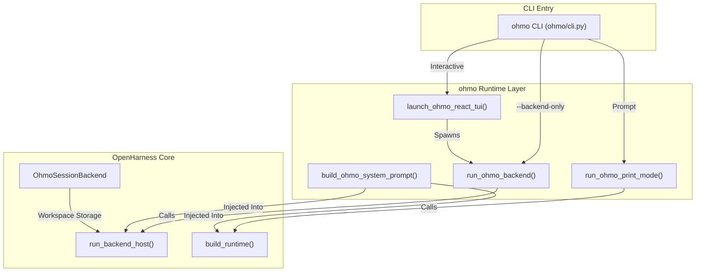
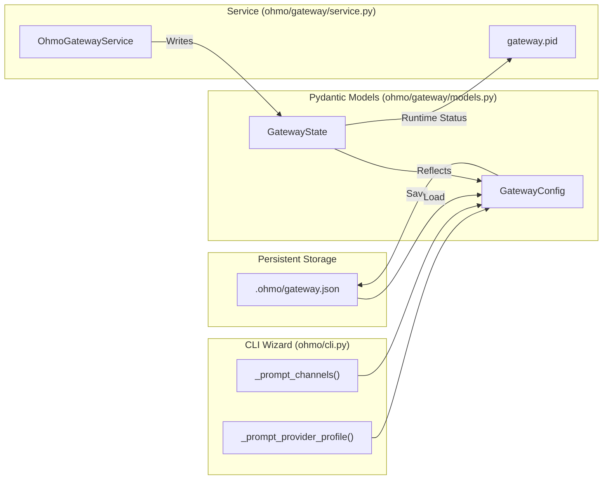

<!-- source: DeepWiki mcp.deepwiki.com · repo HKUDS/OpenHarness · page 17.1 ohmo CLI and Workspace · fetched 2026-11-09 -->

# ohmo CLI and Workspace

Relevant source files

The following files were used as context for generating this wiki page:

- [ohmo/cli.py](ohmo/cli.py)
- [ohmo/gateway/router.py](ohmo/gateway/router.py)
- [ohmo/gateway/service.py](ohmo/gateway/service.py)
- [ohmo/group_registry.py](ohmo/group_registry.py)
- [ohmo/memory.py](ohmo/memory.py)
- [ohmo/workspace.py](ohmo/workspace.py)
- [scripts/migrate_memory.py](scripts/migrate_memory.py)
- [src/openharness/memory/migrate.py](src/openharness/memory/migrate.py)
- [src/openharness/memory/search.py](src/openharness/memory/search.py)
- [src/openharness/ui/coordinator_drain.py](src/openharness/ui/coordinator_drain.py)
- [tests/test_memory/test_memdir.py](tests/test_memory/test_memdir.py)
- [tests/test_ohmo/test_cli.py](tests/test_ohmo/test_cli.py)
- [tests/test_ohmo/test_prompts.py](tests/test_ohmo/test_prompts.py)

The `ohmo` application is a personal-agent implementation built on top of the OpenHarness core. It extends the standard agent capabilities with a dedicated workspace structure (`~/.ohmo/`), a persistent "soul" and "user" context, and a gateway service for multi-channel communication. The `ohmo` CLI provides the primary interface for managing this workspace, configuring LLM providers, and launching the agent in various modes.

## ohmo CLI Overview

The `ohmo` CLI is defined in `ohmo/cli.py` using the `typer` library. It serves as the entry point for workspace initialization, configuration, and agent execution.

### Command Structure
The CLI is organized into several sub-apps to manage different aspects of the personal agent:

| Command | Function | Implementation |
| :--- | :--- | :--- |
| `init` | Bootstraps the `.ohmo` workspace and gateway config. | [ohmo/cli.py:246-278]() |
| `config` | Wizard for provider profiles and messaging channels. | [ohmo/cli.py:281-325]() |
| `soul` | Inspects or edits the agent's core personality (`soul.md`). | [ohmo/cli.py:45-45]() |
| `user` | Inspects or edits the user profile (`user.md`). | [ohmo/cli.py:46-46]() |
| `memory` | Manages durable personal memory entries. | [ohmo/cli.py:44-44]() |
| `gateway` | Manages the background gateway service process. | [ohmo/cli.py:47-47]() |
| `doctor` | Checks workspace health and configuration. | [ohmo/cli.py:359-378]() |

### Execution Modes
When invoked without a subcommand, `ohmo` defaults to launching the interactive agent. It supports three primary execution paths:
1.  **React TUI**: The default interactive mode using the React/Ink terminal interface. Launched via `launch_ohmo_react_tui()` [ohmo/runtime.py:81-133]().
2.  **Print Mode**: A non-interactive mode for single prompts, executed via `run_ohmo_print_mode()` [ohmo/runtime.py:136-190]().
3.  **Backend Only**: Runs the Python backend host without a frontend, typically used when the React TUI spawns its own backend process [ohmo/runtime.py:27-55]().

**Sources:**
- `ohmo/cli.py:38-52` (App and Sub-app definitions)
- `ohmo/runtime.py:27-190` (Execution mode implementations)

---

## Workspace Management

The `ohmo` workspace is a directory (defaulting to `~/.ohmo`) that stores the agent's identity, user context, and persistent state.

### Workspace Structure and Templates
The `ohmo/workspace.py` module defines the directory layout and the initial templates used to bootstrap a new environment.

| File/Directory | Purpose | Template Constant |
| :--- | :--- | :--- |
| `soul.md` | Core personality and behavioral guidelines. | `SOUL_TEMPLATE` [ohmo/workspace.py:11-58]() |
| `user.md` | Information about the human user (preferences, profile). | `USER_TEMPLATE` [ohmo/workspace.py:60-105]() |
| `identity.md` | Short summary of the agent's name and vibe. | `IDENTITY_TEMPLATE` [ohmo/workspace.py:107-116]() |
| `BOOTSTRAP.md` | Instructions for the agent's first run. | `BOOTSTRAP_TEMPLATE` [ohmo/workspace.py:118-154]() |
| `memory/` | Directory for durable markdown-based memories. | `MEMORY_INDEX_TEMPLATE` [ohmo/workspace.py:156-160]() |
| `gateway.json` | Configuration for LLM providers and channels. | N/A |
| `state.json` | Persistent runtime state (e.g., last seen messages). | N/A |

### Workspace Helpers
`ohmo/workspace.py` provides several helper functions to resolve paths within the workspace:
- `get_workspace_root()`: Resolves the root via argument, `OHMO_WORKSPACE` env var, or `~/.ohmo` [ohmo/workspace.py:163-175]().
- `initialize_workspace()`: Ensures all required directories exist and writes initial templates if missing [ohmo/workspace.py:237-275]().
- `get_skills_dir()` / `get_plugins_dir()`: Points to workspace-specific extensions [ohmo/workspace.py:198-203]().
- `get_attachments_dir()`: Storage for media received via gateway channels [ohmo/workspace.py:222-223]().

**Sources:**
- `ohmo/workspace.py:9-160` (Templates and directory names)
- `ohmo/workspace.py:163-234` (Path resolution helpers)

---

## Data Flow: CLI to Runtime

The following diagram illustrates how the `ohmo` CLI command flows into the `OpenHarness` core runtime while injecting `ohmo`-specific context.

### ohmo Runtime Initialization
"Natural Language Space" (User Prompt) -> "Code Entity Space" (Runtime Components)

**Sources:**
- `ohmo/runtime.py:27-55` (`run_ohmo_backend` implementation)
- `ohmo/runtime.py:81-133` (`launch_ohmo_react_tui` implementation)
- `ohmo/runtime.py:136-190` (`run_ohmo_print_mode` implementation)
- `ohmo/cli.py:148-192` (Provider profile resolution)

---

## System Prompt Assembly

The `ohmo` system prompt is more complex than the standard OpenHarness prompt, as it must incorporate personal identity and memory.

### Prompt Components
`build_ohmo_system_prompt` (in `ohmo/prompts.py`) aggregates the following:
1.  **Soul**: Content from `soul.md` [ohmo/workspace.py:178-179]().
2.  **User Context**: Content from `user.md` [ohmo/workspace.py:182-183]().
3.  **Memory**: Injected via `load_memory_prompt()`, which reads `MEMORY.md` and the most recent memory files [ohmo/memory.py:156-176]().
4.  **Base System Prompt**: The standard OpenHarness instructions and tool definitions.

### Memory System
The memory system (`ohmo/memory.py`) allows the agent to persist information across sessions using a schema-v1 markdown format:
- `add_memory_entry()`: Creates a new `.md` file in `memory/` with YAML frontmatter (id, type, signature) and updates the `MEMORY.md` index [ohmo/memory.py:41-107]().
- `list_memory_files()`: Scans the `memory/` directory using `scan_memory_files` from the core [ohmo/memory.py:28-38]().
- `remove_memory_entry()`: Performs a soft-delete by setting `disabled: true` in frontmatter and removing the index link [ohmo/memory.py:110-153]().

**Sources:**
- `ohmo/memory.py:41-153` (Memory management logic)
- `ohmo/prompts.py:10-10` (`build_ohmo_system_prompt` definition)
- `ohmo/workspace.py:11-160` (Template content)

---

## Gateway and Configuration

The `ohmo config` command runs an interactive wizard to populate `gateway.json`, which controls how the agent connects to external platforms.

### Configuration Wizard
The wizard handles:
- **Provider Selection**: Choosing between `claude-api`, `openai-compatible`, etc., using `AuthManager` to check configuration status [ohmo/cli.py:148-192]().
- **Channel Setup**: Configuring tokens and permissions for Telegram, Slack, Discord, and Feishu [ohmo/cli.py:195-243]().
- **Service Management**: If the gateway is already running, the CLI offers to restart it to apply new settings [ohmo/cli.py:309-325]().

### Gateway State Entity Mapping
"Natural Language Space" (Configuration) -> "Code Entity Space" (Models)

**Sources:**
- `ohmo/gateway/service.py:94-103` (`write_state` implementation)
- `ohmo/gateway/config.py:24-24` (`load_gateway_config` usage)
- `ohmo/cli.py:281-325` (`config` command implementation)

---

