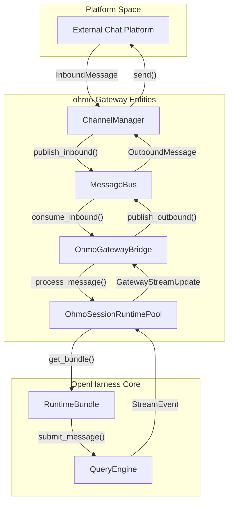
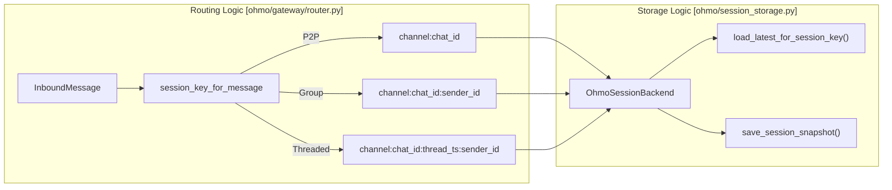

<!-- source: DeepWiki mcp.deepwiki.com · repo HKUDS/OpenHarness · page 17.2 ohmo Gateway Service · fetched 2026-11-09 -->

# ohmo Gateway Service

Relevant source files

The following files were used as context for generating this wiki page:

- [ohmo/__main__.py](ohmo/__main__.py)
- [ohmo/cli.py](ohmo/cli.py)
- [ohmo/gateway/__init__.py](ohmo/gateway/__init__.py)
- [ohmo/gateway/bridge.py](ohmo/gateway/bridge.py)
- [ohmo/gateway/config.py](ohmo/gateway/config.py)
- [ohmo/gateway/group_tool.py](ohmo/gateway/group_tool.py)
- [ohmo/gateway/models.py](ohmo/gateway/models.py)
- [ohmo/gateway/provider_commands.py](ohmo/gateway/provider_commands.py)
- [ohmo/gateway/runtime.py](ohmo/gateway/runtime.py)
- [ohmo/gateway/service.py](ohmo/gateway/service.py)
- [src/openharness/channels/impl/feishu.py](src/openharness/channels/impl/feishu.py)
- [src/openharness/commands/registry.py](src/openharness/commands/registry.py)
- [src/openharness/engine/messages.py](src/openharness/engine/messages.py)
- [tests/test_channels/test_feishu_security.py](tests/test_channels/test_feishu_security.py)
- [tests/test_commands/test_registry.py](tests/test_commands/test_registry.py)
- [tests/test_ohmo/test_cli.py](tests/test_ohmo/test_cli.py)
- [tests/test_ohmo/test_gateway.py](tests/test_ohmo/test_gateway.py)

The **ohmo Gateway Service** provides a persistent, multi-channel bridge for the ohmo personal agent. It enables ohmo to interact with users across various messaging platforms (Telegram, Discord, Slack, Feishu, etc.) by maintaining session-aware runtimes in the background. It manages the lifecycle of these sessions, handles message routing, and provides process management for the gateway as a background service.

## Architecture and Data Flow

The gateway operates by connecting an asynchronous message bus to a pool of OpenHarness runtimes. When a message arrives from a channel, the gateway identifies the session, retrieves or creates a corresponding `RuntimeBundle`, and streams the LLM's response back to the user.

### Bridge to Code Entity Space: Message Routing

The following diagram illustrates how an inbound message from a platform is routed through the gateway entities to produce a response.

Sources: [ohmo/gateway/bridge.py:68-81](), [ohmo/gateway/runtime.py:152-190](), [ohmo/gateway/service.py:54-73]()

## Key Components

### OhmoGatewayBridge
The `OhmoGatewayBridge` in `ohmo/gateway/bridge.py` is the central orchestrator of the gateway's message processing loop.

*   **Message Consumption**: It runs a continuous loop using `self._bus.consume_inbound()` to pull messages from the `MessageBus` [ohmo/gateway/bridge.py:77-83]().
*   **Session Interruption**: If a new message arrives for a session that is currently processing, the bridge interrupts the previous task using `_interrupt_session` to ensure the agent focuses on the latest user intent [ohmo/gateway/bridge.py:120-129]().
*   **Special Commands**: It handles `/stop` to cancel ongoing tasks and `/restart` to trigger a service-level restart [ohmo/gateway/bridge.py:107-112]().
*   **Error Handling**: It converts internal exceptions into user-friendly messages via `_format_gateway_error`, specifically handling authentication failures for providers like Claude [ohmo/gateway/bridge.py:29-53]().

### OhmoSessionRuntimePool
The `OhmoSessionRuntimePool` in `ohmo/gateway/runtime.py` manages the lifecycle of `RuntimeBundle` instances, keyed by a `session_key`.

*   **Session Persistence**: It uses `OhmoSessionBackend` to load and save session snapshots, allowing ohmo to resume conversations even after a gateway restart [ohmo/gateway/runtime.py:120-121](), [ohmo/gateway/runtime.py:182-188]().
*   **Slash Command Routing**: Before passing a message to the LLM engine, it checks if the input is a slash command using `bundle.commands.lookup()` [ohmo/gateway/runtime.py:228-230]().
*   **Progress Updates**: It generates "thinking" phrases (e.g., "🤔 想一想…") and tool execution hints (e.g., "🛠️ web_fetch") to provide immediate feedback over messaging channels that lack real-time streaming text UI [ohmo/gateway/runtime.py:47-61](), [ohmo/gateway/runtime.py:440-465]().

### OhmoGatewayService
The `OhmoGatewayService` in `ohmo/gateway/service.py` manages the service as a system process.

*   **Process Management**: It tracks the service state using a PID file (`gateway.pid`) and a state JSON file (`state.json`) within the workspace [ohmo/gateway/service.py:75-85]().
*   **In-Place Restart**: It supports `_exec_restart()`, which uses `os.execv` to replace the current process with a new gateway instance without changing the PID [ohmo/gateway/service.py:152-166]().
*   **State Reporting**: The `write_state` method periodically updates `GatewayState` (running status, active sessions, last error) for CLI consumption [ohmo/gateway/service.py:94-103]().

## Configuration and CLI

The gateway is configured via `gateway.json` located in the ohmo workspace. This file defines the active `provider_profile` and the list of `enabled_channels` [ohmo/gateway/service.py:48](), [ohmo/gateway/config.py:11-20]().

### CLI Subcommands
The `ohmo gateway` CLI in `ohmo/cli.py` provides the following management commands:

| Command | Function | Implementation |
| :--- | :--- | :--- |
| `run` | Starts the gateway in the foreground. | `OhmoGatewayService.run_foreground()` |
| `start` | Launches the gateway as a background process. | `start_gateway_process()` |
| `stop` | Terminates the background gateway process. | `stop_gateway_process()` |
| `restart` | Stops and then starts the gateway. | `stop_gateway_process()` + `start_gateway_process()` |
| `status` | Reports whether the gateway is running. | `gateway_status()` |

Sources: [ohmo/gateway/service.py:227-253](), [ohmo/gateway/service.py:269-291](), [ohmo/cli.py:343-380]()

## Session Lifecycle and Storage

Sessions are identified by a unique key generated from the message metadata via `session_key_for_message`.

Sources: [ohmo/gateway/router.py:12-42](), [ohmo/gateway/runtime.py:182-188](), [ohmo/session_storage.py:71-77]()

### Group Management Tool
The `OhmoCreateFeishuGroupTool` in `ohmo/gateway/group_tool.py` allows ohmo to transition a private conversation into a managed Feishu group.

*   **Tool Execution**: It calls `self._create_group` (provided by the `OhmoGatewayService`) to create the group via the Feishu API [ohmo/gateway/group_tool.py:93-94]().
*   **Metadata Binding**: It saves a `managed_group_record` to the workspace, linking the new `chat_id` to a specific local `cwd` and `repo` [ohmo/gateway/group_tool.py:103-120]().
*   **Welcome Message**: Automatically publishes a welcome message to the new group explaining the bot's capabilities [ohmo/gateway/group_tool.py:128-138]().

Sources: [ohmo/gateway/group_tool.py:38-47](), [ohmo/gateway/service.py:130-140]()

---

