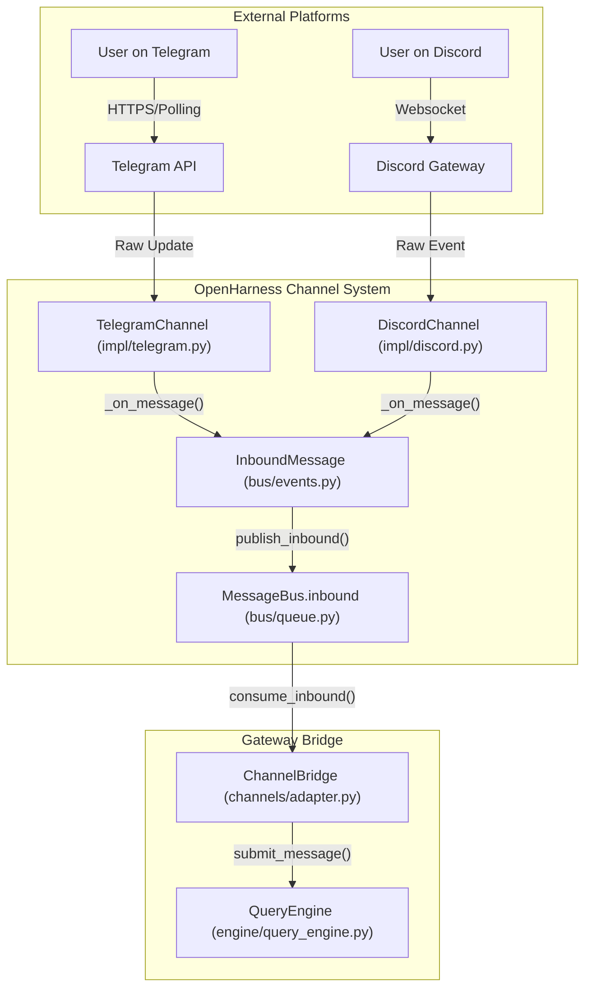
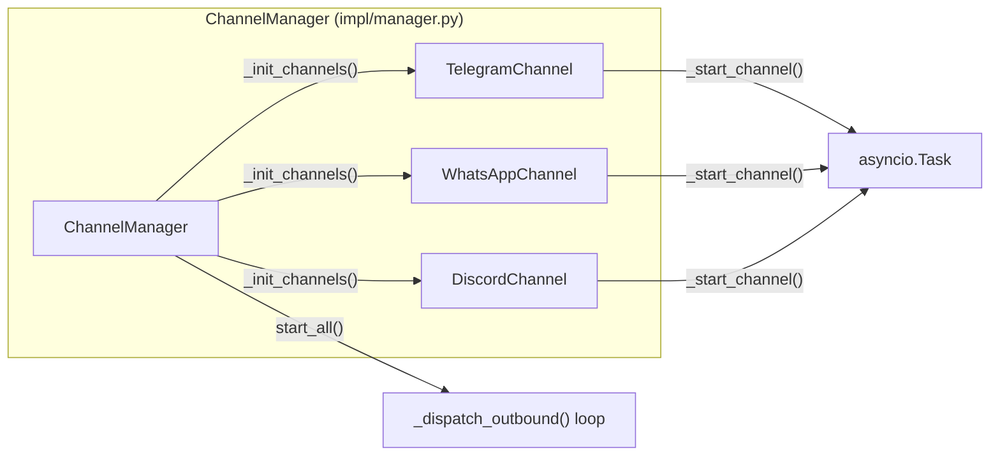

<!-- source: DeepWiki mcp.deepwiki.com · repo HKUDS/OpenHarness · page 18 Channels System · fetched 2026-11-09 -->

# Channels System

Relevant source files

The following files were used as context for generating this wiki page:

- [scripts/sync_nanobot_channels.sh](scripts/sync_nanobot_channels.sh)
- [src/openharness/channels/UPSTREAM](src/openharness/channels/UPSTREAM)
- [src/openharness/channels/__init__.py](src/openharness/channels/__init__.py)
- [src/openharness/channels/adapter.py](src/openharness/channels/adapter.py)
- [src/openharness/channels/bus/__init__.py](src/openharness/channels/bus/__init__.py)
- [src/openharness/channels/bus/events.py](src/openharness/channels/bus/events.py)
- [src/openharness/channels/bus/queue.py](src/openharness/channels/bus/queue.py)
- [src/openharness/channels/impl/__init__.py](src/openharness/channels/impl/__init__.py)
- [src/openharness/channels/impl/manager.py](src/openharness/channels/impl/manager.py)
- [src/openharness/channels/impl/telegram.py](src/openharness/channels/impl/telegram.py)
- [src/openharness/config/schema.py](src/openharness/config/schema.py)
- [tests/test_channels/test_telegram_security.py](tests/test_channels/test_telegram_security.py)
- [tests/test_config/test_schema.py](tests/test_config/test_schema.py)

The **Channels System** provides a multi-platform messaging integration layer for the `ohmo` gateway. It decouples the core agent logic from specific chat platform protocols (like Telegram, Discord, or Slack) using an asynchronous message bus. This allows the OpenHarness engine to interact with users across different messaging apps through a unified interface.

The subsystem is largely based on a synced upstream from `nanobot` [channels/UPSTREAM:1-7](), with adaptations for OpenHarness logging and configuration [scripts/sync_nanobot_channels.sh:70-83]().

### System Architecture

The system is built on a producer-consumer model where platform-specific "Channels" translate external events into internal message objects.

1.  **Platform Channels**: Implementations of `BaseChannel` that manage connections to external APIs (WebSockets, Long Polling, or REST).
2.  **Message Bus**: A central `asyncio.Queue` based broker that routes `InboundMessage` and `OutboundMessage` objects [channels/bus/queue.py:8-18]().
3.  **Channel Manager**: Handles the lifecycle (start/stop) of all enabled channels based on the user's configuration [channels/impl/manager.py:17-25]().
4.  **Channel Bridge**: Connects the `MessageBus` to the `QueryEngine`, facilitating the loop between receiving a message and generating an LLM response [channels/adapter.py:29-35]().

#### Data Flow: Natural Language to Code Entities

The following diagram illustrates how a user message moves from a physical chat app into the OpenHarness `MessageBus`.

**Message Ingestion Flow**

**Sources:** [channels/bus/queue.py:8-15](), [channels/bus/events.py:9-20](), [channels/adapter.py:94-100](), [channels/impl/telegram.py:154-159]()

---

### Message Bus and Base Channel

The `MessageBus` acts as the decoupled communication spine. It maintains two primary queues: `inbound` for messages coming from users and `outbound` for responses generated by the agent [channels/bus/queue.py:16-18]().

All platform integrations must inherit from `BaseChannel` [channels/impl/base.py:34](). This abstract base class enforces a standard interface:
*   `start()`: Initialize connections and start listening.
*   `stop()`: Gracefully shut down connections.
*   `send(msg)`: Transmit an `OutboundMessage` to the platform.
*   `is_allowed(sender_id)`: Enforces access control via the `allow_from` configuration list [config/schema.py:31]().

For details on the bus implementation and base class logic, see **[Message Bus and Base Channel](#18.1)**.

**Sources:** [channels/bus/queue.py:8-34](), [channels/bus/events.py:8-37](), [channels/adapter.py:29-41]()

---

### Platform Channel Implementations

OpenHarness supports a wide array of chat platforms, each implemented as a specialized adapter in `channels/impl/`. These adapters handle platform-specific quirks such as:
*   **Formatting**: Converting Markdown to platform-specific formats like Telegram-safe HTML [channels/impl/telegram.py:32-92]().
*   **Access Control**: Secure defaults ensure that remote access is denied unless an operator explicitly adds allowed identities to `allow_from` [channels/impl/manager.py:155-162]().
*   **Security**: Sensitive tokens are protected from appearing in logs through specialized silencers [channels/impl/telegram.py:25-29]().

**Platform to Code Entity Mapping**
| Platform | Config Class | Implementation File | Primary Library |
| :--- | :--- | :--- | :--- |
| **Telegram** | `TelegramConfig` | [channels/impl/telegram.py:95]() | `python-telegram-bot` |
| **Discord** | `DiscordConfig` | [channels/impl/discord.py]() | `discord.py` |
| **Slack** | `SlackConfig` | [channels/impl/slack.py]() | `slack-sdk` |
| **Feishu/Lark** | `FeishuConfig` | [channels/impl/feishu.py]() | `lark-oapi` |
| **WhatsApp** | `WhatsAppConfig` | [channels/impl/whatsapp.py]() | Meta Graph API |

For a full list of supported platforms and their specific configuration requirements, see **[Platform Channel Implementations](#18.2)**.

**Sources:** [config/schema.py:34-114](), [channels/impl/telegram.py:9-16](), [channels/impl/manager.py:35-151]()

---

### Channel Management

The `ChannelManager` is responsible for the orchestration of multiple active channels. It reads the `ChannelConfigs` from the global `Config` object, instantiates the required `BaseChannel` subclasses, and manages their execution [channels/impl/manager.py:27-33]().

**Lifecycle Management**

**Sources:** [channels/impl/manager.py:35-151](), [channels/impl/manager.py:171-188](), [channels/impl/manager.py:163-170]()

---

