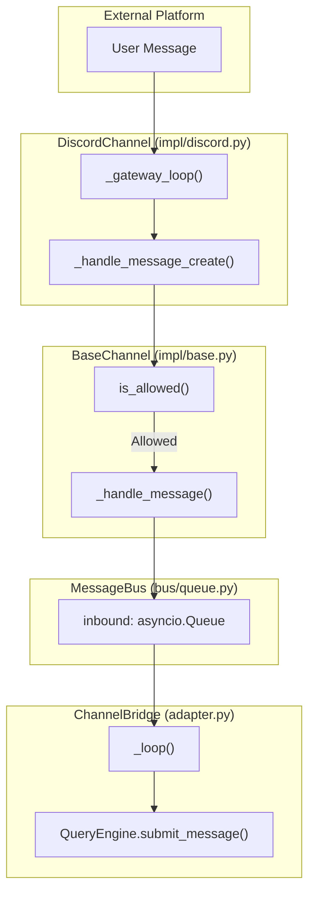
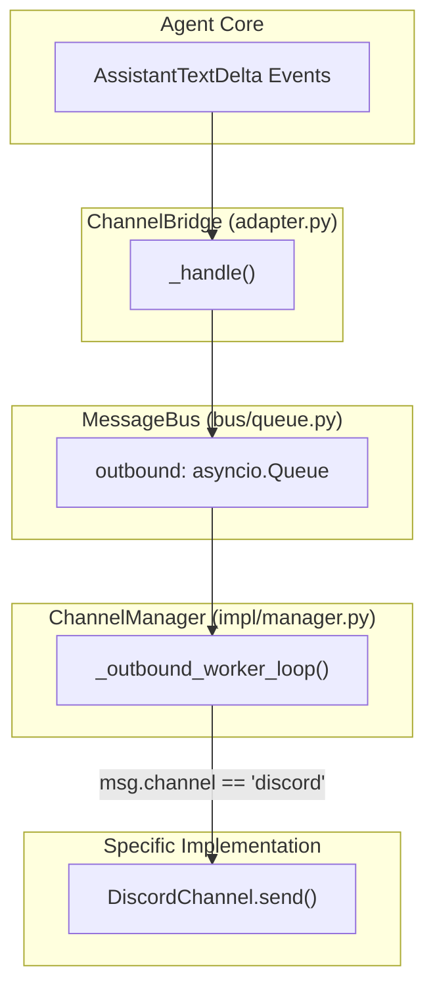

<!-- source: DeepWiki mcp.deepwiki.com · repo HKUDS/OpenHarness · page 18.1 Message Bus and Base Channel · fetched 2026-11-09 -->

# Message Bus and Base Channel

Relevant source files

The following files were used as context for generating this wiki page:

- [scripts/sync_nanobot_channels.sh](scripts/sync_nanobot_channels.sh)
- [src/openharness/channels/UPSTREAM](src/openharness/channels/UPSTREAM)
- [src/openharness/channels/__init__.py](src/openharness/channels/__init__.py)
- [src/openharness/channels/adapter.py](src/openharness/channels/adapter.py)
- [src/openharness/channels/bus/__init__.py](src/openharness/channels/bus/__init__.py)
- [src/openharness/channels/bus/events.py](src/openharness/channels/bus/events.py)
- [src/openharness/channels/bus/queue.py](src/openharness/channels/bus/queue.py)
- [src/openharness/channels/impl/__init__.py](src/openharness/channels/impl/__init__.py)
- [src/openharness/channels/impl/base.py](src/openharness/channels/impl/base.py)
- [src/openharness/channels/impl/discord.py](src/openharness/channels/impl/discord.py)
- [src/openharness/engine/__init__.py](src/openharness/engine/__init__.py)
- [tests/test_channels/test_base.py](tests/test_channels/test_base.py)

The Channels system provides a decoupled architecture for integrating OpenHarness with various chat platforms (Telegram, Discord, Slack, etc.). This integration is mediated by a central **Message Bus** that separates platform-specific communication logic from the core agent engine.

## Message Bus and Events

The `MessageBus` acts as the central nervous system for asynchronous communication between external chat platforms and the OpenHarness engine [src/openharness/channels/bus/queue.py:8-14](). It utilizes two primary `asyncio.Queue` instances to handle the flow of data [src/openharness/channels/bus/queue.py:17-18]().

### Data Flow Entities
Communication is encapsulated in two primary dataclasses defined in `events.py`:

*   **`InboundMessage`**: Represents data coming from a chat platform (e.g., a user message on Telegram) [src/openharness/channels/bus/events.py:9-19]().
    *   Includes `channel`, `sender_id`, `chat_id`, `content`, and `media` URLs.
    *   Provides a `session_key` property used to identify unique conversation threads, defaulting to `{channel}:{chat_id}` [src/openharness/channels/bus/events.py:22-24]().
*   **`OutboundMessage`**: Represents data sent from the agent back to a chat platform [src/openharness/channels/bus/events.py:28-37]().

### Message Bus Interface
| Method | Description |
| :--- | :--- |
| `publish_inbound(msg)` | Pushes a message from a channel into the agent's processing queue [src/openharness/channels/bus/queue.py:20-22](). |
| `consume_inbound()` | Blocks until the agent is ready to process the next incoming message [src/openharness/channels/bus/queue.py:24-25](). |
| `publish_outbound(msg)` | Pushes an agent response into the queue for delivery by a channel [src/openharness/channels/bus/queue.py:28-30](). |
| `consume_outbound()` | Blocks until a channel is ready to send the next response [src/openharness/channels/bus/queue.py:32-34](). |

**Sources:** [src/openharness/channels/bus/queue.py:8-45](), [src/openharness/channels/bus/events.py:9-37]()

## Base Channel Abstraction

The `BaseChannel` is an abstract base class that defines the interface for all platform-specific implementations [src/openharness/channels/impl/base.py:34-40](). It ensures consistent behavior for lifecycle management, message routing, and access control.

### Key Lifecycle and Routing Methods
*   **`start()`**: Abstract method to initialize connections (e.g., WebSocket or Long Polling) and begin listening for messages [src/openharness/channels/impl/base.py:57-66]().
*   **`stop()`**: Abstract method to gracefully close connections and clean up resources [src/openharness/channels/impl/base.py:69-71]().
*   **`send(msg)`**: Abstract method to deliver an `OutboundMessage` via the platform's API [src/openharness/channels/impl/base.py:74-81]().
*   **`_handle_message(...)`**: A concrete helper that validates the sender and wraps raw platform data into an `InboundMessage` before publishing to the `MessageBus` [src/openharness/channels/impl/base.py:96-137]().

### Access Control
The `is_allowed(sender_id)` method implements a whitelist-based permission system [src/openharness/channels/impl/base.py:83-94]():
1.  If the `allow_from` config list is empty, all access is denied [src/openharness/channels/impl/base.py:86-88]().
2.  If `allow_from` contains `"*"`, all senders are permitted [src/openharness/channels/impl/base.py:89-90]().
3.  Otherwise, the `sender_id` must explicitly exist in the `allow_from` list [src/openharness/channels/impl/base.py:91-94]().

### Media Resolution
The `resolve_channel_media_dir(channel_name)` function determines where inbound attachments should be stored [src/openharness/channels/impl/base.py:16-31](). It checks environment variables in the following order:
1.  `OPENHARNESS_CHANNEL_MEDIA_DIR` [src/openharness/channels/impl/base.py:18-20]().
2.  `OHMO_WORKSPACE` (resolving to the workspace's `attachments` directory via `get_attachments_dir`) [src/openharness/channels/impl/base.py:22-26]().
3.  Default data directory (`~/.openharness/media/{channel_name}`) [src/openharness/channels/impl/base.py:28-29]().

**Sources:** [src/openharness/channels/impl/base.py:16-141](), [tests/test_channels/test_base.py:6-28]()

## Channel Management and Bridging

The `ChannelManager` (defined in `channels/impl/manager.py`) is responsible for the lifecycle of all active channels [src/openharness/channels/impl/manager.py:4-6](). It instantiates channel classes based on the provided configuration and manages the background tasks that drive the `MessageBus`.

The `ChannelBridge` connects the `MessageBus` to a `QueryEngine` instance [src/openharness/channels/adapter.py:29-34](). It consumes `InboundMessage` objects, submits the content to the engine, and publishes the resulting `AssistantTextDelta` events as a consolidated `OutboundMessage` [src/openharness/channels/adapter.py:94-131]().

### Natural Language to Code Mapping: Message Routing
The following diagram illustrates how a message travels from a physical platform (like Discord) into the OpenHarness internal logic.

"Message Inbound Flow"

**Sources:** [src/openharness/channels/impl/discord.py:127-159](), [src/openharness/channels/impl/base.py:83-137](), [src/openharness/channels/bus/queue.py:17-22](), [src/openharness/channels/adapter.py:78-100]()

### Natural Language to Code Mapping: Message Dispatching
The following diagram illustrates how the system dispatches responses back to the correct platform.

"Message Outbound Flow"

**Sources:** [src/openharness/channels/bus/queue.py:28-34](), [src/openharness/channels/adapter.py:114-125](), [src/openharness/channels/impl/discord.py:78-104]()

## Implementation Examples

### Discord Gateway Integration
The `DiscordChannel` implements the `BaseChannel` by maintaining a WebSocket connection via `_gateway_loop` [src/openharness/channels/impl/discord.py:127-168](). It handles Discord-specific operations like "Hello" (Op 10) to start heartbeats and "Identify" (Op 2) [src/openharness/channels/impl/discord.py:147-151](). When a `MESSAGE_CREATE` event is received, it triggers the internal routing logic [src/openharness/channels/impl/discord.py:158-159](). It also implements rate-limit handling with retries in `_send_payload` [src/openharness/channels/impl/discord.py:105-125]().

**Sources:** [src/openharness/channels/impl/discord.py:24-168](), [src/openharness/channels/adapter.py:29-131](), [src/openharness/channels/bus/queue.py:8-45]()

---

