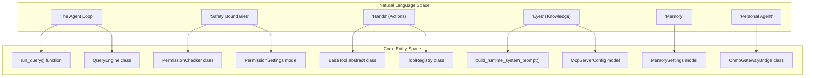
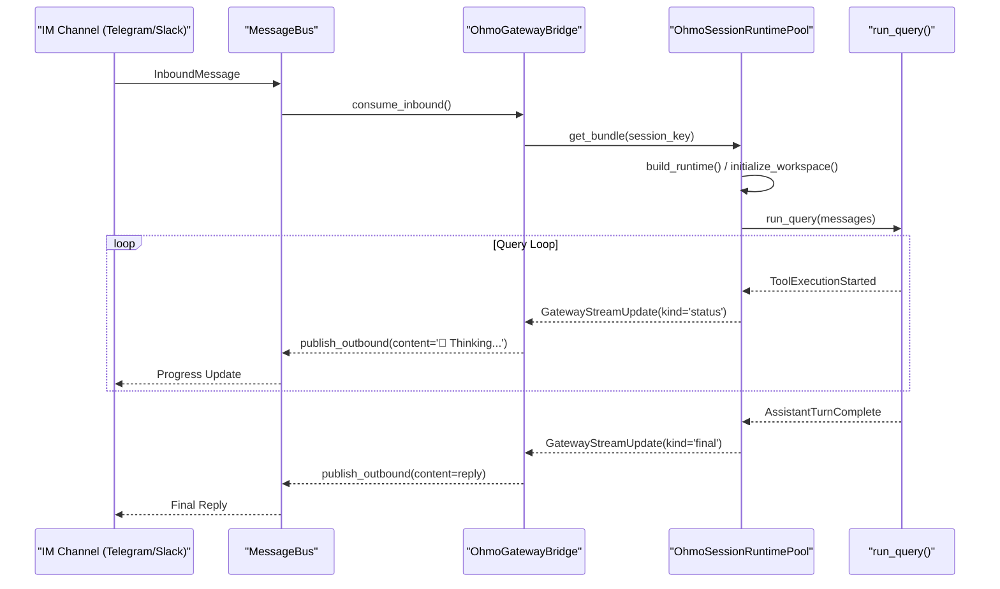

<!-- source: DeepWiki mcp.deepwiki.com · repo HKUDS/OpenHarness · page 19 Glossary · fetched 2026-11-09 -->

# Glossary

Relevant source files

The following files were used as context for generating this wiki page:

- [README.md](README.md)
- [README.zh-CN.md](README.zh-CN.md)
- [ohmo/gateway/bridge.py](ohmo/gateway/bridge.py)
- [ohmo/gateway/group_tool.py](ohmo/gateway/group_tool.py)
- [ohmo/gateway/runtime.py](ohmo/gateway/runtime.py)
- [src/openharness/auth/manager.py](src/openharness/auth/manager.py)
- [src/openharness/channels/impl/feishu.py](src/openharness/channels/impl/feishu.py)
- [src/openharness/commands/registry.py](src/openharness/commands/registry.py)
- [src/openharness/config/settings.py](src/openharness/config/settings.py)
- [src/openharness/coordinator/coordinator_mode.py](src/openharness/coordinator/coordinator_mode.py)
- [src/openharness/engine/messages.py](src/openharness/engine/messages.py)
- [src/openharness/engine/query.py](src/openharness/engine/query.py)
- [src/openharness/engine/query_engine.py](src/openharness/engine/query_engine.py)
- [src/openharness/prompts/system_prompt.py](src/openharness/prompts/system_prompt.py)
- [src/openharness/services/compact/__init__.py](src/openharness/services/compact/__init__.py)
- [src/openharness/services/tool_outputs.py](src/openharness/services/tool_outputs.py)
- [src/openharness/swarm/__init__.py](src/openharness/swarm/__init__.py)
- [src/openharness/swarm/mailbox.py](src/openharness/swarm/mailbox.py)
- [src/openharness/swarm/permission_sync.py](src/openharness/swarm/permission_sync.py)
- [src/openharness/swarm/team_lifecycle.py](src/openharness/swarm/team_lifecycle.py)
- [src/openharness/tools/web_search_tool.py](src/openharness/tools/web_search_tool.py)
- [src/openharness/utils/network_guard.py](src/openharness/utils/network_guard.py)
- [tests/test_channels/test_feishu_security.py](tests/test_channels/test_feishu_security.py)
- [tests/test_commands/test_registry.py](tests/test_commands/test_registry.py)
- [tests/test_config/test_settings.py](tests/test_config/test_settings.py)
- [tests/test_engine/test_query_engine.py](tests/test_engine/test_query_engine.py)
- [tests/test_entrypoints/test_config_cli.py](tests/test_entrypoints/test_config_cli.py)
- [tests/test_ohmo/test_gateway.py](tests/test_ohmo/test_gateway.py)
- [tests/test_services/test_compact.py](tests/test_services/test_compact.py)
- [tests/test_tools/test_web_fetch_tool.py](tests/test_tools/test_web_fetch_tool.py)
- [tests/test_utils/test_network_guard.py](tests/test_utils/test_network_guard.py)

This page defines the core terminology, technical jargon, and domain-specific concepts used throughout the OpenHarness codebase. It serves as a reference for onboarding engineers to understand how abstract agentic concepts map to specific Python classes and implementation details.

## Core Concepts

### Agent Harness
An **Agent Harness** is the complete infrastructure layer that wraps a Large Large Model (LLM) to provide it with capabilities beyond text generation. While the LLM provides the "intelligence," the harness provides the "hands" (Tools), "eyes" (Context/Prompts), "memory" (Persistence), and "safety boundaries" (Permissions). The harness equation is defined as: `Harness = Tools + Knowledge + Observation + Action + Permissions` [README.md:133-143]().

### The Query Loop
The fundamental iterative process where the LLM is called, generates text or tool requests, the harness executes those tools, and the results are fed back into the model until a terminal state is reached. In OpenHarness, the `QueryEngine` drives this loop, calling `run_query` to handle the iterative LLM-tool-result cycle [src/openharness/engine/query_engine.py:21-23](), [src/openharness/engine/query.py:1-5]().

### Swarm Coordination
The multi-agent subsystem that allows a "leader" agent to spawn and manage "teammate" agents. Coordination involves managing task types (e.g., `local_bash`, `in_process_teammate`), worktree isolation, and file-based communication via mailboxes [src/openharness/swarm/team_lifecycle.py:1-10](), [src/openharness/swarm/mailbox.py:1-5]().

---

## Technical Terms & Abbreviations

| Term | Definition | Code Pointer |
|:---|:---|:---|
| **MCP** | Model Context Protocol. A standard for connecting LLMs to external data sources and tools via JSON-RPC. | [src/openharness/config/settings.py:22-22]() |
| **TUI** | Terminal User Interface. The React/Ink-based interactive interface used for the `oh` CLI. | [README.md:29-30]() |
| **Hook** | A lifecycle interceptor (`PreToolUse`/`PostToolUse`) that can run shell commands, webhooks, or LLM-based validations. | [src/openharness/engine/query.py:40-41]() |
| **Skill** | On-demand knowledge stored in Markdown files. Loaded into context only when the LLM calls the `skill` tool. | [src/openharness/commands/registry.py:91-92]() |
| **Compaction** | The process of summarizing or clearing old conversation history to stay within LLM context window limits. | [src/openharness/services/compact/__init__.py:1-7]() |
| **Gateway** | A service (e.g., `ohmo gateway`) that bridges IM channels (Slack, Telegram) to agent runtimes. | [ohmo/gateway/bridge.py:56-58]() |
| **Soul** | A core component of `ohmo` workspace (`soul.md`) defining the agent's personality and long-term directives. | [README.md:15-17]() |

---

## System Architecture Mapping

The following diagram bridges the natural language concepts of an agent harness to the specific code entities that implement them.

### Mapping: Natural Language Space to Code Entity Space

**Sources:** [src/openharness/engine/query.py:1-10](), [src/openharness/engine/query_engine.py:21-23](), [src/openharness/permissions/checker.py:1-5](), [src/openharness/config/settings.py:50-58](), [src/openharness/tools/base.py:30-44](), [ohmo/gateway/bridge.py:56-58]()

---

## Data Flow: Channel Message Processing

When a message arrives from a chat platform (Telegram, Slack, etc.) via the `ohmo` gateway, it follows a specific path through the Message Bus and Session Runtime Pool.

### Gateway Message Flow

**Sources:** [ohmo/gateway/bridge.py:77-135](), [ohmo/gateway/runtime.py:152-196](), [src/openharness/engine/query.py:30-39](), [tests/test_ohmo/test_gateway.py:59-93]()

---

## Glossary Definitions

### 1. Engine & Runtime Entities
*   **`QueryContext`**: A dataclass holding all shared state for a single query execution, including the API client, tool registry, and current directory [src/openharness/engine/query.py:137-156]().
*   **`RuntimeBundle`**: A lifecycle-managed collection of subsystems (Engine, ToolRegistry, CommandRegistry) wired together for a specific session [ohmo/gateway/runtime.py:34-34]().
*   **`UsageSnapshot`**: Tracks token usage (input/output/cache) and stop reasons for a single LLM request [tests/test_ohmo/test_gateway.py:14-14]().
*   **`CostTracker`**: Aggregates `UsageSnapshot` data across multiple turns to track total session cost [src/openharness/engine/query_engine.py:9-9]().

### 2. Permissions & Safety
*   **`PermissionMode`**: Enum defining agent autonomy: `DEFAULT` (ask for dangerous tools), `PLAN` (only allow read-only), `FULL_AUTO` (no prompts) [src/openharness/permissions/modes.py:1-5](), [src/openharness/config/settings.py:53-53]().
*   **`PathRule`**: A glob-based rule defining which filesystem paths the agent is allowed to read or write [src/openharness/config/settings.py:43-48]().
*   **`SandboxSettings`**: Configuration for restricted execution environments, including network and filesystem allow/deny lists [src/openharness/config/settings.py:104-114]().

### 3. Memory & Context
*   **`Microcompact`**: A lightweight compaction strategy that clears large tool outputs (like `read_file` results) from history while keeping the tool call metadata [src/openharness/services/compact/__init__.py:4-7]().
*   **`Auto-Dream`**: A background process that consolidates session history into long-term memory (`MEMORY.md`) during idle periods [src/openharness/engine/query_engine.py:141-143]().
*   **`CLAUDE.md`**: A project-specific context file that OpenHarness automatically discovers and injects into the system prompt to provide coding standards and project info [README.md:94-94]().

### 4. Gateway & Swarm
*   **`InboundMessage`**: Standardized dataclass for messages from various chat adapters, containing `sender_id`, `chat_id`, and `content` [src/openharness/channels/bus/events.py:1-15]().
*   **`MessageBus`**: An asynchronous queue system used by the gateway to decouple message ingestion from processing [src/openharness/channels/bus/queue.py:1-10]().
*   **`TeammateMailbox`**: A file-based communication channel used for asynchronous message passing between leader and worker agents in a swarm [src/openharness/swarm/mailbox.py:1-10]().

---

## Configuration Resolution
OpenHarness uses a strict precedence for settings resolution (highest first):
1.  **CLI Arguments**: Passed via `oh` or `ohmo` commands (e.g., `--model`, `--permission-mode`) [src/openharness/config/settings.py:4-4]().
2.  **Environment Variables**: Prefixed with `OPENHARNESS_` or standard provider variables like `ANTHROPIC_API_KEY` [src/openharness/config/settings.py:5-5]().
3.  **Config File**: JSON configuration stored at `~/.openharness/settings.json` [src/openharness/config/settings.py:6-6]().
4.  **Defaults**: Hardcoded defaults in the Pydantic `Settings` model [src/openharness/config/settings.py:7-7]().

**Sources:** [src/openharness/config/settings.py:1-26](), [tests/test_config/test_settings.py:24-37]()