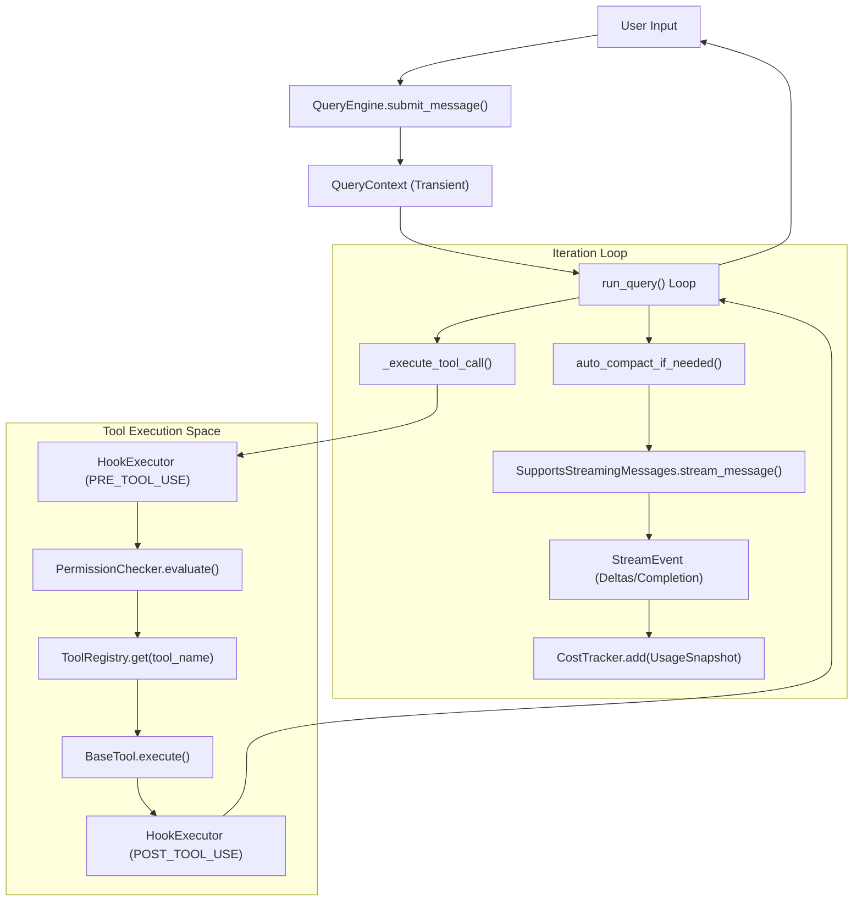
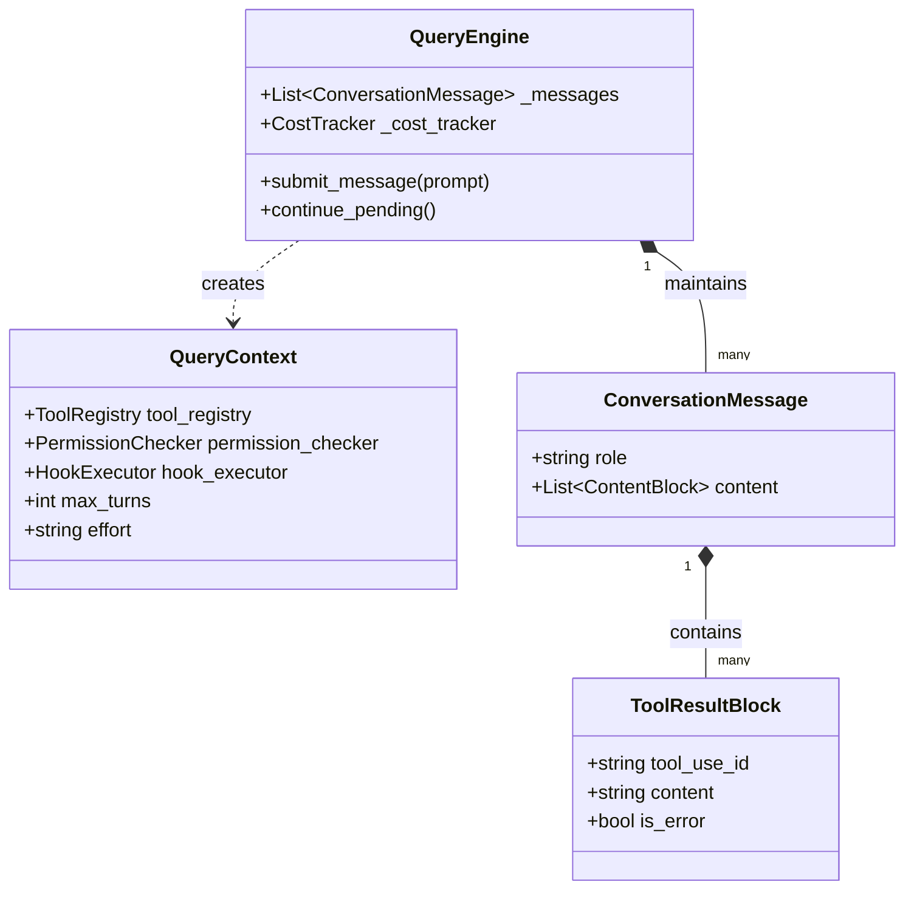

<!-- source: DeepWiki mcp.deepwiki.com · repo HKUDS/OpenHarness · page 2 Core Engine · fetched 2026-11-09 -->

# Core Engine

<details>
<summary>Relevant source files</summary>

The following files were used as context for generating this wiki page:

- [src/openharness/engine/query.py](src/openharness/engine/query.py)
- [src/openharness/engine/query_engine.py](src/openharness/engine/query_engine.py)
- [src/openharness/engine/stream_events.py](src/openharness/engine/stream_events.py)
- [src/openharness/services/compact/__init__.py](src/openharness/services/compact/__init__.py)
- [src/openharness/services/tool_outputs.py](src/openharness/services/tool_outputs.py)
- [tests/test_engine/test_query_engine.py](tests/test_engine/test_query_engine.py)
- [tests/test_services/test_compact.py](tests/test_services/test_compact.py)

</details>


The **Core Engine** is the central orchestration layer of OpenHarness. It manages the iterative conversation loop between the user, the Large Language Model (LLM), and the available toolset. It is responsible for maintaining conversation state, enforcing security via permissions, executing lifecycle hooks, and tracking the financial cost of API interactions.

## Overview

The engine is built around two primary components:
1.  **`QueryEngine`**: A high-level state manager that holds the `ConversationMessage` history, manages session memory, and persists services like the `CostTracker` [src/openharness/engine/query_engine.py:21-60]().
2.  **`run_query`**: The core functional loop that drives the "thought-action-observation" cycle, handling streaming responses, auto-compaction, and concurrent tool execution [src/openharness/engine/query.py:230-550]().

### Core Engine Data Flow

The following diagram illustrates how the `QueryEngine` bridges high-level user requests to low-level code execution and API calls.

**Diagram: Engine Orchestration Flow**

**Sources:** [src/openharness/engine/query_engine.py:214-250](), [src/openharness/engine/query.py:230-550](), [src/openharness/engine/query.py:1005-1150](), [src/openharness/services/compact/__init__.py:222-250]()

---

## Key Components

### QueryEngine
The `QueryEngine` class acts as the primary interface for the UI layer. It encapsulates the `api_client`, `tool_registry`, and `permission_checker` [src/openharness/engine/query_engine.py:24-42](). When a user submits a prompt via `submit_message()`, the engine appends the message to its internal history and initializes a `QueryContext` to execute the turn [src/openharness/engine/query_engine.py:214-245](). It also manages background tasks like `schedule_auto_dream` and session memory updates after user turns [src/openharness/engine/query_engine.py:141-182]().

### QueryContext
A dataclass used to pass configuration and state into the `run_query` loop. It includes metadata such as the current working directory (`cwd`), reasoning `effort` levels, `max_turns` (defaulting to 200), and callbacks for user interaction like `permission_prompt` and `ask_user_prompt` [src/openharness/engine/query.py:138-156]().

### Message and Event Models
The engine communicates state changes via a hierarchy of events and structured message blocks:
*   **`ConversationMessage`**: Represents a single turn in the chat (user, assistant, or tool results) [src/openharness/engine/messages.py:24-31]().
*   **`StreamEvent`**: Granular updates yielded during execution, such as `AssistantTextDelta` for real-time typing or `ToolExecutionStarted` when a tool begins [src/openharness/engine/stream_events.py:12-90]().

**Diagram: Entity Relationship**

**Sources:** [src/openharness/engine/query_engine.py:21-60](), [src/openharness/engine/query.py:138-156](), [src/openharness/engine/messages.py:24-31](), [src/openharness/engine/stream_events.py:12-90]()

---

## Subsystems

### [Query Loop and Tool Execution](#2.1)
This child page details the iterative logic in `run_query`. It explains how the engine handles parallel tool execution using `asyncio.gather` when the LLM requests multiple actions simultaneously [src/openharness/engine/query.py:465-490](). It also covers the validation of tool inputs, turn limits via `MaxTurnsExceeded` [src/openharness/engine/query.py:129-135](), and the integration of the `PermissionChecker` and `HookExecutor` during tool dispatch [src/openharness/engine/query.py:1005-1150]().

### [Streaming Events and Cost Tracking](#2.2)
This child page documents the lifecycle of a request from the first token to the final cost tally. It covers how `ApiTextDeltaEvent` is transformed into `AssistantTextDelta` [src/openharness/engine/query.py:380-385]() and how the `CostTracker` aggregates `UsageSnapshot` data to provide real-time spending metrics [src/openharness/engine/query_engine.py:60](), [src/openharness/engine/query_engine.py:93-95]().

---

## Usage Example

```python
# Initializing the engine
engine = QueryEngine(
    api_client=anthropic_client,
    tool_registry=registry,
    permission_checker=checker,
    cwd=Path.cwd(),
    model="claude-3-5-sonnet-20241022",
    system_prompt="You are a helpful assistant."
)

# Submitting a message and consuming the stream
async for event in engine.submit_message("List the files in this directory"):
    if isinstance(event, AssistantTextDelta):
        print(event.text, end="")
    elif isinstance(event, ToolExecutionStarted):
        print(f"\nExecuting {event.tool_name}...")
    elif isinstance(event, AssistantTurnComplete):
        print(f"\nTurn complete. Usage: {event.usage}")
```
**Sources:** [src/openharness/engine/query_engine.py:24-42](), [src/openharness/engine/query_engine.py:214-250]()

---

