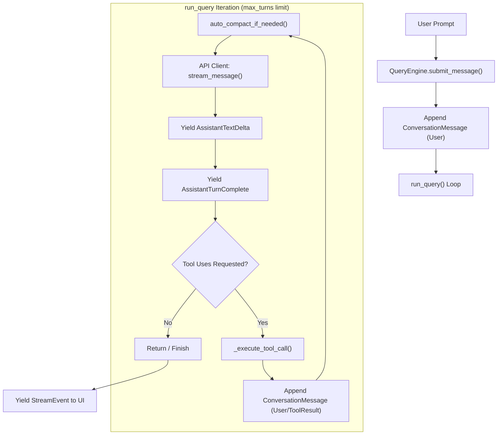
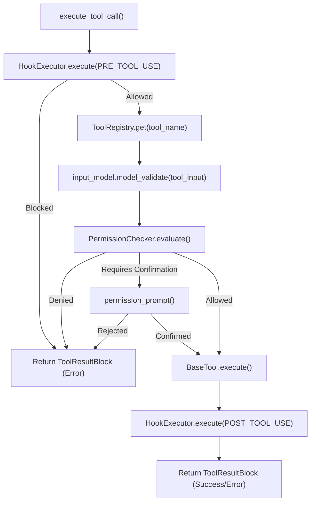

<!-- source: DeepWiki mcp.deepwiki.com · repo HKUDS/OpenHarness · page 2.1 Query Loop and Tool Execution · fetched 2026-11-09 -->

# Query Loop and Tool Execution

Relevant source files

The following files were used as context for generating this wiki page:

- [src/openharness/engine/query.py](src/openharness/engine/query.py)
- [src/openharness/engine/query_engine.py](src/openharness/engine/query_engine.py)
- [src/openharness/hooks/events.py](src/openharness/hooks/events.py)
- [src/openharness/services/compact/__init__.py](src/openharness/services/compact/__init__.py)
- [src/openharness/services/tool_outputs.py](src/openharness/services/tool_outputs.py)
- [src/openharness/tools/agent_tool.py](src/openharness/tools/agent_tool.py)
- [src/openharness/tools/base.py](src/openharness/tools/base.py)
- [src/openharness/tools/send_message_tool.py](src/openharness/tools/send_message_tool.py)
- [tests/test_engine/test_query_engine.py](tests/test_engine/test_query_engine.py)
- [tests/test_services/test_compact.py](tests/test_services/test_compact.py)

The core of OpenHarness is an iterative conversation loop that manages the interaction between the Large Language Model (LLM) and the local environment. This system handles the transition from natural language requests to structured tool execution, enforces security via a permission layer, and integrates lifecycle hooks and conversation compaction for long-running sessions.

## The Query Engine Architecture

The `QueryEngine` class acts as the high-level orchestrator for a conversation session. It maintains the state of the conversation, tracks token usage and costs, and provides a simplified interface for submitting user prompts or continuing interrupted turns.

### Key Components
- **`QueryEngine`**: The stateful wrapper that holds `ConversationMessage` history and the `CostTracker` [src/openharness/engine/query_engine.py:21-60]().
- **`QueryContext`**: A data container that bundles the API client, tool registry, permission checker, and environment settings for a single execution run [src/openharness/engine/query.py:138-156]().
- **`run_query`**: The stateless asynchronous generator that implements the iterative "LLM call -> Tool Execution -> LLM call" loop [src/openharness/engine/query.py:465-590]().

### Data Flow: User Input to Tool Execution
The following diagram illustrates how a user message moves through the `QueryEngine` and into the `run_query` loop.

**Query Execution Flow**

Sources: [src/openharness/engine/query_engine.py:204-245](), [src/openharness/engine/query.py:465-590]()

## The Iterative Loop (`run_query`)

The `run_query` function is the engine's heartbeat. It executes up to a configurable `max_turns` (defaulting to 200) to prevent infinite loops while allowing the model to perform complex multi-step tasks [src/openharness/engine/query.py:153-153]().

1.  **Auto-Compaction**: Before every LLM call, it checks if the conversation history exceeds token thresholds using `auto_compact_if_needed` [src/openharness/engine/query.py:495-502](). It first attempts a "microcompact" (clearing old tool results) and then a full LLM-based summarization if necessary [src/openharness/services/compact/__init__.py:1-7]().
2.  **LLM Invocation**: It calls `api_client.stream_message` with the current message history and tool schemas [src/openharness/engine/query.py:512-516]().
3.  **Streaming**: It yields `AssistantTextDelta` events as they arrive and captures the final `ConversationMessage` [src/openharness/engine/query.py:521-536]().
4.  **Tool Dispatch**: If the model requests tools, the engine determines if they should be run sequentially or concurrently [src/openharness/engine/query.py:550-584]().
5.  **History Augmentation**: Tool results are wrapped in a `ConversationMessage` with the `user` role and appended to the history for the next turn [src/openharness/engine/query.py:586-587]().

### Concurrent vs. Sequential Execution
- **Single Tool**: If only one tool is requested, it executes immediately via `_execute_tool_call` and yields events sequentially [src/openharness/engine/query.py:557-567]().
- **Multiple Tools**: If the LLM requests multiple tools in a single turn, the engine uses `asyncio.gather` to execute them concurrently, improving performance for independent operations [src/openharness/engine/query.py:569-584]().

Sources: [src/openharness/engine/query.py:465-590](), [src/openharness/services/compact/__init__.py:1-7]()

## Tool Execution and Permission Checks

The internal `_execute_tool_call` function is responsible for the lifecycle of a single tool invocation, including validation, permissions, and hooks.

### Execution Pipeline
1.  **Pre-Tool Hooks**: Executes `HookEvent.PRE_TOOL_USE`. If a hook returns a blocked status, the tool execution is aborted [src/openharness/engine/query.py:601-611]().
2.  **Registry Lookup**: Retrieves the tool implementation from the `ToolRegistry` [src/openharness/engine/query.py:613-619]().
3.  **Input Validation**: Uses Pydantic `model_validate` on the tool's `input_model` to ensure the LLM provided valid parameters [src/openharness/engine/query.py:621-628]().
4.  **Permission Evaluation**: The `PermissionChecker` evaluates the request based on the tool name and input parameters [src/openharness/engine/query.py:630-638]().
5.  **Human-in-the-loop**: If the permission check requires confirmation, the `permission_prompt` callback is triggered [src/openharness/engine/query.py:640-653]().
6.  **Actual Execution**: The tool's `execute` method is called with a `ToolExecutionContext` [src/openharness/engine/query.py:655-665]().
7.  **Post-Tool Hooks**: Executes `HookEvent.POST_TOOL_USE` after completion [src/openharness/engine/query.py:671-675]().

**Tool Execution Logic**

Sources: [src/openharness/engine/query.py:593-675]()

## Message and Event Models

The engine uses a structured message model to communicate with the API and a stream event model to update the UI.

### Conversation Messages
The `ConversationMessage` class encapsulates the role and content of a turn. Content can consist of `TextBlock`, `ToolUseBlock`, `ToolResultBlock`, or `ImageBlock` [src/openharness/engine/messages.py:24-29]().

| Block Type | Purpose | Key Fields |
| :--- | :--- | :--- |
| `TextBlock` | Assistant or User text content | `text` [src/openharness/engine/messages.py:27]() |
| `ToolUseBlock` | LLM request to run a tool | `id`, `name`, `input` [src/openharness/engine/messages.py:28]() |
| `ToolResultBlock` | Result of a tool execution | `tool_use_id`, `content`, `is_error` [src/openharness/engine/messages.py:28]() |
| `ImageBlock` | Multimodal input (user only) | `media_type`, `data`, `source_path` [src/openharness/engine/messages.py:26]() |

Sources: [src/openharness/engine/messages.py:24-29]()

### Stream Events
As `run_query` progresses, it yields `StreamEvent` objects:
- **`AssistantTextDelta`**: Real-time text updates for the UI [src/openharness/engine/stream_events.py:31]().
- **`AssistantTurnComplete`**: Signals the end of an LLM turn and provides usage statistics [src/openharness/engine/stream_events.py:32]().
- **`ToolExecutionStarted`**: Notifies the UI that a tool is being invoked [src/openharness/engine/stream_events.py:38]().
- **`ToolExecutionCompleted`**: Provides the final output of a tool [src/openharness/engine/stream_events.py:37]().
- **`StatusEvent`**: Transient messages like retry notifications [src/openharness/engine/stream_events.py:35]().

Sources: [src/openharness/engine/stream_events.py:30-39]()

---

