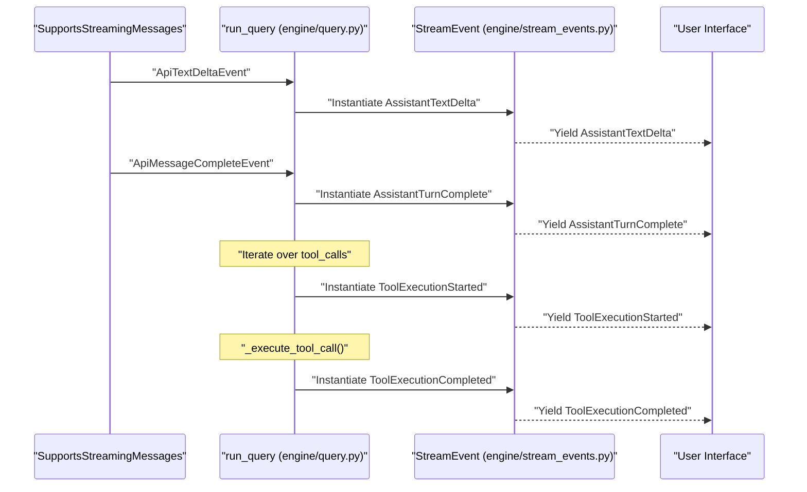
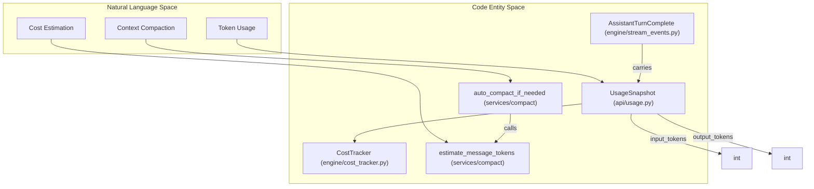

<!-- source: DeepWiki mcp.deepwiki.com · repo HKUDS/OpenHarness · page 2.2 Streaming Events and Cost Tracking · fetched 2026-11-09 -->

# Streaming Events and Cost Tracking

Relevant source files

The following files were used as context for generating this wiki page:

- [src/openharness/engine/query.py](src/openharness/engine/query.py)
- [src/openharness/engine/query_engine.py](src/openharness/engine/query_engine.py)
- [src/openharness/engine/stream_events.py](src/openharness/engine/stream_events.py)
- [src/openharness/services/compact/__init__.py](src/openharness/services/compact/__init__.py)
- [src/openharness/services/tool_outputs.py](src/openharness/services/tool_outputs.py)
- [tests/test_engine/test_messages.py](tests/test_engine/test_messages.py)
- [tests/test_engine/test_query_engine.py](tests/test_engine/test_query_engine.py)
- [tests/test_services/test_compact.py](tests/test_services/test_compact.py)

OpenHarness employs a structured event system to provide real-time feedback during the LLM query loop and a robust tracking mechanism to monitor token consumption across sessions. This page documents the `StreamEvent` hierarchy used for communication between the core engine and user interfaces, alongside the `UsageSnapshot` and `CostTracker` models.

## Streaming Event Hierarchy

The `StreamEvent` union type represents the lifecycle of a single interaction turn with the assistant. These events are yielded by `run_query` in `src/openharness/engine/query.py` [src/openharness/engine/query.py:71-71]() (and specifically within the streaming generator at [src/openharness/engine/query.py:284-633]()) to notify the UI or other observers about incremental text generation, tool invocations, and completion status.

### Event Types

| Event Class | Description | Key Attributes |
|:---|:---|:---|
| `AssistantTextDelta` | Represents a chunk of incremental text generated by the LLM. | `text: str` [src/openharness/engine/stream_events.py:13-17]() |
| `AssistantTurnComplete` | Signals the end of an assistant's response turn, including usage data. | `message: ConversationMessage`, `usage: UsageSnapshot` [src/openharness/engine/stream_events.py:19-25]() |
| `ToolExecutionStarted` | Emitted immediately before the engine executes a tool call. | `tool_name: str`, `tool_input: dict` [src/openharness/engine/stream_events.py:28-33]() |
| `ToolExecutionCompleted` | Emitted after a tool returns a result or encounters an error. | `tool_name: str`, `output: str`, `is_error: bool` [src/openharness/engine/stream_events.py:36-43]() |
| `StatusEvent` | A transient system message, such as an API retry notification. | `message: str` [src/openharness/engine/stream_events.py:54-58]() |
| `ErrorEvent` | An error surfaced to the user, such as a network failure. | `message: str`, `recoverable: bool` [src/openharness/engine/stream_events.py:46-51]() |
| `CompactProgressEvent` | Tracks phases of conversation compaction (e.g., `session_memory_start`). | `phase: Literal`, `trigger: Literal` [src/openharness/engine/stream_events.py:61-80]() |

### Event Data Flow

The following diagram illustrates how the `run_query` loop generates these events during a typical execution involving tool use.

**Query Engine Event Generation Flow**

**Sources:**
- [src/openharness/engine/stream_events.py:1-90]()
- [src/openharness/engine/query.py:284-633]()

---

## Cost Tracking and Usage Models

OpenHarness tracks token usage using the `UsageSnapshot` model for discrete API responses and the `CostTracker` for session-wide accumulation.

### UsageSnapshot and CostTracker
The `UsageSnapshot` captures the raw token counts returned by the model provider.
- **UsageSnapshot**: Includes `input_tokens` and `output_tokens` [src/openharness/api/usage.py:10-12]().
- **CostTracker**: A class in `src/openharness/engine/cost_tracker.py` (referenced in `QueryEngine` [src/openharness/engine/query_engine.py:60]()) that maintains a running `total` of usage across all turns in a session [src/openharness/engine/query_engine.py:93-95]().

### Token Estimation and Compaction
When explicit usage data is unavailable or when planning for compaction, the engine uses `estimate_message_tokens` [src/openharness/services/compact/__init__.py:116-132]().
- **Padding**: A conservative multiplier of `4/3` (`TOKEN_ESTIMATION_PADDING`) is applied to raw character-based estimates [src/openharness/services/compact/__init__.py:75-75]().
- **Thresholds**: Auto-compaction is triggered when the estimated token count approaches the model's context window, minus a buffer (default `13,000` tokens) [src/openharness/services/compact/__init__.py:55-55]().

### Usage Architecture Mapping

The diagram below bridges the natural language concepts of "Usage" and "Estimation" to the specific code entities.

**Usage and Cost Entity Mapping**

**Sources:**
- [src/openharness/api/usage.py:8-18]()
- [src/openharness/engine/query_engine.py:59-60]()
- [src/openharness/engine/stream_events.py:20-25]()
- [src/openharness/services/compact/__init__.py:41-81]()

---

## Implementation Details

### Sequential vs Concurrent Tool Execution
The `run_query` function handles tool events differently based on the number of tool calls requested by the LLM:
- **Single Tool**: Events are streamed immediately. `ToolExecutionStarted` is yielded, the tool runs, and `ToolExecutionCompleted` is yielded [src/openharness/engine/query.py:539-556]().
- **Multiple Tools**: Tools are executed concurrently using `asyncio.gather`. All `ToolExecutionStarted` events are yielded first [src/openharness/engine/query.py:566-574](), followed by the execution block, and finally all `ToolExecutionCompleted` events [src/openharness/engine/query.py:595-603]().

### Network and API Resilience
The engine monitors the stream for `ApiRetryEvent`. When the API client encounters a rate limit, it yields a `StatusEvent` containing the retry attempt number and delay [src/openharness/engine/query.py:378-385](). If a terminal exception occurs, an `ErrorEvent` is yielded to the UI [src/openharness/engine/query.py:392-398]().

### Compaction Triggers
Compaction can be triggered in three ways:
1. **Auto**: Automatically when token estimates exceed thresholds [src/openharness/services/compact/__init__.py:83]().
2. **Reactive**: Triggered when the API returns a "Prompt Too Long" error [src/openharness/engine/query.py:403-421]().
3. **Manual**: Triggered via slash commands (e.g., `/compact`).

**Sources:**
- [src/openharness/engine/query.py:370-633]()
- [src/openharness/engine/messages.py:1-68]()
- [src/openharness/engine/stream_events.py:1-90]()
- [src/openharness/services/compact/__init__.py:83-110]()

---

