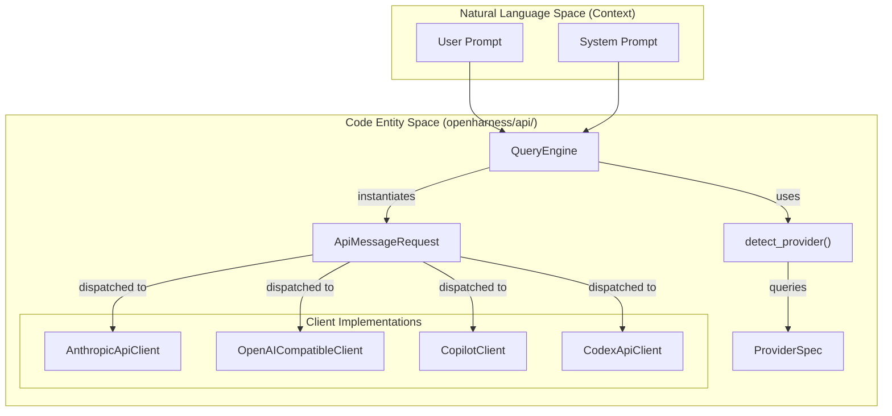
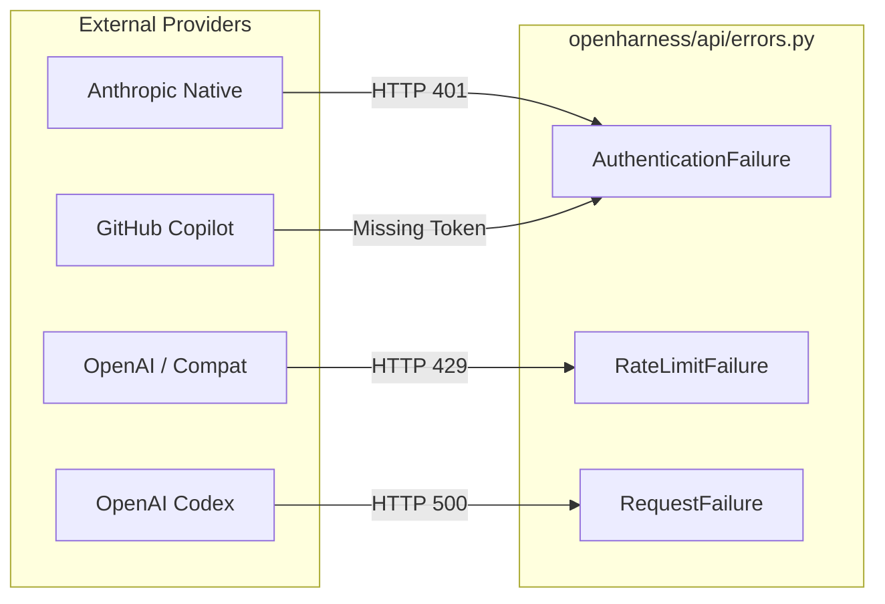

<!-- source: DeepWiki mcp.deepwiki.com · repo HKUDS/OpenHarness · page 3 API Layer · fetched 2026-11-09 -->

# API Layer

Relevant source files

The following files were used as context for generating this wiki page:

- [src/openharness/api/__init__.py](src/openharness/api/__init__.py)
- [src/openharness/api/client.py](src/openharness/api/client.py)
- [src/openharness/api/copilot_client.py](src/openharness/api/copilot_client.py)
- [src/openharness/api/openai_client.py](src/openharness/api/openai_client.py)
- [src/openharness/api/provider.py](src/openharness/api/provider.py)
- [src/openharness/api/registry.py](src/openharness/api/registry.py)
- [tests/test_api/test_copilot_auth.py](tests/test_api/test_copilot_auth.py)
- [tests/test_api/test_copilot_client.py](tests/test_api/test_copilot_client.py)
- [tests/test_api/test_openai_client.py](tests/test_api/test_openai_client.py)
- [tests/test_ui/test_runtime_close.py](tests/test_ui/test_runtime_close.py)

The **API Layer** serves as the communication bridge between the OpenHarness Core Engine and various LLM providers. It abstracts the complexities of streaming responses, multi-provider message format conversion, authentication, and robust error handling with exponential backoff.

### Overview

OpenHarness interacts with LLMs through a standardized interface. While the internal message model is optimized for Anthropic's Claude, the API layer provides specialized clients for OpenAI-compatible gateways, GitHub Copilot, and OpenAI Codex subscriptions. The architecture ensures that the [Core Engine](#2) remains decoupled from specific provider implementations by using the `SupportsStreamingMessages` protocol [src/openharness/api/client.py:80-85]().

**Communication Flow:**
1.  The `QueryEngine` prepares an `ApiMessageRequest` [src/openharness/api/client.py:40-49]().
2.  The active client (e.g., `AnthropicApiClient`, `OpenAICompatibleClient`, or `CopilotClient`) manages the connection and retries transient failures [src/openharness/api/client.py:169-197]().
3.  The client yields `ApiStreamEvent` objects—such as `ApiTextDeltaEvent` for incremental updates or `ApiMessageCompleteEvent` for final message processing [src/openharness/api/client.py:52-77]().

### API Communication Bridge

The following diagram illustrates how high-level requests are translated into provider-specific SDK calls and handled by the client infrastructure.

**Entity Mapping: Engine to API Clients**

**Sources:** [src/openharness/api/client.py:40-49](), [src/openharness/api/provider.py:42-94](), [src/openharness/api/registry.py:18-49](), [src/openharness/api/client.py:80-85]()

---

### Anthropic API Client
The `AnthropicApiClient` is the primary implementation of the `SupportsStreamingMessages` protocol. It wraps the `anthropic` Python SDK to provide standardized streaming and automatic retries.

*   **Retry Logic:** Uses exponential backoff with jitter, respecting `Retry-After` headers when provided by the API [src/openharness/api/client.py:98-115]().
*   **OAuth Support:** Includes specialized handling for Claude subscription auth, including token refreshing and identity headers [src/openharness/api/client.py:157-164]().

For details, see [Anthropic API Client](#3.1).

**Sources:** [src/openharness/api/client.py:118-151](), [src/openharness/api/client.py:165-202]()

---

### OpenAI-Compatible, Codex, and Copilot Clients
OpenHarness supports a wide range of alternative backends through specialized translation layers.

*   **OpenAICompatibleClient:** Bridges Anthropic-style tool schemas and message blocks to the OpenAI ChatCompletion format [src/openharness/api/openai_client.py:60-78](). It handles provider-specific quirks like "thinking" model reasoning content and token limit parameter normalization [src/openharness/api/openai_client.py:46-57](), [src/openharness/api/openai_client.py:162-186]().
*   **CopilotClient:** A wrapper around the OpenAI client that injects GitHub OAuth Bearer tokens and specific headers required by the Copilot API [src/openharness/api/copilot_client.py:48-110]().
*   **CodexApiClient:** Interfaces with the `chatgpt.com` backend, extracting account IDs from JWT claims and converting messages to the Codex-specific JSON-line stream format [src/openharness/api/codex_client.py:1-10]().

For details, see [OpenAI-Compatible, Codex, and Copilot Clients](#3.2).

**Sources:** [src/openharness/api/openai_client.py:81-126](), [src/openharness/api/copilot_client.py:112-130](), [src/openharness/api/openai_client.py:46-57]()

---

### Provider Detection and Authentication
The system automatically identifies the correct backend and authentication flow based on user configuration.

*   **Provider Registry:** A central list of `ProviderSpec` objects defines keywords, API key environment variables, and default base URLs for dozens of providers including DeepSeek, DashScope, and OpenRouter [src/openharness/api/registry.py:55-213]().
*   **Detection Logic:** `detect_provider` inspects the configured model and base URL to resolve metadata for the UI and diagnostics [src/openharness/api/provider.py:42-94]().
*   **Multimodal Detection:** The layer includes heuristics to detect if a model supports native vision capabilities [src/openharness/api/provider.py:175-186]().

For details, see [Provider Detection and Authentication](#3.3).

**Sources:** [src/openharness/api/provider.py:42-94](), [src/openharness/api/registry.py:18-49](), [src/openharness/api/provider.py:135-172]()

---

### Error Handling and Translation
The API layer categorizes exceptions into a hierarchy of `OpenHarnessApiError` types to allow the engine to make informed decisions about whether to halt execution or notify the user.

| Exception Class | Source Trigger | Retriable? |
| :--- | :--- | :--- |
| `AuthenticationFailure` | 401 Unauthorized / 403 Forbidden | No |
| `RateLimitFailure` | 429 Too Many Requests | Yes |
| `RequestFailure` | 400 Bad Request / 500 Internal Error | Depends on status code |

**Provider and Error Mapping**

**Sources:** [src/openharness/api/client.py:14-19](), [src/openharness/api/openai_client.py:22-27](), [src/openharness/api/copilot_client.py:27-27]()

---

