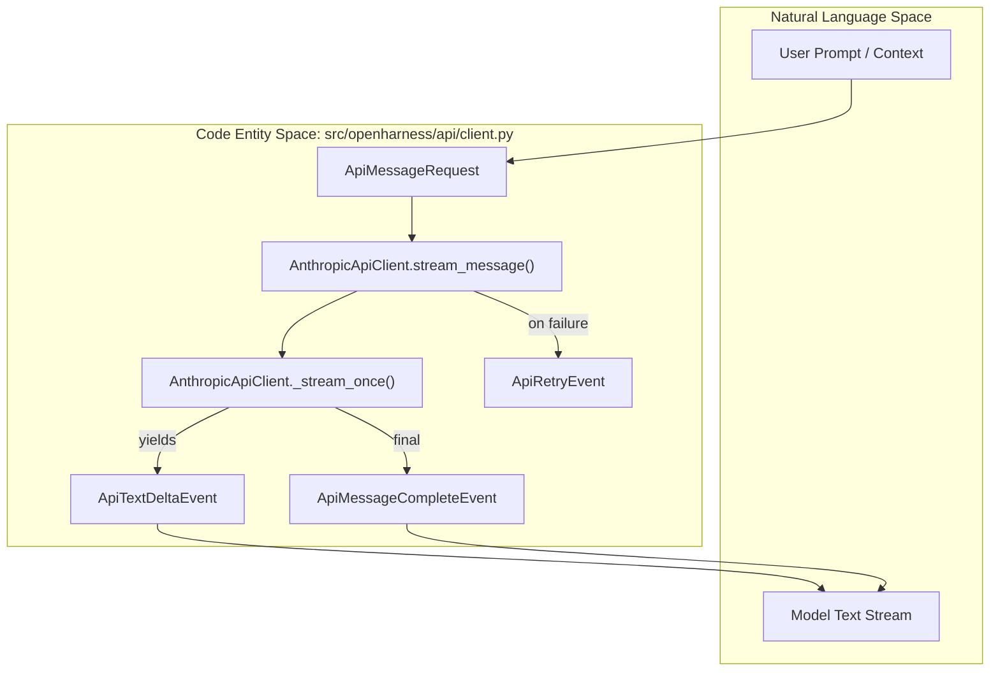
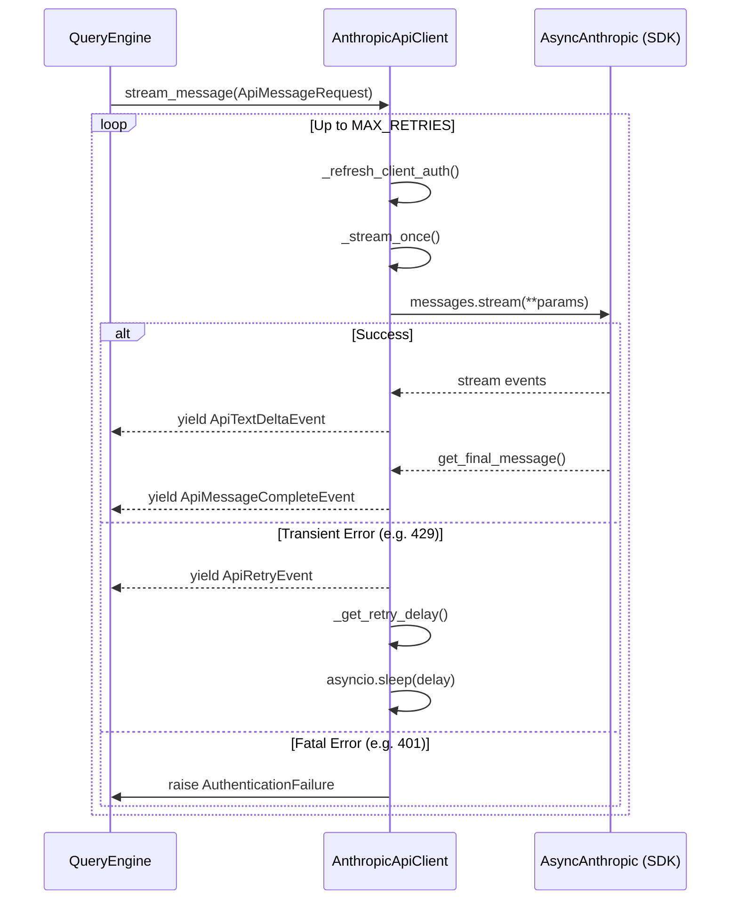

<!-- source: DeepWiki mcp.deepwiki.com · repo HKUDS/OpenHarness · page 3.1 Anthropic API Client · fetched 2026-11-09 -->

# Anthropic API Client

<details>
<summary>Relevant source files</summary>

The following files were used as context for generating this wiki page:

- [src/openharness/api/client.py](src/openharness/api/client.py)
- [src/openharness/api/copilot_client.py](src/openharness/api/copilot_client.py)
- [src/openharness/api/openai_client.py](src/openharness/api/openai_client.py)
- [tests/test_api/test_client.py](tests/test_api/test_client.py)
- [tests/test_api/test_copilot_auth.py](tests/test_api/test_copilot_auth.py)
- [tests/test_api/test_copilot_client.py](tests/test_api/test_copilot_client.py)
- [tests/test_api/test_openai_client.py](tests/test_api/test_openai_client.py)
- [tests/test_ui/test_runtime_close.py](tests/test_ui/test_runtime_close.py)

</details>


The `AnthropicApiClient` serves as the primary interface between the OpenHarness engine and the Anthropic Messages API. It wraps the asynchronous Anthropic SDK to provide robust error handling, automated retry logic with exponential backoff, and a standardized streaming protocol for the query loop. It also supports Claude OAuth authentication and session attribution for specialized environments.

Sources: [src/openharness/api/client.py:1-29]()

## Core Data Structures

The client uses several dataclasses to standardize communication between the API layer and the `QueryEngine`. These structures ensure that the engine remains decoupled from provider-specific SDK formats.

### Request and Event Models
*   **`ApiMessageRequest`**: Encapsulates all parameters required for a model invocation, including the model ID, conversation history, system prompt, token limits, and tool definitions [src/openharness/api/client.py:40-49]().
*   **`ApiTextDeltaEvent`**: Represents an incremental chunk of text streamed from the model [src/openharness/api/client.py:52-56]().
*   **`ApiMessageCompleteEvent`**: The terminal event in a stream, containing the final `ConversationMessage`, token usage statistics via `UsageSnapshot`, and the API's `stop_reason` [src/openharness/api/client.py:59-65]().
*   **`ApiRetryEvent`**: Dispatched when a recoverable upstream failure occurs, informing the UI or engine about the current retry attempt and expected delay [src/openharness/api/client.py:68-75]().

### Usage Tracking
The `UsageSnapshot` model tracks token consumption for both input and output, providing a consistent interface for cost accounting across different providers [src/openharness/api/usage.py:8-18]().

Sources: [src/openharness/api/client.py:40-77](), [src/openharness/api/usage.py:8-18]()

## Streaming Protocol and Implementation

The client implements the `SupportsStreamingMessages` protocol, which defines a standard asynchronous iterator interface for the engine to consume model responses.

### Protocol Definition
```python
class SupportsStreamingMessages(Protocol):
    """Protocol used by the query engine in tests and production."""

    async def stream_message(self, request: ApiMessageRequest) -> AsyncIterator[ApiStreamEvent]:
        """Yield streamed events for the request."""
```
Sources: [src/openharness/api/client.py:80-84]()

### Data Flow: Natural Language to Code Entities
The following diagram illustrates how the `AnthropicApiClient` bridges high-level engine requests to the underlying SDK events.

**API Streaming Data Flow**

Sources: [src/openharness/api/client.py:40-77](), [src/openharness/api/client.py:165-246]()

## Retry Logic and Error Handling

OpenHarness implements a sophisticated retry mechanism to handle transient network issues and API rate limits.

### Exponential Backoff
The client uses exponential backoff with jitter to prevent "thundering herd" problems. 
*   **Base Delay**: 1.0s [src/openharness/api/client.py:33]()
*   **Max Delay**: 30.0s [src/openharness/api/client.py:34]()
*   **Max Retries**: 3 [src/openharness/api/client.py:32]()

The function `_get_retry_delay` calculates wait time and respects the `retry-after` header if provided by the Anthropic API [src/openharness/api/client.py:98-116]().

### Retryable Errors
Errors are categorized via `_is_retryable` [src/openharness/api/client.py:87-95](). Retryable conditions include:
*   HTTP Status Codes: 429 (Rate Limit), 500, 502, 503, 529 [src/openharness/api/client.py:35]().
*   Network exceptions: `ConnectionError`, `TimeoutError`, and `OSError` [src/openharness/api/client.py:93-94]().

### Error Translation
The client maps SDK-specific exceptions to internal `OpenHarnessApiError` types via `_translate_api_error` [src/openharness/api/client.py:249-261]():

| SDK Error | OpenHarness Error |
| :--- | :--- |
| `AuthenticationError` / `PermissionDeniedError` | `AuthenticationFailure` |
| `RateLimitError` | `RateLimitFailure` |
| Generic `APIError` | `RequestFailure` |

Sources: [src/openharness/api/client.py:31-36](), [src/openharness/api/client.py:87-116](), [src/openharness/api/client.py:249-261]()

## Internal Execution Flow

The `AnthropicApiClient` manages authentication state and the retry loop. It supports an `auth_token_resolver` callback to refresh OAuth tokens mid-session if they expire [src/openharness/api/client.py:157-164]().

**Retry and Execution Logic**

Sources: [src/openharness/api/client.py:165-201]()

### Implementation Details of `_stream_once`
1.  **Parameter Mapping**: Converts `ApiMessageRequest` into the format expected by the Anthropic SDK. `ConversationMessage` objects are mapped to API parameters via `to_api_param()` [src/openharness/api/client.py:205-209]().
2.  **OAuth and Thinking Models**: If `claude_oauth` is enabled, the client injects specific headers and metadata, including specialized `betas` for the Claude Code environment [src/openharness/api/client.py:212-220](). It also handles the `effort` parameter for reasoning models [src/openharness/api/client.py:221-222]().
3.  **Delta Filtering**: The client iterates over the SDK stream, yielding `ApiTextDeltaEvent` only for `text_delta` types within `content_block_delta` events [src/openharness/api/client.py:227-234]().
4.  **Finalization**: Retrieves the final message object to extract token usage and the full response body, converting it back to the internal `ConversationMessage` format using `assistant_message_from_api` [src/openharness/api/client.py:236-246]().

Sources: [src/openharness/api/client.py:203-246](), [src/openharness/engine/messages.py:27-27]()

---

