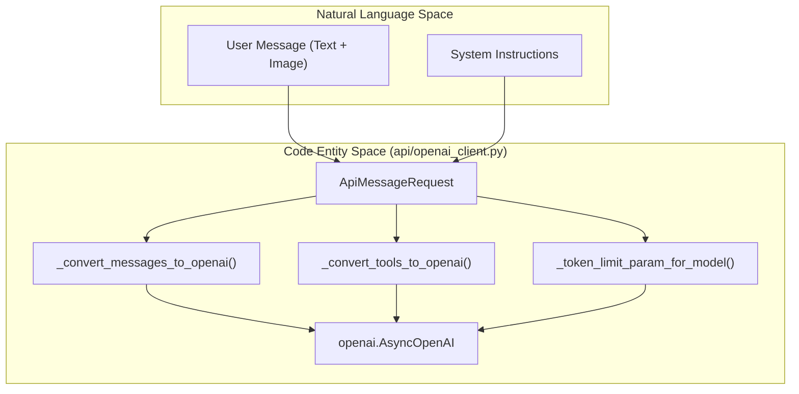
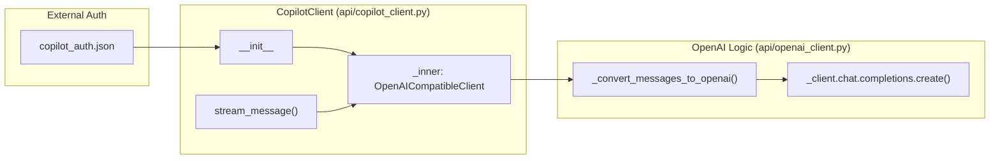

<!-- source: DeepWiki mcp.deepwiki.com · repo HKUDS/OpenHarness · page 3.2 OpenAI-Compatible, Codex, and Copilot Clients · fetched 2026-11-09 -->

# OpenAI-Compatible, Codex, and Copilot Clients

Relevant source files

The following files were used as context for generating this wiki page:

- [src/openharness/api/client.py](src/openharness/api/client.py)
- [src/openharness/api/codex_client.py](src/openharness/api/codex_client.py)
- [src/openharness/api/copilot_client.py](src/openharness/api/copilot_client.py)
- [src/openharness/api/openai_client.py](src/openharness/api/openai_client.py)
- [tests/test_api/test_codex_client.py](tests/test_api/test_codex_client.py)
- [tests/test_api/test_copilot_auth.py](tests/test_api/test_copilot_auth.py)
- [tests/test_api/test_copilot_client.py](tests/test_api/test_copilot_client.py)
- [tests/test_api/test_openai_client.py](tests/test_api/test_openai_client.py)
- [tests/test_ui/test_runtime_close.py](tests/test_ui/test_runtime_close.py)

This page documents the specialized API clients within OpenHarness that facilitate communication with non-Anthropic providers. This includes providers offering OpenAI-compatible endpoints (e.g., Alibaba DashScope, GitHub Models), the subscription-backed Codex interface for chatgpt.com, and the GitHub Copilot chat API.

## OpenAI-Compatible Client

The `OpenAICompatibleClient` class in `api/openai_client.py` provides a bridge between the Anthropic-style message format used internally by the OpenHarness engine and the OpenAI Chat Completion API. [src/openharness/api/openai_client.py:1-21]()

### Schema Conversion
Because the OpenHarness engine standardized on the Anthropic message and tool schema, the `OpenAICompatibleClient` performs real-time translation of requests and responses.

*   **Tool Conversion**: The function `_convert_tools_to_openai` transforms Anthropic's `input_schema` into OpenAI's `function` parameters format. [src/openharness/api/openai_client.py:60-78]()
*   **Message Conversion**: `_convert_messages_to_openai` handles structural differences, such as moving system prompts into the message array and splitting tool results into individual `role: "tool"` entries. [src/openharness/api/openai_client.py:81-126]()
*   **Thinking Models**: For models that support "reasoning" (like Kimi k2.5 or OpenAI o1), the client manages the `reasoning_content` field. It stashes reasoning text in `msg._reasoning` during streaming and replays it in subsequent turns. [src/openharness/api/openai_client.py:162-202]()
*   **Think Block Stripping**: The client includes a utility `_strip_think_blocks` to remove `` tags from model output to provide clean text to the engine. [src/openharness/api/openai_client.py:381-384]()

### Token Limit Logic
Modern OpenAI models (o1, o3, gpt-5) have replaced the `max_tokens` parameter with `max_completion_tokens`. The helper `_token_limit_param_for_model` detects these model prefixes and adjusts the request payload accordingly. [src/openharness/api/openai_client.py:46-57]()

### Data Flow: OpenAI Request Transformation
The following diagram illustrates how an internal `ApiMessageRequest` is transformed into an OpenAI-compatible payload.

Title: OpenAI Client Transformation Flow

Sources: [src/openharness/api/openai_client.py:46-126](), [src/openharness/api/openai_client.py:228-253]()

---

## Codex API Client

The `CodexApiClient` in `api/codex_client.py` is designed to interact with the `chatgpt.com/backend-api/codex` endpoints. This client is used primarily for subscription-backed access to OpenAI's reasoning capabilities via the experimental Responses API. [src/openharness/api/codex_client.py:1-23]()

### JWT Account-ID Extraction
Unlike standard API clients that only require a Bearer token, the Codex backend requires a `chatgpt-account-id` header. The client extracts this ID from the provided JWT (JSON Web Token) by:
1.  Splitting the token and decoding the payload section. [src/openharness/api/codex_client.py:30-39]()
2.  Accessing the `https://api.openai.com/auth` claim. [src/openharness/api/codex_client.py:40-42]()
3.  Retrieving the `chatgpt_account_id` string. [src/openharness/api/codex_client.py:43-46]()

### Protocol Handling
Codex uses a custom EventStream protocol. The `stream_message` method iterates over lines from `httpx.AsyncClient`, parsing events such as `response.output_text.delta` for text and `response.output_item.added` for tool calls. [src/openharness/api/codex_client.py:236-320]()

| Feature | Implementation Detail |
| :--- | :--- |
| **Auth Headers** | Includes `OpenAI-Beta: responses=experimental` and `chatgpt-account-id`. [src/openharness/api/codex_client.py:61-74]() |
| **URL Resolution** | Normalizes base URLs to ensure they end in `/codex/responses`. [src/openharness/api/codex_client.py:49-58]() |
| **Tool Calls** | Converts tool uses to `function_call` types with specific ID prefixing (`fc_`). [src/openharness/api/codex_client.py:112-121]() |

Sources: [src/openharness/api/codex_client.py:1-121](), [tests/test_api/test_codex_client.py:69-121]()

---

## Copilot Client

The `CopilotClient` in `api/copilot_client.py` is a wrapper around the `OpenAICompatibleClient`. It leverages the fact that GitHub Copilot's chat endpoint is OpenAI-compatible but requires specific headers and authentication flows. [src/openharness/api/copilot_client.py:1-10]()

### Authentication and Initialization
*   **Bearer Token**: It uses the GitHub OAuth token (prefixed with `ghu_` or `gho_`) directly as the API key. [src/openharness/api/copilot_client.py:51-52]()
*   **Token Resolution**: It attempts to load tokens from `~/.openharness/copilot_auth.json` via `load_copilot_auth()` if no token is provided explicitly. [src/openharness/api/copilot_client.py:74-79]()
*   **Enterprise Support**: Supports custom enterprise domains, resolving the API base URL via `copilot_api_base(ent_url)`. [src/openharness/api/copilot_client.py:81-89]()

### Specialized Headers
The client injects mandatory headers for Copilot compatibility: [src/openharness/api/copilot_client.py:90-93]()
*   `User-Agent`: Identifies the client as `openharness/<version>`.
*   `Openai-Intent`: Set to `conversation-edits` to signal the context of the request.

### Client Architecture: Copilot Wrapper
The diagram below shows how `CopilotClient` encapsulates the standard OpenAI client while applying Copilot-specific configurations.

Title: Copilot Client Delegation Architecture

Sources: [src/openharness/api/copilot_client.py:48-105](), [src/openharness/api/copilot_client.py:112-130](), [tests/test_api/test_copilot_client.py:113-141]()

## Summary of Client Protocol Support

| Client | Protocol | Key Files |
| :--- | :--- | :--- |
| **OpenAICompatibleClient** | OpenAI Chat Completions | `api/openai_client.py` [src/openharness/api/openai_client.py:1-13]() |
| **CodexApiClient** | chatgpt.com Backend API | `api/codex_client.py` [src/openharness/api/codex_client.py:1-23]() |
| **CopilotClient** | OpenAI + Copilot Headers | `api/copilot_client.py` [src/openharness/api/copilot_client.py:1-10]() |

Sources: [src/openharness/api/openai_client.py:1-5](), [src/openharness/api/codex_client.py:1-5](), [src/openharness/api/copilot_client.py:1-10]()

---

