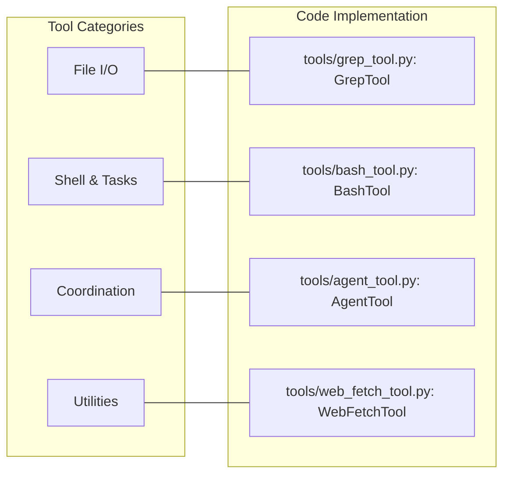

<!-- source: DeepWiki mcp.deepwiki.com · repo HKUDS/OpenHarness · page 4 Tools System · fetched 2026-11-09 -->

# Tools System

<details>
<summary>Relevant source files</summary>

The following files were used as context for generating this wiki page:

- [scripts/react_tui_e2e.py](scripts/react_tui_e2e.py)
- [src/openharness/hooks/events.py](src/openharness/hooks/events.py)
- [src/openharness/tools/__init__.py](src/openharness/tools/__init__.py)
- [src/openharness/tools/agent_tool.py](src/openharness/tools/agent_tool.py)
- [src/openharness/tools/base.py](src/openharness/tools/base.py)
- [src/openharness/tools/glob_tool.py](src/openharness/tools/glob_tool.py)
- [src/openharness/tools/grep_tool.py](src/openharness/tools/grep_tool.py)
- [src/openharness/tools/send_message_tool.py](src/openharness/tools/send_message_tool.py)
- [tests/test_hooks_skills_plugins_real.py](tests/test_hooks_skills_plugins_real.py)
- [tests/test_real_large_tasks.py](tests/test_real_large_tasks.py)
- [tests/test_swarm/test_imports.py](tests/test_swarm/test_imports.py)
- [tests/test_tools/test_core_tools.py](tests/test_tools/test_core_tools.py)
- [tests/test_tools/test_grep_tool.py](tests/test_tools/test_grep_tool.py)
- [tests/test_tools/test_integration_flows.py](tests/test_tools/test_integration_flows.py)
- [tests/test_untested_features.py](tests/test_untested_features.py)

</details>


The **Tools System** is the primary interface through which the OpenHarness agent interacts with the external world. It provides a structured framework for the LLM to perform actions such as file manipulation, shell command execution, web searching, and multi-agent coordination. The system currently supports over 43 built-in tools, all managed through a unified registry and execution pipeline [src/openharness/tools/__init__.py:48-98]().

### Core Architecture

The tools system is built on a strictly typed foundation using Pydantic for input validation and a centralized registry for discovery. When the LLM decides to use a tool, the `QueryEngine` dispatches the request to the `ToolRegistry`, which instantiates the appropriate tool class and executes it within a controlled `ToolExecutionContext` [src/openharness/tools/base.py:12-34]().

#### Tool Interaction Flow
The following diagram illustrates how a natural language request from the LLM is transformed into a code execution via the `ToolRegistry` and `BaseTool` abstractions.

**Tool Execution Pipeline**
```mermaid
graph TD
    subgraph "Natural Language Space (LLM)"
        A["LLM Tool Call (JSON)"]
    end

    subgraph "Code Entity Space (OpenHarness)"
        B["engine/query_engine.py: QueryEngine"]
        C["tools/base.py: ToolRegistry"]
        D["tools/base.py: BaseTool Subclass"]
        E["tools/base.py: ToolExecutionContext"]
        F["tools/base.py: ToolResult"]
    end

    A -->|Dispatch| B
    B -->|Lookup| C
    C -->|Instantiate| D
    D -->|Validate Input| E
    E -->|execute()| D
    D -->|Return| F
    F -->|Observation| A
```
Sources: [src/openharness/tools/base.py:12-34](), [src/openharness/tools/__init__.py:50-98]()

### Tool Abstractions and Registry

Every tool in OpenHarness inherits from the `BaseTool` abstract base class [src/openharness/tools/base.py:12-12](). This ensures a consistent interface for the `QueryEngine` to interact with, regardless of whether the tool is a simple file reader or a complex MCP (Model Context Protocol) client.

Key components include:
- **`BaseTool`**: Defines the `execute()` method and the `input_model` (a Pydantic class) used for argument validation [src/openharness/tools/base.py:26-34]().
- **`ToolRegistry`**: A registry that manages the lifecycle of all available tools, including built-in tools, plugin-contributed tools, and MCP tools [src/openharness/tools/base.py:12-12]().
- **`ToolExecutionContext`**: Provides tools with access to the current environment, such as the working directory (`cwd`), session ID, and event emitters [src/openharness/tools/base.py:12-12]().
- **`ToolResult`**: A standardized container for tool output, supporting text results and error flagging via `is_error` [src/openharness/tools/base.py:12-12]().

For details on implementing custom tools or the internals of the registry, see [Tool Abstractions and Registry](#4.1).

Sources: [src/openharness/tools/base.py:12-34](), [src/openharness/tools/__init__.py:48-98]()

### Built-in Tool Categories

OpenHarness ships with a comprehensive suite of 43+ tools designed to cover the majority of software engineering and general-purpose tasks. These are logically grouped into several categories:

| Category | Description | Key Tools |
| :--- | :--- | :--- |
| **File I/O** | Safe filesystem operations with path validation and regex search. | `read_file`, `write_file`, `edit_file`, `grep`, `glob` |
| **Shell** | Execution of arbitrary bash commands with timeout control. | `bash` |
| **Tasks** | Management of background processes via `BackgroundTaskManager`. | `task_create`, `task_list`, `task_stop`, `task_output` |
| **Agents** | Spawning and communicating with sub-agents via `TeamRegistry`. | `agent`, `team_create`, `send_message` |
| **MCP** | Integration with external Model Context Protocol servers. | `mcp_tool`, `list_mcp_resources`, `read_mcp_resource` |
| **Utilities** | Specialized helpers for search, web, and productivity. | `web_search`, `web_fetch`, `skill`, `lsp`, `cron_create` |

#### System Integration Diagram
This diagram maps high-level tool categories to their specific implementation entry points in the codebase.

**Tool Category Mapping**

Sources: [src/openharness/tools/grep_tool.py:29-34](), [src/openharness/tools/agent_tool.py:38-43](), [src/openharness/tools/glob_tool.py:25-30]()

For a complete catalog of all built-in tools and their parameters, see [Built-in Tool Reference](#4.2).

### Tool Invocation and Security

Tools are not executed in a vacuum. Every tool call is intercepted by the **Permissions System** and can be observed by the **Hooks System** [tests/test_untested_features.py:104-143]().
1. **Discovery**: The `ToolRegistry` generates a tool schema which is sent to the LLM [src/openharness/tools/__init__.py:48-98]().
2. **Validation**: When the LLM calls a tool, the `QueryEngine` validates arguments against the tool's `input_model` (e.g., `GrepToolInput` [src/openharness/tools/grep_tool.py:15-26]()).
3. **Authorization**: The `PermissionChecker` evaluates the call based on the current `PermissionMode` [tests/test_untested_features.py:43-65]().
4. **Hooks**: Lifecycle hooks like `PRE_TOOL_USE` and `POST_TOOL_USE` can block execution or log results [src/openharness/hooks/events.py:8-21]().
5. **Sandboxing**: Sensitive tools like `BashTool` or `GlobTool` check for sandbox availability and use the `DockerSandbox` if configured [src/openharness/tools/glob_tool.py:117-126]().

For details on the security layer, see [Permissions System](#5) and [Hooks System](#6).

Sources: [src/openharness/tools/grep_tool.py:40-71](), [src/openharness/hooks/events.py:15-16](), [src/openharness/tools/glob_tool.py:117-133]()

---

