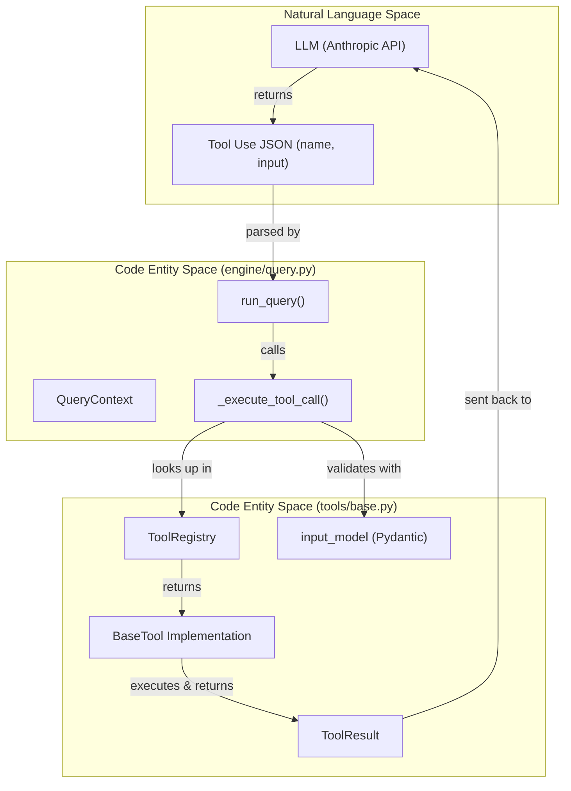
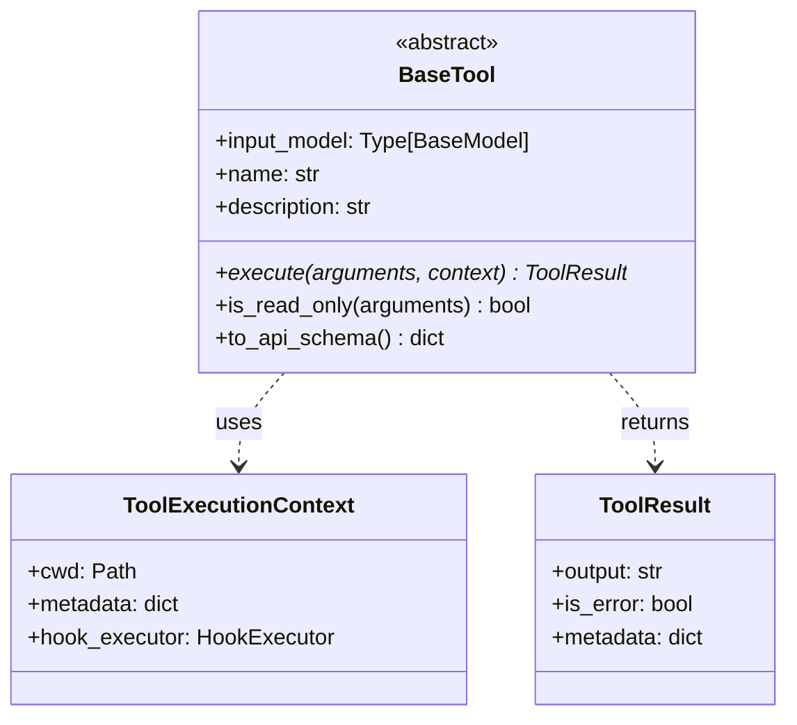
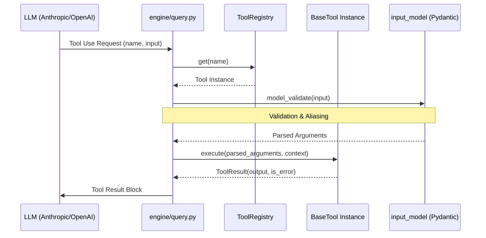

<!-- source: DeepWiki mcp.deepwiki.com · repo HKUDS/OpenHarness · page 4.1 Tool Abstractions and Registry · fetched 2026-11-09 -->

# Tool Abstractions and Registry

Relevant source files

The following files were used as context for generating this wiki page:

- [src/openharness/hooks/events.py](src/openharness/hooks/events.py)
- [src/openharness/tools/agent_tool.py](src/openharness/tools/agent_tool.py)
- [src/openharness/tools/base.py](src/openharness/tools/base.py)
- [src/openharness/tools/glob_tool.py](src/openharness/tools/glob_tool.py)
- [src/openharness/tools/grep_tool.py](src/openharness/tools/grep_tool.py)
- [src/openharness/tools/send_message_tool.py](src/openharness/tools/send_message_tool.py)
- [tests/test_tools/test_core_tools.py](tests/test_tools/test_core_tools.py)
- [tests/test_tools/test_grep_tool.py](tests/test_tools/test_grep_tool.py)

This page documents the core abstractions and registration mechanisms that power the OpenHarness tools system. It details the lifecycle of a tool from its definition and registration to its execution within the LLM query loop.

## Overview

The OpenHarness tool system is built on a unified interface that bridges the gap between the Large Language Model's (LLM) intent and the execution of Python code. Every tool in the system inherits from a common base class, uses Pydantic for strict input validation, and is managed by a central registry.

### Core Architecture Diagram

The following diagram illustrates how the `QueryContext` coordinates between the LLM's tool calls and the underlying `ToolRegistry`.

**Natural Language to Code Entity Bridge: Tool Dispatch**

Sources: [src/openharness/tools/base.py:35-81](), [src/openharness/tools/base.py:18-33]()

---

## Tool Definitions

### BaseTool
The `BaseTool` class is the abstract foundation for all tools [src/openharness/tools/base.py:35-58](). It requires a Pydantic `input_model` for schema generation and validation, and an `execute()` method for the actual logic.

*   **`input_model`**: A `type[BaseModel]` that defines the arguments the LLM must provide [src/openharness/tools/base.py:40-40](). This is used by `to_api_schema()` to generate the JSON Schema sent to the LLM provider [src/openharness/tools/base.py:51-57](). For example, `GrepTool` uses `GrepToolInput` [src/openharness/tools/grep_tool.py:34-34](), and `GlobTool` uses `GlobToolInput` [src/openharness/tools/glob_tool.py:30-30]().
*   **`execute(arguments, context)`**: An asynchronous method that receives the validated Pydantic model and a `ToolExecutionContext`. It returns a `ToolResult` [src/openharness/tools/base.py:42-44](). Implementation examples include searching files using `ripgrep` in `GrepTool` [src/openharness/tools/grep_tool.py:40-94]() or listing files in `GlobTool` [src/openharness/tools/glob_tool.py:36-41]().
*   **`is_read_only(arguments)`**: A method used by the permission system to determine if the tool call requires elevated privileges. Read-only tools like `GrepTool` [src/openharness/tools/grep_tool.py:36-38]() and `GlobTool` [src/openharness/tools/glob_tool.py:32-34]() override this to return `True`.
*   **`to_api_schema()`**: Automatically generates the tool definition (name, description, and input schema) required by the Anthropic Messages API format [src/openharness/tools/base.py:51-57]().

### ToolExecutionContext
This object provides tools with necessary environmental data and callbacks without coupling them to the core engine.
*   **`cwd`**: The current working directory for file or shell operations [src/openharness/tools/base.py:21-21]().
*   **`metadata`**: A dictionary containing optional references, such as the `edit_approval_prompt` used in `FileWriteTool` tests [src/openharness/tools/base.py:22-22](), [tests/test_tools/test_core_tools.py:69-69]().
*   **`hook_executor`**: An optional reference to the `HookExecutor` for emitting events like `SUBAGENT_STOP` during tool execution [src/openharness/tools/base.py:23-23](), [src/openharness/tools/agent_tool.py:109-123]().

### ToolResult
The normalized output of a tool execution, containing the string `output`, a boolean `is_error` flag, and optional `metadata` [src/openharness/tools/base.py:26-33](). For instance, `AgentTool` includes the `task_id` and `agent_id` in the metadata [src/openharness/tools/agent_tool.py:135-140]().

**Tool Implementation Structure**

Sources: [src/openharness/tools/base.py:18-58]()

---

## Tool Registry

The `ToolRegistry` serves as the central repository for all available tools [src/openharness/tools/base.py:60-81](). It is responsible for mapping tool names to their implementation instances and generating the collective schema for the LLM.

### Key Functions
*   **`register(tool)`**: Adds a `BaseTool` instance to the internal mapping [src/openharness/tools/base.py:66-68]().
*   **`get(name)`**: Retrieves a tool instance by its string name [src/openharness/tools/base.py:70-72]().
*   **`list_tools()`**: Returns a list of all registered tool instances [src/openharness/tools/base.py:74-76]().
*   **`to_api_schema()`**: Iterates through all registered tools and compiles their individual schemas into a list suitable for the API request [src/openharness/tools/base.py:78-80]().

Sources: [src/openharness/tools/base.py:60-81]()

---

## Execution Flow and Validation

When the LLM requests a tool, the engine manages the lifecycle of that request by interacting with the `ToolRegistry` and the tool's `input_model`.

1.  **Lookup**: The tool is retrieved from the `ToolRegistry`.
2.  **Validation**: The raw JSON input from the LLM is validated against the tool's `input_model`. Tools like `GlobTool` use `validation_alias` to support multiple parameter names (e.g., `pattern` or `path`) [src/openharness/tools/glob_tool.py:17-20]().
3.  **Execution**: The tool's `execute` method is called. Tools handle their own internal logic, such as `GrepTool` falling back from `ripgrep` to a pure-Python implementation if the binary is missing [src/openharness/tools/grep_tool.py:74-94]().
4.  **Error Handling**: If a tool times out (e.g., `GrepTool` reaching its `timeout_seconds`), it returns a `ToolResult` with `is_error=True` and a descriptive message [src/openharness/tools/grep_tool.py:151-161]().

### Data Flow: Tool Call to Result

Sources: [src/openharness/tools/base.py:35-81](), [src/openharness/tools/grep_tool.py:40-94](), [src/openharness/tools/glob_tool.py:14-23]()

---

