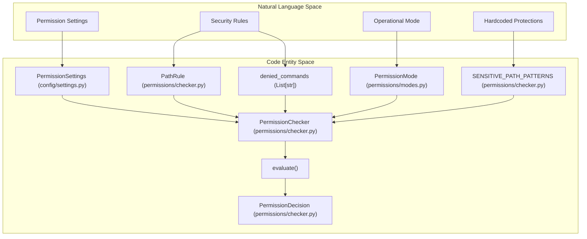
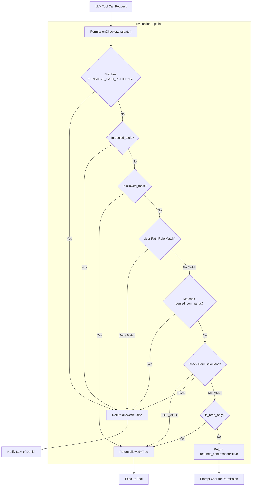

<!-- source: DeepWiki mcp.deepwiki.com · repo HKUDS/OpenHarness · page 5 Permissions System · fetched 2026-11-09 -->

# Permissions System

Relevant source files

The following files were used as context for generating this wiki page:

- [src/openharness/permissions/checker.py](src/openharness/permissions/checker.py)
- [src/openharness/tools/bash_tool.py](src/openharness/tools/bash_tool.py)
- [src/openharness/utils/shell.py](src/openharness/utils/shell.py)
- [tests/test_permissions/test_checker.py](tests/test_permissions/test_checker.py)
- [tests/test_tools/test_bash_tool.py](tests/test_tools/test_bash_tool.py)
- [tests/test_utils/test_shell.py](tests/test_utils/test_shell.py)

The Permissions System in OpenHarness provides a robust security and safety layer that governs how the LLM interacts with the host system. It evaluates every tool call against a set of configurable modes, path-based rules, and command patterns to determine if an action should be executed, blocked, or require explicit user confirmation.

The system is centered around the `PermissionChecker` class [src/openharness/permissions/checker.py:57-58](), which processes `PermissionSettings` [src/openharness/config/settings.py]() to yield a `PermissionDecision` [src/openharness/permissions/checker.py:41-46]().

## Permission Modes

OpenHarness operates in one of three primary modes defined by the `PermissionMode` enum [src/openharness/permissions/modes.py:8-13](). These modes dictate the baseline behavior for "mutating" tools (tools that modify the system state, such as file writes or shell commands).

| Mode | Behavior | Use Case |
| :--- | :--- | :--- |
| `DEFAULT` | Mutating tools require user confirmation; read-only tools are allowed [src/openharness/permissions/checker.py:143-156](). | Standard interactive development. |
| `PLAN` | Mutating tools are strictly blocked [src/openharness/permissions/checker.py:137-141](). | Initial brainstorming or architecture phases. |
| `FULL_AUTO` | All tools are allowed to execute without confirmation [src/openharness/permissions/checker.py:129-130](). | Autonomous agents or trusted environments. |

For a deep dive into how these modes are configured and the impact of the `--dangerously-skip-permissions` flag, see **[Permission Modes and Path Rules](#5.1)**.

**Sources:**
- [src/openharness/permissions/modes.py:8-13]()
- [src/openharness/permissions/checker.py:127-156]()
- [tests/test_permissions/test_checker.py:12-50]()

## Permission Rules and Evaluation

Beyond the global mode, the system supports granular rules to allow or deny specific actions based on tool names, file paths, or shell command patterns.

### Sensitive Path Protection
A critical security feature is the `SENSITIVE_PATH_PATTERNS` [src/openharness/permissions/checker.py:18-37](). This hardcoded list protects high-value credentials (SSH keys, AWS/GCP/Azure configs, Kubernetes tokens) from LLM access. These patterns are checked first and cannot be overridden by user settings or `FULL_AUTO` mode [src/openharness/permissions/checker.py:84-98]().

### Path and Command Rules
The `PermissionChecker` utilizes `PathRule` [src/openharness/permissions/checker.py:50-55]() objects to match file paths against glob patterns. This allows users to protect specific directories even if the tool is generally allowed [src/openharness/permissions/checker.py:109-117](). Similarly, `denied_commands` patterns in settings can block specific dangerous shell invocations like `rm -rf /` [src/openharness/permissions/checker.py:120-126]().

### The Evaluation Logic
The `evaluate()` method [src/openharness/permissions/checker.py:75-82]() follows a strict precedence:
1. **Sensitive Paths**: Matches against `SENSITIVE_PATH_PATTERNS` are denied immediately [src/openharness/permissions/checker.py:88-98]().
2. **Explicit Deny List**: If a tool is in `self._settings.denied_tools`, it is blocked [src/openharness/permissions/checker.py:101-102]().
3. **Explicit Allow List**: If a tool is in `self._settings.allowed_tools`, it is permitted [src/openharness/permissions/checker.py:104-106]().
4. **Path Rules**: User-defined glob matches against `file_path` are checked [src/openharness/permissions/checker.py:109-117]().
5. **Command Patterns**: Shell commands are matched against `denied_commands` [src/openharness/permissions/checker.py:120-126]().
6. **Mode Resolution**: Logic falls back to `PermissionMode` and `is_read_only` status [src/openharness/permissions/checker.py:128-156]().

### Permission System Components
The following diagram bridges the natural language concepts of "Rules" and "Modes" to the specific classes and enums in the codebase.

**Diagram: Permission Entity Mapping**

**Sources:**
- [src/openharness/permissions/checker.py:18-82]()
- [src/openharness/permissions/modes.py:8-13]()

## Integration with Tool Execution

The Permissions System is integrated directly into the `QueryEngine` loop. Before any tool is invoked via `_execute_tool_call` in `engine/query.py`, the engine requests a decision from the `PermissionChecker`.

If the decision returns `allowed=False` with `requires_confirmation=True`, the UI layer intercepts the flow to prompt the user [src/openharness/permissions/checker.py:152-156](). If `allowed=False` without confirmation, the tool execution is aborted, and a failure message is returned to the LLM explaining the permission violation.

Special handling exists for shell commands; for example, `BashTool` [src/openharness/tools/bash_tool.py:27]() pre-flights commands to check for interactivity requirements [src/openharness/tools/bash_tool.py:36-42](), while the `PermissionChecker` provides specific hints for package installation commands in `DEFAULT` mode [src/openharness/permissions/checker.py:172-195]().

### Decision Pipeline
The diagram below illustrates how a tool request flows through the various checks defined in the `PermissionChecker`.

**Diagram: Permission Decision Flow**

For a line-by-line trace of this pipeline within the engine, see **[Permission Decision Flow](#5.2)**.

**Sources:**
- [src/openharness/permissions/checker.py:75-156]()
- [src/openharness/permissions/modes.py:8-13]()
- [src/openharness/tools/bash_tool.py:34-85]()

---

