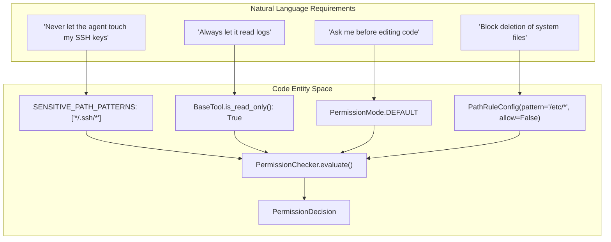
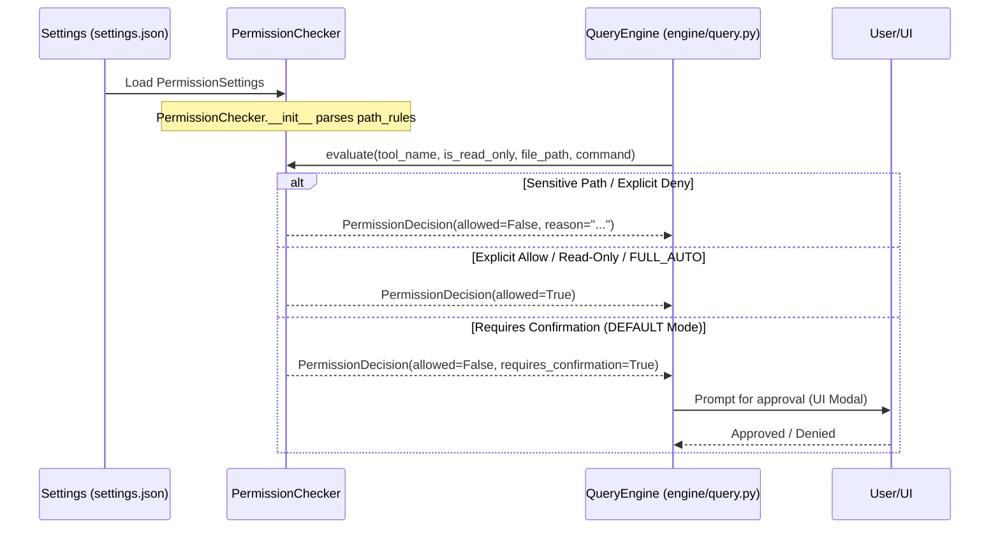

<!-- source: DeepWiki mcp.deepwiki.com · repo HKUDS/OpenHarness · page 5.1 Permission Modes and Path Rules · fetched 2026-11-09 -->

# Permission Modes and Path Rules

Relevant source files

The following files were used as context for generating this wiki page:

- [src/openharness/auth/manager.py](src/openharness/auth/manager.py)
- [src/openharness/config/settings.py](src/openharness/config/settings.py)
- [src/openharness/permissions/checker.py](src/openharness/permissions/checker.py)
- [src/openharness/tools/bash_tool.py](src/openharness/tools/bash_tool.py)
- [src/openharness/utils/shell.py](src/openharness/utils/shell.py)
- [tests/test_config/test_settings.py](tests/test_config/test_settings.py)
- [tests/test_permissions/test_checker.py](tests/test_permissions/test_checker.py)
- [tests/test_tools/test_bash_tool.py](tests/test_tools/test_bash_tool.py)
- [tests/test_utils/test_shell.py](tests/test_utils/test_shell.py)

The OpenHarness permissions system provides a multi-layered security framework that governs how the LLM interacts with the host system. It evaluates every tool call against a combination of high-level operation modes, explicit tool allow/deny lists, and granular glob-based path or command rules.

## Permission Modes

The `PermissionMode` enum defines the high-level behavior of the agent loop regarding tool execution.

| Mode | Identifier | Description |
| :--- | :--- | :--- |
| **DEFAULT** | `default` | The standard operating mode. Read-only tools are allowed automatically, while mutating tools (e.g., `bash`, `write_file`) require explicit user confirmation via the UI. |
| **PLAN** | `plan` | A restrictive mode used for architectural review or planning. Mutating tools are strictly blocked, preventing the agent from making any changes to the environment. |
| **FULL_AUTO** | `full_auto` | A non-interactive mode where all tool calls are automatically approved (subject to sensitive path protections). |

**Sources:**
- `PermissionMode` definition: [src/openharness/permissions/modes.py:8-13]()
- Mode logic in `evaluate()`: [src/openharness/permissions/checker.py:129-156]()

## Permission Configuration

Permissions are configured via the `PermissionSettings` model, which is a sub-component of the global `Settings` object [src/openharness/config/settings.py:50-58]().

### PermissionSettings Attributes
- `mode`: The active `PermissionMode`. Defaults to `PermissionMode.DEFAULT` [src/openharness/config/settings.py:53]().
- `allowed_tools`: A list of tool names that bypass all confirmation prompts [src/openharness/config/settings.py:54]().
- `denied_tools`: A list of tool names that are strictly forbidden from executing [src/openharness/config/settings.py:55]().
- `path_rules`: A list of `PathRuleConfig` objects for file-system level access control [src/openharness/config/settings.py:56]().
- `denied_commands`: A list of glob patterns used to block specific shell commands (e.g., `rm -rf *`) [src/openharness/config/settings.py:57]().

### Path Rules
Path rules use `fnmatch` glob patterns to either allow or deny access to specific files or directories.
- `pattern`: The glob string (e.g., `src/**/*.py`, `/etc/*`) [src/openharness/config/settings.py:46]().
- `allow`: A boolean indicating if the pattern represents an inclusion (True) or exclusion (False). Defaults to True [src/openharness/config/settings.py:47]().

**Sources:**
- `PermissionSettings` class: [src/openharness/config/settings.py:50-58]()
- `PathRuleConfig` class: [src/openharness/config/settings.py:43-48]()
- `PathRule` internal class: [src/openharness/permissions/checker.py:50-55]()

## PermissionChecker Evaluation Logic

The `PermissionChecker` class is responsible for resolving a `PermissionDecision` for every tool invocation. The `evaluate()` method processes rules in a specific order of precedence, including a hardcoded "defence-in-depth" layer for sensitive files.

### Decision Resolution Flow
1.  **Sensitive Path Protection**: Before any user settings are checked, the system matches `file_path` against `SENSITIVE_PATH_PATTERNS`. If a match is found (e.g., `~/.ssh/id_rsa`), the tool is blocked regardless of the mode [src/openharness/permissions/checker.py:88-98]().
2.  **Explicit Deny List**: If the `tool_name` is in `self._settings.denied_tools`, it is blocked [src/openharness/permissions/checker.py:101-102]().
3.  **Explicit Allow List**: If the `tool_name` is in `self._settings.allowed_tools`, it is allowed immediately [src/openharness/permissions/checker.py:105-106]().
4.  **Path Rules**: If a `file_path` is provided, it is checked against `self._path_rules`. If a pattern matches and `rule.allow` is `False`, the tool is blocked [src/openharness/permissions/checker.py:109-117]().
5.  **Command Patterns**: If the tool provides a `command` string (e.g., `bash`), it is checked against `denied_commands` glob patterns [src/openharness/permissions/checker.py:120-126]().
6.  **Full Auto Mode**: If the mode is `PermissionMode.FULL_AUTO`, the tool is allowed [src/openharness/permissions/checker.py:129-130]().
7.  **Read-Only Check**: If the tool is marked as `is_read_only`, it is allowed [src/openharness/permissions/checker.py:133-134]().
8.  **Plan Mode**: If the mode is `PermissionMode.PLAN`, the mutating tool is blocked [src/openharness/permissions/checker.py:137-141]().
9.  **Default Mode**: If none of the above apply, the tool is blocked and `requires_confirmation` is set to `True` [src/openharness/permissions/checker.py:143-156]().

### Sensitive Path Patterns
The system includes a built-in list of patterns that are always denied to prevent LLM-directed access to credential material. These include SSH keys, AWS/GCP/Azure credentials, Docker/Kubernetes configs, and OpenHarness's own credential stores [src/openharness/permissions/checker.py:18-37]().

### Permission Logic Mapping
This diagram maps the natural language security requirements to the internal code entities that enforce them.

**Logic to Entity Mapping**

**Sources:**
- `PermissionChecker` implementation: [src/openharness/permissions/checker.py:57-156]()
- `PermissionDecision` dataclass: [src/openharness/permissions/checker.py:41-47]()
- `SENSITIVE_PATH_PATTERNS`: [src/openharness/permissions/checker.py:18-37]()

## Settings Precedence and CLI Flags

The system resolves settings with specific precedence to allow for flexible overrides.

### Configuration Precedence
1.  **CLI Arguments**: (e.g., `--dangerously-skip-permissions` or `--permission-mode full_auto`) [src/openharness/config/settings.py:4]().
2.  **Environment Variables**: (e.g., `OPENHARNESS_PERMISSION_MODE`) [src/openharness/config/settings.py:5]().
3.  **Config File**: `~/.openharness/settings.json` [src/openharness/config/settings.py:6]().
4.  **Defaults**: [src/openharness/config/settings.py:7]().

The `--dangerously-skip-permissions` flag is handled at the engine level to bypass the standard permission check turn-by-turn logic.

**Sources:**
- Settings precedence: [src/openharness/config/settings.py:3-8]()
- CLI override application: [src/openharness/config/settings.py:456-465]()
- Environment override logic: [src/openharness/config/settings.py:504-515]()

## Permission Data Flow

The following diagram illustrates how user settings are transformed into runtime decisions during a tool execution turn.

**Permission Data Flow**

**Sources:**
- `PermissionChecker.__init__`: [src/openharness/permissions/checker.py:60-74]()
- `PermissionChecker.evaluate`: [src/openharness/permissions/checker.py:75-156]()
- `PermissionSettings` model: [src/openharness/config/settings.py:50-58]()

---

