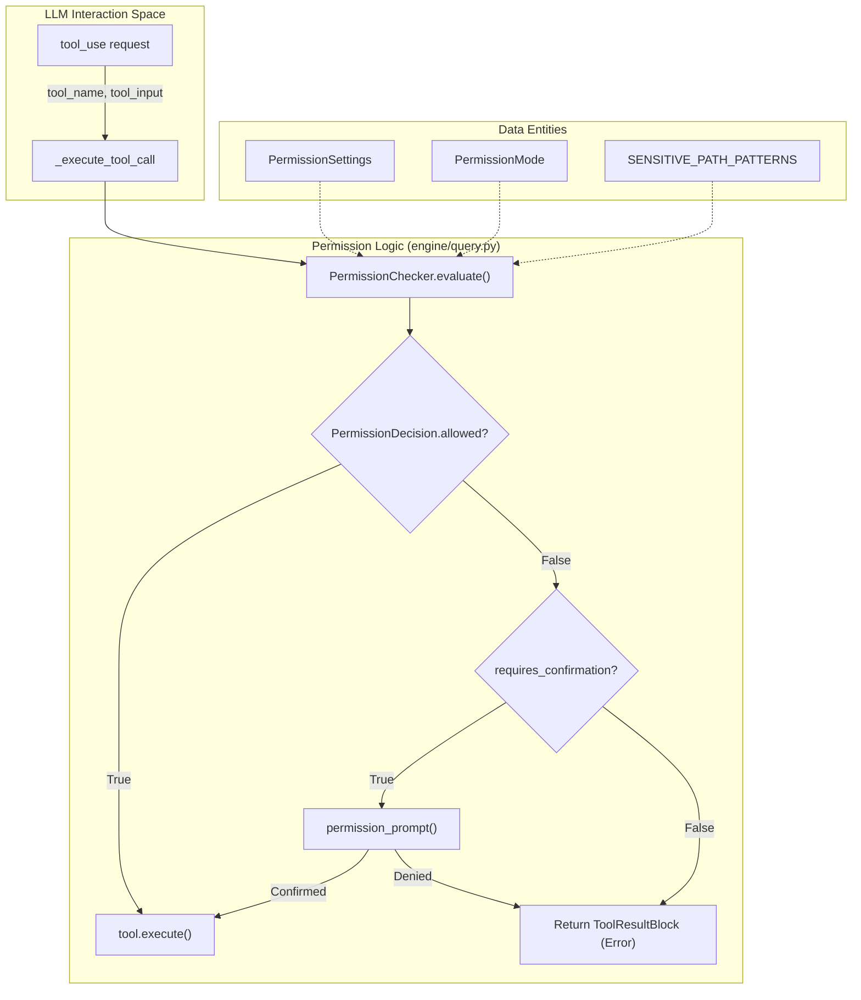
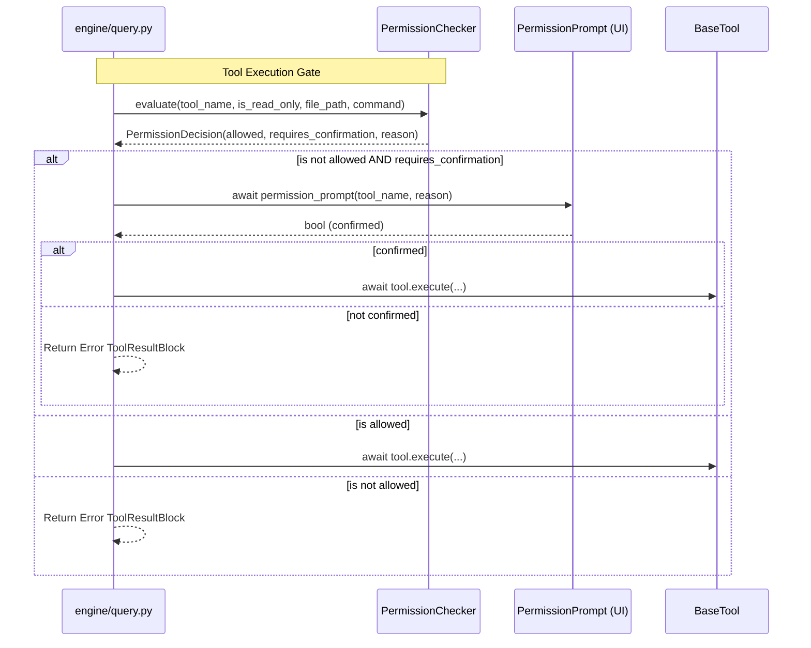

<!-- source: DeepWiki mcp.deepwiki.com · repo HKUDS/OpenHarness · page 5.2 Permission Decision Flow · fetched 2026-11-09 -->

# Permission Decision Flow

Relevant source files

The following files were used as context for generating this wiki page:

- [src/openharness/engine/query.py](src/openharness/engine/query.py)
- [src/openharness/engine/query_engine.py](src/openharness/engine/query_engine.py)
- [src/openharness/permissions/checker.py](src/openharness/permissions/checker.py)
- [src/openharness/services/compact/__init__.py](src/openharness/services/compact/__init__.py)
- [src/openharness/services/tool_outputs.py](src/openharness/services/tool_outputs.py)
- [src/openharness/tools/bash_tool.py](src/openharness/tools/bash_tool.py)
- [src/openharness/utils/shell.py](src/openharness/utils/shell.py)
- [tests/test_engine/test_query_engine.py](tests/test_engine/test_query_engine.py)
- [tests/test_permissions/test_checker.py](tests/test_permissions/test_checker.py)
- [tests/test_services/test_compact.py](tests/test_services/test_compact.py)
- [tests/test_tools/test_bash_tool.py](tests/test_tools/test_bash_tool.py)
- [tests/test_utils/test_shell.py](tests/test_utils/test_shell.py)

This page documents the technical implementation of the permission decision pipeline within OpenHarness. It traces how a tool call requested by an LLM is validated against user settings, path rules, sensitive path protections, and operational modes before execution.

## Pipeline Overview

The permission logic is primarily orchestrated within the `_execute_tool_call` function in `engine/query.py` [src/openharness/engine/query.py:210-255](). This function acts as a gatekeeper between the LLM's request and the actual tool execution. It utilizes the `PermissionChecker` class [src/openharness/permissions/checker.py:57-157]() to evaluate whether a tool invocation is safe and authorized.

### Decision Logic Flow

The following diagram illustrates the transition from the LLM tool request (Natural Language/JSON space) to the internal permission evaluation (Code Entity Space).

**Tool Execution Permission Gate**

Sources: [src/openharness/engine/query.py:210-255](), [src/openharness/permissions/checker.py:57-157]()

## The `PermissionChecker` Evaluation Sequence

The `PermissionChecker.evaluate` method [src/openharness/permissions/checker.py:75-157]() performs a prioritized check. The order of evaluation is critical as early returns prevent subsequent rules from being processed. Notably, **Sensitive Path Protection** is the highest priority and cannot be overridden.

| Step | Check Type | Logic | Source |
| :--- | :--- | :--- | :--- |
| 1 | **Sensitive Paths** | Check `file_path` against `SENSITIVE_PATH_PATTERNS` (SSH keys, AWS/GCP/Kube creds). | [src/openharness/permissions/checker.py:88-98]() |
| 2 | **Denied Tools** | If `tool_name` is in `denied_tools`, return `allowed=False`. | [src/openharness/permissions/checker.py:101-102]() |
| 3 | **Allowed Tools** | If `tool_name` is in `allowed_tools`, return `allowed=True`. | [src/openharness/permissions/checker.py:105-106]() |
| 4 | **Path Rules** | If `file_path` is provided, check against user-defined `PathRule` glob patterns. | [src/openharness/permissions/checker.py:109-117]() |
| 5 | **Command Deny** | If `command` is provided, check against `denied_commands` glob patterns. | [src/openharness/permissions/checker.py:120-126]() |
| 6 | **Full Auto Mode** | If `PermissionMode.FULL_AUTO`, return `allowed=True`. | [src/openharness/permissions/checker.py:129-130]() |
| 7 | **Read-Only** | If `is_read_only` is True, return `allowed=True`. | [src/openharness/permissions/checker.py:133-134]() |
| 8 | **Plan Mode** | If `PermissionMode.PLAN`, return `allowed=False`. | [src/openharness/permissions/checker.py:137-141]() |
| 9 | **Default Mode** | Return `allowed=False` with `requires_confirmation=True`. | [src/openharness/permissions/checker.py:144-156]() |

### Path and Command Rules
OpenHarness supports granular control over filesystem and shell access using glob patterns:
*   **Sensitive Path Protection**: A hardcoded list of patterns like `*/.ssh/*` or `*/.aws/credentials` that are always denied [src/openharness/permissions/checker.py:18-37]().
*   **Path Rules**: Defined as a list of `PathRule` objects containing a `pattern` (e.g., `/etc/*`) and an `allow` boolean [src/openharness/permissions/checker.py:50-55]().
*   **Command Deny Patterns**: Simple strings (e.g., `rm -rf /`) matched using `fnmatch` against the `command` argument of shell-based tools [src/openharness/permissions/checker.py:120-126]().

Sources: [src/openharness/permissions/checker.py:18-157](), [src/openharness/config/settings.py:14-14]()

## Implementation Detail: `_execute_tool_call`

The execution flow in `engine/query.py` handles the results of the `PermissionChecker` and manages the asynchronous user confirmation loop.

**Code-to-System Mapping**

Sources: [src/openharness/engine/query.py:210-255](), [src/openharness/permissions/checker.py:41-48]()

### Key Components

#### PermissionDecision
A frozen dataclass returned by the checker [src/openharness/permissions/checker.py:41-48]():
*   `allowed`: Boolean indicating if the tool can proceed without user intervention.
*   `requires_confirmation`: Boolean indicating if the user should be prompted (used in `DEFAULT` mode for mutating tools).
*   `reason`: A string explaining the decision (e.g., "Access denied: sensitive credential path").

#### PermissionMode
An Enum [src/openharness/permissions/modes.py:8-13]() defining the overall security posture:
*   `DEFAULT`: Safe mode. Read-only tools pass; mutating tools require confirmation.
*   `PLAN`: Restricted mode. Mutating tools are blocked entirely to allow the LLM to "plan" without side effects [src/openharness/permissions/checker.py:137-141]().
*   `FULL_AUTO`: Unrestricted mode. All tools are allowed unless explicitly denied by tool/path rules or sensitive path protections [src/openharness/permissions/checker.py:129-130]().

#### Input Extraction
Before calling the checker, `_execute_tool_call` attempts to extract standard fields from the LLM's tool input to facilitate path and command-level filtering [src/openharness/engine/query.py:217-219]():
*   `file_path`: Extracted from `tool_input.get("path")` or `tool_input.get("file_path")`.
*   `command`: Extracted from `tool_input.get("command")`.

#### Bash Permission Hints
In `DEFAULT` mode, if a `bash` command matches specific installation or scaffolding patterns (like `npm install` or `create-next-app`), the `PermissionChecker` appends a specific hint to the reason [src/openharness/permissions/checker.py:172-195]().

Sources: [src/openharness/engine/query.py:210-225](), [src/openharness/permissions/modes.py:1-14](), [src/openharness/permissions/checker.py:1-195]()

---

