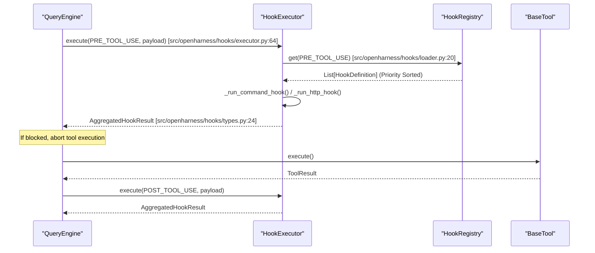

<!-- source: DeepWiki mcp.deepwiki.com · repo HKUDS/OpenHarness · page 6 Hooks System · fetched 2026-11-09 -->

# Hooks System

<details>
<summary>Relevant source files</summary>

The following files were used as context for generating this wiki page:

- [src/openharness/hooks/executor.py](src/openharness/hooks/executor.py)
- [src/openharness/hooks/loader.py](src/openharness/hooks/loader.py)
- [src/openharness/hooks/schemas.py](src/openharness/hooks/schemas.py)
- [tests/test_hooks/test_executor.py](tests/test_hooks/test_executor.py)
- [tests/test_hooks/test_priority.py](tests/test_hooks/test_priority.py)

</details>


The **Hooks System** in OpenHarness provides a flexible framework for intercepting and reacting to lifecycle events within the agent loop. It allows developers to inject custom logic—ranging from shell scripts and webhooks to LLM-based validations—at critical execution points such as before or after a tool is used.

The system is designed to be extensible and reactive, supporting "hot-reload" capabilities that allow hook configurations to be modified without restarting the active session.

### Lifecycle Events

Hooks are triggered by specific events defined in the `HookEvent` enumeration [src/openharness/hooks/events.py:8-15]().

| Event | Description |
| :--- | :--- |
| `SESSION_START` | Triggered when a new OpenHarness session is initialized. |
| `SESSION_END` | Triggered when a session is terminated or completed. |
| `PRE_TOOL_USE` | Triggered immediately before a tool is executed. Often used for validation or environment setup. |
| `POST_TOOL_USE` | Triggered immediately after a tool execution completes. Often used for cleanup or result verification. |

### Hook Architecture

The system bridges high-level configuration to executable logic via the `HookExecutor`. It manages a `HookRegistry` and utilizes a `HookExecutionContext` to provide necessary dependencies like API clients and the current working directory.

**Hook Execution Flow**
```mermaid
graph TD
    subgraph "Natural Language Space (Config)"
        A["HookDefinition (YAML/JSON)"]
    end

    subgraph "Code Entity Space"
        B["HookRegistry"]
        C["HookExecutor"]
        D["HookExecutionContext"]
        E["AggregatedHookResult"]
    end

    A -->|"Loaded via load_hook_registry()"| B [src/openharness/hooks/loader.py:48-50]
    B -->|"Injected into"| C [src/openharness/hooks/executor.py:44-46]
    D -->|"Provides api_client & cwd"| C [src/openharness/hooks/executor.py:33-46]
    
    C -->|"execute(event, payload)"| F{{"Hook Loop"}} [src/openharness/hooks/executor.py:64-78]
    F -->|"Match Glob Pattern"| G["_matches_hook()"]
    G -->|"Run Logic"| H["HookResult"] [src/openharness/hooks/types.py:13-21]
    H -->|"Collect all"| E
```
Sources: [src/openharness/hooks/executor.py:33-78](), [src/openharness/hooks/loader.py:48-50](), [src/openharness/hooks/types.py:13-21]()

### Hook Types and Schemas
OpenHarness supports four distinct types of hooks, each inheriting from `HookDefinition`. These allow for a variety of integration patterns:

*   **Command Hooks**: Execute arbitrary shell commands via `create_shell_subprocess` [src/openharness/hooks/executor.py:80-98]().
*   **HTTP Hooks**: Send POST requests to external webhooks using `httpx` [src/openharness/hooks/executor.py:138-151]().
*   **Prompt Hooks**: Use an LLM to validate the event payload based on a natural language prompt [src/openharness/hooks/executor.py:169-189]().
*   **Agent Hooks**: Similar to Prompt Hooks but intended for more complex, "agentic" reasoning over the payload [src/openharness/hooks/executor.py:182-183]().

Each hook can specify a `matcher` (glob pattern) to filter which tools or subjects trigger the hook, and a `block_on_failure` flag to halt the agent's execution if the hook fails [src/openharness/hooks/schemas.py:10-58](). Additionally, hooks support a `priority` field; higher priority hooks within the same event run first [src/openharness/hooks/loader.py:20-27]().

For detailed schema definitions and configuration examples, see **[Hook Types and Schemas (#6.1)]**.

### Execution and Environment
The `HookExecutor` is responsible for the actual invocation of hook logic. When a hook is executed, OpenHarness injects context into the execution environment.

**Environment Injection (Command Hooks)**
When a `CommandHookDefinition` is triggered, the following environment variables are made available to the shell process [src/openharness/hooks/executor.py:93-97]():
*   `OPENHARNESS_HOOK_EVENT`: The name of the event (e.g., `pre_tool_use`).
*   `OPENHARNESS_HOOK_PAYLOAD`: A JSON-encoded string containing the event data.

To prevent shell injection, `$ARGUMENTS` in command hooks are shell-escaped using `shlex.quote` when `shell_escape=True` is passed to `_inject_arguments` [src/openharness/hooks/executor.py:86-88](), [tests/test_hooks/test_executor.py:88-95]().

**LLM Validation (Prompt/Agent Hooks)**
For LLM-based hooks, the `HookExecutor` uses the `SupportsStreamingMessages` protocol to send a validation request. The LLM is instructed to return a strict JSON object: `{"ok": true}` or `{"ok": false, "reason": "..."}` [src/openharness/hooks/executor.py:178-181]().

For details on the executor implementation and the hot-reload mechanism, see **[Hook Executor and Hot Reload (#6.2)]**.

### System Integration

The Hooks System is integrated directly into the `QueryEngine`. During the tool execution phase, the engine calls `HookExecutor.execute()` to ensure all safety checks and side effects are processed.

**Component Interaction**

Sources: [src/openharness/hooks/executor.py:64-78](), [src/openharness/hooks/loader.py:20-27](), [src/openharness/hooks/types.py:24-27](), [tests/test_hooks/test_priority.py:83-99]()

---
**Child Pages:**
*   **[Hook Types and Schemas](#6.1)**: Documentation on `matcher` patterns, `block_on_failure`, `priority` ordering, and the four hook implementations (`Command`, `Http`, `Prompt`, `Agent`).
*   **[Hook Executor and Hot Reload](#6.2)**: Deep dive into `executor.py`, environment injection (`OPENHARNESS_HOOK_PAYLOAD`), and the `hot_reload.py` file watcher for dynamic config updates.

---

