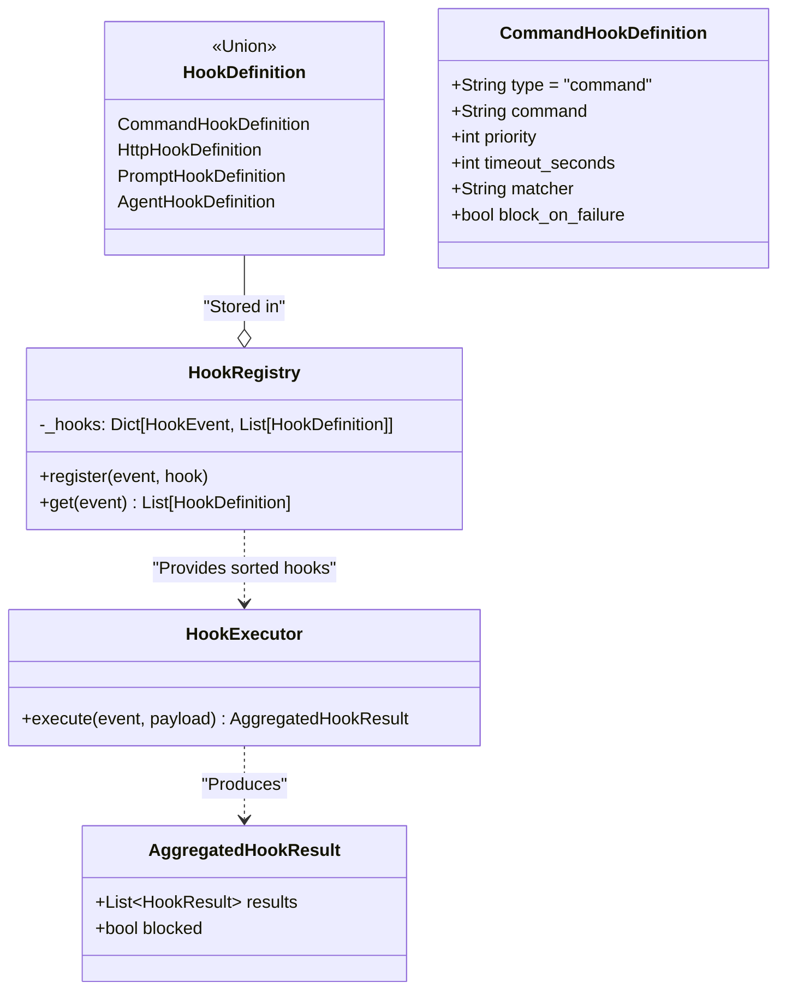
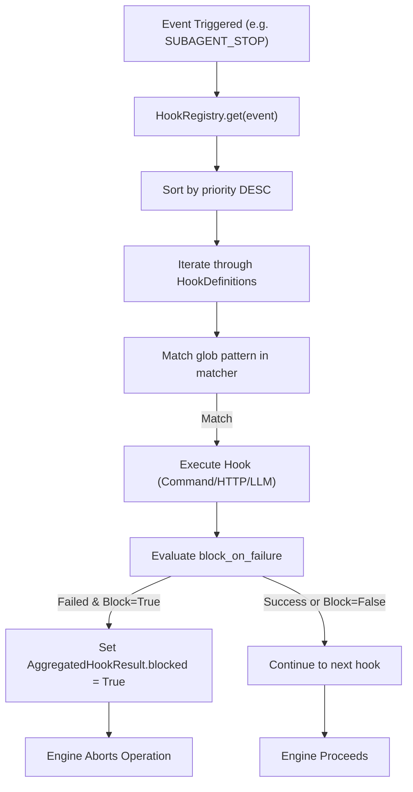

<!-- source: DeepWiki mcp.deepwiki.com · repo HKUDS/OpenHarness · page 6.1 Hook Types and Schemas · fetched 2026-11-09 -->

# Hook Types and Schemas

Relevant source files

The following files were used as context for generating this wiki page:

- [src/openharness/hooks/events.py](src/openharness/hooks/events.py)
- [src/openharness/hooks/loader.py](src/openharness/hooks/loader.py)
- [src/openharness/hooks/schemas.py](src/openharness/hooks/schemas.py)
- [src/openharness/tools/agent_tool.py](src/openharness/tools/agent_tool.py)
- [src/openharness/tools/base.py](src/openharness/tools/base.py)
- [src/openharness/tools/send_message_tool.py](src/openharness/tools/send_message_tool.py)
- [tests/test_hooks/test_priority.py](tests/test_hooks/test_priority.py)

The OpenHarness hook system allows developers to inject custom logic, validations, and side effects into the agentic lifecycle. Hooks are triggered by specific events and can be configured to either passively observe or actively block execution based on the result of a shell command, HTTP request, or LLM-based evaluation.

## Hook Definition Hierarchy

All hooks in OpenHarness are defined using Pydantic models in `src/openharness/hooks/schemas.py`. These definitions specify the execution parameters, timeout constraints, and failure behaviors for the hook.

### Core Configuration Fields
Across all hook types, several key fields control the execution flow:

| Field | Type | Description |
| :--- | :--- | :--- |
| `matcher` | `str \| None` | A glob pattern used to filter events. For tool-related events, this matches against the `tool_name` [src/openharness/hooks/schemas.py:16-16](). |
| `block_on_failure` | `bool` | If `True`, a failed hook execution (or a negative validation) will halt the current operation [src/openharness/hooks/schemas.py:17-17](). |
| `timeout_seconds` | `int` | Maximum duration allowed for the hook to complete before it is terminated [src/openharness/hooks/schemas.py:15-15](). |
| `priority` | `int` | Determines execution order within an event. Higher priority runs first [src/openharness/hooks/schemas.py:18-19](). |

### Hook Schema Mapping
The system supports four distinct hook types, encapsulated in the `HookDefinition` union [src/openharness/hooks/schemas.py:61-66]().

#### 1. CommandHookDefinition (type: "command")
Executes a local shell command. This is typically used for linting, running tests, or environment setup/cleanup [src/openharness/hooks/schemas.py:10-20]().
- **Default Timeout**: 30 seconds.
- **Default Block**: `False`.
- **Default Priority**: 0.

#### 2. HttpHookDefinition (type: "http")
Sends an asynchronous `POST` request to a specified URL containing the event payload. Useful for webhooks, external logging, or remote CI integration [src/openharness/hooks/schemas.py:35-45]().
- **Default Timeout**: 30 seconds.
- **Default Block**: `False`.

#### 3. PromptHookDefinition (type: "prompt")
Performs a lightweight LLM-based validation. It sends a specific prompt to the model to check if a condition is met [src/openharness/hooks/schemas.py:22-32](). The executor enforces a strict JSON response format: `{"ok": true}` or `{"ok": false, "reason": "..."}`.
- **Default Timeout**: 30 seconds.
- **Default Block**: `True`.

#### 4. AgentHookDefinition (type: "agent")
Performs a deeper model-based validation. This is used for complex reasoning tasks that might require more time or a more capable model [src/openharness/hooks/schemas.py:48-58]().
- **Default Timeout**: 60 seconds.
- **Default Block**: `True`.

**Sources:** [src/openharness/hooks/schemas.py:1-67](), [src/openharness/hooks/loader.py:26-27]()

---

## Data Flow and Execution State

When an event occurs, the `HookExecutor` processes all matching `HookDefinition` objects. These are retrieved from the `HookRegistry`, which maintains hooks sorted by their `priority` field [src/openharness/hooks/loader.py:26-27]().

### Entity Relationship: Definition to Result
The following diagram illustrates how configuration schemas translate into runtime result objects within the system.

**Hook Schema to Runtime Entity Mapping**

**Sources:** [src/openharness/hooks/schemas.py:61-66](), [src/openharness/hooks/loader.py:10-27](), [src/openharness/hooks/executor.py:14-23]()

---

## Hook Lifecycle Events

Hooks are triggered by the `HookEvent` enumeration. The engine emits these events at critical transition points, including session management, tool execution, and subagent lifecycle [src/openharness/hooks/events.py:8-21]().

| Event Name | Code Symbol | Description |
| :--- | :--- | :--- |
| `session_start` | `HookEvent.SESSION_START` | Triggered when a new session is initialized [src/openharness/hooks/events.py:11-11](). |
| `session_end` | `HookEvent.SESSION_END` | Triggered when a session is closed [src/openharness/hooks/events.py:12-12](). |
| `pre_tool_use` | `HookEvent.PRE_TOOL_USE` | Triggered before a tool is executed [src/openharness/hooks/events.py:15-15](). |
| `post_tool_use` | `HookEvent.POST_TOOL_USE` | Triggered after tool execution [src/openharness/hooks/events.py:16-16](). |
| `subagent_stop` | `HookEvent.SUBAGENT_STOP` | Triggered when a background agent task finishes [src/openharness/hooks/events.py:20-20](). |

### Logic Flow: Event to Block Decision
The `HookRegistry` ensures that hooks with higher priority values are executed first [src/openharness/hooks/loader.py:21-27](). If multiple hooks have the same priority, their registration order is preserved [tests/test_hooks/test_priority.py:48-57]().

**Hook Execution Logic Flow**

**Sources:** [src/openharness/hooks/loader.py:21-27](), [src/openharness/hooks/schemas.py:15-18](), [tests/test_hooks/test_priority.py:37-46]()

---

## Detailed Schema Specifications

### Shell Hooks (`CommandHookDefinition`)
The `command` string is executed in the user's current shell environment. The system injects context via environment variables and allows filtering by `matcher` against the event metadata [src/openharness/hooks/schemas.py:10-20]().

### LLM Hooks (`PromptHookDefinition` & `AgentHookDefinition`)
These hooks leverage the LLM to perform semantic checks. 
- **Prompt Hook**: Used for quick checks. `block_on_failure` defaults to `True` [src/openharness/hooks/schemas.py:30-30]().
- **Agent Hook**: Used for complex validation. It has a longer default timeout (60s) and higher execution limits [src/openharness/hooks/schemas.py:54-56]().

### Subagent Integration
The `AgentTool` integrates with the hook system by emitting a `SUBAGENT_STOP` event when a background task completes [src/openharness/tools/agent_tool.py:102-123](). It registers a completion listener with the `TaskManager` to ensure hooks run even if the parent tool execution has finished [src/openharness/tools/agent_tool.py:125-128]().

**Sources:** [src/openharness/hooks/schemas.py:10-58](), [src/openharness/tools/agent_tool.py:98-128](), [src/openharness/hooks/events.py:20-20]()

---

