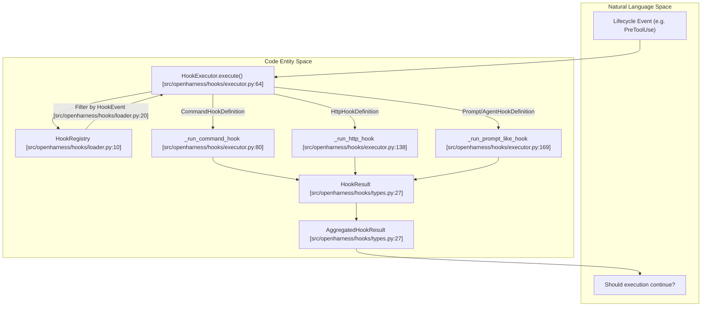
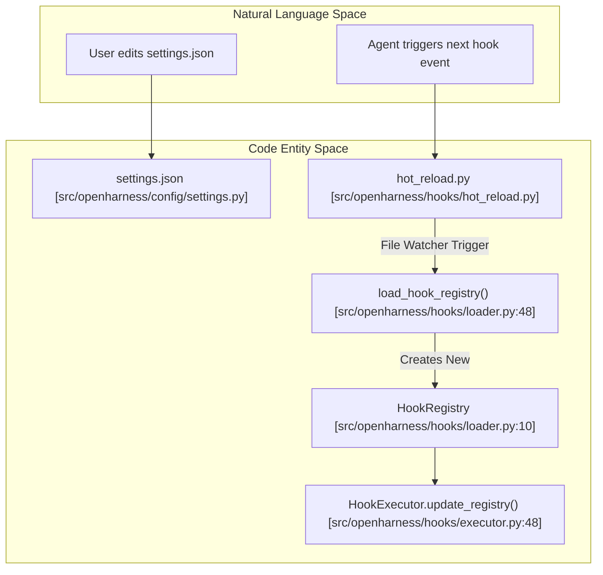

<!-- source: DeepWiki mcp.deepwiki.com · repo HKUDS/OpenHarness · page 6.2 Hook Executor and Hot Reload · fetched 2026-11-09 -->

# Hook Executor and Hot Reload

Relevant source files

The following files were used as context for generating this wiki page:

- [src/openharness/hooks/executor.py](src/openharness/hooks/executor.py)
- [src/openharness/hooks/loader.py](src/openharness/hooks/loader.py)
- [src/openharness/hooks/schemas.py](src/openharness/hooks/schemas.py)
- [tests/test_hooks/test_executor.py](tests/test_hooks/test_executor.py)
- [tests/test_hooks/test_priority.py](tests/test_hooks/test_priority.py)

The Hooks system in OpenHarness provides a mechanism to intercept lifecycle events (such as `PreToolUse` or `PostToolUse`) and execute custom logic via shell commands, HTTP requests, or LLM-based validations. The `HookExecutor` is responsible for dispatching these events to registered hooks, while the Hot Reload system ensures that configuration changes are picked up without requiring a process restart.

## Hook Executor

The `HookExecutor` class in `src/openharness/hooks/executor.py` is the central engine for running hooks [src/openharness/hooks/executor.py:41-42](). It maintains a reference to a `HookRegistry` and uses a `HookExecutionContext` to provide necessary environment details like the current working directory, API clients for LLM-based hooks, and the default model name [src/openharness/hooks/executor.py:32-39](), [src/openharness/hooks/executor.py:44-46]().

### Execution Flow

When `HookExecutor.execute()` is called [src/openharness/hooks/executor.py:64](), it performs the following steps:
1. **Filtering**: It retrieves all hooks registered for the specific `HookEvent` from the registry, sorted by priority (higher priority runs first) [src/openharness/hooks/loader.py:20-27](), [src/openharness/hooks/executor.py:67]().
2. **Matching**: It checks if the hook's `matcher` (if present) matches the event payload (e.g., matching a specific tool name) using `_matches_hook` [src/openharness/hooks/executor.py:68-69]().
3. **Dispatching**: Based on the hook's type, it invokes specialized private methods:
    - `_run_command_hook`: Executes a bash command [src/openharness/hooks/executor.py:70-71]().
    - `_run_http_hook`: Sends an HTTP POST request [src/openharness/hooks/executor.py:72-73]().
    - `_run_prompt_like_hook`: Calls an LLM to validate the event, with an optional `agent_mode` flag for `AgentHookDefinition` [src/openharness/hooks/executor.py:74-77]().
4. **Aggregation**: Results from all executed hooks are collected into an `AggregatedHookResult` [src/openharness/hooks/executor.py:78]().

### Hook Execution Logic

| Hook Type | Implementation Detail | Environment / Context Injection |
| :--- | :--- | :--- |
| **Command** | Spawns a shell subprocess via `create_shell_subprocess` [src/openharness/hooks/executor.py:88-98]() | Injects `OPENHARNESS_HOOK_EVENT` and `OPENHARNESS_HOOK_PAYLOAD` (JSON) [src/openharness/hooks/executor.py:95-96](). |
| **HTTP** | Uses `httpx.AsyncClient` to POST [src/openharness/hooks/executor.py:145-150]() | Sends JSON body with `event` and `payload` keys [src/openharness/hooks/executor.py:148](). |
| **Prompt/Agent** | Streams message via `api_client.stream_message` [src/openharness/hooks/executor.py:193]() | Injects payload arguments into the prompt string via `_inject_arguments` [src/openharness/hooks/executor.py:177](). |

### Data Flow: Hook Execution Pipeline

The following diagram traces the flow from an event trigger to the final aggregated result.

**Hook Execution Pipeline**

Sources: [src/openharness/hooks/executor.py:64-78](), [src/openharness/hooks/loader.py:10-27](), [src/openharness/hooks/types.py:27]()

## Environment Injection and Security

For `CommandHookDefinition` types, OpenHarness provides the hook script with full context via environment variables. This allows external scripts to reason about the tool being called or the output produced.

- `OPENHARNESS_HOOK_EVENT`: The string value of the `HookEvent` (e.g., `pre_tool_use`) [src/openharness/hooks/executor.py:95]().
- `OPENHARNESS_HOOK_PAYLOAD`: A JSON-serialized string containing the event payload [src/openharness/hooks/executor.py:96]().

### Shell Injection Prevention
To prevent shell injection from payload values containing metacharacters (e.g., `$(...)`), the `_inject_arguments` helper uses `shlex.quote` when `shell_escape=True` is passed [src/openharness/hooks/executor.py:86](). This ensures that the `$ARGUMENTS` substitution in command hooks is safely wrapped in single quotes, causing the shell to treat the JSON as a literal string [tests/test_hooks/test_executor.py:88-93]().

Sources: [src/openharness/hooks/executor.py:80-98](), [tests/test_hooks/test_executor.py:81-122]()

## Result Aggregation and Blocking

The system uses `AggregatedHookResult` to determine if the main agent loop should proceed.

- **Blocking**: If any single hook returns `success=False` AND has `block_on_failure=True`, the `AggregatedHookResult.blocked` property becomes `True` [src/openharness/hooks/executor.py:133]().
- **Reasoning**: The `reason` property of the hook result captures the output or the failure cause (e.g., timeout or exit code) [src/openharness/hooks/executor.py:119-120](), [src/openharness/hooks/executor.py:134]().
- **Sandbox Safety**: If a command hook is attempted but the sandbox is unavailable, a `SandboxUnavailableError` is caught and the hook is marked as failed/blocked based on its definition [src/openharness/hooks/executor.py:99-105]().

Sources: [src/openharness/hooks/executor.py:99-136](), [src/openharness/hooks/types.py:27]()

## Hot Reloading

The `hot_reload.py` file-watcher mechanism (implemented via `HookReloader`) monitors the OpenHarness configuration files.

### Implementation

The reloader tracks changes to hook definitions in `settings.json` or plugin configurations. When the `HookExecutor` is updated via `update_registry()` [src/openharness/hooks/executor.py:48-49](), the system can swap out the active registry without restarting. This allows users to modify hook definitions (e.g., changing a bash command, priority, or an LLM prompt) and have them take effect in the next tool execution.

**Hot Reload Data Flow**

Sources: [src/openharness/hooks/executor.py:48-49](), [src/openharness/hooks/loader.py:10-14](), [src/openharness/hooks/loader.py:48-68]()

---

