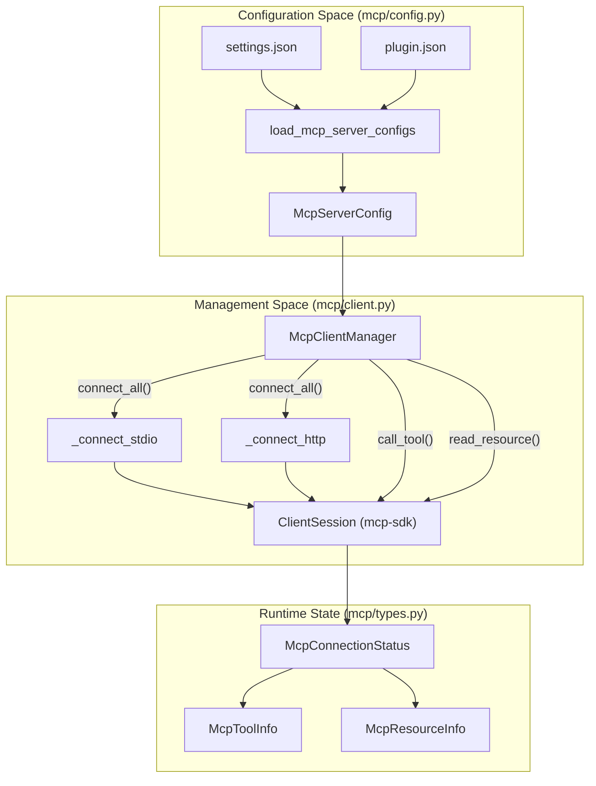
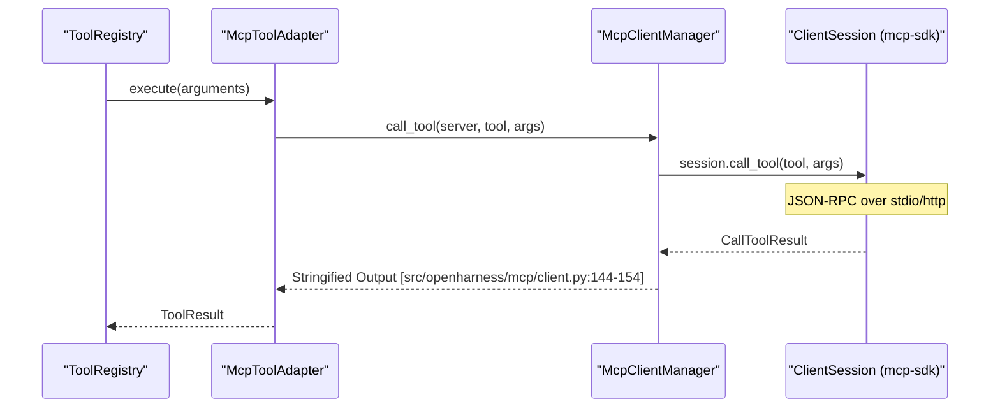

<!-- source: DeepWiki mcp.deepwiki.com · repo HKUDS/OpenHarness · page 7 MCP Integration · fetched 2026-11-09 -->

# MCP Integration

Relevant source files

The following files were used as context for generating this wiki page:

- [src/openharness/mcp/__init__.py](src/openharness/mcp/__init__.py)
- [src/openharness/mcp/client.py](src/openharness/mcp/client.py)
- [src/openharness/tools/mcp_tool.py](src/openharness/tools/mcp_tool.py)
- [src/openharness/tools/read_mcp_resource_tool.py](src/openharness/tools/read_mcp_resource_tool.py)
- [tests/test_mcp/test_client_errors.py](tests/test_mcp/test_client_errors.py)
- [tests/test_mcp/test_http_flow.py](tests/test_mcp/test_http_flow.py)
- [tests/test_tools/test_mcp_tool.py](tests/test_tools/test_mcp_tool.py)

The Model Context Protocol (MCP) integration in OpenHarness allows the system to connect to external servers that provide additional tools and resources to the LLM. By implementing the MCP standard, OpenHarness can extend its capabilities beyond built-in tools, enabling interactions with specialized databases, APIs, and local services through a unified interface.

### System Overview

The MCP subsystem is responsible for lifecycle management of server connections, discovery of remote capabilities, and the execution of remote tool calls. It supports multiple transport layers, primarily `stdio` for local process communication and `http` for remote streamable services [src/openharness/mcp/client.py:47-52]().

#### MCP Data Flow and Entity Mapping

The following diagram illustrates how high-level MCP concepts map to specific code entities and how data flows from configuration to active sessions.

**MCP Entity Architecture**

Sources: [src/openharness/mcp/client.py:29-52](), [src/openharness/mcp/types.py:16-22](), [src/openharness/mcp/__init__.py:35-47]()

### Key Components

#### Client Management
The `McpClientManager` class serves as the primary orchestrator for all MCP interactions [src/openharness/mcp/client.py:29-30](). It maintains a mapping of server names to active `ClientSession` instances and tracks the health of each connection via `McpConnectionStatus` [src/openharness/mcp/client.py:34-43](). It provides methods to aggregate all available tools and resources across all connected servers for injection into the LLM context [src/openharness/mcp/client.py:115-127]().

For details on session lifecycle, tool invocation, and resource reading, see **[MCP Client Manager](#7.1)**.

#### Configuration and Discovery
MCP servers can be configured globally in user settings or contributed dynamically by plugins. The system supports `McpStdioServerConfig` for local executable servers [src/openharness/mcp/client.py:180-185]() and `McpHttpServerConfig` for streamable HTTP servers [src/openharness/mcp/client.py:211-216](). The `mcp` CLI subcommand allows users to inspect and manage these configurations at runtime.

For details on configuration schemas and the MCP CLI, see **[MCP Configuration](#7.2)**.

### Transport Support

OpenHarness supports both local and remote MCP transports.

| Transport | Config Class | Implementation Status |
| :--- | :--- | :--- |
| **stdio** | `McpStdioServerConfig` | Fully Supported via `stdio_client` [src/openharness/mcp/client.py:184]() |
| **http** | `McpHttpServerConfig` | Fully Supported via `streamable_http_client` [src/openharness/mcp/client.py:215]() |
| **websocket** | `McpWebSocketServerConfig` | Configurable / Not yet implemented [src/openharness/mcp/client.py:52-59]() |

Sources: [src/openharness/mcp/client.py:47-60](), [src/openharness/mcp/types.py:16-22]()

### Integration with Subsystems

The MCP subsystem interacts with several other core areas of OpenHarness:
*   **Tools System**: MCP tools are wrapped by `McpToolAdapter` [src/openharness/tools/mcp_tool.py:14-24](), which dynamically generates Pydantic input models from JSON schemas [src/openharness/tools/mcp_tool.py:49-63]().
*   **Resources**: The `ReadMcpResourceTool` provides a standardized way for the LLM to access MCP resources by URI [src/openharness/tools/read_mcp_resource_tool.py:18-23]().
*   **Error Handling**: If a server is disconnected or a call fails, the system raises `McpServerNotConnectedError` [src/openharness/mcp/client.py:25-26](), which is caught by tool adapters to return an error result to the LLM [src/openharness/tools/mcp_tool.py:34-36]().

**MCP Integration Logic**

Sources: [src/openharness/mcp/client.py:129-154](), [src/openharness/tools/mcp_tool.py:26-36](), [src/openharness/tools/read_mcp_resource_tool.py:32-38]()

---
## Child Pages
*   **[MCP Client Manager](#7.1)**: Detailed documentation of `McpClientManager`, session handling, and the `call_tool`/`read_resource` implementation.
*   **[MCP Configuration](#7.2)**: Deep dive into `mcp/config.py`, server configuration models, and CLI management commands.

---

