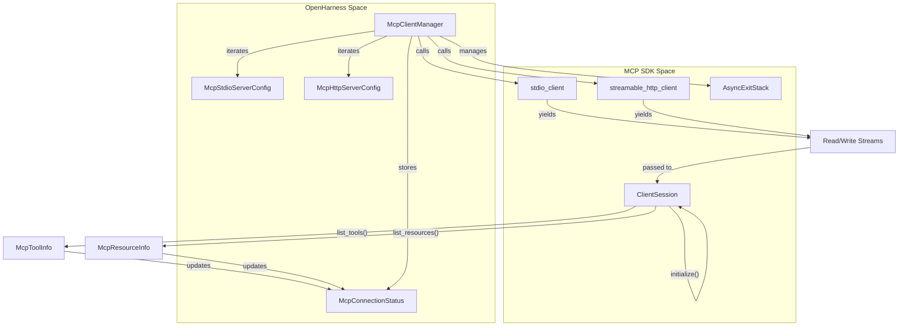
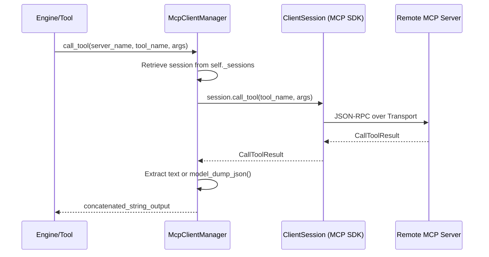

<!-- source: DeepWiki mcp.deepwiki.com · repo HKUDS/OpenHarness · page 7.1 MCP Client Manager · fetched 2026-11-09 -->

# MCP Client Manager

Relevant source files

The following files were used as context for generating this wiki page:

- [src/openharness/mcp/__init__.py](src/openharness/mcp/__init__.py)
- [src/openharness/mcp/client.py](src/openharness/mcp/client.py)
- [src/openharness/tools/mcp_tool.py](src/openharness/tools/mcp_tool.py)
- [src/openharness/tools/read_mcp_resource_tool.py](src/openharness/tools/read_mcp_resource_tool.py)
- [tests/test_mcp/test_client_errors.py](tests/test_mcp/test_client_errors.py)
- [tests/test_mcp/test_http_flow.py](tests/test_mcp/test_http_flow.py)
- [tests/test_tools/test_mcp_tool.py](tests/test_tools/test_mcp_tool.py)

The `McpClientManager` is the central component responsible for managing the lifecycle of connections to Model Context Protocol (MCP) servers. It handles the instantiation of client sessions, discovery of remote tools and resources, and provides an interface for the OpenHarness engine to invoke these capabilities via standard MCP primitives.

## Overview

The manager operates by consuming server configurations and maintaining a registry of active sessions. It supports both `stdio` transport (running local MCP servers as subprocesses) and `http` transport (connecting to remote streamable HTTP MCP servers).

### Key Responsibilities
*   **Connection Lifecycle**: Initializing, reconnecting, and closing sessions using `AsyncExitStack` for robust resource management [[src/openharness/mcp/client.py:43-85]]().
*   **Discovery**: Querying connected servers for their available tools and resources during the registration phase [[src/openharness/mcp/client.py:202-230]]().
*   **Execution**: Proxying calls to `call_tool` and `read_resource` from the OpenHarness environment to the remote MCP server [[src/openharness/mcp/client.py:129-178]]().
*   **Status Tracking**: Maintaining real-time state (`connected`, `failed`, `pending`) for every configured server via `McpConnectionStatus` [[src/openharness/mcp/client.py:34-41]]().

---

## Connection Flow and Entity Mapping

The following diagram illustrates how the `McpClientManager` bridges the gap between high-level server configurations and the underlying MCP SDK entities.

**MCP Connection Logic**

Sources: [src/openharness/mcp/client.py:180-230](), [src/openharness/mcp/types.py:16-41]()

---

## Implementation Details

### Connection Management
The manager uses specialized private methods to establish communication based on the transport type:
*   **Stdio**: `_connect_stdio` uses `mcp.client.stdio.stdio_client` to spawn server processes using the `command`, `args`, and `env` provided in the configuration [[src/openharness/mcp/client.py:180-192]]().
*   **HTTP**: `_connect_http` uses `mcp.client.streamable_http.streamable_http_client` to connect to remote endpoints, supporting custom headers for authentication [[src/openharness/mcp/client.py:232-244]]().

The lifecycle of these connections is tied to an `AsyncExitStack` stored in `self._stacks`. When `close()` is called, all stacks are closed asynchronously, ensuring subprocesses are terminated and network resources are released. The implementation suppresses `RuntimeError` and `CancelledError` during this cleanup to ensure all stacks are processed [[src/openharness/mcp/client.py:103-110]]().

### Data Flow: Tool Execution
When the LLM requests an MCP tool, the manager identifies the correct `ClientSession` by `server_name` and executes the call. Results are stringified for LLM consumption.

**Tool Call Sequence**

Sources: [src/openharness/mcp/client.py:129-154](), [src/openharness/tools/mcp_tool.py:26-36]()

### Tool Adaptation
The `McpToolAdapter` converts an MCP tool definition into an OpenHarness `BaseTool`. It dynamically generates a Pydantic `input_model` from the MCP `input_schema` using `_input_model_from_schema` [[src/openharness/tools/mcp_tool.py:14-24]](). This ensures that arguments passed by the LLM are validated before being sent to the MCP server [[src/openharness/tools/mcp_tool.py:49-63]](). If the server is disconnected, the adapter catches `McpServerNotConnectedError` and returns a `ToolResult` with `is_error=True` [[src/openharness/tools/mcp_tool.py:34-36]]().

---

## Key Functions

### `connect_all()`
Iterates through all provided `server_configs`. It dispatches to `_connect_stdio` or `_connect_http` based on the config class. If a configuration type is unknown, it marks the status as `failed` [[src/openharness/mcp/client.py:45-60]]().

### `call_tool(server_name, tool_name, arguments)`
Invokes a tool on a specific server. It handles the transformation of the MCP `CallToolResult` (which can contain multiple content items) into a single concatenated string [[src/openharness/mcp/client.py:144-154]](). If the server is not connected or the call fails, it raises `McpServerNotConnectedError` with descriptive details [[src/openharness/mcp/client.py:131-143]]().

### `read_resource(server_name, uri)`
Fetches the content of a specific URI from an MCP server via `session.read_resource(uri)` [[src/openharness/mcp/client.py:166]](). It supports both text and binary (blob) content, concatenating multiple content items into a single string [[src/openharness/mcp/client.py:171-178]]().

### `list_statuses()`
Returns a list of `McpConnectionStatus` objects sorted by server name, providing visibility into the health and capabilities of all configured servers [[src/openharness/mcp/client.py:111-113]]().

---

## Data Models

### `McpConnectionStatus`
Tracks the health and capabilities of a server [[src/openharness/mcp/types.py:17-18]]().
*   `state`: Current lifecycle state (`connected`, `failed`, `pending`).
*   `tools`: List of `McpToolInfo` discovered on the server.
*   `resources`: List of `McpResourceInfo` discovered on the server.
*   `detail`: Error message if state is `failed`.

### `McpStdioServerConfig`
Defines how to launch a local MCP server [[src/openharness/mcp/types.py:20]]().
*   `command`: Executable to run.
*   `args`: Command line arguments.
*   `env`: Environment variables (used for API keys).

### `McpHttpServerConfig`
Defines how to connect to a remote MCP server [[src/openharness/mcp/types.py:18]]().
*   `url`: The endpoint URL.
*   `headers`: Optional HTTP headers for authentication.

Sources: [src/openharness/mcp/client.py:1-244](), [src/openharness/mcp/types.py:1-32](), [src/openharness/tools/mcp_tool.py:1-73](), [tests/test_mcp/test_client_errors.py:39-161]()

---

