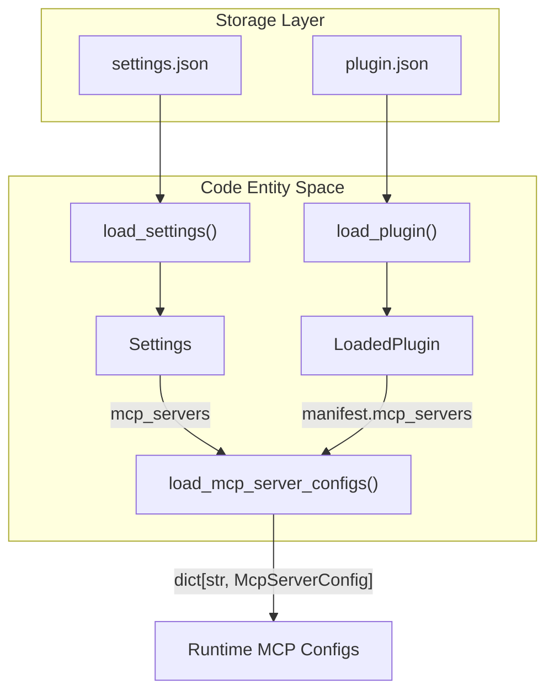
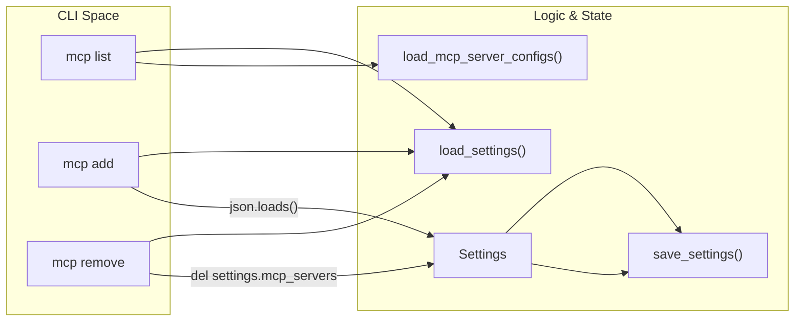

<!-- source: DeepWiki mcp.deepwiki.com · repo HKUDS/OpenHarness · page 7.2 MCP Configuration · fetched 2026-11-09 -->

# MCP Configuration

Relevant source files

The following files were used as context for generating this wiki page:

- [src/openharness/auth/manager.py](src/openharness/auth/manager.py)
- [src/openharness/config/settings.py](src/openharness/config/settings.py)
- [src/openharness/mcp/__init__.py](src/openharness/mcp/__init__.py)
- [src/openharness/mcp/client.py](src/openharness/mcp/client.py)
- [src/openharness/tools/mcp_tool.py](src/openharness/tools/mcp_tool.py)
- [src/openharness/tools/read_mcp_resource_tool.py](src/openharness/tools/read_mcp_resource_tool.py)
- [tests/test_config/test_settings.py](tests/test_config/test_settings.py)
- [tests/test_mcp/test_client_errors.py](tests/test_mcp/test_client_errors.py)
- [tests/test_mcp/test_http_flow.py](tests/test_mcp/test_http_flow.py)
- [tests/test_tools/test_mcp_tool.py](tests/test_tools/test_mcp_tool.py)

The Model Context Protocol (MCP) configuration system manages the discovery, loading, and persistence of MCP server definitions. OpenHarness aggregates MCP server configurations from multiple sources, including global user settings and installed plugins, to provide a unified set of external tools and resources to the LLM.

## Configuration Discovery and Merging

OpenHarness uses a hierarchical approach to load MCP servers. The primary logic resides in `load_mcp_server_configs`, which merges servers defined in the user's global `settings.json` with those contributed by active plugins.

### Data Flow for Server Loading
The following diagram illustrates how configurations are gathered from disparate sources into a single runtime dictionary.

**MCP Configuration Aggregation Flow**

Sources: [src/openharness/config/settings.py:231-255](), [src/openharness/mcp/__init__.py:44-47]()

### Implementation Details
*   **`load_mcp_server_configs(settings, plugins)`**: This function initializes a dictionary from the `mcp_servers` field of the `Settings` model. It then iterates through the provided `plugins` list. If a plugin is enabled, its `mcp_servers` are added to the dictionary. To prevent name collisions, plugin-contributed servers are namespaced using the pattern `{plugin_name}:{server_name}`.
*   **Settings Resolution**: Settings are resolved with precedence: CLI arguments > Environment variables > `settings.json` [src/openharness/config/settings.py:3-8]().

## Configuration Models

OpenHarness defines structured models for different MCP transport types using Pydantic. These models ensure that server definitions (commands, arguments, URLs) are validated before the `McpClientManager` attempts a connection.

### Core Models

| Class | Description | Key Fields |
| :--- | :--- | :--- |
| `McpStdioServerConfig` | Configuration for local executable servers communicating via stdin/stdout [src/openharness/mcp/types.py:11-20](). | `command`, `args`, `env`, `cwd` |
| `McpHttpServerConfig` | Configuration for remote servers using SSE/HTTP [src/openharness/mcp/types.py:23-28](). | `url`, `headers` |
| `McpWebSocketServerConfig` | Configuration for remote servers using WebSockets [src/openharness/mcp/types.py:31-36](). | `url`, `headers` |
| `McpJsonConfig` | The schema used for `mcp.json` files in plugins or project roots [src/openharness/mcp/types.py:39-43](). | `mcpServers` (Map of name to config) |

Sources: [src/openharness/mcp/types.py:11-43]()

### Runtime Metadata
Once a configuration is loaded and a connection is established, the system tracks the server's state and capabilities using:
*   **`McpConnectionStatus`**: Tracks if a server is `connected`, `failed`, `pending`, or `disabled`. It also stores the transport type and whether authentication is configured [src/openharness/mcp/types.py:66-77]().
*   **`McpToolInfo`**: Stores metadata for tools exposed by the server, including the dynamic `input_schema` [src/openharness/mcp/types.py:46-54]().
*   **`McpResourceInfo`**: Stores metadata for resources (like logs or documentation) exposed by the server [src/openharness/mcp/types.py:56-64]().

## CLI Management

The `openharness mcp` (or `oh mcp`) subcommand provides a management interface for the MCP configuration stored in the user's global settings.

### Command Mapping
The CLI interacts directly with the configuration persistence layer to modify `settings.json`.

**CLI to Configuration Mapping**

Sources: [src/openharness/config/settings.py:231-255](), [src/openharness/config/settings.py:356-371]()

### CLI Operations
1.  **List**: Aggregates all servers (global and plugin-based) and prints their names and transport details. It uses `load_mcp_server_configs` to show the full active set.
2.  **Add**: Takes a server name and a JSON string representing the configuration. It parses the JSON into an `McpServerConfig` object, updates the `mcp_servers` dictionary in the `Settings` model, and calls `save_settings()` to persist the change.
3.  **Remove**: Locates the server by name in the `settings.mcp_servers` dictionary and deletes the entry before saving.

Sources: [src/openharness/config/settings.py:231-255](), [src/openharness/config/settings.py:356-371]()

## Integration with Tools

MCP servers are exposed to the OpenHarness engine as native tools through adapters.

*   **`McpToolAdapter`**: Wraps an MCP tool into a `BaseTool` compatible with the `ToolRegistry`. It dynamically generates a Pydantic `input_model` from the MCP tool's JSON schema using `_input_model_from_schema` [src/openharness/tools/mcp_tool.py:14-24]().
*   **`ReadMcpResourceTool`**: A built-in tool (`read_mcp_resource`) that allows the LLM to fetch content from configured MCP resources by specifying the server name and URI [src/openharness/tools/read_mcp_resource_tool.py:18-38]().
*   **Error Handling**: If an MCP server is disconnected or fails during execution, the `McpClientManager` raises `McpServerNotConnectedError`, which the adapters catch to return a `ToolResult` with `is_error=True` [src/openharness/tools/mcp_tool.py:34-36](), [src/openharness/tools/read_mcp_resource_tool.py:36-37]().

Sources: [src/openharness/tools/mcp_tool.py:14-36](), [src/openharness/tools/read_mcp_resource_tool.py:18-38](), [src/openharness/mcp/client.py:25-27]()

---

