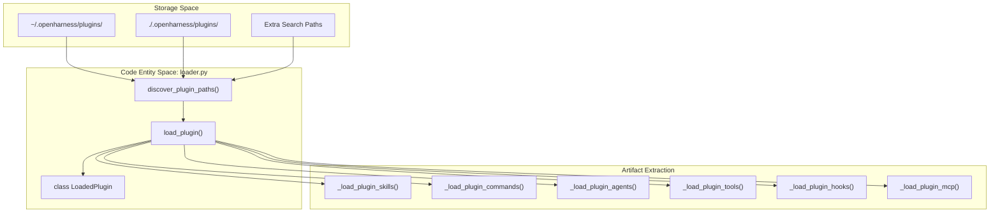
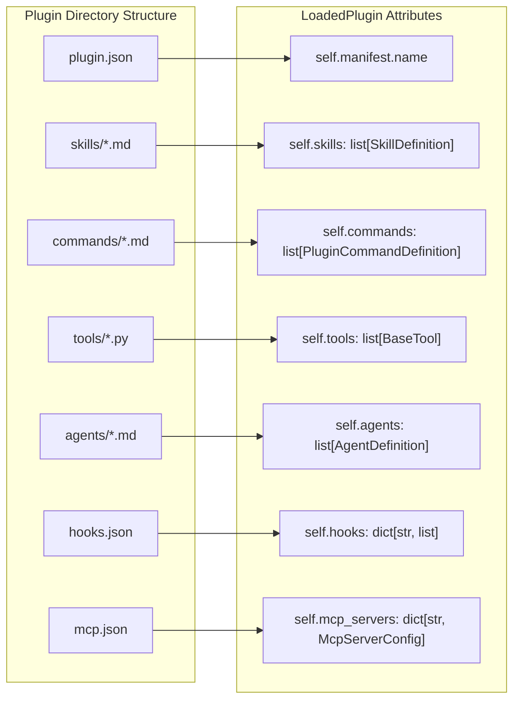

<!-- source: DeepWiki mcp.deepwiki.com · repo HKUDS/OpenHarness · page 8.2 Plugin System · fetched 2026-11-09 -->

# Plugin System

Relevant source files

The following files were used as context for generating this wiki page:

- [src/openharness/plugins/installer.py](src/openharness/plugins/installer.py)
- [src/openharness/plugins/loader.py](src/openharness/plugins/loader.py)
- [src/openharness/plugins/schemas.py](src/openharness/plugins/schemas.py)
- [src/openharness/plugins/types.py](src/openharness/plugins/types.py)
- [tests/test_commands/test_command_flows.py](tests/test_commands/test_command_flows.py)
- [tests/test_plugins/test_lifecycle_flow.py](tests/test_plugins/test_lifecycle_flow.py)
- [tests/test_plugins/test_loader.py](tests/test_plugins/test_loader.py)
- [tests/test_ui/test_project_plugin_security.py](tests/test_ui/test_project_plugin_security.py)
- [tests/test_ui/test_runtime_plugin_tools.py](tests/test_ui/test_runtime_plugin_tools.py)

The OpenHarness Plugin System allows for the functional extension of the assistant by bundling skills, lifecycle hooks, slash commands, agent definitions, tools, and Model Context Protocol (MCP) servers into distributable packages. Plugins are discovered automatically from both global user directories and project-specific paths, enabling a flexible "bring-your-own-tools" architecture.

## Plugin Discovery and Loading

OpenHarness identifies plugins by searching for directories containing a `plugin.json` manifest. The system distinguishes between global plugins (available across all sessions) and project plugins (scoped to a specific repository).

### Directory Resolution
Plugins are discovered in three primary locations:
1.  **User Directory**: Located at `~/.openharness/plugins/` [src/openharness/plugins/loader.py:36-40]().
2.  **Project Directory**: Located at `{cwd}/.openharness/plugins/` [src/openharness/plugins/loader.py:43-47]().
3.  **Extra Roots**: Optional additional paths passed during initialization [src/openharness/plugins/loader.py:61-68]().

The `_find_manifest()` helper looks for `plugin.json` either at the root of a subdirectory or within a `.claude-plugin/` folder [src/openharness/plugins/loader.py:50-58]().

### Security and Project Plugins
Project-local plugins are disabled by default to prevent unauthorized code execution when entering a new workspace. Users must explicitly opt-in by setting `allow_project_plugins=true` in their configuration [src/openharness/plugins/loader.py:109-117](). The `load_plugins` function issues a warning if project plugins are found but disabled [src/openharness/plugins/loader.py:113-117]().

### The Loading Process
The `load_plugins()` function serves as the entry point for initializing the plugin ecosystem for a session [src/openharness/plugins/loader.py:107-124](). It consumes the user's `Settings` to determine if specific plugins have been manually enabled or disabled [src/openharness/plugins/loader.py:120]().

**Plugin Discovery and Data Flow**

Sources: [src/openharness/plugins/loader.py:36-162]()

---

## Plugin Manifest (`plugin.json`)

The `PluginManifest` defines the metadata and structural layout of a plugin. It is validated using Pydantic [src/openharness/plugins/schemas.py:8-25]().

| Field | Type | Description |
| :--- | :--- | :--- |
| `name` | `str` | Unique identifier for the plugin. |
| `version` | `str` | Semantic versioning string (default: "0.0.0"). |
| `description` | `str` | Brief explanation of plugin functionality. |
| `enabled_by_default`| `bool` | Whether the plugin loads automatically (default: `True`). |
| `skills_dir` | `str` | Subdirectory containing Markdown skills (default: "skills"). |
| `tools_dir` | `str` | Subdirectory containing Python tools (default: "tools"). |
| `hooks_file` | `str` | Path to the hooks configuration (default: "hooks.json"). |
| `mcp_file` | `str` | Path to the MCP server configuration (default: "mcp.json"). |

Sources: [src/openharness/plugins/schemas.py:8-25]()

---

## Contributed Artifacts

A `LoadedPlugin` object acts as a container for all capabilities extracted from the plugin directory [src/openharness/plugins/types.py:40-52]().

### 1. Skills and Commands
Plugins contribute on-demand knowledge and custom slash commands via Markdown files. 
*   **Skills**: Scanned from the `skills_dir` [src/openharness/plugins/loader.py:138](). These are parsed into `SkillDefinition` objects [src/openharness/skills/types.py:12-30]().
*   **Commands**: Scanned from the `commands/` directory [src/openharness/plugins/loader.py:139](). These are parsed into `PluginCommandDefinition` objects and namespaced as `plugin_name:namespace:command` [src/openharness/plugins/types.py:19-37]().

### 2. Agent Definitions
Plugins can define specialized agent roles (e.g., `reviewer`, `coder`) by placing Markdown files in the `agents/` directory [src/openharness/plugins/loader.py:140](). These files support YAML frontmatter to configure `effort`, `permission_mode`, and `isolation_mode` [src/openharness/coordinator/agent_definitions.py:23-45]().

### 3. Plugin Tools
Plugins can contribute native Python tools. If a plugin is enabled, the system scans the `tools_dir` for `.py` files [src/openharness/plugins/loader.py:141](). These tools must inherit from `BaseTool` and are dynamically imported using `importlib` [src/openharness/tools/base.py:43-55]().

### 4. Lifecycle Hooks
Hooks allow plugins to intercept system events (e.g., `PreToolUse`). Plugins can define hooks in two ways:
*   **Flat Structure**: A JSON file mapped by event type [src/openharness/plugins/loader.py:142]().
*   **Structured**: A `hooks/hooks.json` containing complex matchers and environment variable expansion, specifically supporting `${CLAUDE_PLUGIN_ROOT}` to reference the plugin's absolute path [src/openharness/plugins/loader.py:145]().

### 5. MCP Servers
Plugins can bundle Model Context Protocol server configurations. These are loaded from the `mcp_file` (typically `mcp.json`) or a hidden `.mcp.json` and merged into the global `McpClientManager` [src/openharness/plugins/loader.py:147-150]().

**Plugin Internal Structure to Code Mapping**

Sources: [src/openharness/plugins/loader.py:126-162](), [src/openharness/plugins/types.py:40-52]()

---

## Plugin Management CLI

The `plugin` subcommand in the OpenHarness CLI provides tools for lifecycle management.

### `plugin list`
Lists all discovered plugins, their current status (enabled/disabled), and descriptions. This is handled by the `plugin` slash command in interactive mode or the CLI equivalent.

### `plugin install`
Copies a plugin directory from a source path into the user's global plugin directory (`~/.openharness/plugins/`). If a plugin with the same name exists, it is overwritten [src/openharness/plugins/installer.py:23-30]().
*   **Implementation**: Uses `shutil.copytree` to relocate the source directory [src/openharness/plugins/installer.py:29]().

### `plugin uninstall`
Removes the plugin directory from the user's global plugin directory [src/openharness/plugins/installer.py:33-39]().
*   **Validation**: The system performs a safety check to ensure the name does not contain path traversal characters like `..` or `\` [src/openharness/plugins/installer.py:13-19]().

### Slash Command Integration
The `test_plugin_command_lifecycle_flow` integration test demonstrates that the `/plugin` slash commands (install, enable, disable, uninstall) correctly modify the `Settings` and the filesystem [tests/test_commands/test_command_flows.py:131-154]().

Sources: [src/openharness/plugins/installer.py:1-40](), [tests/test_commands/test_command_flows.py:131-154]()

---

