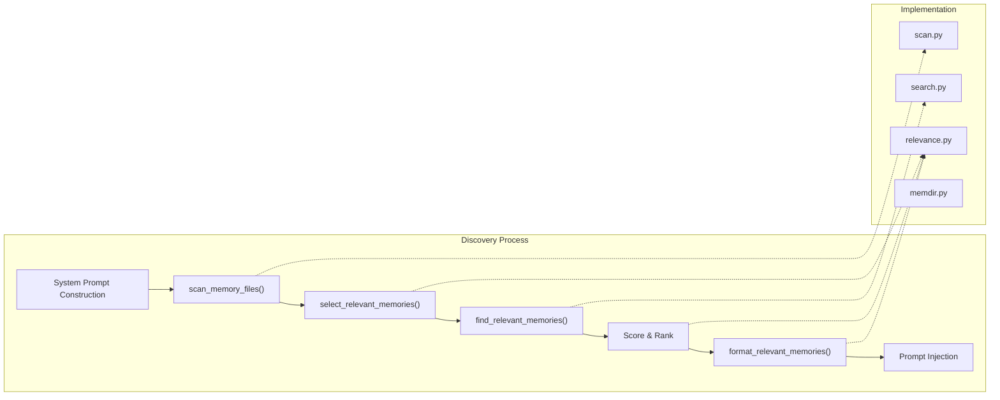

<!-- source: DeepWiki mcp.deepwiki.com · repo HKUDS/OpenHarness · page 9 Memory System · fetched 2026-11-09 -->

# Memory System

<details>
<summary>Relevant source files</summary>

The following files were used as context for generating this wiki page:

- [src/openharness/memory/__init__.py](src/openharness/memory/__init__.py)
- [src/openharness/memory/agent.py](src/openharness/memory/agent.py)
- [src/openharness/memory/manager.py](src/openharness/memory/manager.py)
- [src/openharness/memory/memdir.py](src/openharness/memory/memdir.py)
- [src/openharness/memory/relevance.py](src/openharness/memory/relevance.py)
- [src/openharness/memory/scan.py](src/openharness/memory/scan.py)
- [src/openharness/memory/schema.py](src/openharness/memory/schema.py)
- [src/openharness/memory/team.py](src/openharness/memory/team.py)
- [src/openharness/memory/types.py](src/openharness/memory/types.py)

</details>


The **Memory System** in OpenHarness provides a cross-session persistence layer designed to store durable project context, user preferences, and historical insights that survive beyond a single conversation. Unlike the session history, which tracks the immediate dialogue, the Memory System focuses on long-term knowledge management through structured Markdown files and a central index.

### Overview of Persistence
The system operates by maintaining a dedicated directory within the project's local state where it stores thematic `.md` files. This allows the LLM to "remember" complex architectural decisions, recurring bugs, or specific user instructions across different days or even different hardware environments if the project directory is synced.

The core of the system is the `MEMORY.md` file, which serves as a human-readable and machine-parsable entrypoint for the agent to understand what knowledge is available [src/openharness/memory/memdir.py:23-28]().

### Memory Architecture and Code Mapping

The following diagram illustrates how high-level memory concepts map to the underlying Python implementation and file structures.

**Memory Entity Mapping**
```mermaid
graph TD
    subgraph "Natural Language Space"
        "Persistent Context"
        "Memory Index"
        "Topic Files"
        "Search Query"
    end

    subgraph "Code Entity Space"
        "Persistent Context" --> ["load_memory_prompt()"]
        "Memory Index" --> ["get_memory_entrypoint()"]
        "Topic Files" --> ["scan_memory_files()"]
        "Search Query" --> ["find_relevant_memories()"]
        
        ["load_memory_prompt()"] --> F1["memdir.py"]
        ["get_memory_entrypoint()"] --> F2["paths.py"]
        ["scan_memory_files()"] --> F3["scan.py"]
        ["find_relevant_memories()"] --> F4["search.py"]
    end

    subgraph "Storage Layer"
        F2 --> DB[".openharness/memory/"]
        DB --> M_INDEX["MEMORY.md"]
        DB --> M_TOPIC["topic_slug.md"]
        M_TOPIC --> HEADER["MemoryHeader"]
    end
```
Sources: [src/openharness/memory/memdir.py:15-20](), [src/openharness/memory/paths.py:1-10](), [src/openharness/memory/scan.py:20-27](), [src/openharness/memory/search.py:8-12](), [src/openharness/memory/types.py:11-34]()

---

### Memory Storage and Management
Memory is managed as a collection of Markdown documents, often enriched with YAML frontmatter for structured metadata like `id`, `name`, `type`, `scope`, and `importance` [src/openharness/memory/schema.py:32-49](). The system provides utility functions in `manager.py` to programmatically create, delete, and list these entries. When a new memory is added via `add_memory_entry()`, the system generates a "slugified" filename and automatically appends a link to the `MEMORY.md` index [src/openharness/memory/manager.py:39-121]().

Key management features include:
*   **Automatic Indexing**: Every memory file is tracked in a central `MEMORY.md` file to provide a global table of contents for the LLM [src/openharness/memory/manager.py:116-120]().
*   **Scoped Vaults**: Memories can be scoped to the `project`, `private` (user-specific), or `team` (shared) [src/openharness/memory/schema.py:20-23](). Team memories include safety checks to prevent leaking secrets like API keys [src/openharness/memory/team.py:80-91]().
*   **Agent Isolation**: Specific agent types can have their own isolated memory vaults and snapshots [src/openharness/memory/agent.py:25-34]().
*   **Soft Deletion**: `remove_memory_entry()` marks a memory as `disabled` in its frontmatter rather than deleting the file, and removes it from the index [src/openharness/memory/manager.py:124-159]().

For details, see [Memory Storage and Management](#9.1).

Sources: [src/openharness/memory/manager.py:39-159](), [src/openharness/memory/schema.py:17-49](), [src/openharness/memory/team.py:24-31](), [src/openharness/memory/agent.py:25-57]()

---

### Memory Scanning and Search
To keep the LLM's context window efficient, the entire memory directory is not injected into every prompt. Instead, the system uses a combination of static indexing and dynamic relevance selection.

The `select_relevant_memories()` function handles the retrieval of context for a specific query [src/openharness/memory/relevance.py:44-68](). It uses heuristic search to find matches and can apply a secondary `MemorySelector` (an LLM-based reranker) to refine the results [src/openharness/memory/relevance.py:120-145]().

**Memory Discovery Flow**


For details, see [Memory Scanning and Search](#9.2).

Sources: [src/openharness/memory/relevance.py:44-100](), [src/openharness/memory/scan.py:20-47](), [src/openharness/memory/search.py:8-12](), [src/openharness/memory/memdir.py:15-52]()

---

### Key Memory Functions Reference

| Function | File | Description |
| :--- | :--- | :--- |
| `add_memory_entry` | `manager.py` | Creates/updates a memory file with metadata and updates `MEMORY.md` [src/openharness/memory/manager.py:39-121](). |
| `scan_memory_files` | `scan.py` | Scans the memory directory and returns `MemoryHeader` objects sorted by modification time [src/openharness/memory/scan.py:20-47](). |
| `find_relevant_memories` | `search.py` | Performs a heuristic keyword search across memory files [src/openharness/memory/search.py:8-12](). |
| `select_relevant_memories`| `relevance.py` | High-level API to find and rank memories for a specific user query [src/openharness/memory/relevance.py:44-68](). |
| `load_memory_prompt` | `memdir.py` | Generates the static memory policy and `MEMORY.md` index for the system prompt [src/openharness/memory/memdir.py:15-52](). |
| `format_relevant_memories`| `relevance.py` | Renders a list of `RelevantMemory` objects into a Markdown block for injection [src/openharness/memory/relevance.py:88-100](). |

Sources: [src/openharness/memory/manager.py:1-160](), [src/openharness/memory/scan.py:1-110](), [src/openharness/memory/relevance.py:1-146](), [src/openharness/memory/memdir.py:1-53]()

---

